# Ringkasan Eksekutif & Matriks Paritas Porting: TSRossa Android (`tsrossa-ujicoba`) ke macOS (`tsrossa-macos`)

**Tanggal Audit:** 2026  
**Repositori Target (macOS):** `/Users/yuka/Documents/Projects/tsrossa-macos`  
**Repositori Acuan Ground-Truth (Android, Read-Only):** `/Users/yuka/Documents/Projects/tsrossa-ujicoba`

---

## 1. Kesimpulan Eksekutif (Executive Verdict)

Berdasarkan audit kode sumber menyeluruh (*line-by-line reverse engineering & parity audit*) terhadap seluruh **15 file sumber di `tsrossa-macos`** (~6.850 baris kode C++/Swift/Bash) dibandingkan dengan **98 file sumber di `tsrossa-ujicoba`** (~29.600 baris kode C++/Kotlin/Unit Test), disimpulkan bahwa:

> **`tsrossa-macos` saat ini baru merupakan prototipe visual (UI shell) yang mengimitasi tampilan aplikasi Android aslinya, namun kehilangan lebih dari 65% kapabilitas rekayasa audio, manajemen memori, database, dan integrasi sistem yang membuat `tsrossa-ujicoba` unggul.**
>
> Lebih kritis lagi, banyak klaim fitur unggulan yang ditampilkan pada antarmuka `tsrossa-macos` — seperti **`Float64 Zero-Copy`**, **`Gapless Engine: ACTIVE (Direct Handover)`**, **`0.0 dBFS Bit-Perfect`**, **`HOG MODE ACTIVE`**, dan **`SORT: DATE (NEWEST)`** — ternyata merupakan **teks statis (hardcoded placebo UI)** yang tidak didukung oleh implementasi di balik layar. Bahkan dalam kondisi repositori mandiri saat ini, **`./build_mac.sh` gagal dikompilasi** karena hilangnya file header `dr_flac.h`, `dr_wav.h`, dan asset ikon yang masih merujuk ke direktori relatif proyek Android.

---

## 2. Skor Kematangan & Paritas per Aspek

| No | Aspek Audit | Skor Android (`tsrossa-ujicoba`) | Skor macOS (`tsrossa-macos`) | Tingkat Kesenjangan (Gap) | Dokumen Detail |
| :-: | :--- | :-: | :-: | :--- | :--- |
| **1** | **Audio Engine, DSP Mathematics & Signal Path** | **9.6 / 10** | **4.0 / 10** | **KRITIS** (Float32 truncation, 0% TPDF Dither, 0% Volume Ramping, Blind Sample Rate) | [`01-AUDIT-AUDIO-ENGINE-DSP-DAN-COREAUDIO.md`](file:///Users/yuka/Documents/Projects/tsrossa-macos/AUDIT-ANALISA/01-AUDIT-AUDIO-ENGINE-DSP-DAN-COREAUDIO.md) |
| **2** | **Arsitektur Memori, Streaming, Gapless & Konkurensi** | **9.5 / 10** | **3.5 / 10** | **KRITIS** (Dekode penuh ke RAM tanpa batas, 0% Gapless, Data Race C++ & CAS Seek hilang) | [`02-AUDIT-MEMORI-STREAMING-GAPLESS-DAN-KONKURENSI.md`](file:///Users/yuka/Documents/Projects/tsrossa-macos/AUDIT-ANALISA/02-AUDIT-MEMORI-STREAMING-GAPLESS-DAN-KONKURENSI.md) |
| **3** | **Metadata, Database Library, Sorting & Search** | **9.4 / 10** | **4.2 / 10** | **TINGGI** (0% SQLite Cache, FLAC Vorbis/Art gagal di `AVURLAsset`, Sort Date rusak, 0% Fuzzy Search) | [`03-AUDIT-METADATA-DATABASE-LIBRARY-DAN-SEARCH.md`](file:///Users/yuka/Documents/Projects/tsrossa-macos/AUDIT-ANALISA/03-AUDIT-METADATA-DATABASE-LIBRARY-DAN-SEARCH.md) |
| **4** | **UI/UX, Kejujuran Telemetri & Integrasi macOS** | **9.5 / 10** | **4.8 / 10** | **TINGGI** (Telemetri 90% hardcoded palsu, Keyboard hook membajak tombol panah, 0% Media Keys) | [`04-AUDIT-UI-UX-TELEMETRI-PALSU-DAN-INTEGRASI-MACOS.md`](file:///Users/yuka/Documents/Projects/tsrossa-macos/AUDIT-ANALISA/04-AUDIT-UI-UX-TELEMETRI-PALSU-DAN-INTEGRASI-MACOS.md) |
| **5** | **Build System, Packaging, Keamanan Updater & Testing** | **9.2 / 10** | **2.5 / 10** | **KRITIS** (`build_mac.sh` gagal kompilasi, hardcoded `/Users/alen`, Updater salah repo & `/tmp` tidak aman, 0 Unit Test) | [`05-AUDIT-BUILD-SYSTEM-KEAMANAN-UPDATER-DAN-TESTING.md`](file:///Users/yuka/Documents/Projects/tsrossa-macos/AUDIT-ANALISA/05-AUDIT-BUILD-SYSTEM-KEAMANAN-UPDATER-DAN-TESTING.md) |
| **6** | **UI/UX Themes, Standar Swift, Apple HIG & Liquid Glass** | **9.4 / 10** | **3.8 / 10** | **TINGGI** (Meniru Material 3 Android, 0% Liquid Glass / `.ultraThinMaterial`, "God View" 3.579 baris re-render 4x/detik, 60+ `.cornerRadius` deprecated tanpa `.continuous`) | [`06-AUDIT-UI-UX-THEMES-SWIFT-HIG-DAN-LIQUID-GLASS.md`](file:///Users/yuka/Documents/Projects/tsrossa-macos/AUDIT-ANALISA/06-AUDIT-UI-UX-THEMES-SWIFT-HIG-DAN-LIQUID-GLASS.md) |
| — | **RATA-RATA KESELURUHAN** | **9.43 / 10** | **3.80 / 10** | **Defisit Paritas: ~60%** | [`LAPORAN-AUDIT-LENGKAP.md`](file:///Users/yuka/Documents/Projects/tsrossa-macos/AUDIT-ANALISA/LAPORAN-AUDIT-LENGKAP.md) |

---

## 3. Diagram Perbandingan Arsitektur (Android Asli vs Porting macOS Saat Ini)

```mermaid
flowchart TD
    subgraph ANDROID["Arsitektur Android Asli (tsrossa-ujicoba)"]
        A1["File FLAC / WAV"] --> A2["Initial 5s Sync Decode (<50ms Start)\n+ Background Thread 'TsrossaDecode'"]
        A2 --> A3["64 MB Sliding-Window Ring Buffer (int32_t)\n+ 32 MB Gapless Next-Track Pre-Buffer"]
        A3 --> A4{"Volume == 0 dBFS?"}
        A4 -- "Ya (Bit-Perfect)" --> A5["Direct Integer memcpy (PCM_I32 / S24_3LE)"]
        A4 -- "Tidak (Attenuated)" --> A6["64-Bit Double DSP + Frame-Locked Gain Ramp\n+ Dual-Ch SplitMix64 TPDF Dither + std::llrint()"]
        A5 --> A7["libusb Isochronous URB (Bresenham 8000 FPS)\natau AAudio Exclusive Hardware Stream"]
        A6 --> A7
    end

    subgraph MACOS["Arsitektur Porting macOS Saat Ini (tsrossa-macos)"]
        M1["File FLAC / WAV"] --> M2["Synchronous 100% Full-File Decode\n(Blocking engineQueue & Alokasi RAM Tak Terbatas)"]
        M2 --> M3["std::vector<int32_t> m_pcmBuffer\n(Tanpa Ring Buffer & 0% Gapless Pre-Buffer)"]
        M3 --> M4["Konversi Paksa ke 32-Bit Float:\noutBuffer[i] = (float)src[i] * (gain / 2147483648.0f)\n(Tanpa Double64, Tanpa Ramping, Tanpa TPDF Dither)"]
        M4 --> M5["CoreAudio HALOutput (kAudioFormatFlagIsFloat)\n(Resampling OS Tersembunyi jika Sample Rate > Batas DAC)"]
    end
```

---

## 4. Peringkat Masalah Berdasarkan Tingkat Keparahan (Ranked Findings)

### Prioritas 1: KRITIS — Harus Segera Diperbaiki (Must Fix / Showstoppers)
1. **[BUILD-01] Kegagalan Kompilasi Mandiri (`build_mac.sh` & `dr_impl.c`):** File header `dr_flac.h`, `dr_wav.h`, dan asset ikon tidak ada di dalam repositori `tsrossa-macos` karena masih mereferensikan `../app/src/main/cpp` milik repo Android.
2. **[AUDIO-01] Pemotongan Presisi 32-Bit Integer akibat Paksaan Format `float` 32-Bit (`CoreAudioSink.cpp:L428, L630-L634`):** Seluruh sampel `int32_t` dikonversi ke IEEE 754 `float` 32-bit (yang hanya memiliki mantissa 24-bit), menghancurkan 7–8 bit LSB pada file 32-bit dan membatalkan klaim `"Float64 Zero-Copy"` serta `"Bit-Perfect"`.
3. **[AUDIO-02] Hilangnya Mesin DSP 64-Bit `double`, SplitMix64 TPDF Dithering, Pembulatan `std::llrint`, dan Volume Ramping (`CoreAudioSink.cpp:L630-L634`):** Menyebabkan distorsi kuantisasi saat volume `< 0 dB` dan suara klik (*zipper noise*) saat mengubah volume.
4. **[MEM-01] Dekode Penuh Sinkron ke RAM Tanpa Batas & Memori Tidak Dibebaskan Saat `stop()` (`CoreAudioSink.cpp:L501-L515, L564-L579`):** Membuka file Hi-Res 192 kHz berdurasi panjang menyedot bergiga-giga RAM sekaligus, menahan `engineQueue`, dan memori `m_pcmBuffer` tidak pernah di-dealokasi saat berhenti.
5. **[GAPLESS-01] Absennya Gapless Playback + Bug Lagu Pendek Macet Selamanya (`AudioEngine.swift:L346-L363`):** Tidak ada pre-buffer lagu berikutnya; transisi lagu menggunakan timer 250ms di Main Thread dengan syarat `t >= self.totalDuration - 0.5` yang membuat lagu `< 0.5s` (atau selisih durasi > 0.5s) berhenti total dan tidak pernah lanjut ke lagu berikutnya.
6. **[CONC-01] Data Race pada Real-Time Callback, Hilangnya Proteksi CAS Saat Seek, & Global Pointer Tidak Aman (`CoreAudioSink.cpp:L494-L505, L617-L637`, `TsrossaAudioBridge.cpp:L6-L57`):** Mutasi `m_pcmBuffer` sebelum `teardownAudioUnit()`, `.store()` tanpa `compare_exchange_strong` yang menimpa posisi seek pengguna, serta pointer `c_str()` dari `std::vector` global tanpa mutex.
7. **[SEC-01] Salah Repositori Update, Unduhan Sembarang `.zip`, & Eksekusi Script Tidak Aman di `/tmp/tsrossa_update` (`UpdateManager.swift:L8-L9, L109-L119, L189-L298`):** Mengarah ke `RazerZS-oss/tsrossa`, mengunduh `.zip` apa pun, menggunakan direktori statis `/tmp` yang rentan pembajakan, tidak memvalidasi `codesign`/`CFBundleIdentifier`, dan gagal mendeteksi update dari versi `-beta` ke stabil.

### Prioritas 2: TINGGI — Sangat Penting Diperbaiki (Should Fix)
8. **[AUDIO-03] Absennya Validasi `supportedRates` pada `setDeviceSampleRate` (`CoreAudioSink.cpp:L312-L338`):** Mengirimkan sample rate yang tidak didukung DAC tanpa fallback kelipatan terdekat, memicu resampler macOS secara diam-diam sambil menampilkan klaim `"Crystal Lock • BIT-PERFECT"` di UI.
9. **[META-01] Ketergantungan pada `AVURLAsset` yang Gagal Membaca Tag Vorbis, Artwork, & Lirik Embedded FLAC (`MetadataScanner.swift:L144-L162`, `Theme.swift:L169`, `LyricsManager.swift:L49`):** Tidak mem-porting parser biner `AudioTagReader.kt`.
10. **[DATA-01] Ketiadaan SQLite Cache Library (`MetadataScanner.swift` vs `MusicLibraryDatabaseHelper.kt`):** Memindai ulang seluruh disk di setiap startup.
11. **[DATA-02] Tiga Bug Sekaligus pada Sistem Sort (`AppViewModel.swift:L125, L679-L698`):** Label awal `"DATE (NEWEST)"` padahal diurutkan berdasarkan Judul, klik `"DATE (NEWEST)"` hanya memanggil `tracks.reverse()` pada urutan Artis, dan `enrichMetadataInBackground` menimpa urutan sort pengguna.
12. **[DATA-03] 10 Pengaturan Utama Tidak Pernah Disimpan ke `UserDefaults` (`AppViewModel.swift:L115-L185`):** Termasuk `volumeDb` (selalu reset ke `0 dBFS` / 100% saat restart), `selectedDeviceId`, `accentColorMode`, `bgCanvasMode`, `isShuffle`, `isRepeat`, dll.
13. **[UI-01] Telemetri Palsu (Hardcoded Placebo) & Timestamp Log yang Berubah Setiap 0,25 Detik (`TelemetryModalView.swift:L125-L158`):** Tidak pernah membaca `engine.telemetryJson` untuk tampilan modal dan menggunakan `Date()` langsung di fungsi render SwiftUI.
14. **[UX-01] Global Keyboard Monitor Membajak Tombol Panah Polos & Absennya `MPNowPlayingInfoCenter` (`AppViewModel.swift:L827-L848`):** Merusak navigasi keyboard standar macOS sementara tombol media fisik (`F7`/`F8`/`F9`) & kontrol AirPods tidak berfungsi.
15. **[UX-02] Konflik Logika `isRepeat` (`RepeatOne` vs `RepeatAll`) & Shuffle Tanpa Deck (`AudioEngine.swift:L355` vs `AppViewModel.swift:L589-L600`):** Pengguna tidak bisa melakukan *Repeat All* saat pemutaran otomatis.

### Prioritas 3: SEDANG — Penyempurnaan Paritas Fitur (Nice to Have)
16. **[PARITY-01] Hardcoded Path `/Users/alen/...` (`Theme.swift:L378`, `AppViewModel.swift:L60`):** Menyebabkan logo dan ikon aplikasi hilang (`nil`).
17. **[PARITY-02] Fitur Android yang Belum Di-porting:** `FuzzySearchHelper` (multi-token & subsequence search), `ColorContrastHelper` (12-Bin Hue-Family clustering & WCAG contrast), `TrackDetailsModalSheet`, Filter Chips (`Artist`/`Genre`/`Album`/`Year`/`Format`), Multi-select batch action, Fast Scroller A–Z, Rename/Pin/Folder Playlists, Volume Slider & Mute & Hardware UAC Volume, DAC Warm-up, Auto-Resume Last Track, Light Mode, dan Unit Test Suite.

---

## 5. Matriks Paritas Fitur Lengkap (Android vs macOS)

| Kategori | Fitur Spesifik | Android (`tsrossa-ujicoba`) | macOS (`tsrossa-macos`) | Keterangan / Gap |
| :--- | :--- | :-: | :-: | :--- |
| **Audio Engine** | Dekoder Lossless `dr_flac` & `dr_wav` | ✅ | ⚠️ | Di macOS file header `.h` hilang dari repo |
| **Audio Engine** | Output Integer Murni (32-bit / 24-bit Bit-Perfect) | ✅ | ❌ | macOS memaksa konversi ke 32-bit `float` |
| **Audio Engine** | 64-Bit `double` DSP Attenuation | ✅ | ❌ | macOS memakai 32-bit `float` |
| **Audio Engine** | Dual-Ch SplitMix64 TPDF Dithering + `llrint` | ✅ | ❌ | Dihapus total di macOS |
| **Audio Engine** | Per-Sample Linear Volume Ramping (Anti-Click) | ✅ | ❌ | Perubahan gain melompat kasar per-buffer |
| **Audio Engine** | Kurva Volume Studio Taper + Slider Halus | ✅ | ❌ | macOS hanya tombol `-` / `+` 1 dB bulat |
| **Audio Engine** | Hybrid Hardware DAC Volume + Residual Trim | ✅ | ❌ | Tidak ada kontrol volume hardware CoreAudio |
| **Audio Engine** | Per-DAC Smart Volume Memory | ✅ | ❌ | Volume selalu reset ke `0 dBFS` saat buka aplikasi |
| **Audio Engine** | Validasi & Fallback Sample Rate Terdekat | ✅ | ❌ | Mengirim rate mentah tanpa cek `supportedRates` |
| **Audio Engine** | DAC Hardware Warm-up (1600ms Sweep/Silence) | ✅ | ❌ | Tidak ada di macOS |
| **Streaming** | 64 MB Sliding-Window Ring Buffer | ✅ | ❌ | macOS mendekode 100% file sekaligus ke RAM |
| **Streaming** | Instant Start `< 50 ms` (5s Pre-decode) | ✅ | ❌ | macOS memblokir hingga seluruh file selesai didekode |
| **Streaming** | Gapless Playback (`prepareNextTrack` 32 MB) | ✅ | ❌ | 0% diimplementasikan (hanya teks palsu di UI) |
| **Streaming** | Atomic CAS (`compare_exchange_strong`) saat Seek | ✅ | ❌ | `.store()` di RT callback dapat menimpa seek |
| **Library & Data** | SQLite Persistent Cache & Incremental Scan | ✅ | ❌ | Scan ulang dari nol setiap buka aplikasi |
| **Library & Data** | Binary Tag Parser (FLAC Vorbis, WAV INFO, ID3v2) | ✅ | ❌ | Hanya `STREAMINFO` teknis; tag teks via `AVURLAsset` |
| **Library & Data** | Deteksi MQA (`[MQA]`, `MQAENCODER` header) | ✅ | ❌ | Tidak ada di macOS |
| **Library & Data** | 12 Bidang Sort × Asc/Desc (`SortField`) | ✅ | ❌ | Hanya 3 mode, dan mode `DATE (NEWEST)` rusak |
| **Library & Data** | Filter Chips (`Artist`, `Genre`, `Album`, `Year`) | ✅ | ❌ | Tidak ada di macOS |
| **Library & Data** | Fuzzy Search (Multi-Token & Subsequence) | ✅ | ❌ | Hanya `localizedCaseInsensitiveContains` |
| **Library & Data** | Multi-Select Batch Add/Delete & Fast Scroller | ✅ | ❌ | Tidak ada di macOS |
| **Playlist & Queue**| Buat, Hapus, Tambah/Hapus Lagu Playlist | ✅ | ✅ | Tersedia di kedua platform |
| **Playlist & Queue**| Rename Playlist, Pin Playlist, Clear Playlist | ✅ | ❌ | Tidak ada di macOS |
| **Playlist & Queue**| Auto Folder Playlists (`Make Folder as Playlist`) | ✅ | ❌ | Tidak ada di macOS |
| **Playlist & Queue**| 3-State Repeat (`OFF`, `ALL`, `ONE`) | ✅ | ❌ | Hanya 1 `Bool` yang konflik antara `ONE` dan `ALL` |
| **Playlist & Queue**| Shuffle Deck Bebas Pengulangan + History Back | ✅ | ❌ | Hanya `randomElement()` acak buta |
| **Lirik & Tema** | Parser Lirik `.lrc` Tersinkronisasi + Klik untuk Seek| ✅ | ✅ | Tersedia, namun ekstraksi lirik embedded FLAC gagal |
| **Lirik & Tema** | 12-Bin Hue-Family Color Clustering + WCAG Contrast| ✅ | ❌ | macOS hanya merata-rata piksel 40×40 (warna kusam) |
| **Lirik & Tema** | Dark Mode, AMOLED Mode, & Light Mode | ✅ | ⚠️ | `themeMode` ada di kode tetapi Light Mode tidak dibuat |
| **Integrasi OS** | Media Session / `MPNowPlayingInfoCenter` & Media Keys| ✅ | ❌ | Tombol media Mac (`F7`/`F8`/`F9`) & AirPods mati |
| **Integrasi OS** | Prevent Idle Sleep (`WakeLock` / `IOPMAssertion`) | ✅ | ❌ | Variabel `keepScreenAwake` tidak dihubungkan ke OS |
| **Diagnostik** | Panel Log Nyata + Telemetri Hardware Live | ✅ | ❌ | `TelemetryModalView.swift` berisi teks palsu statis |
| **Kualitas & Build**| Standalone Build + Unit Test Suite (17 file test) | ✅ | ❌ | Build gagal mandiri & 0 file unit test |
