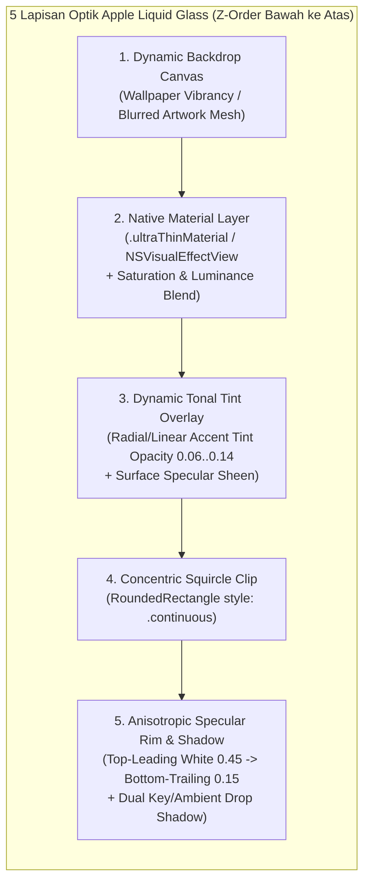

# Audit & Analisa Aspek 6: Arsitektur UI/UX Themes, Kaidah Pemrograman Swift/SwiftUI, Apple HIG, & Desain "Liquid Glass"

**Target Audit:**
- [`Theme.swift`](file:///Users/yuka/Documents/Projects/tsrossa-macos/macos/Sources/Theme.swift) (474 baris)
- [`MainAppView.swift`](file:///Users/yuka/Documents/Projects/tsrossa-macos/macos/Sources/MainAppView.swift) (3.579 baris)
- [`TelemetryModalView.swift`](file:///Users/yuka/Documents/Projects/tsrossa-macos/macos/Sources/TelemetryModalView.swift) (219 baris)
- [`AppViewModel.swift`](file:///Users/yuka/Documents/Projects/tsrossa-macos/macos/Sources/AppViewModel.swift) (866 baris)
- [`main.swift`](file:///Users/yuka/Documents/Projects/tsrossa-macos/macos/Sources/main.swift) (101 baris)

**Standar Acuan:**
- **Apple Human Interface Guidelines (HIG)** untuk macOS & Apple Platforms (macOS Sequoia / macOS Tahoe 26)
- **Paradigma Desain Apple "Liquid Glass"** (Optical Translucency, Real-Time Backdrop Refraction, Specular Rim Lighting, Concentric Continuous Squircles, Fluid Spring Dynamics)
- **Aturan & Idiom Pemrograman Bahasa Swift / SwiftUI Modern** (Swift 5.9+ / 6, macOS 14+ / 15+ / 26 API Standards)

---

## 1. Ringkasan Eksekutif Audit UI/UX Themes & Standar Swift/Apple

Hasil audit terhadap [`Theme.swift`](file:///Users/yuka/Documents/Projects/tsrossa-macos/macos/Sources/Theme.swift) dan [`MainAppView.swift`](file:///Users/yuka/Documents/Projects/tsrossa-macos/macos/Sources/MainAppView.swift) menunjukkan bahwa **sistem tampilan dan tema `tsrossa-macos` saat ini mengalami "Krisis Identitas Platform"**: aplikasi ini menyalin mentah-mentah konsep warna **Google Android Material 3 ("Material You / Monet")** dengan permukaan kotak solid (opaque/semi-opaque flat surfaces), menggunakan puluhan API SwiftUI yang sudah **usang (*deprecated*)**, serta **belum menerapkan prinsip optik *Liquid Glass* maupun *macOS Vibrancy* yang menjadi standar perangkat Apple**.

| Dimensi Desain & Kode Swift | Kondisi Saat Ini di `tsrossa-macos` | Standar Apple HIG, Swift Modern & "Liquid Glass" | Tingkat Keparahan |
| :--- | :--- | :--- | :--- |
| **Paradigma Bahasa Desain** | **Android Material 3 / Monet** (`DynamicMaterialTheme`, label UI `"MATERIAL YOU"`, `"Tonal M3"` di `MainAppView.swift:L3005, L3026`) | **Apple Liquid Glass & macOS Vibrancy** (translusensi berlapis yang membiaskan warna latar secara real-time dengan pantulan cahaya spekular) | **TINGGI (Asing bagi Ekosistem Apple)** |
| **Implementasi Material Kaca (`GlassmorphicSurface`)** | **Kaca Palsu (100% Flat Color)** — hanya `RoundedRectangle.fill(surfaceContainer.opacity(0.85))` tanpa blur optik, bahkan modifier `.glassmorphic()` **tidak pernah dipanggil (0 kali)** di seluruh UI (`Theme.swift:L344-L366`) | Menggunakan `.ultraThinMaterial` / `.thinMaterial`, `NSVisualEffectView` (`blendingMode: .withinWindow` / `.behindWindow`), dan `.glassEffect()` (macOS 26+) dengan pembiasan latar nyata | **KRITIS (Tidak Ada Efek Glass/Vibrancy Nyata)** |
| **Arsitektur Layout Terhadap Translusensi (Scroll-Under)** | **Box Grid Kaku (`VStack`/`HStack`)** — konten `ScrollView` terpotong oleh `Divider()` sebelum menyentuh Top Bar atau Bottom Transport Bar (`MainAppView.swift:L29-L77`), sehingga **tidak ada konten yang lewat di balik bar untuk dibiaskan** | **Floating Glass Chrome** menggunakan `.safeAreaInset(edge: .top / .bottom)` atau `ZStack` overlay sehingga sampul album & daftar lagu mengalir lembut di balik kaca Transport Bar & Header | **KRITIS (Merusak Efek Kedalaman Liquid Glass)** |
| **Specular Rim Lighting (Pantulan Tepi Kaca)** | Garis border datar seragam `.stroke(outline.opacity(0.18), lineWidth: 1)` seperti tabel web (`MainAppView.swift:L2832, L3413, L3498`) | **Anisotropic Specular Stroke** (`LinearGradient` putih `0.45` di *top-leading* -> `0.05` di tengah -> bias aksen/putih `0.20` di *bottom-trailing*) + *inner highlight* | **TINGGI** |
| **Geometri Sudut (Corner Continuity & Concentricity)** | Memakai `.cornerRadius()` (API **deprecated**) sebanyak **60+ kali** dengan kurva busur lingkaran biasa (`.circular`), **0 pemakaian `style: .continuous`** | Wajib menggunakan **Apple Squircle (`style: .continuous`)** via `.clipShape(.rect(cornerRadius: r, style: .continuous))` dengan rumus konsentris $R_{\text{outer}} = R_{\text{inner}} + \text{padding}$ | **TINGGI (Melanggar Geometri Visual Apple)** |
| **Arsitektur View SwiftUI & Performa Render** | **Anti-Pattern "God View"**: 1 file `MainAppView.swift` berisi **3.579 baris** dalam satu `struct`, di-trigger ulang seluruhnya **4 kali per detik** oleh `engine.currentTime` (`MainAppView.swift:L5`) | Dekomposisi ke sub-view modular terisolasi + `@Observable` / `@Environment` agar update scrubber `0.25s` tidak merender ulang Sidebar, Library, dan Settings | **KRITIS (Pemborosan CPU/GPU Apple Silicon)** |
| **Kepatuhan API SwiftUI Modern** | **200+ `.foregroundColor()`** (deprecated), **60+ `.cornerRadius()`** (deprecated), **`.accentColor()`** (deprecated), `PlainButtonStyle()`, dan state bertipe `String` mentah | Gunakan `.foregroundStyle()` (mendukung `.primary`, `.secondary`, `.tertiary` hierarchical vibrancy), `.tint()`, `.buttonStyle(.plain)`, dan `enum` bertipe kuat | **TINGGI (Kode Legacy / Tidak Idiomatik)** |
| **Window Management, Modal & Aksesibilitas macOS** | Modal dibuat dengan `ZStack` + `Color.black.opacity(0.72)` (`L83-L114`) yang **tidak bisa ditutup dengan tombol `Esc`**, tanpa dukungan Light Mode, tanpa `@Environment(\.accessibilityReduceTransparency)` | Gunakan `.sheet` / `.popover` native, `NavigationSplitView`, dukung `@Environment(\.colorScheme)`, `@Environment(\.controlActiveState)`, dan `accessibilityReduceTransparency` | **TINGGI (Melanggar Standar macOS HIG)** |

---

## 2. Bedah Teknis Temuan demi Temuan

### 2.1. Mengapa `GlassmorphicSurface` di `Theme.swift` Bukan "Liquid Glass" (dan Bahkan Tidak Pernah Dipakai)
- **Lokasi Kode:** [`Theme.swift:L344-L366`](file:///Users/yuka/Documents/Projects/tsrossa-macos/macos/Sources/Theme.swift#L344-L366)
- **Analisa Kode Saat Ini:**
  Di dalam `Theme.swift`, terdapat definisi modifier yang diberi nama `GlassmorphicSurface`:
  ```swift
  // macOS: Theme.swift:L344-L366
  public struct GlassmorphicSurface: ViewModifier {
      var cornerRadius: CGFloat = 16
      var opacity: Double = 0.85
      var borderColor: Color = Color.white.opacity(0.10)
      
      public func body(content: Content) -> some View {
          content
              .background(
                  RoundedRectangle(cornerRadius: cornerRadius)
                      .fill(TsrossaColors.surfaceContainer.opacity(opacity))
              )
              .overlay(
                  RoundedRectangle(cornerRadius: cornerRadius)
                      .stroke(borderColor, lineWidth: 0.8)
              )
      }
  }
  ```
- **Kelemahan Fatal:**
  1. **Tidak Ada Pemrosesan Blur atau Refraksi:** Mengisi `RoundedRectangle` dengan `Color(red: 0.106, green: 0.094, blue: 0.133).opacity(0.85)` bukanlah efek kaca (*glassmorphism* / *Liquid Glass*), melainkan hanyalah kotak warna ungu-gelap semi-pekat! Jika ada teks atau gambar di belakangnya, gambar tersebut akan terlihat tembus pandang secara tajam dan berantakan (mengganggu keterbacaan teks), bukan diburamkan secara optik (*Gaussian / Variable Backdrop Blur* + *Saturation Boost*).
  2. **Dead Code:** Pencarian di seluruh repositori menunjukkan bahwa `.glassmorphic(...)` **tidak pernah dipanggil satu kali pun** di `MainAppView.swift` maupun `TelemetryModalView.swift`! Sebaliknya, seluruh kartu dan bar di `MainAppView.swift` menulis ulang `.background(vm.currentTheme.surfaceContainer.opacity(0.90))` dan `.cornerRadius(16)` secara manual berulang-ulang.

---

### 2.2. Kesalahan Arsitektur Layout (`VStack` Kaku) yang Mematikan Efek Kedalaman *Liquid Glass*
- **Lokasi Kode:** [`MainAppView.swift:L29-L77`](file:///Users/yuka/Documents/Projects/tsrossa-macos/macos/Sources/MainAppView.swift#L29-L77) & [`MainAppView.swift:L3477-L3479`](file:///Users/yuka/Documents/Projects/tsrossa-macos/macos/Sources/MainAppView.swift#L3477-L3479)
- **Analisa Kode Saat Ini:**
  Pada `MainAppView.swift`, struktur ruang kerja desktop dibangun seperti tabel HTML kuno yang membagi layar menjadi 3 kotak terpisah yang tidak pernah saling bertumpuk:
  ```swift
  // macOS: MainAppView.swift:L29-L77
  VStack(spacing: 0) {
      HStack(spacing: 0) {
          desktopSidebar.frame(width: 236)
          Rectangle().fill(vm.currentTheme.outline.opacity(0.18)).frame(width: 1)
          VStack(spacing: 0) {
              desktopTopBar // Kotak atas terpisah
              Divider()
              ZStack { /* Konten ScrollView terkurung di tengah */ }
          }
      }
      Rectangle().fill(vm.currentTheme.outline.opacity(0.22)).frame(height: 1)
      desktopBottomTransportBar.frame(height: 90) // Kotak bawah terpisah
  }
  ```
- **Mengapa Ini Bertentangan dengan Apple HIG & Liquid Glass:**
  Dalam desain **Liquid Glass** Apple (seperti pada Apple Music di macOS Tahoe / Sequoia, Podcasts, dan TV app):
  - **Kanvas Konten Harus Menyeluruh (*Full-Bleed Content Canvas*):** Area konten (`ScrollView`) membentang dari tepi atas jendela hingga tepi paling bawah jendela.
  - **Header Bar & Playback Transport Bar Mengapung (*Floating Liquid Glass Capsule/Bar*):** Top Bar dipasang melalui `.safeAreaInset(edge: .top)` dan Transport Bar dipasang melalui `.safeAreaInset(edge: .bottom)` (sebagai kapsul kaca melayang dengan padding luar `12pt–16pt` dari tepi bawah jendela, atau bar kaca penuh dengan `.ultraThinMaterial`).
  - Saat pengguna menggulir daftar album atau lirik, gambar sampul album **mengalir masuk ke kolong Transport Bar dan Top Bar**, sehingga lapisan kaca `.ultraThinMaterial` membiaskan warna-warni album tersebut secara *real-time*! Pada kode `tsrossa-macos` saat ini, karena `ScrollView` dipotong habis oleh `Rectangle()` sebelum menyentuh `desktopBottomTransportBar`, bagian bawah layar selalu tampak statis dan mati.

---

### 2.3. Anatomi Visual "Liquid Glass" Apple yang Hilang & Cara Menerapkannya di Swift

Untuk mengubah tampilan `tsrossa-macos` agar benar-benar mengikuti filosofi **Apple Liquid Glass**, terdapat **5 komponen optik wajib** yang harus menggantikan pendekatan `DynamicMaterialTheme` (Material 3 Android) di [`Theme.swift`](file:///Users/yuka/Documents/Projects/tsrossa-macos/macos/Sources/Theme.swift):



#### 1. Kurva Geometri Squircle Kontinu (`style: .continuous`) & Aturan Konsentrisitas
- Di kode saat ini, `tsrossa-macos` memakai `.cornerRadius(16)` (busur lingkaran klasik) di mana kelengkungan melompat secara tiba-tiba dari $0$ ke $1/R$ pada titik singgung, menghasilkan sudut yang terlihat kaku.
- Di SwiftUI untuk perangkat Apple, setiap sudut lengkung **wajib** menggunakan `RoundedRectangle(cornerRadius: radius, style: .continuous)` atau `.clipShape(.rect(cornerRadius: radius, style: .continuous))`.
- Selain itu, ketika sebuah kartu (`padding = 14pt`, `outerRadius = 22pt`) memuat elemen tombol/baris di dalamnya, jari-jari sudut elemen dalam harus mengikuti rumus konsentris Apple:
  $$R_{\text{inner}} = \max\left(6, R_{\text{outer}} - \text{padding}\right) = 22 - 14 = 8\text{ pt}$$
  Di `MainAppView.swift:L2909, L3495`, kartu luar memiliki `cornerRadius(16)` dengan `padding(18)`, namun baris di dalamnya memakai `cornerRadius(12)` (seharusnya $16 - 18 \rightarrow$ minimal $6\text{–}8\text{ pt}$, atau kartu luar diperbesar menjadi `24pt` dengan padding `12pt` agar konsentris).

#### 2. Anisotropic Specular Rim Highlight (Garis Pantulan Cahaya di Tepi Kaca)
- Kaca asli tidak memiliki garis tepi abu-abu rata (`stroke(outline.opacity(0.18))`). Kaca memantulkan sumber cahaya dari atas-kiri (*top-leading*) dan membiaskan sedikit cahaya di bawah-kanan (*bottom-trailing*).
- Dalam SwiftUI, tepi *Liquid Glass* dibuat dengan `LinearGradient` pada `.strokeBorder`:
  - **Titik `.topLeading`:** `Color.white.opacity(0.42)` (kilau cahaya langsung pada bibir kaca atas).
  - **Titik tengah:** `Color.white.opacity(0.06)` (sisi samping yang transparan).
  - **Titik `.bottomTrailing`:** `accentColor.opacity(0.28)` atau `Color.white.opacity(0.18)` (pantulan internal / *caustic reflection* di dasar kaca).

#### 3. Pemanfaatan Hierarki `Material` & `ForegroundStyle` Native SwiftUI
- Alih-alih mendefinisikan `textPrimary = Color(white: 0.96)`, `textSecondary = Color(white: 0.65)`, `textMuted = Color(white: 0.42)` secara statis di [`Theme.swift:L126-L128`](file:///Users/yuka/Documents/Projects/tsrossa-macos/macos/Sources/Theme.swift#L126-L128), aturan SwiftUI modern menggunakan **Semantic Hierarchical Foreground Styles**:
  - `.foregroundStyle(.primary)`
  - `.foregroundStyle(.secondary)`
  - `.foregroundStyle(.tertiary)`
- Keunggulan utama `.foregroundStyle(.secondary)` di atas `.background(.ultraThinMaterial)` pada macOS adalah **Apple CoreAnimation secara otomatis mengaktifkan efek *Vibrancy***: warna teks tidak sekadar abu-abu transparan, melainkan secara dinamis mencampur (*color-dodge / burn*) piksel latar belakang di bawah kaca agar teks selalu tampak bercahaya dan terbaca jelas di atas sampul album berwarna apa pun!

---

### 2.4. Pelanggaran Aturan Pemrograman Swift & SwiftUI yang Menguras Performa macOS

#### 1. Anti-Pattern "God View" 3.579 Baris & Re-evaluasi Penuh Setiap 0,25 Detik
- **Lokasi Kode:** [`MainAppView.swift:L4-L154`](file:///Users/yuka/Documents/Projects/tsrossa-macos/macos/Sources/MainAppView.swift#L4-L154)
- **Analisa Teknis:**
  `MainAppView` adalah satu `struct` raksasa yang menampung seluruh sub-halaman sebagai *computed property* (`private var desktopSidebar: some View`, `private var desktopLibraryView: some View`, `private var desktopNowPlayingSplitView: some View`, `private var desktopSettingsBentoView: some View`, `private var desktopBottomTransportBar: some View`).
  Karena di baris 5 tertulis:
  ```swift
  @ObservedObject private var engine = AudioEngine.shared
  ```
  dan di [`AudioEngine.swift:L349`](file:///Users/yuka/Documents/Projects/tsrossa-macos/macos/Sources/AudioEngine.swift#L349) `progressTimer` memperbarui `@Published public var currentTime: Double` setiap **0,25 detik**, maka `engine.objectWillChange` dipancarkan 4 kali per detik.
  Akibatnya, **setiap 0,25 detik SwiftUI memanggil ulang `MainAppView.body` dan mengevaluasi ulang pohon view dari Sidebar, Daftar Lagu Library, Lyrics, maupun Settings**, padahal yang berubah hanyalah angka detik dan posisi `Slider` di dalam Transport Bar!
- **Solusi Sesuai Kaidah Swift:**
  - Pecah `MainAppView.swift` menjadi `struct` View mandiri di file terpisah (`SidebarView.swift`, `LibraryContentView.swift`, `NowPlayingView.swift`, `QueueLyricsView.swift`, `SettingsBentoView.swift`, `LiquidTransportBarView.swift`).
  - Isolasi state waktu putar (`currentTime`) ke dalam komponen kecil `PlaybackScrubberView` sehingga ketika lagu berjalan, **hanya `PlaybackScrubberView` (dan `SyncedLyricsScrollView` jika sedang dibuka) yang di-render ulang oleh SwiftUI**.
  - Migrasi dari `ObservableObject` + `@Published` ke makro **`@Observable`** (framework `Observation` standar Swift 5.9+ / macOS 14+), di mana SwiftUI secara otomatis melacak properti mana yang dibaca oleh setiap View tanpa memicu invalidasi global.

#### 2. Penggunaan Modifier SwiftUI yang Sudah *Deprecated* (Usang)
Di seluruh [`MainAppView.swift`](file:///Users/yuka/Documents/Projects/tsrossa-macos/macos/Sources/MainAppView.swift), [`TelemetryModalView.swift`](file:///Users/yuka/Documents/Projects/tsrossa-macos/macos/Sources/TelemetryModalView.swift), dan [`Theme.swift`](file:///Users/yuka/Documents/Projects/tsrossa-macos/macos/Sources/Theme.swift), ditemukan ratusan pemanggilan API lama yang sudah didepresiasi oleh Apple:
- **`.cornerRadius(_:)` (60+ lokasi):** Deprecated sejak macOS 14. Harus diganti dengan `.clipShape(.rect(cornerRadius: ..., style: .continuous))` atau `.background(..., in: .rect(cornerRadius: ..., style: .continuous))`.
- **`.foregroundColor(_:)` (200+ lokasi):** Deprecated. Harus diganti dengan `.foregroundStyle(_:)`.
- **`.accentColor(_:)` (`MainAppView.swift:L3158, L3358`):** Deprecated sejak macOS 12. Harus diganti dengan `.tint(_:)`.
- **`PlainButtonStyle()` (`MainAppView.swift:L302, L2823, L2916, L3266, L3273, L3533, L3552`):** Idiom Swift modern menggunakan static member lookup `.buttonStyle(.plain)`.
- **`SwitchToggleStyle(tint:)` (`MainAppView.swift:L3514`):** Gunakan `.toggleStyle(.switch)` dikombinasikan dengan `.tint(vm.currentTheme.primary)`.

#### 3. State Bertipe `String` Mentah (*Stringly-Typed Programming*)
- **Lokasi Kode:** [`AppViewModel.swift:L87, L92, L111, L125, L160-L162`](file:///Users/yuka/Documents/Projects/tsrossa-macos/macos/Sources/AppViewModel.swift#L160-L162)
- **Masalah:**
  Menggunakan `String` untuk state terbatas (`themeMode = "DARK"`, `bgCanvasMode = "DYNAMIC"`, `accentColorMode = "DYNAMIC"`, `queueTabMode = "QUEUE"`) melanggar prinsip utama bahasa Swift yaitu **Compile-Time Type Safety**.
  Bahkan hal ini sudah memicu inkonsistensi nyata di dalam [`AppViewModel.swift`](file:///Users/yuka/Documents/Projects/tsrossa-macos/macos/Sources/AppViewModel.swift#L160-L162):
  - `themeMode` memiliki komentar `// DARK, OLED, LIGHT`, sedangkan `bgCanvasMode` memiliki nilai `"DYNAMIC"`, `"AURA"`, `"BLACK"`, dan `sortMode` di `toggleSort()` menggunakan `"A-Z TITLE"` serta `"ARTIST"` yang tidak pernah bisa diverifikasi oleh compiler.
- **Solusi Sesuai Kaidah Swift:**
  Gunakan `enum` dengan `String, CaseIterable, Identifiable, Codable`:
  ```swift
  public enum AppearanceMode: String, CaseIterable, Identifiable, Codable {
      case system = "System"
      case dark = "Dark"
      case light = "Light"
      public var id: String { rawValue }
  }

  public enum LiquidCanvasStyle: String, CaseIterable, Identifiable, Codable {
      case liquidAura = "Liquid Aura"
      case tonalMesh = "Tonal Mesh"
      case deepObsidian = "Obsidian"
      public var id: String { rawValue }
  }
  ```

#### 4. Window Chrome, Sidebar, & Modal yang Tidak Mengikuti Konvensi AppKit / macOS HIG
- **Lokasi Kode:** [`main.swift:L24-L28`](file:///Users/yuka/Documents/Projects/tsrossa-macos/macos/Sources/main.swift#L24-L28) & [`MainAppView.swift:L83-L114, L212-L217`](file:///Users/yuka/Documents/Projects/tsrossa-macos/macos/Sources/MainAppView.swift#L83-L114)
- **Masalah:**
  1. **Sidebar Kaku Tanpa `NavigationSplitView`:** Sidebar dibuat dengan `HStack` manual selebar `236px` (`MainAppView.swift:L34`) dan `Spacer().frame(height: 46)` (`L216`) untuk menghindari tombol *Traffic Lights* macOS. Pengguna tidak dapat menyembunyikan (*collapse*) sidebar (`Cmd + Ctrl + S`), tidak dapat mengatur lebar sidebar, dan sidebar tidak otomatis memperoleh material `.sidebar` native macOS.
  2. **Modal Kustom Tanpa Dukungan Tombol `Esc` & VoiceOver:** Ketiga dialog modal (`showNewPlaylistModal`, `showSaveQueueModal`, `showTelemetry` di `MainAppView.swift:L83-L114`) dirender secara manual di dalam `ZStack` dengan latar `Color.black.opacity(0.72)`. Akibatnya:
     - Menekan tombol **`Esc`** di keyboard tidak menutup modal.
     - Fokus keyboard (`Tab`) masih bisa bocor ke elemen di belakang modal.
     - Tidak memiliki transisi sheet Liquid Glass standar macOS (`.sheet(isPresented:)` dengan `.presentationBackground(.ultraThinMaterial)` dan `.presentationCornerRadius(24)`).

---

## 3. Arsitektur Referensi: Implementasi "Liquid Glass" Native SwiftUI untuk `tsrossa-macos`

Berikut adalah rancangan kode referensi Swift/SwiftUI yang mengikuti aturan pemrograman Swift modern dan Apple HIG untuk menggantikan sistem tema Material 3 Android di [`Theme.swift`](file:///Users/yuka/Documents/Projects/tsrossa-macos/macos/Sources/Theme.swift):

### 3.1. Komponen `NSVisualEffectView` Bridge & Modifier `LiquidGlassSurface`
```swift
import SwiftUI
import AppKit

/// Jembatan AppKit NSVisualEffectView untuk kontrol penuh vibransi belakang jendela (macOS Sidebar / HUD)
public struct MacVisualEffectView: NSViewRepresentable {
    public var material: NSVisualEffectView.Material
    public var blendingMode: NSVisualEffectView.BlendingMode
    public var state: NSVisualEffectView.State = .followsWindowActiveState

    public func makeNSView(context: Context) -> NSVisualEffectView {
        let view = NSVisualEffectView()
        view.material = material
        view.blendingMode = blendingMode
        view.state = state
        view.isEmphasized = true
        return view
    }

    public func updateNSView(_ nsView: NSVisualEffectView, context: Context) {
        nsView.material = material
        nsView.blendingMode = blendingMode
        nsView.state = state
    }
}

/// Modifier permukaan "Liquid Glass" sesuai Apple HIG (macOS Sequoia / Tahoe 26)
public struct LiquidGlassModifier: ViewModifier {
    @Environment(\.colorScheme) private var colorScheme
    @Environment(\.accessibilityReduceTransparency) private var reduceTransparency

    public var cornerRadius: CGFloat = 20
    public var material: Material = .ultraThinMaterial
    public var tintColor: Color = .clear
    public var tintOpacity: Double = 0.08
    public var isInteractivePressed: Bool = false
    public var isHovered: Bool = false
    public var shadowRadius: CGFloat = 16

    public func body(content: Content) -> some View {
        let shape = RoundedRectangle(cornerRadius: cornerRadius, style: .continuous)

        content
            .background {
                if reduceTransparency {
                    // Fallback aksesibilitas sesuai wajib Apple HIG
                    shape.fill(colorScheme == .dark ? Color(white: 0.14) : Color(white: 0.94))
                } else {
                    ZStack {
                        // 1. Lapisan pembiasan optik (Backdrop Blur & Vibrancy)
                        shape.fill(material)

                        // 2. Bias warna dinamis dari sampul album (Liquid Tint)
                        if tintColor != .clear {
                            shape.fill(
                                LinearGradient(
                                    colors: [
                                        tintColor.opacity(tintOpacity * 1.35),
                                        tintColor.opacity(tintOpacity * 0.45)
                                    ],
                                    startPoint: .topLeading,
                                    endPoint: .bottomTrailing
                                )
                            )
                        }

                        // 3. Kilau permukaan atas (Surface Specular Sheen + Hover Glow)
                        shape.fill(
                            LinearGradient(
                                colors: [
                                    Color.white.opacity(colorScheme == .dark ? (isHovered ? 0.12 : 0.07) : 0.35),
                                    Color.white.opacity(0.0)
                                ],
                                startPoint: .top,
                                endPoint: .center
                            )
                        )
                    }
                }
            }
            .clipShape(shape)
            .overlay {
                // 4. Anisotropic Specular Rim Highlight (Pantulan Cahaya Bibir Kaca)
                shape.strokeBorder(
                    LinearGradient(
                        stops: [
                            .init(color: Color.white.opacity(colorScheme == .dark ? 0.42 : 0.75), location: 0.0),
                            .init(color: Color.white.opacity(colorScheme == .dark ? 0.08 : 0.20), location: 0.45),
                            .init(color: (tintColor == .clear ? Color.white : tintColor).opacity(colorScheme == .dark ? 0.24 : 0.35), location: 1.0)
                        ],
                        startPoint: .topLeading,
                        endPoint: .bottomTrailing
                    ),
                    lineWidth: isHovered ? 1.2 : 0.9
                )
            }
            .shadow(
                color: Color.black.opacity(colorScheme == .dark ? 0.36 : 0.10),
                radius: shadowRadius,
                x: 0,
                y: shadowRadius * 0.45
            )
            .scaleEffect(isInteractivePressed ? 0.975 : 1.0)
            .animation(.spring(response: 0.28, dampingFraction: 0.78), value: isHovered)
            .animation(.spring(response: 0.22, dampingFraction: 0.72), value: isInteractivePressed)
    }
}

extension View {
    public func liquidGlass(
        cornerRadius: CGFloat = 20,
        material: Material = .ultraThinMaterial,
        tint: Color = .clear,
        tintOpacity: Double = 0.08,
        isHovered: Bool = false,
        isPressed: Bool = false,
        shadowRadius: CGFloat = 16
    ) -> some View {
        modifier(
            LiquidGlassModifier(
                cornerRadius: cornerRadius,
                material: material,
                tintColor: tint,
                tintOpacity: tintOpacity,
                isInteractivePressed: isPressed,
                isHovered: isHovered,
                shadowRadius: shadowRadius
            )
        )
    }
}
```

### 3.2. Pola Layout Floating Glass Bar dengan `.safeAreaInset` (Scroll-Under Refraction)
Agar efek *Liquid Glass* bekerja secara nyata saat pengguna menggulir daftar lagu atau album, ubah struktur [`MainAppView.swift:L29-L77`](file:///Users/yuka/Documents/Projects/tsrossa-macos/macos/Sources/MainAppView.swift#L29-L77) dari `VStack` terpisah menjadi kanvas dengan `.safeAreaInset`:

```swift
// Pola Standar Apple Music / macOS Liquid Glass Workspace
NavigationSplitView {
    SidebarView()
        .navigationSplitViewColumnWidth(min: 210, ideal: 240, max: 290)
} detail: {
    ZStack {
        AmbientArtworkCanvasView()
            .ignoresSafeArea()

        // Konten utama mengalir penuh dari ujung atas ke ujung bawah
        ActiveWorkspaceDetailView()
            .safeAreaInset(edge: .top, spacing: 0) {
                FloatingTopHeaderBar()
                    .padding(.horizontal, 20)
                    .padding(.top, 10)
                    .padding(.bottom, 8)
            }
            .safeAreaInset(edge: .bottom, spacing: 0) {
                // Kapsul Transport Bar Liquid Glass yang mengapung di atas konten ScrollView
                FloatingLiquidTransportBar()
                    .liquidGlass(
                        cornerRadius: 26,
                        material: .ultraThinMaterial,
                        tint: vm.currentTheme.primary,
                        tintOpacity: 0.10,
                        shadowRadius: 22
                    )
                    .padding(.horizontal, 20)
                    .padding(.bottom, 14)
            }
    }
}
```

---

## 4. Ringkasan Rekomendasi Perbaikan UI/UX Themes & Swift (Actionable Checklist)

1. **Ganti Sistem Tema "Material 3 Android" dengan "Apple Liquid Glass" di [`Theme.swift`](file:///Users/yuka/Documents/Projects/tsrossa-macos/macos/Sources/Theme.swift):**
   - Implementasikan `LiquidGlassModifier` dan `MacVisualEffectView` yang memanfaatkan `.ultraThinMaterial`, `.thinMaterial`, *anisotropic specular rim stroke*, dan bayangan berlapis.
   - Tambahkan dukungan penuh `@Environment(\.colorScheme)` (Dark & Light Mode otomatis mengikuti macOS System Settings) serta `@Environment(\.accessibilityReduceTransparency)`.
   - Ubah nomenklatur UI di Settings (`MainAppView.swift:L3005-L3030`) dari `"MATERIAL YOU & DESKTOP APPEARANCE"` / `"Auto (Monet)"` / `"Tonal M3"` menjadi istilah native Apple seperti **`"LIQUID GLASS & APPEARANCE"`**, **`"Dynamic Artwork Tint"`**, dan **`"Translucent Glass"`**.
2. **Ubah Layout Kaku Menjadi Floating Glass Chrome (`Scroll-Under Refraction`):**
   - Gunakan `NavigationSplitView` untuk Sidebar dan pasang `desktopTopBar` serta `desktopBottomTransportBar` menggunakan `.safeAreaInset(edge: .top)` dan `.safeAreaInset(edge: .bottom)` agar daftar lagu/sampul album mengalir dan membiaskan cahaya di balik kaca saat digulir.
3. **Terapkan Geometri Squircle Kontinu (`style: .continuous`) & Radius Konsentris:**
   - Hapus seluruh 60+ pemanggilan `.cornerRadius(...)` yang sudah *deprecated* dan ganti dengan `RoundedRectangle(cornerRadius: r, style: .continuous)` atau `.clipShape(.rect(cornerRadius: r, style: .continuous))`.
4. **Refaktor Arsitektur SwiftUI untuk Performa & Kepatuhan Standar Bahasa Swift:**
   - Pecah `MainAppView.swift` (3.579 baris) menjadi file-file View modular dan isolasi observer `engine.currentTime` ke dalam `PlaybackScrubberView` agar layar utama tidak di-render ulang 4 kali setiap detik.
   - Ganti seluruh properti state `String` (`themeMode`, `bgCanvasMode`, `accentColorMode`, `sortMode`) menjadi `enum` Swift bertipe kuat (`Codable`, `CaseIterable`).
   - Ganti `.foregroundColor()` dengan `.foregroundStyle()`, `.accentColor()` dengan `.tint()`, dan modal `ZStack` manual dengan `.sheet(isPresented:)` native yang mendukung tombol `Esc` serta `.presentationBackground(.ultraThinMaterial)`.
