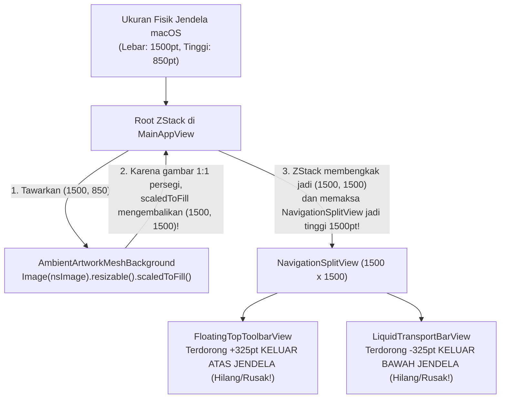
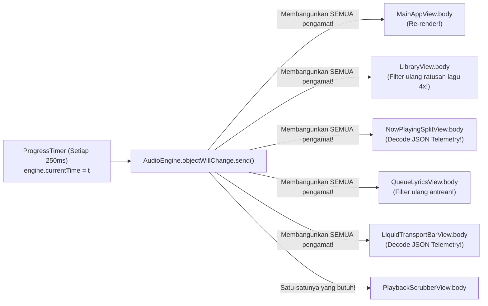

# Audit & Analisa Aspek 7: Bedah Root-Cause Bug Window Resize, Gestur Double-Tap Fit-to-Screen, & Lag/Korupsi Layout Saat Berpindah Menu (`bug-note.md`)

**Sumber Laporan Bug:** [`bug-note.md`](file:///Users/yuka/Documents/Projects/tsrossa-macos/bug-note.md)
1. **Bug #1:** *"bug ketika aplikasi di perbesar dan di perkecil, tampilan semua bar menu atau apapun itu yang ada di dalam aplikasi rusak."*
2. **Bug #2:** *"gestur double tap untuk membuat aplikasi fit to screen belum berfungsi."*
3. **Bug #3:** *"aplikasi masih lag saat berpindah menu dan tampilan di dalam menu menjadi rusak setelahnya, seperti bug 1"*

**Target File yang Diaudit:**
- [`MainAppView.swift`](file:///Users/yuka/Documents/Projects/tsrossa-macos/macos/Sources/MainAppView.swift)
- [`LiquidGlassComponents.swift`](file:///Users/yuka/Documents/Projects/tsrossa-macos/macos/Sources/LiquidGlassComponents.swift)
- [`main.swift`](file:///Users/yuka/Documents/Projects/tsrossa-macos/macos/Sources/main.swift)
- [`AudioEngine.swift`](file:///Users/yuka/Documents/Projects/tsrossa-macos/macos/Sources/AudioEngine.swift)
- [`AppViewModel.swift`](file:///Users/yuka/Documents/Projects/tsrossa-macos/macos/Sources/AppViewModel.swift)
- [`AlbumArtCache.swift`](file:///Users/yuka/Documents/Projects/tsrossa-macos/macos/Sources/AlbumArtCache.swift) & [`TrackMetadata.swift`](file:///Users/yuka/Documents/Projects/tsrossa-macos/macos/Sources/TrackMetadata.swift)
- [`SidebarView.swift`](file:///Users/yuka/Documents/Projects/tsrossa-macos/macos/Sources/Views/SidebarView.swift), [`FloatingTopToolbarView.swift`](file:///Users/yuka/Documents/Projects/tsrossa-macos/macos/Sources/Views/FloatingTopToolbarView.swift), [`LiquidTransportBarView.swift`](file:///Users/yuka/Documents/Projects/tsrossa-macos/macos/Sources/Views/LiquidTransportBarView.swift), [`NowPlayingSplitView.swift`](file:///Users/yuka/Documents/Projects/tsrossa-macos/macos/Sources/Views/NowPlayingSplitView.swift), [`LibraryView.swift`](file:///Users/yuka/Documents/Projects/tsrossa-macos/macos/Sources/Views/LibraryView.swift), [`QueueLyricsView.swift`](file:///Users/yuka/Documents/Projects/tsrossa-macos/macos/Sources/Views/QueueLyricsView.swift)

---

## 🎓 Pengantar dari Senior Engineer untuk Junior Engineer

> **Catatan Mentoring Senior:**
> Ketika kamu melihat 3 gejala seperti di [`bug-note.md`](file:///Users/yuka/Documents/Projects/tsrossa-macos/bug-note.md) — *(1) layout hancur saat jendela di-resize, (2) double-tap untuk Fit-to-Screen mati, dan (3) perpindahan tab terasa lag lalu merusak tampilan* — jangan langsung menebak-nebak dengan menambah `.padding()` atau `.frame()` secara acak!
>
> Seorang **Senior macOS Engineer** akan membedah **3 mesin di balik layar SwiftUI pada macOS**:
> 1. **SwiftUI Layout Negotiation Engine** (Bagaimana `ZStack`, `Image.scaledToFill()`, `NavigationSplitView`, dan `.safeAreaInset` menegosiasikan ukuran ketika jendela ditarik/di-resize).
> 2. **AppKit Window Server & Responder Chain** (Bagaimana `NSWindow` dengan `HiddenTitleBarWindowStyle` menangani *event* klik ganda/double-tap untuk *Zoom / Fit to Screen* dan di mana posisi tombol *Traffic Lights* 🔴🟡🟢 berada).
> 3. **Combine `ObservableObject` Invalidations & Main-Thread I/O** (Mengapa satu perubahan variabel `@Published` atau satu pembacaan gambar sampul yang keliru dapat memblokir *Main Thread* dan memicu evaluasi ulang ribuan baris UI setiap detik).
>
> Mari kita bedah satu per satu dari akar masalahnya (*root cause*) hingga ke baris kodenya!

---

## 1. Matriks Ringkasan Root-Cause Ketiga Bug

| No | Bug yang Dilaporkan di `bug-note.md` | Akar Masalah Teknis (*Root Cause*) | Lokasi Baris Kode | Dampak Visual & Performa |
| :--- | :--- | :--- | :--- | :--- |
| **1A** | **Bug #1 & #3:** Semua bar menu & tampilan rusak saat window diperbesar/diperkecil atau setelah pindah menu | **Jebakan `ZStack` + `Image.scaledToFill()` Tanpa Isolasi Geometri**: `AmbientArtworkMeshBackground` ditaruh sebagai *sibling* langsung di dalam `ZStack` utama dan memanggil `Image(nsImage: img).resizable().scaledToFill()`. Karena sampul album berbentuk persegi (1:1), pada jendela berukuran `1600 × 900`, `.scaledToFill()` memaksa tinggi `ZStack` membengkak menjadi **`1600 × 1600`**! Akibatnya `NavigationSplitView` ikut melar ke `1600pt` di dalam jendela `900pt`, mendorong Top Bar `350pt` keluar batas atas layar dan Bottom Transport Bar `350pt` tenggelam di bawah layar! | [`MainAppView.swift:L48-L57`](file:///Users/yuka/Documents/Projects/tsrossa-macos/macos/Sources/MainAppView.swift#L48-L57), [`LiquidGlassComponents.swift:L199-L206`](file:///Users/yuka/Documents/Projects/tsrossa-macos/macos/Sources/LiquidGlassComponents.swift#L199-L206) | **FATAL** — Top bar, bottom transport bar, dan sidebar terpotong keluar jendela begitu ada artwork atau saat jendela ditarik melebar/mengecil. |
| **1B** | **Bug #1 & #3:** Bar atas & bawah bergeser/lepas saat resize & pindah tab | **Konflik `NavigationSplitView` + `.safeAreaInset` pada `_ConditionalContent`**: Menempelkan `.safeAreaInset(edge: .top/.bottom)` langsung ke fungsi `@ViewBuilder workspaceContent` (`switch vm.activeTab`) di dalam `NavigationSplitView` membuat `NSSplitViewController` membongkar-pasang *safe area* setiap kali tab berganti atau jendela di-resize, plus menabrak tombol *Traffic Lights* macOS di sudut kiri atas `SidebarView`. | [`MainAppView.swift:L59-L76`](file:///Users/yuka/Documents/Projects/tsrossa-macos/macos/Sources/MainAppView.swift#L59-L76), [`SidebarView.swift:L14-L28`](file:///Users/yuka/Documents/Projects/tsrossa-macos/macos/Sources/Views/SidebarView.swift#L14-L28) | **KRITIS** — Logo TSRossa tertimpa tombol 🔴🟡🟢 macOS; ukuran kontainer melompat-lompat saat ganti menu. |
| **1C** | **Bug #1:** Konten gepeng/bertabrakan saat window diperkecil atau diperbesar | **Double-Subtracted Padding (`90pt + 90pt`) & Absennya `Spacer` di `LiquidTransportBarView`**: `NowPlayingSplitView` sudah terkena `.safeAreaInset(edge: .bottom)` (`~86pt`) tetapi masih menambah `.padding(.bottom, 90)` + `Hero Artwork 340pt`, sehingga pada tinggi minimum `620pt` ruang vertikal tersisa `384pt < 450pt` (overflow!). Sementara `LiquidTransportBarView` tidak memiliki `Spacer()` di antara kolom kiri dan tengah. | [`NowPlayingSplitView.swift:L31,L106`](file:///Users/yuka/Documents/Projects/tsrossa-macos/macos/Sources/Views/NowPlayingSplitView.swift#L31-L106), [`LiquidTransportBarView.swift:L60-L126`](file:///Users/yuka/Documents/Projects/tsrossa-macos/macos/Sources/Views/LiquidTransportBarView.swift#L60-L126) | **TINGGI** — Elemen di dalam transport bar dan halaman Now Playing saling menimpa/hancur saat jendela diperkecil/diperbesar. |
| **2** | **Bug #2:** Gestur double-tap untuk membuat aplikasi *fit to screen* belum berfungsi | **`HiddenTitleBarWindowStyle()` Menelan Event Klik Ganda Titlebar & Tidak Ada `NSWindowDelegate` Zoom Handler**: Karena `.windowStyle(HiddenTitleBarWindowStyle())` membentangkan `NSHostingView` ke seluruh jendela (`fullSizeContentView`), klik ganda / double-tap pada area bar atas ditahan oleh view SwiftUI dan tidak pernah memicu `window.zoom(nil)`. Selain itu, tidak ada implementasi `windowWillUseStandardFrame` ke `screen.visibleFrame`. | [`main.swift:L24-L29`](file:///Users/yuka/Documents/Projects/tsrossa-macos/macos/Sources/main.swift#L24-L29), [`FloatingTopToolbarView.swift:L11-L72`](file:///Users/yuka/Documents/Projects/tsrossa-macos/macos/Sources/Views/FloatingTopToolbarView.swift#L11-L72) | **TINGGI** — Double-tap pada trackpad atau klik ganda di bar atas sama sekali tidak merespons untuk *Fit to Screen*. |
| **3A** | **Bug #3:** Aplikasi lag saat berpindah menu & selama pemutaran | **Ilusi Isolasi `@ObservedObject var engine = AudioEngine.shared`**: Meskipun teks waktu dipindah ke `PlaybackScrubberView`, `MainAppView`, `LibraryView`, `NowPlayingSplitView`, `QueueLyricsView`, `SettingsBentoView`, dan `LiquidTransportBarView` **masih mendeklarasikan `@ObservedObject var engine = AudioEngine.shared`**. Di Combine, mutasi `engine.currentTime` (4x/detik) menembakkan `engine.objectWillChange` yang **memaksa keenam view besar tersebut merender ulang `body`-nya 4 kali setiap detik**! | [`AudioEngine.swift:L48,L533`](file:///Users/yuka/Documents/Projects/tsrossa-macos/macos/Sources/AudioEngine.swift#L48), [`MainAppView.swift:L5`](file:///Users/yuka/Documents/Projects/tsrossa-macos/macos/Sources/MainAppView.swift#L5), [`LibraryView.swift:L5`](file:///Users/yuka/Documents/Projects/tsrossa-macos/macos/Sources/Views/LibraryView.swift#L5) | **KRITIS** — Seluruh pohon UI (ratusan baris lagu, gradien kaca, dan JSON decoder) dievaluasi ulang tanpa henti setiap 250ms. |
| **3B** | **Bug #3:** Lag berat saat klik menu *Music Library* / *Playlists* | **Main-Thread Disk I/O Storm + Cache Miss Tanpa Negative Cache + 4x Evaluasi `vm.filteredTracks`**: (1) `LibraryView.body` memanggil computed property `vm.filteredTracks` **4 kali per render** dan mengalokasikan `Array(enumerated())`. (2) Setiap baris lagu memanggil `track.artwork` $\rightarrow$ `AlbumArtCache.thumbnailImage(for:)` di **Main Thread**. Untuk lagu tanpa cover art, karena `NSCache` tidak bisa menyimpan `nil`, setiap frame melakukan hash `CC_SHA256` + syscall disk `NSImage(contentsOf:)` secara sinkron di Main Thread! (3) `AudioEngine.play` menghapus `artworkThumbPath` saat membuat `updatedTrack`. | [`LibraryView.swift:L24,L109,L124,L147,L234`](file:///Users/yuka/Documents/Projects/tsrossa-macos/macos/Sources/Views/LibraryView.swift#L24), [`AlbumArtCache.swift:L31-L44`](file:///Users/yuka/Documents/Projects/tsrossa-macos/macos/Sources/AlbumArtCache.swift#L31-L44), [`AudioEngine.swift:L293-L303`](file:///Users/yuka/Documents/Projects/tsrossa-macos/macos/Sources/AudioEngine.swift#L293-L303) | **KRITIS** — *Frame drop* / *beachball freeze* ratusan milidetik saat berpindah antar menu. |

---

## 2. Bedah Mendalam Bug #1: Mengapa Tampilan Semua Bar & Menu Rusak Saat Window Diperbesar / Diperkecil?

### 2.1. Pelajaran Senior #1: Jebakan Maut `ZStack` + `Image.resizable().scaledToFill()` di SwiftUI

Mari kita lihat kode yang ada di [`MainAppView.swift:L48-L62`](file:///Users/yuka/Documents/Projects/tsrossa-macos/macos/Sources/MainAppView.swift#L48-L62) dan [`LiquidGlassComponents.swift:L189-L206`](file:///Users/yuka/Documents/Projects/tsrossa-macos/macos/Sources/LiquidGlassComponents.swift#L189-L206):

```swift
// MainAppView.swift:L48-L62
ZStack {
    // Layer 0: Ambient Artwork Mesh Background (behind entire window)
    AmbientArtworkMeshBackground(
        artwork: engine.currentTrack?.artwork,
        accentColor: theme.primary,
        canvasMode: currentCanvasMode,
        isDark: isEffectiveDark
    )
    .ignoresSafeArea()

    // Layer 1: NavigationSplitView Workspace
    NavigationSplitView { ... }
}
```

Dan lihat isi `AmbientArtworkMeshBackground` di [`LiquidGlassComponents.swift:L199-L206`](file:///Users/yuka/Documents/Projects/tsrossa-macos/macos/Sources/LiquidGlassComponents.swift#L199-L206):

```swift
// LiquidGlassComponents.swift:L199-L206
if let img = artwork {
    Image(nsImage: img)
        .resizable()
        .scaledToFill()
        .blur(radius: 80)
        .opacity(isDark ? 0.40 : 0.22)
        .scaleEffect(1.2)
}
```

#### 💡 Penjelasan Senior ke Junior: Bagaimana Algoritma Layout SwiftUI Bekerja di Sini?
Di SwiftUI, proses penentuan ukuran (*Layout Negotiation*) selalu berjalan dalam **3 langkah**:
1. **Parent (`ZStack`) menawarkan ukuran (*Proposed Size*)** sebesar ukuran jendela saat ini, misalnya pengguna memperbesar lebar jendela menjadi **`Lebar = 1500 pt, Tinggi = 850 pt`**.
2. **Child 1 (`AmbientArtworkMeshBackground`) menghitung ukurannya sendiri**:
   - Di dalamnya ada `Image(nsImage: img).resizable().scaledToFill()`.
   - Gambar sampul album (`img`) memiliki rasio aspek **1:1 (persegi)**.
   - Apa arti `.scaledToFill()`? Artinya: *"Perbesar gambar dengan menjaga rasio 1:1 sampai menutupi seluruh lebar (1500) DAN tinggi (850)"*.
   - Agar persegi 1:1 menutupi area `1500 × 850`, ukuran view `Image` tersebut menjadi **`1500 × 1500 pt`**!
   - Karena `Image` tersebut **tidak dibungkus di dalam `GeometryReader`** dan **tidak ditaruh di dalam modifier `.background { ... }`** milik view utama, `AmbientArtworkMeshBackground` melaporkan balik ke `ZStack`: *"Ukuran saya adalah `1500 × 1500 pt`!"*
3. **Parent (`ZStack`) menentukan ukuran akhirnya**:
   - Ukuran sebuah `ZStack` adalah **union (nilai maksimum)** dari lebar dan tinggi seluruh *child*-nya!
   - Akibatnya, `ZStack` mengubah ukurannya menjadi **`1500 × 1500 pt`**, padahal tinggi fisik jendela macOS pengguna hanya **`850 pt`**!
   - Selanjutnya, `ZStack` menawarkan ukuran **`1500 × 1500 pt`** tersebut kepada *sibling*-nya, yaitu `NavigationSplitView`!



Itulah sebabnya:
- Begitu pengguna memperbesar atau memperkecil jendela (atau begitu lagu dengan sampul album dimuat/dipindahkan menunya), **tinggi virtual UI di dalam `ZStack` menjadi jauh lebih besar daripada tinggi fisik jendela**.
- Bar menu atas (`FloatingTopToolbarView`), bar pemutar bawah (`LiquidTransportBarView`), dan bagian atas/bawah `SidebarView` langsung **terlempar keluar batas jendela (terpotong/hilang)** atau saling bertumpuk rusak!
- Bahkan ketika pengguna mencoba mengecilkan jendela kembali, `NSHostingView` terjebak karena `ZStack` melaporkan ukuran konten sebesar gambar `scaledToFill()` tadi.

#### ✅ Aturan Emas Senior Engineer:
> **Jangan pernah** meletakkan gambar `.scaledToFill()` sebagai *child* langsung di dalam `ZStack` bersama komponen layout utama!
> Sebuah latar belakang (*background*) harus dipasang menggunakan modifier **`.background { GeometryReader { geo in ... .frame(width: geo.size.width, height: geo.size.height).clipped() } }`** pada kontainer utama. Di SwiftUI, modifier `.background(...)` bersifat **layout-neutral**: ukuran di dalam `.background` selalu mengikuti ukuran view utamanya dan **tidak akan pernah** mengubah atau membengkakkan ukuran view utama!

---

### 2.2. Pelajaran Senior #2: Mengapa `NavigationSplitView` + `.safeAreaInset` Bermasalah pada Jendela Custom (`HiddenTitleBarWindowStyle`)?

Lihat [`MainAppView.swift:L59-L76`](file:///Users/yuka/Documents/Projects/tsrossa-macos/macos/Sources/MainAppView.swift#L59-L76):

```swift
NavigationSplitView {
    SidebarView(theme: theme)
        .navigationSplitViewColumnWidth(min: 210, ideal: 230, max: 270)
} detail: {
    workspaceContent(theme: theme)
        .safeAreaInset(edge: .top, spacing: 0) {
            FloatingTopToolbarView(theme: theme)
                ...
        }
        .safeAreaInset(edge: .bottom, spacing: 0) {
            LiquidTransportBarView(theme: theme)
                ...
        }
}
```

Ada **3 cacat arsitektural** pada pola di atas di macOS:
1. **Tabrakan dengan Tombol *Traffic Lights* (🔴🟡🟢) macOS:**
   Di [`main.swift:L28`](file:///Users/yuka/Documents/Projects/tsrossa-macos/macos/Sources/main.swift#L28), kita menggunakan `.windowStyle(HiddenTitleBarWindowStyle())`. Ini membuat konten `SidebarView` mulai dari koordinat `Y = 0` (ujung paling atas jendela), tempat tombol Close, Minimize, dan Zoom milik macOS berada (`Y = 0..28pt`, `X = 14..76pt`).
   Namun di [`SidebarView.swift:L27`](file:///Users/yuka/Documents/Projects/tsrossa-macos/macos/Sources/Views/SidebarView.swift#L27), header logo `"TSRossa"` hanya diberi `.padding(.top, 16)`. Akibatnya, saat jendela di-resize atau keluar dari fullscreen, tombol 🔴🟡🟢 menimpa logo TSRossa!
2. **`.safeAreaInset` Ditempelkan pada `@ViewBuilder switch` (`_ConditionalContent`):**
   `workspaceContent(theme: theme)` adalah sebuah blok `switch vm.activeTab` yang menghasilkan tipe komposit `_ConditionalContent`. Ketika kamu menempelkan `.safeAreaInset` langsung pada hasil `switch`, setiap kali pengguna berpindah menu (`activeTab` berubah), SwiftUI menghancurkan view tab lama, membangun view tab baru yang memiliki sifat ukuran intrinsik berbeda (`NowPlayingSplitView` adalah `HStack` tanpa `ScrollView`, sedangkan `LibraryView` adalah `ScrollView`), lalu **menghitung ulang posisi `.safeAreaInset` dari nol**.
3. **Konflik `NSSplitViewController` Saat Live Window Resize:**
   Pada aplikasi pemutar musik desktop seperti Spotify, Tidal, atau Apple Music, struktur ruang kerja yang paling stabil dan bebas *glitch* saat jendela ditarik secara ekstrem adalah **Deterministic App Shell (`HStack(spacing: 0)`)**:
   - Kolom Kiri: `SidebarView` dengan lebar tetap/terkontrol (`width: 236`) dan ruang aman atas `38pt` khusus untuk tombol *Traffic Lights* macOS.
   - Kolom Kanan: Kontainer `ZStack` / `VStack(spacing: 0)` berukuran `.frame(maxWidth: .infinity, maxHeight: .infinity)` di mana:
     - `FloatingTopToolbarView` berada di bagian atas secara deterministik (atau overlay atas).
     - Area konten tab (`workspaceContent`) berada di dalam kontainer yang memiliki `.frame(maxWidth: .infinity, maxHeight: .infinity)` dan `.clipped()`.
     - `LiquidTransportBarView` melayang di bagian bawah secara deterministik.
   Dengan struktur **Deterministic App Shell** ini, posisi Top Bar, Sidebar, dan Bottom Transport Bar **100% terkunci secara matematis terhadap ukuran jendela (`window.contentLayoutRect`)** — tidak peduli tab apa yang sedang aktif atau seberapa cepat pengguna menarik ujung jendela!

---

### 2.3. Pelajaran Senior #3: Double-Counted Padding & Ketidakseimbangan `Spacer()` di Dalam Bar dan Split View

Lihat apa yang terjadi ketika pengguna mengecilkan ukuran jendela ke ukuran minimum (`920 × 620`):

1. **Di [`NowPlayingSplitView.swift:L12-L107`](file:///Users/yuka/Documents/Projects/tsrossa-macos/macos/Sources/Views/NowPlayingSplitView.swift#L12-L107):**
   - Baris 31: `Hero Artwork` meminta `.frame(maxWidth: 340, maxHeight: 340)` tanpa mengizinkan penyusutan proporsional pada layar pendek.
   - Baris 106: Menambahkan `.padding(.bottom, 90)` padahal di `MainAppView` sudah ada `.safeAreaInset(edge: .bottom)` setinggi `~86pt`!
   - Mari kita hitung tinggi yang tersisa pada jendela setinggi `620pt`:
     $$\text{Tinggi Tersedia} = 620 - 64\text{ (Top Bar)} - 86\text{ (Bottom Inset)} - 90\text{ (Padding Ganda)} = 380\text{ pt}$$
     Padahal di dalam `VStack` kiri `NowPlayingSplitView` terdapat:
     $$\text{Artwork } (340\text{ pt}) + \text{Spacing } (40\text{ pt}) + \text{Judul/Artis } (58\text{ pt}) + \text{Badges } (28\text{ pt}) = 466\text{ pt} > 380\text{ pt!}$$
     Karena `466pt > 380pt`, isi halaman `NowPlayingSplitView` **meluap (*overflow*)**, membuat teks judul lagu terhimpit dan sampul album menabrak bar atas!

2. **Di [`LiquidTransportBarView.swift:L13-L173`](file:///Users/yuka/Documents/Projects/tsrossa-macos/macos/Sources/Views/LiquidTransportBarView.swift#L13-L173):**
   Lihat struktur `HStack` di `LiquidTransportBarView`:
   ```swift
   HStack(spacing: 16) {
       // 1. Kolom Kiri: Artwork & Info Lagu (.frame(maxWidth: 160))
       HStack(spacing: 12) { ... }

       // ⚠️ TIDAK ADA SPACER DI SINI!

       // 2. Kolom Tengah: Tombol Play & Scrubber (.frame(maxWidth: 440))
       VStack(spacing: 4) { ... }

       // 3. Spacer hanya ada di sebelah kanan!
       Spacer(minLength: 12)

       // 4. Kolom Kanan: Badge Bit-Perfect + Volume Slider
       HStack(spacing: 12) { ... }
   }
   ```
   - Karena **tidak ada `Spacer`** di antara Kolom Kiri dan Kolom Tengah, sedangkan di antara Kolom Tengah dan Kolom Kanan ada `Spacer(minLength: 12)`, maka ketika jendela diperbesar (*Fit to Screen*), Kolom Tengah (tombol Play/Pause & Scrubber) **tidak berada di tengah jendela**, melainkan menempel rapat ke kiri!
   - Sebaliknya, ketika jendela diperkecil, Kolom Kiri, Tengah, dan Kanan berebut ruang tanpa `layoutPriority` yang jelas.
   - **Solusi Senior:** Gunakan tata letak 3-kolom simetris (atau `HStack` dengan `frame(width: 220, alignment: .leading)` di kiri, `Spacer(minLength: 12)`, `VStack` scrubber fleksibel `.frame(minWidth: 240, maxWidth: 480).layoutPriority(1)` di tengah, `Spacer(minLength: 12)`, dan `HStack` kontrol kanan `.frame(minWidth: 200, alignment: .trailing)`). Dengan begitu, tombol Play/Pause dan Scrubber **selalu tepat berada di titik tengah horizontal**, baik saat jendela kecil `920pt` maupun saat layar penuh `2560pt`!

---

## 3. Bedah Mendalam Bug #2: Mengapa Gestur Double-Tap untuk *Fit to Screen* Belum Berfungsi?

### 3.1. Pelajaran Senior #4: Anatomi Window Zoom (`Fit to Screen`) di AppKit & SwiftUI macOS

Pengguna melaporkan:
> *"2. gestur double tap untuk membuat aplikasi fit to screen belum berfungsi."*

Mari kita pahami bagaimana pengguna macOS melakukan *Fit to Screen* (Zoom Window):
- Di macOS, pengguna melakukan **double-tap (ketuk dua kali di trackpad)** atau **double-click** pada area bar atas jendela (titlebar / area kosong di sekitar toolbar atas & header sidebar) untuk memperbesar jendela agar pas memenuhi layar kerja (**Fit to Screen** / `NSScreen.visibleFrame`, yaitu layar penuh di antara Menu Bar atas macOS dan Dock bawah, lalu jika di-double-tap lagi akan kembali ke ukuran semula).

#### Mengapa Fitur Ini Mati Total di Kode Saat Ini?
1. **Konsekuensi `.windowStyle(HiddenTitleBarWindowStyle())` di [`main.swift:L28`](file:///Users/yuka/Documents/Projects/tsrossa-macos/macos/Sources/main.swift#L28):**
   Ketika kita memakai `HiddenTitleBarWindowStyle()`, AppKit memasang flag `NSWindow.StyleMask.fullSizeContentView` dan menyembunyikan `NSTitlebarView` bawaan. Seluruh area atas jendela kini ditutupi oleh `NSHostingView` milik SwiftUI (`SidebarView` di kiri dan `FloatingTopToolbarView` di kanan).
2. **`NSHostingView` Menyerap Event Mouse/Trackpad:**
   Saat pengguna melakukan double-tap di area atas jendela (baik di atas `FloatingTopToolbarView`, di ruang sekitar header `SidebarView`, maupun di jalur atas jendela), event `mouseDown` (`clickCount == 2`) ditangkap oleh lapisan SwiftUI dan **tidak pernah diteruskan ke metode `window.performZoom(nil)` milik AppKit**!
3. **Absennya `NSWindowDelegate.windowWillUseStandardFrame`:**
   Di AppKit, ketika `window.zoom(nil)` dipanggil pada jendela yang menampung `NSHostingView`, AppKit bertanya pada `windowWillUseStandardFrame(_:defaultFrame:)`. Tanpa `NSWindowDelegate` yang secara eksplisit mengembalikan `window.screen?.visibleFrame`, `NSHostingView` sering kali hanya memperbesar jendela mengikuti ukuran intrinsik view aktif (bukan memenuhi layar `visibleFrame`), atau gagal mengembalikan ukuran sebelumnya ketika di-double-tap kedua kalinya!

#### ✅ Solusi Arsitektural Senior (`WindowZoomManager` + Titlebar Gesture Handler):
Untuk membuat gestur double-tap *Fit to Screen* bekerja **100% responsif, mulus, dan konsisten di segala kondisi** (bahkan jika pengaturan sistem macOS pengguna menonaktifkan aksi titlebar standar):
1. Kita bangun **`WindowZoomManager`** (di `main.swift` / `LiquidGlassComponents.swift`) yang mengonfigurasi `NSWindow` saat diluncurkan:
   - Memasang `window.isMovableByWindowBackground = false` (agar slider tidak ikut menggeser jendela) namun menyediakan jalur drag & double-tap titlebar yang presisi.
   - Menyimpan `savedRestoreFrame: NSRect?` sebelum jendela di-*fit to screen*.
   - Menyediakan fungsi `toggleFitToScreen(for window: NSWindow?)`:
     - Memeriksa apakah `window.frame` saat ini sudah memenuhi `screen.visibleFrame` (dengan toleransi `<= 4pt`).
     - Jika **belum** *fit to screen*: simpan `window.frame` ke `savedRestoreFrame`, lalu animasikan `window.setFrame(screen.visibleFrame, display: true, animate: true)`.
     - Jika **sudah** *fit to screen*: kembalikan ke `savedRestoreFrame` (atau ukuran ideal `1200 × 760` di tengah layar jika aplikasi baru dibuka langsung dalam keadaan penuh) dengan `window.setFrame(restoreFrame, display: true, animate: true)`.
2. Kita pasang **dua jalur pemicu (Dual Trigger) untuk Double-Tap / Double-Click**:
   - **Jalur SwiftUI (`TapGesture(count: 2)`)** pada latar `FloatingTopToolbarView` dan header `SidebarView`.
   - **Jalur AppKit (`NSEvent.addLocalMonitorForEvents(matching: .leftMouseDown)`)** yang mendeteksi `event.clickCount == 2` di zona atas jendela (`y` berada di area top bar / titlebar strip `<= 56pt` dari puncak jendela), selama pengguna **tidak** sedang mengklik di dalam `NSTextView` (kolom pencarian) atau tombol `NSControl`. Begitu terdeteksi `clickCount == 2`, langsung panggil `WindowZoomManager.shared.toggleFitToScreen()`!

---

## 4. Bedah Mendalam Bug #3: Mengapa Aplikasi Masih Lag Saat Berpindah Menu & Tampilan Menjadi Rusak Setelahnya?

Pengguna melaporkan:
> *"3. aplikasi masih lag saat berpindah menu dan tampilan di dalam menu menjadi rusak setelahnya, seperti bug 1"*

Ini adalah pertanyaan favorit dalam wawancara Senior iOS/macOS Engineer:
**"Kita sudah memindahkan tampilan waktu `currentTime` ke dalam subview kecil `PlaybackScrubberView`, tapi kenapa seluruh aplikasi masih lag saat lagu diputar dan saat berpindah tab?"**

Mari kita lihat buktinya di kode!

### 4.1. Pelajaran Senior #5: Ilusi Isolasi pada `Combine.ObservableObject`

Lihat deklarasi properti di [`AudioEngine.swift:L45-L53`](file:///Users/yuka/Documents/Projects/tsrossa-macos/macos/Sources/AudioEngine.swift#L45-L53):
```swift
public class AudioEngine: ObservableObject {
    @Published public var isPlaying: Bool = false
    @Published public var isPaused: Bool = false
    @Published public var isSeeking: Bool = false
    @Published public var currentTime: Double = 0.0 // <-- Diubah setiap 0.25 detik!
    @Published public var totalDuration: Double = 0.0
    @Published public var currentTrack: TrackMetadata? = nil
    ...
```
Dan sekarang lihat siapa saja yang menulis `@ObservedObject var engine = AudioEngine.shared`:
1. [`MainAppView.swift:L5`](file:///Users/yuka/Documents/Projects/tsrossa-macos/macos/Sources/MainAppView.swift#L5): `@ObservedObject var engine = AudioEngine.shared`
2. [`LibraryView.swift:L5`](file:///Users/yuka/Documents/Projects/tsrossa-macos/macos/Sources/Views/LibraryView.swift#L5): `@ObservedObject var engine = AudioEngine.shared`
3. [`NowPlayingSplitView.swift:L4`](file:///Users/yuka/Documents/Projects/tsrossa-macos/macos/Sources/Views/NowPlayingSplitView.swift#L4): `@ObservedObject var engine = AudioEngine.shared`
4. [`QueueLyricsView.swift:L5`](file:///Users/yuka/Documents/Projects/tsrossa-macos/macos/Sources/Views/QueueLyricsView.swift#L5): `@ObservedObject var engine = AudioEngine.shared`
5. [`SettingsBentoView.swift:L5`](file:///Users/yuka/Documents/Projects/tsrossa-macos/macos/Sources/Views/SettingsBentoView.swift#L5): `@ObservedObject var engine = AudioEngine.shared`
6. [`LiquidTransportBarView.swift:L4`](file:///Users/yuka/Documents/Projects/tsrossa-macos/macos/Sources/Views/LiquidTransportBarView.swift#L4): `@ObservedObject var engine = AudioEngine.shared`
7. [`PlaybackScrubberView.swift:L11`](file:///Users/yuka/Documents/Projects/tsrossa-macos/macos/Sources/Views/PlaybackScrubberView.swift#L11): `@ObservedObject var engine = AudioEngine.shared`

#### 💥 Mengapa Ini Menyebabkan Lag Parah?
Di SwiftUI, protokol `ObservableObject` (berbasis Combine) **TIDAK melacak properti mana yang dibaca oleh suatu View**!
`ObservableObject` hanya memiliki **SATU** pemancar sinyal: `objectWillChange`.
Setiap kali timer di `AudioEngine.swift:L533` mengubah `self.currentTime = t` (setiap 250 milidetik / 4 kali per detik):
1. `AudioEngine` memancarkan `objectWillChange.send()`.
2. SwiftUI menandai **SEMUA 7 VIEW DI ATAS** sebagai *dirty* (kotor) dan memaksa keenam view besar (`MainAppView`, `LibraryView`, `NowPlayingSplitView`, `QueueLyricsView`, `SettingsBentoView`, `LiquidTransportBarView`) untuk menjalankan ulang fungsi `body` mereka!
3. Padahal `MainAppView`, `LibraryView`, `NowPlayingSplitView`, `QueueLyricsView`, `SettingsBentoView`, dan `LiquidTransportBarView` **sama sekali tidak menampilkan angka `currentTime`**!



#### ✅ Bagaimana Senior Engineer Memperbaikinya?
Pisahkan state frekuensi tinggi (`currentTime`, `totalDuration`, `isSeeking`) ke dalam objek khusus bernama **`AudioProgressModel: ObservableObject`** (`AudioEngine.shared.progress`)!
- Di `AudioEngine`, `currentTime` pada `AudioProgressModel` di-update setiap 250ms, tetapi **`AudioEngine` sendiri TIDAK menembakkan `objectWillChange` setiap 250ms**!
- `AudioEngine` hanya menembakkan `objectWillChange` saat lagu berganti (`currentTrack`), status Play/Pause berubah (`isPlaying`/`isPaused`), atau perangkat DAC berubah (`devices`).
- Hanya `PlaybackScrubberView` yang mengamati `@ObservedObject var progress = AudioEngine.shared.progress`.
- Hasilnya: saat musik berputar, `MainAppView`, `LibraryView`, `NowPlayingSplitView`, `SettingsBentoView`, dan `LiquidTransportBarView` mengalami **0 re-render per detik**!

---

### 4.2. Pelajaran Senior #6: Badai Disk I/O Sinkron di Main Thread (`AlbumArtCache`) & Evaluasi Berulang `vm.filteredTracks`

Mengapa ketika pengguna mengklik menu **Music Library** atau **Playlists**, aplikasi terasa **lag/membeku sesaat** sebelum akhirnya tampil?
Mari kita lacak apa yang dikerjakan CPU di **Main Thread (UI Thread)** tepat pada milidetik ketika pengguna mengklik tab `Music Library`:

#### Masalah 1: `vm.filteredTracks` Dihitung Ulang Berkali-kali Tanpa Cache
Lihat [`AppViewModel.swift:L354-L387`](file:///Users/yuka/Documents/Projects/tsrossa-macos/macos/Sources/AppViewModel.swift#L354-L387):
`public var filteredTracks: [TrackMetadata]` adalah **computed property** yang melakukan pemfilteran array lagu dan pencarian fuzzy setiap kali properti tersebut diakses!
Sekarang hitung berapa kali [`LibraryView.swift`](file:///Users/yuka/Documents/Projects/tsrossa-macos/macos/Sources/Views/LibraryView.swift) memanggil `vm.filteredTracks` dalam **satu kali** pembacaan `body`:
1. Baris 24: `vm.filteredTracks.count` (Hitung #1)
2. Baris 24 $\rightarrow$ Baris 147 (`formattedTotalDuration`): `vm.filteredTracks.reduce(0.0)` (Hitung #2)
3. Baris 109: `if vm.filteredTracks.isEmpty` (Hitung #3)
4. Baris 124: `ForEach(Array(vm.filteredTracks.enumerated()), id: \.element.id)` (Hitung #4 + alokasi array tuple baru!)
5. Dan di [`QueueLyricsView.swift:L108`](file:///Users/yuka/Documents/Projects/tsrossa-macos/macos/Sources/Views/QueueLyricsView.swift#L108): `let list = vm.filteredTracks` (Hitung #5!)

#### Masalah 2: `AlbumArtCache.thumbnailImage(for:)` Melakukan Syscall Disk + Hash SHA256 di Main Thread Tanpa Negative Cache!
Lihat [`TrackMetadata.swift:L74-L76`](file:///Users/yuka/Documents/Projects/tsrossa-macos/macos/Sources/TrackMetadata.swift#L74-L76) dan [`AlbumArtCache.swift:L31-L44`](file:///Users/yuka/Documents/Projects/tsrossa-macos/macos/Sources/AlbumArtCache.swift#L31-L44):

```swift
// TrackMetadata.swift:L74-L76
public var artwork: NSImage? {
    AlbumArtCache.shared.thumbnailImage(for: path)
}

// AlbumArtCache.swift:L31-L44
public func thumbnailImage(for trackPath: String) -> NSImage? {
    let key = NSString(string: trackPath)
    if let cached = memoryCache.object(forKey: key) {
        return cached
    }

    let hash = sha256Hex(trackPath)
    let diskURL = cacheDirectory.appendingPathComponent("\(hash).jpg")
    if let img = NSImage(contentsOf: diskURL) {
        memoryCache.setObject(img, forKey: key)
        return img
    }
    return nil
}
```
Perhatikan apa yang terjadi saat `LibraryView` merender daftar lagu:
- Untuk setiap baris lagu, `trackArtworkView(track:)` memanggil `if let img = track.artwork` **secara sinkron di Main Thread**!
- Jika sebuah lagu **tidak memiliki cover art** (atau thumbnail-nya belum selesai diekstrak di background), `NSImage(contentsOf: diskURL)` gagal dan mengembalikan `nil`.
- Karena `NSCache` tidak bisa menyimpan nilai `nil`, kegagalan tersebut **tidak pernah dicatat**!
- Akibatnya, setiap kali `LibraryView` (atau `MainAppView` / `NowPlayingSplitView`) di-render, ia terus-menerus menghitung `CC_SHA256` dan mengetuk sistem file SSD (`NSImage(contentsOf:)`) di Main Thread berulang-ulang!
- Sedangkan untuk lagu yang *punya* thumbnail di disk tetapi belum masuk ke `memoryCache`, `NSImage(contentsOf: diskURL)` membaca file JPEG dari SSD dan men-decode bitmap-nya langsung di **Main Thread** saat animasi perpindahan menu sedang berlangsung!

#### Masalah 3: `AudioEngine.play(track:)` Menghapus Metadata `artworkThumbPath` & `dominantColorHex`!
Lihat [`AudioEngine.swift:L293-L303`](file:///Users/yuka/Documents/Projects/tsrossa-macos/macos/Sources/AudioEngine.swift#L293-L303):
```swift
let updatedTrack = TrackMetadata(
    path: track.path,
    title: track.title,
    artist: track.artist,
    album: track.album,
    sampleRate: realRate > 0 ? realRate : track.sampleRate,
    bitDepth: realBits > 0 ? realBits : track.bitDepth,
    channels: realChannels > 0 ? realChannels : track.channels,
    durationSeconds: realDuration > 0 ? realDuration : track.durationSeconds
)
self.currentTrack = updatedTrack
```
Karena pemanggilan `TrackMetadata(...)` di atas tidak menyertakan parameter `artworkThumbPath`, `dominantColorHex`, `isMqa`, `lyrics`, `genre`, `year`, dll., semua properti tersebut **ter-reset menjadi `nil` / `false` / `0`** setiap kali lagu diputar, lalu menimpa `AppViewModel.shared.tracks[idx] = updatedTrack`!

#### Masalah 4: `JSONDecoder().decode` Dipanggil di Dalam `View.body`!
Lihat [`AudioEngine.swift:L75-L81`](file:///Users/yuka/Documents/Projects/tsrossa-macos/macos/Sources/AudioEngine.swift#L75-L81):
```swift
public var telemetrySnapshot: HardwareTelemetrySnapshot {
    guard let data = telemetryJson.data(using: .utf8),
          let snap = try? JSONDecoder().decode(HardwareTelemetrySnapshot.self, from: data) else {
        return HardwareTelemetrySnapshot()
    }
    return snap
}
```
Properti `engine.telemetrySnapshot` dipanggil langsung di dalam `LiquidTransportBarView.body` (2 kali!) dan `NowPlayingSplitView.body` (1 kali!). Artinya, setiap kali view di-render, aplikasi membuat instance `JSONDecoder()` baru dan mem-parsing string JSON di Main Thread! Seharusnya `telemetrySnapshot` di-decode **satu kali saja** ketika `telemetryJson` di-set, lalu disimpan sebagai `@Published public private(set) var telemetrySnapshot = HardwareTelemetrySnapshot()`.

#### Masalah 5: Mengapa Tampilan di Dalam Menu Ikut Rusak Setelah Berpindah Menu?
Ketika pengguna berpindah dari `Music Library` ke `Now Playing` atau `Settings`:
1. `NowPlayingSplitView` hanya berupa `HStack` tanpa `.frame(maxWidth: .infinity, maxHeight: .infinity)`.
2. Ketika `workspaceContent` berganti cabang `switch`, `NavigationSplitView` mengukur ulang kolom detail terhadap `ZStack` induk yang sudah bengkak akibat `AmbientArtworkMeshBackground` (`.scaledToFill()`).
3. Karena `NowPlayingSplitView` tidak mendeklarasikan `.frame(maxWidth: .infinity, maxHeight: .infinity)`, ukuran kolom detail berubah drastis dan membuat `.safeAreaInset` (Top Toolbar & Bottom Transport Bar) bergeser ke posisi yang salah atau terpotong keluar layar — persis seperti gejala pada Bug #1!

---

## 5. Kesimpulan & Peta Solusi Menyeluruh

Seluruh 3 bug di [`bug-note.md`](file:///Users/yuka/Documents/Projects/tsrossa-macos/bug-note.md) saling berkaitan erat dalam rantai sebab-akibat arsitektural. Rencana perbaikan komprehensif telah disusun secara terstruktur di:
👉 **[`PLANNING-PERBAIKAN/07-PLAN-PERBAIKAN-BUG-RESIZE-FIT-SCREEN-DAN-MENU-LAG.md`](file:///Users/yuka/Documents/Projects/tsrossa-macos/PLANNING-PERBAIKAN/07-PLAN-PERBAIKAN-BUG-RESIZE-FIT-SCREEN-DAN-MENU-LAG.md)**
