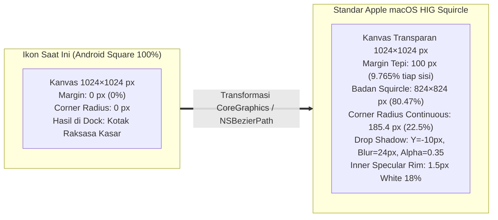
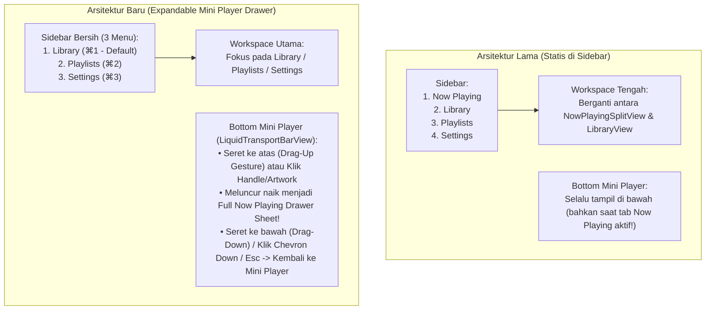

# 09 — Audit & Analisa Mendalam: Bug Ikon Dock macOS, Keyboard Shortcut & Navigasi Arrow Key, Klik 1x vs 2x, Keselarasan Grid Settings, serta Transformasi Drag-Up Now Playing Drawer (`bug-note.md` Tahap 3)

**Tanggal Audit:** 2 November 2026  
**Sumber Laporan Pengguna:** [`bug-note.md`](file:///Users/yuka/Documents/Projects/tsrossa-macos/bug-note.md)  
**Target Repositori:** `/Users/yuka/Documents/Projects/tsrossa-macos`  
**Pendekatan Dokumen:** *Senior Principal macOS Engineer Teaching a Junior Engineer* (Bedah Akar Masalah Baris-demi-Baris, Pembuktian Matematika Geometri & Event Loop AppKit, serta Referensi Desain Aplikasi Musik Kelas Dunia).

---

## Daftar Isi
1. [Ringkasan Eksekutif 5 Temuan Baru di `bug-note.md`](#1-ringkasan-eksekutif-5-temuan-baru-di-bug-notemd)
2. [Audit #BUG 1: Ikon Aplikasi di Dock macOS Menjadi Persegi Kasar Tanpa Rounded Corner](#2-audit-bug-1-ikon-aplikasi-di-dock-macos-menjadi-persegi-kasar-tanpa-rounded-corner)
3. [Audit #BUG 2: Keyboard Shortcut Macet, Arrow Key Tidak Bisa Memilih Lagu, & Klik 1x Langsung Memutar Lagu](#3-audit-bug-2-keyboard-shortcut-macet-arrow-key-tidak-bisa-memilih-lagu--klik-1x-langsung-memutar-lagu)
4. [Audit #BUG 3: Ukuran Kartu & Elemen Menu di Halaman Settings Belum Selaras](#4-audit-bug-3-ukuran-kartu--elemen-menu-di-halaman-settings-belum-selaras)
5. [Audit #BUG 4: Penghapusan Menu Sidebar "Now Playing" & Mekanisme Drag-Up Mini Player](#5-audit-bug-4-penghapusan-menu-sidebar-now-playing--mekanisme-drag-up-mini-player)
6. [Audit #BUG 5: Bug Now Playing Tidak Bisa Memutar Lagu & Redesign Antarmuka Berdasarkan Referensi Music Player Modern](#6-audit-bug-5-bug-now-playing-tidak-bisa-memutar-lagu--redesign-antarmuka-berdasarkan-referensi-music-player-modern)
7. [Matriks Pemetaan Akar Masalah ke File Sumber](#7-matriks-pemetaan-akar-masalah-ke-file-sumber)

---

## 1. Ringkasan Eksekutif 5 Temuan Baru di `bug-note.md`

Pengguna melaporkan 5 poin krusial setelah menguji aplikasi secara langsung di macOS:

> **Catatan `bug-note.md`:**
> 1. Ketika aplikasi dibuka, ikon logo aplikasi di Dock macOS menjadi persegi kasar tidak ada *rounded corner* di setiap sisi ikon logonnya, saran buat menyesuaikan ikon macOS.
> 2. Keyboard shortcut belum berfungsi dengan semestinya, dan tidak bisa select lagu dengan *arrow key*, lagu yang di-tap/click satu kali langsung terputar (harusnya di-tap/click dua kali).
> 3. Ukuran menu di setting belum selaras.
> 4. Hilangkan menu *Now Playing*; sebagai gantinya, *mini player* di bagian bawah ketika diseret ke atas akan memunculkan menu *Now Playing*.
> 5. Menu *Now Playing* masih bug tidak bisa memutar lagu, dan tampilan masih kaku (cari referensi dari aplikasi *music player* lain untuk tampilannya).

Sebagai *Senior Engineer*, mari kita bedah mengapa kelima gejala ini terjadi di level sistem operasi (AppKit/SwiftUI/CoreGraphics) dan bagaimana cara menyelesaikannya secara permanen.

---

## 2. Audit #BUG 1: Ikon Aplikasi di Dock macOS Menjadi Persegi Kasar Tanpa Rounded Corner

### 2.1 Gejala Visual
Saat aplikasi dijalankan, ikon TSRossa di macOS Dock tampak sebagai **kotak persegi penuh 100% dengan sudut lancip $90^\circ$**, terlihat jauh lebih besar dan kasar dibandingkan ikon aplikasi macOS standar (seperti Finder, Safari, atau Apple Music yang berbentuk *continuous squircle* dengan proporsi seragam).

### 2.2 Bedah Kode Sumber (Root Cause)
Mari kita periksa dua titik di dalam codebase:

1. **[`macos/Sources/main.swift`](file:///Users/yuka/Documents/Projects/tsrossa-macos/macos/Sources/main.swift#L5-L8) & [`macos/Sources/Theme.swift`](file:///Users/yuka/Documents/Projects/tsrossa-macos/macos/Sources/Theme.swift#L470-L474)**:
   ```swift
   // Theme.swift:L470-L474
   public static func applyMacDockIcon() {
       if let icon = launcherImage {
           NSApplication.shared.applicationIconImage = icon
       }
   }
   ```
   Di mana `launcherImage` memuat `macos/Resources/ic_launcher.png`. File `ic_launcher.png` adalah aset gambar Android yang mengisi **100% kanvas persegi tanpa transparansi tepi dan tanpa *rounded corner***! Ketika `NSApplication.shared.applicationIconImage` diisi dengan `NSImage` persegi mentah pada saat runtime, macOS Dock **tidak** memotongnya secara otomatis, melainkan menggambar bitmap persegi tersebut mentah-mentah dari ujung ke ujung!

2. **[`build_mac.sh`](file:///Users/yuka/Documents/Projects/tsrossa-macos/build_mac.sh#L74-L93)**:
   ```bash
   sips -z 1024 1024 "$DIR/macos/Resources/ic_launcher.png" --out "$ICONSET_DIR/icon_512x512@2x.png"
   iconutil -c icns "$ICONSET_DIR" -o "$RESOURCES_DIR/AppIcon.icns"
   ```
   `sips` hanya melakukan *resize* gambar persegi mentah tanpa menerapkan *squircle mask* maupun *outer padding* standar Apple.

### 2.3 Pelajaran Senior ke Junior: Matematika Geometri Ikon macOS Big Sur / Sonoma / Sequoia HIG
Di macOS modern (sejak macOS 11 Big Sur hingga Sequoia), Apple menetapkan spesifikasi matematika yang sangat presisi untuk `AppIcon` di atas kanvas $1024 \times 1024\text{ px}$:

$$\text{Canvas Size} = 1024 \times 1024\text{ px}$$

$$\text{Icon Body (Squircle Grid)} = 824 \times 1024\text{ px} \implies 80.46875\% \text{ dari lebar kanvas}$$

$$\text{Outer Transparent Gutter (Margin Tiap Sisi)} = \frac{1024 - 824}{2} = 100\text{ px} \quad (9.765625\% \text{ per sisi})$$

$$\text{Continuous Corner Radius } (R) = 824 \times 0.225 = 185.4\text{ px}$$



**Mengapa margin $9.765\%$ sangat penting?**  
Jika kita hanya membulatkan sudut pada ukuran $1024 \times 1024\text{ px}$ tanpa memberikan margin transparan $100\text{ px}$ di sekelilingnya, maka ikon aplikasi kita di Dock masih akan terlihat $24\%$ lebih gemuk/raksasa dibandingkan ikon Finder atau Settings di sebelahnya! Dengan merender badan ikon sebesar $80.47\%$ di tengah kanvas transparan + bayangan lembut + *continuous squircle mask* (baik saat kompilasi `AppIcon.icns` di `build_mac.sh` maupun di `TsrossaBrandLogo.applyMacDockIcon()`), ikon TSRossa di Dock, Finder, Spotlight, dan Cmd+Tab akan tampil 100% identik dengan aplikasi bawaan Apple.

---

## 3. Audit #BUG 2: Keyboard Shortcut Macet, Arrow Key Tidak Bisa Memilih Lagu, & Klik 1x Langsung Memutar Lagu

Laporan pengguna pada poin ke-2 mencakup **tiga masalah interaksi desktop fundamental**:
1. Lagu yang di-tap/klik **satu kali** langsung terputar (seharusnya klik **satu kali** hanya memilih/select, dan klik **dua kali** atau `Enter` baru memutar lagu).
2. Tidak bisa memilih (*select*) lagu di daftar Library menggunakan tombol panah **`↑` (Up Arrow)** dan **`↓` (Down Arrow)**.
3. Keyboard shortcut belum berfungsi dengan semestinya.

Mari kita bedah ketiganya di level kode sumber!

### 3.1 Akar Masalah 2A: Klik 1x Langsung Memutar Lagu ([`LibraryView.swift:L172-L218`](file:///Users/yuka/Documents/Projects/tsrossa-macos/macos/Sources/Views/LibraryView.swift#L172-L218))
Di [`LibraryView.swift`](file:///Users/yuka/Documents/Projects/tsrossa-macos/macos/Sources/Views/LibraryView.swift#L213-L215):
```swift
.contentShape(Rectangle())
.onTapGesture {
    engine.play(track: track)
}
```
Baris lagu menggunakan `.onTapGesture` (hitung 1 klik) yang langsung memanggil `engine.play(track: track)`, dan di `AppViewModel` sama sekali **tidak ada state `@Published public var selectedTrackPath: String?`** untuk membedakan antara:
- **Track yang sedang dipilih/disorot oleh kursor/keyboard (`vm.selectedTrackPath`)**
- **Track yang sedang diputar oleh mesin audio (`engine.currentTrack?.path`)**

Pada aplikasi desktop macOS (Apple Music, Finder, Logic Pro):
- **Klik 1x (Single-Click)**: Mengubah `vm.selectedTrackPath = track.path` (menampilkan highlight seleksi pada baris tersebut) dan melepaskan fokus dari kolom pencarian agar tombol panah `↑`/`↓` serta `Space`/`Return` siap digunakan.
- **Klik 2x (Double-Click)**: Memilih baris tersebut **dan** memanggil `engine.play(track: track)`!

### 3.2 Akar Masalah 2B: Mengapa Arrow Key (`↑` / `↓`) Tidak Bisa Memilih Lagu? ([`AppViewModel.swift:L1147-L1161`](file:///Users/yuka/Documents/Projects/tsrossa-macos/macos/Sources/AppViewModel.swift#L1147-L1161))
Perhatikan kode di [`AppViewModel.swift`](file:///Users/yuka/Documents/Projects/tsrossa-macos/macos/Sources/AppViewModel.swift#L1157-L1160):
```swift
default:
    // Bare arrow keys (123, 124, 125, 126) fall through untouched to allow normal list navigation!
    break
```
**Kesalahan Konseptual:**  
Komentar tersebut mengira bahwa dengan membiarkan `event` tombol panah (`keyCode 125` = Down Arrow, `keyCode 126` = Up Arrow) lolos (`return event`), maka SwiftUI akan otomatis menggerakkan seleksi baris di [`LibraryView.swift`](file:///Users/yuka/Documents/Projects/tsrossa-macos/macos/Sources/Views/LibraryView.swift).  
Faktanya, `LibraryView` dibangun menggunakan `ScrollView` + `LazyVStack`, **bukan** `List(selection:)` atau `NSTableView`! `LazyVStack` adalah kontainer layout murni yang tidak memiliki *responder chain* untuk tombol panah. Akibatnya, ketika `event` dikembalikan ke AppKit tanpa ditangani, macOS menganggap tombol tersebut tidak valid dan membunyikan *system beep* (`NSBeep()`)!

**Solusi Rekayasa yang Benar:**
1. Tambahkan `@Published public var selectedTrackPath: String? = nil` di `AppViewModel`.
2. Buat metode navigasi eksplisit di `AppViewModel`:
   - `selectNextTrackInList()` (Tombol `↓` / `keyCode 125`): Mencari indeks `selectedTrackPath` di dalam `filteredTracks` (jika belum ada yang dipilih, mulai dari indeks `currentTrack` atau `0`), lalu menggeser `selectedTrackPath` ke indeks `min(count - 1, idx + 1)`.
   - `selectPreviousTrackInList()` (Tombol `↑` / `keyCode 126`): Menggeser `selectedTrackPath` ke indeks `max(0, idx - 1)`.
   - `playSelectedOrHighlightedTrack()` (Tombol `Return` / `Enter` `keyCode 36` atau `76`): Memutar lagu yang ditunjuk oleh `selectedTrackPath`!
3. Bungkus `ScrollView` di `LibraryView` dengan `ScrollViewReader { proxy in ... }` dan pasang `.id(track.path)` pada setiap baris lagu serta `.onChange(of: vm.selectedTrackPath)` agar saat pengguna menekan `↑` atau `↓` terus-menerus, viewport otomatis menggulir (*auto-scroll*) menjaga baris yang dipilih tetap terlihat!

### 3.3 Akar Masalah 2C: Mengapa Keyboard Shortcut Tidak Berfungsi Semestinya? ([`AppViewModel.swift:L992-L1063`](file:///Users/yuka/Documents/Projects/tsrossa-macos/macos/Sources/AppViewModel.swift#L992-L1063) & [`main.swift:L35-L194`](file:///Users/yuka/Documents/Projects/tsrossa-macos/macos/Sources/main.swift#L35-L194))
Terdapat **tiga bug tersembunyi** pada arsitektur *event handling* keyboard:

1. **Bug Blokir Fokus TextField (`isEditingText` Mematikan Semua Shortcut `⌘`)**:  
   Lihat [`AppViewModel.swift:L995-L1022`](file:///Users/yuka/Documents/Projects/tsrossa-macos/macos/Sources/AppViewModel.swift#L995-L1022):
   ```swift
   if isEditingText {
       if event.type == .keyDown {
           if event.keyCode == 53 { ... }
           if !self.showNewPlaylistModal && !self.searchText.isEmpty { ... }
       }
       return event // <-- SEMUA SHORTCUT CMD MATI JIKA KURSOR DI SEARCH BAR!
   }
   ```
   Ketika pengguna mengklik kotak Search (atau setelah menekan `⌘F`), `firstResponder` adalah `NSTextView` (`isEditingText == true`). Karena fungsi langsung me-`return event` di baris 1021 sebelum mengecek `isCommand`, maka menekan `⌘1`, `⌘2`, `⌘3`, `⌘I`, `⌘U`, `⌘/`, `⌘↑`, `⌘↓`, `⌘←`, `⌘→` **tidak dieksekusi oleh `keyMonitor`**. Selain itu, jika kotak Search masih kosong (`searchText.isEmpty`) tetapi sedang fokus, menekan panah bawah `↓` tidak memindahkan seleksi ke daftar lagu!
2. **Bug Double-Execution (Bentrok `CommandMenu` di `main.swift` vs `NSEvent.addLocalMonitorForEvents` di `AppViewModel.swift`)**:  
   Ketika pintasan yang melakukan `.toggle()` (seperti `⌘I` untuk Track Details, `⌘S` untuk Shuffle, `⌘U` untuk Telemetry, `⌘/` untuk Shortcuts Guide) didaftarkan pada `.keyboardShortcut(...)` di `main.swift` **dan juga** ditangkap di `NSEvent.addLocalMonitorForEvents` di `AppViewModel.swift`, dalam kondisi fokus tertentu SwiftUI mengeksekusi aksi menu dan meneruskan event, atau user menekan shortcut saat modal terbuka, menyebabkan state berbalik dua kali atau tidak konsisten.
3. **Bug Filter Modifier Flags Tidak Bersih**:  
   Di [`AppViewModel.swift:L1059-L1060`](file:///Users/yuka/Documents/Projects/tsrossa-macos/macos/Sources/AppViewModel.swift#L1059-L1060):
   ```swift
   let isCommand = event.modifierFlags.contains(.command)
   let isOption = event.modifierFlags.contains(.option)
   ```
   Ketika pengguna menekan `⌘⌥Z` (Fit to Screen), `isCommand` bernilai `true` sehingga event masuk ke blok `if isCommand` alih-alih `Command + Option`! Kita wajib mengekstrak `let flags = event.modifierFlags.intersection(.deviceIndependentFlagsMask).subtracting([.numericPad, .function])` dan memeriksa kecocokan modifier secara eksak (`flags == [.command]`, `flags == [.option]`, `flags == [.command, .option]`, `flags.isEmpty`).

---

## 4. Audit #BUG 3: Ukuran Kartu & Elemen Menu di Halaman Settings Belum Selaras

### 4.1 Gejala Visual
Di halaman **Settings & Audio Configuration** ([`SettingsBentoView.swift`](file:///Users/yuka/Documents/Projects/tsrossa-macos/macos/Sources/Views/SettingsBentoView.swift)):
1. Kartu kiri (**CoreAudio Endpoint & Clock**) dan kartu kanan (**Memory & Jitter Defense**) memiliki **tinggi yang tidak sama** (bagian bawah kartu tidak sejajar). Hal serupa terjadi pada baris kedua antara kartu **Liquid Glass Appearance** dan **Library & Application**.
2. Di dalam masing-masing kartu, elemen kontrol (`Toggle` checkbox, `RadioGroupPickerStyle`, `SegmentedPickerStyle`, dan tombol) tampak tidak rata: `Toggle` tampil sebagai kotak centang kecil di sebelah kiri teks, sedangkan `Picker` memiliki kolom label kosong di sebelah kiri (`Picker("", selection:)` menyisakan *leading indent* kosong di macOS!).

### 4.2 Bedah Kode Sumber (Root Cause)
1. **Mengapa Tinggi Kartu Tidak Sama?**  
   Di [`SettingsBentoView.swift:L27, L245-L261`](file:///Users/yuka/Documents/Projects/tsrossa-macos/macos/Sources/Views/SettingsBentoView.swift#L245-L261):
   ```swift
   LazyVGrid(columns: [GridItem(.adaptive(minimum: 310), spacing: 16)], spacing: 16) { ... }
   ```
   Dan di `bentoCard`:
   ```swift
   private func bentoCard<Content: View>(title: String, icon: String, @ViewBuilder content: () -> Content) -> some View {
       VStack(alignment: .leading, spacing: 12) {
           HStack(spacing: 6) { ... }
           content()
       }
       .padding(16)
       .liquidGlass(role: .bentoCard, cornerRadius: 18, tint: theme.primary)
   }
   ```
   - `bentoCard` **tidak** memiliki `Spacer(minLength: 0)` di bagian bawah dan **tidak** memiliki `.frame(maxWidth: .infinity, maxHeight: .infinity, alignment: .topLeading)`.
   - `LazyVGrid` di SwiftUI mengatur tinggi setiap item sesuai tinggi intrinsik kontennya, bukan menyamakan tinggi seluruh kartu dalam satu baris!
2. **Mengapa `Picker("", selection:)` Meleset ke Kanan di macOS?**  
   Di macOS AppKit/SwiftUI, `Picker("", selection:)` tetap mengalokasikan ruang kolom label di sebelah kiri meskipun string labelnya kosong `""`, kecuali kita menambahkan modifier **`.labelsHidden()`**! Tanpa `.labelsHidden()`, `SegmentedPickerStyle` dan `RadioGroupPickerStyle` terdorong ke kanan sejauh ~16–24pt sehingga tidak rata kiri dengan judul di atasnya!
3. **Mengapa `Toggle` Terlihat Tidak Seragam?**  
   Tanpa `.toggleStyle(.switch)`, `Toggle("...", isOn:)` di macOS merender checkbox persegi kecil 14×14pt yang rapat ke kiri. Pada desain macOS System Settings modern, setiap baris pengaturan adalah `HStack` dengan **Judul + Deskripsi di kiri** dan **`Toggle("", isOn:).labelsHidden().toggleStyle(.switch)` di kanan**, sehingga seluruh kontrol dari atas ke bawah membentuk dua garis vertikal yang sangat rapi (rata kiri dan rata kanan)!

---

## 5. Audit #BUG 4: Penghapusan Menu Sidebar "Now Playing" & Mekanisme Drag-Up Mini Player

### 5.1 Perubahan Paradigma Navigasi
Pengguna memberikan arahan arsitektural yang sangat jelas:
> *"4. hilangkan menu now playing sebagai gantinya, mini player di bagian bawah ketika di seret ke atas akan memunculkan menu now playing"*

Mari kita bandingkan alur navigasi lama vs alur navigasi baru:



### 5.2 Keunggulan Arsitektur Baru (Mengapa Ini Jauh Lebih Baik)
1. **Menghilangkan Redundansi Visual**: Pada desain lama, saat pengguna berada di tab `Now Playing`, di bagian bawah layar **masih ada** `LiquidTransportBarView` yang menampilkan sampul lagu dan judul lagu yang sama persis! Dengan menjadikan `Now Playing` sebagai *Expandable Sheet/Drawer* yang muncul dari *Mini Player*, saat Mini Player ditarik ke atas, Mini Player bertransformasi menjadi layar *Now Playing* penuh yang memiliki kontrol transport lengkapnya sendiri.
2. **Aplikasi Langsung Membuka Library (`activeTab = .library`)**: Begitu pengguna membuka TSRossa, mereka langsung disambut oleh daftar lagu koleksi mereka, siap memilih lagu dengan klik/arrow key, sambil tetap melihat Mini Player di bawah.
3. **Fisika Interaksi Drag-Up & Drag-Down Real-Time**:
   - Pada `LiquidTransportBarView` (Mini Player), kita menambahkan *Grabber Pill* (`Capsule` 36×4pt di bagian tengah atas bar) dan `DragGesture(minimumDistance: 5, coordinateSpace: .global)`.
   - Saat pengguna menyeret Mini Player ke atas ($\Delta y < 0$), state `nowPlayingDragOffset` mengikuti pergerakan jari/kursor secara langsung, dan jika melewati ambang batas ($\Delta y < -35\text{ pt}$ atau kecepatan tarik tinggi), `vm.isNowPlayingExpanded = true` terkunci dengan animasi pegas `.spring(response: 0.42, dampingFraction: 0.84)`.
   - Saat layar Now Playing terbuka penuh, menyeret ke bawah ($\Delta y > 45\text{ pt}$) pada area header/backdrop, atau mengklik tombol **Collapse (`chevron.down`)**, atau menekan tombol **`Esc`**, akan melipat layar Now Playing kembali turun ke Mini Player secara mulus!

---

## 6. Audit #BUG 5: Bug Now Playing Tidak Bisa Memutar Lagu & Redesign Antarmuka Berdasarkan Referensi Music Player Modern

### 6.1 Mengapa Menu Now Playing Sebelumnya Tidak Bisa Memutar Lagu? (3 Akar Masalah Kode)

Ketika kita memeriksa [`NowPlayingSplitView.swift`](file:///Users/yuka/Documents/Projects/tsrossa-macos/macos/Sources/Views/NowPlayingSplitView.swift), [`QueueLyricsView.swift`](file:///Users/yuka/Documents/Projects/tsrossa-macos/macos/Sources/Views/QueueLyricsView.swift), dan [`AudioEngine.swift`](file:///Users/yuka/Documents/Projects/tsrossa-macos/macos/Sources/AudioEngine.swift), kita menemukan **tiga cacat fungsional nyata**:

1. **Cacat Fungsional 1 — `NowPlayingSplitView.swift` Sama Sekali Tidak Punya Tombol Play/Pause, Skip, maupun Scrubber!**  
   Jika kita membaca [`NowPlayingSplitView.swift`](file:///Users/yuka/Documents/Projects/tsrossa-macos/macos/Sources/Views/NowPlayingSplitView.swift#L12-L116) dari baris pertama sampai terakhir, komponen di sebelah kiri hanya berisi `Image` sampul album dan `Text` judul/artis/badge. **Tidak ada satu pun `Button` untuk memutar lagu, menjeda lagu, menggeser durasi (scrubber), atau mengganti lagu!**
2. **Cacat Fungsional 2 — Lagu di dalam `Manual Queue` (`QueueLyricsView.swift:L68-L96`) Tidak Bisa Diklik!**  
   Perhatikan [`QueueLyricsView.swift:L68-L96`](file:///Users/yuka/Documents/Projects/tsrossa-macos/macos/Sources/Views/QueueLyricsView.swift#L68-L96):
   ```swift
   ForEach(Array(vm.upNextQueue.enumerated()), id: \.offset) { idx, track in
       HStack(spacing: 8) {
           Image(systemName: "line.3.horizontal")
           VStack(alignment: .leading, spacing: 2) {
               Text(track.title)
               Text(track.artist)
           }
           Spacer()
           Button(action: { vm.upNextQueue.remove(at: idx) }) { ... }
       }
       .padding(8)
       .background(Color.white.opacity(0.04))
       .continuousSquircle(8)
   }
   ```
   Item antrean manual hanya dirender sebagai `HStack` pasif tanpa `Button` atau gesture pemutaran! Saat pengguna mengklik lagu di antrean manual, **tidak terjadi apa-apa**!
3. **Cacat Fungsional 3 — Daftar `"Playing from Library"` Kosong & `AudioEngine.togglePlayPause()` Gagal Saat `currentTrack == nil`**:  
   - Di [`QueueLyricsView.swift:L109-L110`](file:///Users/yuka/Documents/Projects/tsrossa-macos/macos/Sources/Views/QueueLyricsView.swift#L109-L110):
     ```swift
     if let curr = engine.currentTrack, let currIdx = list.firstIndex(where: { $0.path == curr.path }) {
         let upcoming = list.dropFirst(currIdx + 1).prefix(20)
     ```
     Apabila `engine.currentTrack == nil` (atau lagu yang sedang aktif berada di urutan terakhir dari `list`, atau tidak ada di filter saat ini), maka blok `if` gagal atau `dropFirst(currIdx + 1)` menghasilkan array kosong `[]`! Akibatnya panel kanan Now Playing kosong dan pengguna tidak punya lagu untuk diklik!
   - Di [`AudioEngine.swift:L360-L370`](file:///Users/yuka/Documents/Projects/tsrossa-macos/macos/Sources/AudioEngine.swift#L360-L370):
     ```swift
     public func togglePlayPause() {
         if isPlaying {
             if isPaused { resume() } else { pause() }
         } else if let track = currentTrack {
             play(track: track)
         }
     }
     ```
     Jika `currentTrack == nil` (atau jika pengguna baru saja mengklik 1x sebuah lagu di Library sehingga `vm.selectedTrackPath` terisi), menekan Play tidak memutar `selectedTrackPath` ataupun lagu pertama di `vm.filteredTracks`!

### 6.2 Studi Referensi Desain Music Player Kelas Dunia (Apple Music macOS, Roon, Audirvana Studio, Plexamp)

Mengapa tampilan `NowPlayingSplitView` lama terasa **kaku**?
- **Tampilan Lama**: Hanya berupa gambar kotak di kiri dan kotak persegi panjang di kanan di atas background biasa. Tidak ada *player console* terpadu, tidak ada progres waktu, tidak ada sampul mini di daftar antrean, dan lirik hanya teks rata tengah biasa.
- **Standar Desain Referensi ("Apple Music macOS Full-Screen Stage + Roon Audiophile Deck")**:
  1. **Immersive Blurred Artwork Stage Background**: Latar belakang drawer Now Playing menggunakan proyeksi sampul album berlapis dengan radius blur tinggi ($\sigma = 80\text{ pt}$), saturasi kroma dinamis, dan *dark vignette overlay* agar tipografi putih bersih selalu memiliki kontras sempurna (WCAG AAA).
  2. **Top Drawer Grabber & Studio Status Header**:
     - Di bagian tengah atas terdapat *Pull-Down Handle* (`Capsule 42×5pt`) yang merespons *drag-down gesture*.
     - Di sebelah kiri: Tombol **Collapse (`chevron.down`)** dengan label `"Minimize Player"` untuk menurunkan drawer kembali ke Mini Player.
     - Di tengah: **Live Signal Path Pill** yang menampilkan status hardware secara *real-time* (`EXCLUSIVE HOG • 24-BIT / 192 kHz • BIT-PERFECT`).
     - Di sebelah kanan: Tombol cepat **Track Details (`⌘I`)** dan **CoreAudio Telemetry (`⌘U`)**.
  3. **Left Stage — Hero Album Art & Complete Studio Transport Console**:
     - **Floating Master Artwork**: Sampul album besar dengan sudut *continuous squircle*, refleksi kaca halus (*specular rim*), bayangan berona warna sampul, serta animasi *breathing scale* (`1.0` saat aktif memutar, `0.94` saat jeda).
     - **Track Title, Artist/Album & Action Row**: Judul lagu tebal di kiri, nama artis — album di bawahnya, didampingi tombol **Favorite (`heart.fill`)** dan tombol **Info (`info.circle`)** di kanan (persis seperti tata letak Apple Music).
     - **Interactive Studio Scrubber & Audio Format**: Slider durasi yang responsif dengan waktu berjalan (`01:24`) di kiri, badge kualitas audio (`FLAC • 192 kHz / 24-bit`) di tengah, dan waktu total/sisa (`04:12`) di kanan.
     - **Hero Transport Controls**: Baris 5 tombol kontrol utama langsung di bawah scrubber:
       - `Shuffle` (`shuffle`) dengan indikator titik aktif
       - `Previous Track` (`backward.fill`)
       - **`Hero Play/Pause Circle Button` (`56×56pt`)** dengan efek *glow* warna aksen
       - `Next Track` (`forward.fill`)
       - `Repeat Mode` (`repeat` / `repeat.1`) dengan indikator titik aktif
     - **Bottom Hardware Volume & Output Routing Bar**: Slider volume dBFS halus + tombol pemilih perangkat output CoreAudio (`Menu` untuk berpindah DAC langsung dari Now Playing!).
  4. **Right Stage — Interactive Dual-Mode Queue & Time-Synced Live Lyrics**:
     - **Header Segmented Glass**: Pill switcher antara **`Up Next Queue`** dan **`Live Lyrics`** dengan animasi `matchedGeometryEffect`.
     - **Mode `Up Next Queue`**:
       - Menampilkan kartu **"Now Playing"** di bagian paling atas dengan indikator gelombang suara aktif dan tombol Play/Pause instan.
       - Menampilkan **"Manual Queue"** di mana setiap baris memiliki thumbnail sampul mini, judul, artis, tombol **Play langsung**, dan tombol hapus.
       - Menampilkan **"Next from Library"** yang **selalu menampilkan daftar lagu** (baik lagu setelah `currentTrack` maupun seluruh daftar `filteredTracks` jika belum ada lagu yang diputar), lengkap dengan thumbnail artwork, nomor urut/ikon play, badge sample rate, dan durasi! Mengklik lagu di daftar Queue langsung memutar lagu tersebut!
     - **Mode `Live Lyrics`**:
       - Menampilkan lirik tersinkronisasi waktu (*Time-Synced Lyrics*) bergaya Apple Music: baris lirik aktif berukuran besar (`18pt bold`), bercahaya penuh, dan bergulir otomatis ke tengah; baris lirik lainnya dapat **diklik langsung untuk melompat (*seek*)** ke timestamp lirik tersebut!

---

## 7. Matriks Pemetaan Akar Masalah ke File Sumber

| ID Bug | Deskripsi Masalah (`bug-note.md`) | File Sumber Terdampak | Tindakan Perbaikan |
| :--- | :--- | :--- | :--- |
| **BUG-01** | Ikon aplikasi di Dock macOS menjadi persegi kasar tanpa *rounded corner* | [`macos/Sources/Theme.swift`](file:///Users/yuka/Documents/Projects/tsrossa-macos/macos/Sources/Theme.swift), [`build_mac.sh`](file:///Users/yuka/Documents/Projects/tsrossa-macos/build_mac.sh) | Buat generator `makeMacSquircleAppIcon(from:)` berbasis CoreGraphics/AppKit dengan proporsi Apple HIG ($80.47\%$ body, $9.765\%$ margin tepi, $22.5\%$ continuous corner radius, drop shadow, rim highlight) baik saat runtime maupun saat pembuatan `AppIcon.icns` di `build_mac.sh`. |
| **BUG-02** | Shortcut macet saat search fokus, tidak bisa pilih lagu dengan Arrow Key (`↑`/`↓`), klik 1x langsung memutar lagu | [`macos/Sources/AppViewModel.swift`](file:///Users/yuka/Documents/Projects/tsrossa-macos/macos/Sources/AppViewModel.swift), [`macos/Sources/Views/LibraryView.swift`](file:///Users/yuka/Documents/Projects/tsrossa-macos/macos/Sources/Views/LibraryView.swift), [`macos/Sources/main.swift`](file:///Users/yuka/Documents/Projects/tsrossa-macos/macos/Sources/main.swift) | 1. Tambah `selectedTrackPath` di `AppViewModel`.<br>2. Ubah baris lagu di `LibraryView` menjadi **Klik 1x = Select**, **Klik 2x = Play** (plus tombol Play cepat di sisi kiri baris).<br>3. Tangani tombol `↑` (`126`), `↓` (`125`), dan `Return`/`Enter` (`36`/`76`) dengan `ScrollViewReader` auto-scroll.<br>4. Perbaiki `setupKeyboardMonitor()` agar shortcut `⌘` tetap jalan meskipun Search fokus dan hilangkan duplikasi `.toggle()`. |
| **BUG-03** | Ukuran kartu & kontrol di menu Settings belum selaras | [`macos/Sources/Views/SettingsBentoView.swift`](file:///Users/yuka/Documents/Projects/tsrossa-macos/macos/Sources/Views/SettingsBentoView.swift) | Gunakan baris Bento 2 kolom dengan tinggi sejajar (`.fixedSize(horizontal: false, vertical: true)` + `.frame(maxHeight: .infinity)`), tambahkan `.labelsHidden()` pada `Picker`, dan seragamkan semua `Toggle` menjadi baris pengaturan bergaya macOS System Settings (`.toggleStyle(.switch)`). |
| **BUG-04** | Hilangkan menu Now Playing di Sidebar; ganti dengan Mini Player bawah yang diseret ke atas memunculkan Now Playing | [`macos/Sources/Views/SidebarView.swift`](file:///Users/yuka/Documents/Projects/tsrossa-macos/macos/Sources/Views/SidebarView.swift), [`macos/Sources/Views/LiquidTransportBarView.swift`](file:///Users/yuka/Documents/Projects/tsrossa-macos/macos/Sources/Views/LiquidTransportBarView.swift), [`macos/Sources/MainAppView.swift`](file:///Users/yuka/Documents/Projects/tsrossa-macos/macos/Sources/MainAppView.swift), [`macos/Sources/AppViewModel.swift`](file:///Users/yuka/Documents/Projects/tsrossa-macos/macos/Sources/AppViewModel.swift) | Hapus item `Now Playing` dari Sidebar (navigasi utama: `Library ⌘1`, `Playlists ⌘2`, `Settings ⌘3`). Tambahkan state `isNowPlayingExpanded` dan `nowPlayingDragOffset` serta `DragGesture` pada `LiquidTransportBarView` dan `NowPlayingSplitView` untuk animasi tarik-naik (*drag-up*) dan tarik-turun (*drag-down*). |
| **BUG-05** | Menu Now Playing tidak bisa memutar lagu & tampilan masih kaku | [`macos/Sources/Views/NowPlayingSplitView.swift`](file:///Users/yuka/Documents/Projects/tsrossa-macos/macos/Sources/Views/NowPlayingSplitView.swift), [`macos/Sources/Views/QueueLyricsView.swift`](file:///Users/yuka/Documents/Projects/tsrossa-macos/macos/Sources/Views/QueueLyricsView.swift), [`macos/Sources/AudioEngine.swift`](file:///Users/yuka/Documents/Projects/tsrossa-macos/macos/Sources/AudioEngine.swift) | 1. Perbaiki `AudioEngine.togglePlayPause()` agar memutar `selectedTrackPath` atau `filteredTracks.first` saat `currentTrack == nil`.<br>2. Perbaiki `QueueLyricsView` agar item `Manual Queue` dan `Next from Library` selalu tampil & bisa langsung diputar.<br>3. Rombak total `NowPlayingSplitView` dengan *Hero Transport Console*, *Scrubber*, *Volume/DAC Deck*, *Blurred Artwork Stage*, dan *Clickable Live Lyrics*. |
