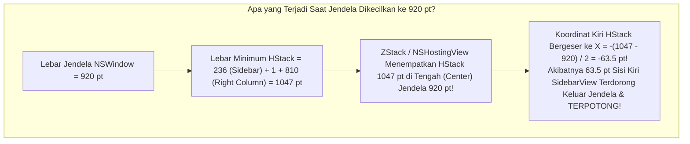
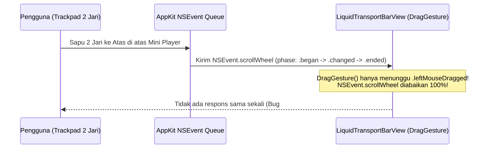

# 10 — Audit & Analisa Mendalam: Bug Sidebar Kiri Terpotong Saat Jendela Dikecilkan, Gestur Trackpad Dua Jari pada Mini Player, & Fisika Animasi Buka/Tutup Now Playing (`bug-note.md` Tahap 4)

**Tanggal Audit:** 2 November 2026  
**Sumber Laporan Pengguna:** [`bug-note.md`](file:///Users/yuka/Documents/Projects/tsrossa-macos/bug-note.md)  
**Target Repositori:** `/Users/yuka/Documents/Projects/tsrossa-macos`  
**Pendekatan Dokumen:** *Senior Principal macOS Engineer Mentoring a Junior Engineer* (Bedah Akar Masalah Baris-demi-Baris, Pembuktian Matematika Layout SwiftUI, Arsitektur Event Trackpad AppKit `NSEvent`, serta Fisika Animasi Kontinu).

---

## Daftar Isi
1. [Ringkasan Eksekutif 3 Temuan Baru di `bug-note.md`](#1-ringkasan-eksekutif-3-temuan-baru-di-bug-notemd)
2. [Audit #BUG 1: Bar Kiri (`SidebarView`) Terpotong Ketika Ukuran Aplikasi Dikecilkan](#2-audit-bug-1-bar-kiri-sidebarview-terpotong-ketika-ukuran-aplikasi-dikecilkan)
3. [Audit #BUG 2: Mini Player Tidak Bisa Di-Drag dengan Gestur Dua Jari Trackpad](#3-audit-bug-2-mini-player-tidak-bisa-di-drag-dengan-gestur-dua-jari-trackpad)
4. [Audit #BUG 3: Animasi Muncul & Tutup Menu Now Playing Belum Ada / Patah](#4-audit-bug-3-animasi-muncul--tutup-menu-now-playing-belum-ada--patah)
5. [Matriks Pemetaan Akar Masalah ke File Sumber](#5-matriks-pemetaan-akar-masalah-ke-file-sumber)

---

## 1. Ringkasan Eksekutif 3 Temuan Baru di `bug-note.md`

Setelah pengujian langsung di perangkat macOS, pengguna mencatat 3 bug spesifik pada [`bug-note.md`](file:///Users/yuka/Documents/Projects/tsrossa-macos/bug-note.md):

> **Catatan `bug-note.md`:**
> 1. Ketika ukuran aplikasi dikecilkan, bar kiri yang menampung menu playlist dll terpotong.
> 2. Menu mini player tidak bisa di-drag dengan gestur dua jari untuk memunculkan dan menutup menu now playing.
> 3. Animasi ketika memunculkan menu now playing belum ada begitu juga ketika close menu now playing (drag ke atas dan drag ke bawah ketika ingin memunculkan dan close menu now playing dari mini player).

Sebagai *Senior Engineer*, mari kita bedah satu per satu bersama *Junior Engineer* mengapa ketiga masalah ini terjadi secara matematis dan mekanis di dalam mesin SwiftUI & AppKit macOS.

---

## 2. Audit #BUG 1: Bar Kiri (`SidebarView`) Terpotong Ketika Ukuran Aplikasi Dikecilkan

### 2.1 Gejala yang Dialami Pengguna
Saat pengguna mengecilkan ukuran jendela aplikasi (baik menyempitkan lebar jendela mendekati ukuran minimum maupun memendekkan tinggi jendela), panel navigasi sebelah kiri ([`SidebarView.swift`](file:///Users/yuka/Documents/Projects/tsrossa-macos/macos/Sources/Views/SidebarView.swift)) yang berisi logo TSRossa, menu *Music Library*, *Playlists*, daftar playlist, serta tombol bawah ikut **terpotong (*clipped*) di sisi kiri jendela** atau **terjepit secara vertikal**.

### 2.2 Pembuktian Matematika Layout (Mengapa Sisi Kiri Terpotong di SwiftUI?)
Mari kita hitung secara eksak lebar minimum (*intrinsic minimum width*) yang diminta oleh komponen-komponen di dalam `HStack` utama pada [`MainAppView.swift:L50-L80`](file:///Users/yuka/Documents/Projects/tsrossa-macos/macos/Sources/MainAppView.swift#L50-L80):

```swift
// MainAppView.swift:L50-L80
HStack(spacing: 0) {
    SidebarView(theme: theme)
        .frame(width: 236)
    Rectangle()
        .frame(width: 1)
    VStack(spacing: 0) {
        FloatingTopToolbarView(theme: theme)
            .padding(.horizontal, 18)
        workspaceContent(theme: theme)
        LiquidTransportBarView(theme: theme)
            .padding(.horizontal, 18)
    }
    .frame(maxWidth: .infinity, maxHeight: .infinity)
}
```

Sekarang periksa berapa lebar minimum kaku (`minWidth`) yang dipaksakan oleh [`LiquidTransportBarView.swift`](file:///Users/yuka/Documents/Projects/tsrossa-macos/macos/Sources/Views/LiquidTransportBarView.swift) di dalam `VStack` sebelah kanan:
1. **Blok Kiri (Artwork & Judul Lagu)** — [Baris 69](file:///Users/yuka/Documents/Projects/tsrossa-macos/macos/Sources/Views/LiquidTransportBarView.swift#L69):
   `.frame(minWidth: 190, idealWidth: 220, maxWidth: 260, alignment: .leading)` $\implies \mathbf{190\text{ pt}}$
2. **Spacer Kiri + Spacing `HStack(spacing: 12)`** — [Baris 13 & 71](file:///Users/yuka/Documents/Projects/tsrossa-macos/macos/Sources/Views/LiquidTransportBarView.swift#L71):
   $12 + 8 + 12 = \mathbf{32\text{ pt}}$
3. **Blok Tengah (Transport Controls & Scrubber)** — [Baris 165](file:///Users/yuka/Documents/Projects/tsrossa-macos/macos/Sources/Views/LiquidTransportBarView.swift#L165):
   `.frame(minWidth: 240, maxWidth: 440)` $\implies \mathbf{240\text{ pt}}$
4. **Spacer Kanan + Spacing `HStack(spacing: 12)`** — [Baris 13 & 167](file:///Users/yuka/Documents/Projects/tsrossa-macos/macos/Sources/Views/LiquidTransportBarView.swift#L167):
   $12 + 8 + 12 = \mathbf{32\text{ pt}}$
5. **Blok Kanan (Badge Audio + Volume Slider + Chevron)** — [Baris 236](file:///Users/yuka/Documents/Projects/tsrossa-macos/macos/Sources/Views/LiquidTransportBarView.swift#L236):
   `.frame(minWidth: 240, idealWidth: 290, maxWidth: 320, alignment: .trailing)` $\implies \mathbf{240\text{ pt}}$
6. **Padding Horizontal Internal `LiquidTransportBarView`** — [Baris 238](file:///Users/yuka/Documents/Projects/tsrossa-macos/macos/Sources/Views/LiquidTransportBarView.swift#L238):
   `.padding(.horizontal, 20)` $\implies \mathbf{40\text{ pt}}$
7. **Padding Horizontal Eksternal di `MainAppView`** — [Baris 74](file:///Users/yuka/Documents/Projects/tsrossa-macos/macos/Sources/MainAppView.swift#L74):
   `.padding(.horizontal, 18)` $\implies \mathbf{36\text{ pt}}$

Mari kita jumlahkan lebar minimum absolut yang diminta oleh kolom kanan (`VStack`):
$$W_{\text{kanan, min}} = 190 + 32 + 240 + 32 + 240 + 40 + 36 = \mathbf{810\text{ pt}}$$
Dan jika ditambah dengan `SidebarView` ($236\text{ pt}$) + `Divider` ($1\text{ pt}$):
$$W_{\text{total HStack, min}} = 236 + 1 + 810 = \mathbf{1047\text{ pt}} \quad (\text{dan pada idealWidth mencapai } \mathbf{1327\text{ pt}}!)$$

Padahal, di [`LiquidGlassComponents.swift:L264`](file:///Users/yuka/Documents/Projects/tsrossa-macos/macos/Sources/LiquidGlassComponents.swift#L264) dan [`MainAppView.swift:L163`](file:///Users/yuka/Documents/Projects/tsrossa-macos/macos/Sources/MainAppView.swift#L163), batas ukuran minimum jendela diizinkan mengecil hingga:
$$W_{\text{window, min}} = \mathbf{920\text{ pt}}$$



> [!IMPORTANT]
> **Pelajaran Senior ke Junior (The SwiftUI Overflow Centering Trap):**  
> Di SwiftUI, apabila sebuah `HStack` memiliki anak-anak yang total `minWidth`-nya ($1047\text{ pt}$) melebihi lebar jendela yang tersedia ($920\text{ pt}$), `HStack` **tidak akan** mengecilkan anak-anak tersebut di bawah `minWidth`. Sebaliknya, `HStack` tetap berukuran $1047\text{ pt}$, dan karena wadah induknya (`ZStack` / `.frame(maxWidth: .infinity)`) memiliki perataan default `.center`, SwiftUI meletakkan `HStack` $1047\text{ pt}$ tersebut tepat di tengah jendela $920\text{ pt}$. Akibatnya, sisi paling kiri (`SidebarView`) terdorong ke koordinat negatif ($X = -63.5\text{ pt}$) dan **terpotong oleh tepi kiri jendela macOS**!

### 2.3 Masalah Kedua pada `SidebarView.swift`: Kompresi Vertikal & Ketidakhadiran `layoutPriority`
Selain terpotong secara horizontal, mari lihat [`SidebarView.swift:L13-L157`](file:///Users/yuka/Documents/Projects/tsrossa-macos/macos/Sources/Views/SidebarView.swift#L13-L157):
1. Pada baris 64–98, terdapat `ScrollView` untuk daftar Playlist, lalu diikuti oleh `Spacer()` pada baris 98. Padahal `ScrollView` sudah mengambil ruang vertikal yang tersisa. Ketika tinggi jendela dikecilkan ke $620\text{ pt}$, ketiadaan `.fixedSize(horizontal: false, vertical: true)` pada seksi *Brand Header*, *Primary Navigation*, dan *Footer Quick Actions* membuat tata letak vertikal di dalam sidebar rawan tertekan.
2. Lebar `SidebarView` dipatok mati `.frame(width: 236)` tanpa kemampuan beradaptasi (misalnya menyusut secara proporsional ke $200\text{–}236\text{ pt}$ saat jendela diperkecil) dan tidak diberi `.layoutPriority(1)` terhadap kolom kanan.
3. Di [`SettingsBentoView.swift`](file:///Users/yuka/Documents/Projects/tsrossa-macos/macos/Sources/Views/SettingsBentoView.swift#L36), `Slider` memiliki `.frame(width: 110)` dan picker memiliki lebar tetap yang jika dikombinasikan dalam 2 kolom bento pada jendela sempit juga menahan penyusutan kolom kanan.

---

## 3. Audit #BUG 2: Mini Player Tidak Bisa Di-Drag dengan Gestur Dua Jari Trackpad

### 3.1 Gejala yang Dialami Pengguna
Pengguna mencoba membuka menu *Now Playing* dengan meletakkan **dua jari pada Trackpad** di atas bar Mini Player lalu menggesernya ke atas (*two-finger drag/swipe up*), serta mencoba menutup *Now Playing* dengan menggeser **dua jari ke bawah** (*two-finger drag/swipe down*), namun **Mini Player sama sekali tidak merespons**.

### 3.2 Pelajaran Senior ke Junior: Mengapa `DragGesture()` di SwiftUI TIDAK Menangkap Gestur Dua Jari Trackpad macOS?
Ini adalah perbedaan arsitektur input paling fundamental antara iOS dan macOS (AppKit):

| Jenis Input Pengguna di MacBook | Event AppKit (`NSEvent.EventType`) yang Dihasilkan | Apakah Ditangkap oleh SwiftUI `DragGesture()`? |
| :--- | :--- | :--- |
| **Klik 1 Jari Tahan + Geser** (*Click & Drag*) | `.leftMouseDown` $\to$ `.leftMouseDragged` $\to$ `.leftMouseUp` | **YA** |
| **Geser 2 Jari di Trackpad** (*Two-Finger Drag / Swipe / Pan*) | `.scrollWheel` (`hasPreciseScrollingDeltas == true`, `phase: .began / .changed / .ended`, `scrollingDeltaY`) | **TIDAK SAMA SEKALI!** |

Lihat kode kita saat ini di [`LiquidTransportBarView.swift:L241-L257`](file:///Users/yuka/Documents/Projects/tsrossa-macos/macos/Sources/Views/LiquidTransportBarView.swift#L241-L257) dan [`NowPlayingSplitView.swift:L148-L163`](file:///Users/yuka/Documents/Projects/tsrossa-macos/macos/Sources/Views/NowPlayingSplitView.swift#L148-L163):
```swift
// LiquidTransportBarView.swift:L241-L242
.simultaneousGesture(
    DragGesture(minimumDistance: 8, coordinateSpace: .global)
        .onChanged { val in ... }
```
Ketika pengguna menggeser **dua jari** ke atas di atas Mini Player pada Trackpad MacBook:
1. Sistem operasi macOS mengirimkan rentetan `NSEvent` bertipe **`.scrollWheel`** dengan `event.hasPreciseScrollingDeltas = true` dan `event.scrollingDeltaY` (bernilai negatif/positif sesuai arah sapuan jari dan pengaturan *Natural Scrolling*).
2. SwiftUI `DragGesture` **sama sekali buta** terhadap event `.scrollWheel` karena `DragGesture` hanya mendengarkan tombol mouse kiri yang ditekan tahan (`leftMouseDragged`)!
3. Lebih buruk lagi, bahkan untuk *Click & Drag* 1 jari sekalipun, hampir seluruh permukaan [`LiquidTransportBarView.swift`](file:///Users/yuka/Documents/Projects/tsrossa-macos/macos/Sources/Views/LiquidTransportBarView.swift#L15-L68) ditutupi oleh `Button` (area sampul & judul lagu di kiri adalah `Button`, tombol play/pause/skip di tengah adalah `Button`, scrubber adalah `PlaybackScrubberView` yang punya `DragGesture` sendiri, dan sisi kanan adalah `Slider` + `Button`). Di macOS, `NSButton` / SwiftUI `Button` menyerap klik mouse sehingga `DragGesture` pada container luar sering terblokir!



---

## 4. Audit #BUG 3: Animasi Muncul & Tutup Menu Now Playing Belum Ada / Patah

### 4.1 Gejala yang Dialami Pengguna
1. Saat memunculkan menu *Now Playing* (baik lewat klik maupun drag ke atas dari Mini Player), **animasi meluncur dari bawah ke atas tidak terlihat** (tampilan langsung muncul tiba-tiba / *instant jump*).
2. Saat menutup menu *Now Playing* (baik lewat klik tombol *Hide* maupun drag ke bawah), **animasi meluncur turun ke Mini Player tidak ada / langsung lenyap**.

### 4.2 Bedah Baris-demi-Baris: 4 Cacat Fatal yang Mematikan Animasi Now Playing
Mari kita periksa [`MainAppView.swift:L82-L96`](file:///Users/yuka/Documents/Projects/tsrossa-macos/macos/Sources/MainAppView.swift#L82-L96), [`LiquidTransportBarView.swift:L241-L257`](file:///Users/yuka/Documents/Projects/tsrossa-macos/macos/Sources/Views/LiquidTransportBarView.swift#L241-L257), dan [`NowPlayingSplitView.swift:L148-L163`](file:///Users/yuka/Documents/Projects/tsrossa-macos/macos/Sources/Views/NowPlayingSplitView.swift#L148-L163):

```swift
// MainAppView.swift:L82-L96
// Layer 1.5: Expandable Now Playing Stage Drawer
if vm.isNowPlayingExpanded || vm.nowPlayingDragOffset < 0 {
    Color.black.opacity(0.55)
        .ignoresSafeArea()
        .onTapGesture {
            withAnimation(.spring(response: 0.38, dampingFraction: 0.85)) {
                vm.isNowPlayingExpanded = false
            }
        }

    NowPlayingSplitView(theme: theme)
        .offset(y: max(0, vm.nowPlayingDragOffset))
        .transition(.move(edge: .bottom).combined(with: .opacity))
        .zIndex(15)
}
```

Perhatikan **4 kesalahan fatal** pada potongan kode di atas:

#### Cacat Fatal 3A: Rumus `.offset(y: max(0, vm.nowPlayingDragOffset))` Membunuh Drag-Up!
- Ketika `isNowPlayingExpanded == false` dan pengguna menyeret Mini Player ke **atas**, nilai pergeseran `vm.nowPlayingDragOffset` adalah **negatif** (contoh: `-15`, `-60`, `-180`).
- Sekarang masukkan nilai `-60` ke dalam rumus di baris 93:
  $$\text{offset}(y) = \max(0, -60) = \mathbf{0}!$$
- Karena $\max(0, \text{angka negatif})$ **selalu menghasilkan $0$**, maka begitu pengguna menyeret ke atas sejauh `-8 pt` saja:
  1. Kondisi `if vm.nowPlayingDragOffset < 0` menjadi `true`.
  2. `NowPlayingSplitView` langsung dipasang pada posisi **`offset(y: 0)` (terbuka penuh 100% di atas layar)**, bukan bergerak naik dari bawah layar (`windowHeight + dragOffset`)!
  3. Saat pengguna melepas jari (`onEnded`), `vm.isNowPlayingExpanded` disetel ke `true`, tetapi karena `NowPlayingSplitView` sudah berada di `offset(y: 0)`, **tidak ada gerakan animasi sama sekali!**

#### Cacat Fatal 3B: Tabrakan State Saat Menutup (`nowPlayingDragOffset = 0` vs `isNowPlayingExpanded = false`)
Lihat kode penutupan di [`NowPlayingSplitView.swift:L155-L161`](file:///Users/yuka/Documents/Projects/tsrossa-macos/macos/Sources/Views/NowPlayingSplitView.swift#L155-L161):
```swift
let shouldClose = val.translation.height > 40 || val.predictedEndTranslation.height > 80
withAnimation(.spring(response: 0.42, dampingFraction: 0.84)) {
    vm.nowPlayingDragOffset = 0
    if shouldClose {
        vm.isNowPlayingExpanded = false
    }
}
```
- Bayangkan pengguna sudah menyeret `NowPlayingSplitView` turun ke bawah sejauh `+200 pt` (`nowPlayingDragOffset = 200`).
- Begitu pengguna melepas jari untuk menutup (`shouldClose == true`), kode menyetel `vm.nowPlayingDragOffset = 0` (yang menarik view kembali ke atas ke $Y=0$!) pada saat yang bersamaan dengan menyetel `vm.isNowPlayingExpanded = false` (yang mencabut `NowPlayingSplitView` dari hierarki `if` di `ZStack`)!
- Akibatnya, SwiftUI gagal menjalankan transisi keluar dan view langsung lenyap seketika (*instant disappear*)!

#### Cacat Fatal 3C: `DragGesture(coordinateSpace: .global)` pada View yang Sedang Bergerak (`.offset`)
- Di [`NowPlayingSplitView.swift:L149`](file:///Users/yuka/Documents/Projects/tsrossa-macos/macos/Sources/Views/NowPlayingSplitView.swift#L149), `DragGesture` dipasang di dalam `NowPlayingSplitView`, sedangkan `NowPlayingSplitView` itu sendiri digeser dengan `.offset(y: ...)`.
- Di macOS AppKit/SwiftUI, ketika sebuah view bergerak di bawah kursor akibat `.offset`, perhitungan delta lokal/global berosilasi (*jitter*) kecuali dihitung terhadap sistem koordinat statis induk atau menggunakan monitor event AppKit yang stabil.

#### Cacat Fatal 3D: Ketidakhadiran *Persistent Geometry-Driven Drawer* (Mengandalkan `if` Kondisional)
- Di SwiftUI macOS, membungkus drawer besar berisi gambar resolusi tinggi (`blur(radius: 80)`) dan `ScrollView` di dalam blok kondisional `if vm.isNowPlayingExpanded` menyebabkan:
  1. Saat dibuka, SwiftUI harus membangun seluruh pohon view dari nol di tengah frame pertama animasi, sehingga frame awal melompat.
  2. Saat ditutup, pencabutan view dari `ZStack` sering memutus interpolasi spring sebelum mencapai tepi bawah layar.
- **Standar Industri (Apple Music / Roon / Spotify Architecture)**:
  Drawer *Now Playing* harus dirender di dalam `GeometryReader` menggunakan **interpolasi posisi vertikal kontinu ($Y$)**:
  - Ketika tertutup (`isNowPlayingExpanded == false` dan tidak di-drag): Drawer diposisikan di $Y = H_{\text{container}} + 40\text{ pt}$ (tersembunyi tepat di bawah layar dengan `.allowsHitTesting(false)` dan `opacity(0)`).
  - Ketika di-drag naik dari Mini Player: $Y$ bergerak mulus dari $H_{\text{container}}$ menuju $0$ mengikuti pergeseran jari secara *real-time* 1:1!
  - Ketika dilepas untuk membuka: `withAnimation(.spring(response: 0.44, dampingFraction: 0.86))` menggerakkan $Y \to 0$ secara mulus!
  - Ketika di-drag turun atau tombol *Hide* diklik: `withAnimation(.spring(response: 0.44, dampingFraction: 0.86))` menggerakkan $Y \to H_{\text{container}} + 40\text{ pt}$ hingga benar-benar turun kembali ke dalam Mini Player!

---

## 5. Matriks Pemetaan Akar Masalah ke File Sumber

| ID Bug | Deskripsi Masalah (`bug-note.md`) | File Sumber Terdampak | Akar Masalah Teknis |
| :--- | :--- | :--- | :--- |
| **BUG-01** |Ketika ukuran aplikasi dikecilkan, bar kiri (`SidebarView`) yang menampung menu playlist dll terpotong | [`MainAppView.swift`](file:///Users/yuka/Documents/Projects/tsrossa-macos/macos/Sources/MainAppView.swift)<br>[`LiquidTransportBarView.swift`](file:///Users/yuka/Documents/Projects/tsrossa-macos/macos/Sources/Views/LiquidTransportBarView.swift)<br>[`SidebarView.swift`](file:///Users/yuka/Documents/Projects/tsrossa-macos/macos/Sources/Views/SidebarView.swift)<br>[`LiquidGlassComponents.swift`](file:///Users/yuka/Documents/Projects/tsrossa-macos/macos/Sources/LiquidGlassComponents.swift) | Total `minWidth` anak-anak `HStack` ($236 + 1 + 810 = 1047\text{ pt}$) melebihi `minSize` jendela ($920\text{ pt}$). Saat jendela dikecilkan ke $920\text{ pt}$, `ZStack` memusatkan `HStack` $1047\text{ pt}$ sehingga sisi kiri `SidebarView` terdorong ke $X = -63.5\text{ pt}$ (terpotong di luar kiri layar). Selain itu `SidebarView` memiliki `Spacer()` ganda di bawah `ScrollView`. |
| **BUG-02** | Menu Mini Player tidak bisa di-drag dengan gestur dua jari untuk memunculkan dan menutup menu Now Playing | [`LiquidGlassComponents.swift`](file:///Users/yuka/Documents/Projects/tsrossa-macos/macos/Sources/LiquidGlassComponents.swift)<br>[`LiquidTransportBarView.swift`](file:///Users/yuka/Documents/Projects/tsrossa-macos/macos/Sources/Views/LiquidTransportBarView.swift)<br>[`NowPlayingSplitView.swift`](file:///Users/yuka/Documents/Projects/tsrossa-macos/macos/Sources/Views/NowPlayingSplitView.swift)<br>[`AppViewModel.swift`](file:///Users/yuka/Documents/Projects/tsrossa-macos/macos/Sources/AppViewModel.swift) | Gestur 2 jari di Trackpad macOS menghasilkan `NSEvent.EventType.scrollWheel` (`hasPreciseScrollingDeltas`), bukan `leftMouseDragged`. SwiftUI `DragGesture()` sama sekali tidak menangkap event 2 jari Trackpad, dan tombol-tombol di dalam Mini Player memblokir area drag. |
| **BUG-03** | Animasi ketika memunculkan maupun menutup menu Now Playing belum ada (baik lewat klik maupun drag ke atas / ke bawah dari Mini Player) | [`MainAppView.swift`](file:///Users/yuka/Documents/Projects/tsrossa-macos/macos/Sources/MainAppView.swift)<br>[`AppViewModel.swift`](file:///Users/yuka/Documents/Projects/tsrossa-macos/macos/Sources/AppViewModel.swift)<br>[`LiquidTransportBarView.swift`](file:///Users/yuka/Documents/Projects/tsrossa-macos/macos/Sources/Views/LiquidTransportBarView.swift)<br>[`NowPlayingSplitView.swift`](file:///Users/yuka/Documents/Projects/tsrossa-macos/macos/Sources/Views/NowPlayingSplitView.swift) | 1) Rumus `.offset(y: max(0, vm.nowPlayingDragOffset))` membuat nilai drag negatif (`< 0`) selalu menjadi `0` (langsung lompat terbuka penuh tanpa animasi).<br>2) Saat menutup, `nowPlayingDragOffset = 0` di-reset bersamaan dengan pencabutan blok `if vm.isNowPlayingExpanded`, mematikan animasi turun.<br>3) Drawer belum menggunakan *Persistent Geometry-Driven Offset* ($Y: H \leftrightarrow 0$). |
