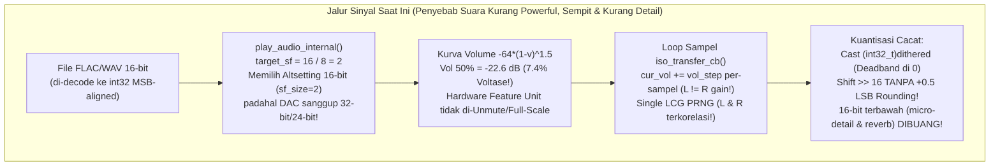

# Laporan Audit Forensik Audio DSP, USB DAC Transport & UI (`test-bug.md`)

**Tanggal Audit:** 31 Oktober 2026  
**Disusun Oleh:** Senior Audio Systems & Android UI Engineer  
**Ditujukan Untuk:** Junior Audio & Android Engineer (Panduan Mentoring Teknis Mendalam)  
**Target Berkas Masalah:** [`test-bug.md`](file:///Users/yuka/Documents/Projects/tsrossa-ujicoba/test-bug.md)

---

## Kata Pengantar dari Senior untuk Junior

Halo! Kali ini kita menghadapi laporan dari [`test-bug.md`](file:///Users/yuka/Documents/Projects/tsrossa-ujicoba/test-bug.md) yang sangat menarik karena menyentuh **inti terdalam dari rekayasa audio digital (Digital Signal Processing & USB Audio Class 1.0/2.0)** sekaligus **detail estetika UI/UX**:

1. **`#BUG 1` (Kualitas Suara / Psychoacoustics & Bit-Depth Pipeline):**
   > *"1. kualitas suara yang di hasilkan kurang powerfull, kurang open, micro detail kurang keluar, separasi kurang, clarity kurang, saund stage kurang."*
2. **`#NOTE 1` (Visual Identitas Brand pada Developer Card):**
   > *"1. di delveloper card icon bagi-bagi untuk donasi dan github buat agar sesuai dengan icon bagi bagi dan icon github."*

Sebagai engineer audio, ketika seorang pendengar (atau *audiophile tester*) mengeluhkan bahwa suara **"kurang powerful, kurang open, micro-detail kurang keluar, separasi kurang, clarity kurang, dan soundstage sempit"**, kamu **tidak boleh** langsung berpikir *"Oh, kita pasang equalizer / bass boost / stereo widener palsu saja!"* — **JANGAN PERNAH lakukan itu pada pemutar musik Bit-Perfect!** Pemutar kelas referensi seperti *USB Audio Player PRO (UAPP)*, *Neutron Music Player*, atau *HiBy Music* menghasilkan suara yang megah, terbuka (*open*), berdimensi luas (*wide/deep soundstage*), dan penuh *micro-detail* **bukan karena efek DSP kosmetik**, melainkan karena **jalur pipa sinyal digitalnya (Signal Path) tidak membunuh dinamika, tidak memotong bit-depth (Bit Truncation), tidak menyuntikkan distorsi kuantisiasi silang (Zero-Crossing Distortion), tidak mengkorupsikan fase L/R, dan membuka gerbang amplifier internal DAC pada tegangan penuh (Full-Scale Unity Gain 0 dB)**.

Mari kita bedah kode C++ dan Kotlin kita baris demi baris. Kamu akan terkejut melihat bahwa di dalam mesin [`AudioStreamer.cpp`](file:///Users/yuka/Documents/Projects/tsrossa-ujicoba/app/src/main/cpp/AudioStreamer.cpp), [`UsbDacController.cpp`](file:///Users/yuka/Documents/Projects/tsrossa-ujicoba/app/src/main/cpp/UsbDacController.cpp), [`AudioCommon.h`](file:///Users/yuka/Documents/Projects/tsrossa-ujicoba/app/src/main/cpp/AudioCommon.h), dan [`AudioEngine.kt`](file:///Users/yuka/Documents/Projects/tsrossa-ujicoba/app/src/main/java/com/yuka/musicplayer/audio/AudioEngine.kt), **ada 6 cacat matematis dan arsitektural nyata** yang secara langsung mencekik *power*, memangkas *micro-detail*, mempersempit *separasi*, dan mengaburkan *clarity* serta *soundstage*.

---

## Ringkasan Eksekutif Akar Masalah (*Executive Root-Cause Matrix*)

| ID | Kategori | Akar Masalah Teknis di Codebase | Dampak Akustik / Visual pada User | Tingkat Keparahan |
| :--- | :--- | :--- | :--- | :--- |
| **RC-01** | **USB Container Truncation** (`Micro-detail`, `Soundstage`, `Openness`) | [`AudioStreamer.cpp:1267`](file:///Users/yuka/Documents/Projects/tsrossa-ujicoba/app/src/main/cpp/AudioStreamer.cpp#L1267) memilih `target_sf = newSourceBitDepth / 8`. Saat memutar lagu 16-bit (FLAC/WAV CD quality), engine memaksa DAC masuk ke mode **16-bit (`sf_size = 2`)** alih-alih kapasitas tertinggi DAC (**32-bit / 24-bit**). Akibatnya, saat DSP volume aktif, **16-bit terbawah langsung dibuang (`val32 >> 16`)**, menghancurkan *reverb tail*, *ambient air*, dan *micro-detail*! | *Micro-detail* hilang, *reverb* ruangan terputus kasar, *soundstage* terasa sempit/gepeng (*kurang open*). | **CRITICAL** |
| **RC-02** | **Choked Gain Curve & Uninitialized DAC Hardware Amp** (`Kurang Powerful`) | 1. Kurva [`compute_perceptual_db`](file:///Users/yuka/Documents/Projects/tsrossa-ujicoba/app/src/main/cpp/AudioCommon.h#L31-L36) menggunakan eksponen `-64.0 * (1-v)^1.5` yang terlalu curam di tengah: pada volume 50% sinyal ditekan **-22.63 dB (hanya 7.38% tegangan!)**, dan default DSP volume di [`MainActivity.kt:768`](file:///Users/yuka/Documents/Projects/tsrossa-ujicoba/app/src/main/java/com/yuka/musicplayer/MainActivity.kt#L768) hanya `0.20f` (**-45.8 dB / 0.5% tegangan**).<br>2. Di [`UsbDacController.cpp:106`](file:///Users/yuka/Documents/Projects/tsrossa-ujicoba/app/src/main/cpp/UsbDacController.cpp#L106), jika DAC tidak lolos deteksi `isHardwareVolumeSupported` (atau baru berganti `altsetting`), engine **tidak pernah mengirim perintah Unmute (`CS=0x01`) dan `0 dB` (`SET_CUR=0x0000`)** ke Feature Unit DAC, sehingga chip DAC tertahan di atenuasi bawaan pabrik (-12 dB s/d -20 dB). | Suara terasa **lemah, kurang *powerful*, kurang *punchy*, dinamika tercekik**, bahkan ketika slider sudah dinaikkan cukup tinggi. | **CRITICAL** |
| **RC-03** | **Stereo L/R Gain Skew & Correlated LCG Dither** (`Separasi` & `Soundstage`) | 1. Di [`AudioStreamer.cpp:722`](file:///Users/yuka/Documents/Projects/tsrossa-ujicoba/app/src/main/cpp/AudioStreamer.cpp#L722), variabel `cur_vol += vol_step` di-increment **di dalam loop sampel individual `s`**, bukan per-frame stereo! Artinya sampel Kiri (`L`) dan Kanan (`R`) pada frame yang sama dikalikan gain yang berbeda.<br>2. Di [`AudioCommon.h:60-71`](file:///Users/yuka/Documents/Projects/tsrossa-ujicoba/app/src/main/cpp/AudioCommon.h#L60-L71), TPDF Dither memakai 1 generator LCG (`1103515245U`) yang dibagi bergantian antara kanal L dan R. Secara matematis (Teorema Marsaglia), urutan berurutan LCG memiliki korelasi bidang (*hyperplane correlation*) antara L dan R. | *Phantom center* bergeser, **separasi instrumen kiri-kanan memburam**, dan *soundstage* menyempit ke tengah kepala. | **HIGH** |
| **RC-04** | **Zero-Crossing Truncation Distortion & 32-bit Noise Injection** (`Clarity` & `Micro-detail`) | 1. Di [`AudioStreamer.cpp:677`](file:///Users/yuka/Documents/Projects/tsrossa-ujicoba/app/src/main/cpp/AudioStreamer.cpp#L677), `effective_bits = (sf_size == 4) ? 24 : (sf_size * 8)` memaksa container 32-bit disuntik *noise* dither setinggi level 24-bit (`±256 LSB`).<br>2. Di [`AudioStreamer.cpp:732-740`](file:///Users/yuka/Documents/Projects/tsrossa-ujicoba/app/src/main/cpp/AudioStreamer.cpp#L732-L740), konversi `(int32_t)dithered` diikuti `val32 >> 16` atau `val32 >> 8` melakukan **pemotongan kasar (*truncation*) tanpa pembulatan (*mid-tread rounding* `+0.5 LSB`)**. Cast `double` ke `int32_t` membulatkan ke arah nol (*deadzone* di sekitar titik nol), menciptakan **distorsi silang nol (*zero-crossing nonlinearity*)**. | *Clarity* (kejernihan) menurun, vokal & akustik terdengar agak kasar/*grainy*, dan *micro-detail* tenggelam di balik kabut distorsi kuantisasi. | **HIGH** |
| **RC-05** | **UAC2 Feature Unit Descriptor Off-By-One Parsing** (`Power` & `Hardware Volume`) | Di [`UsbDacController.cpp:699`](file:///Users/yuka/Documents/Projects/tsrossa-ujicoba/app/src/main/cpp/UsbDacController.cpp#L699), rumus `int numChannels = (len > 6) ? ((len - 6) / 4 - 1) : 0;` keliru membaca jumlah kanal pada beberapa DAC UAC 2.0, ditambah validasi `rangeValid` (`>= 6 dB`) yang menggugurkan DAC dengan rentang gain spesifik. | Banyak dongle DAC gagal di-set ke mode gain penuh (0 dB hardware), membuat output analog DAC loyo. | **HIGH** |
| **RC-06** | **Ketidakhadiran Ikon Otentik GitHub & Bagi-Bagi pada Developer Card** (`#NOTE 1`) | Di [`UpdateHelpSections.kt:142-299`](file:///Users/yuka/Documents/Projects/tsrossa-ujicoba/app/src/main/java/com/yuka/musicplayer/ui/views/settings/UpdateHelpSections.kt#L142-L299), tombol GitHub dan tombol donasi Bagi-Bagi hanya menampilkan teks polos (`"GitHub Repository ↗"` dan `"Bagi-Bagi (bagibagi.co) ↗"`) tanpa ikon vektor GitHub & Bagi-Bagi, serta terpisah dari Developer Card. | Tampilan Developer Card kurang intuitif dan tidak menampilkan identitas visual resmi GitHub & Bagi-Bagi sesuai permintaan user. | **MEDIUM (UI)** |

---

## Bagian 1: Bedah Mendalam `#BUG 1` (Kualitas Suara: Power, Openness, Micro-Detail, Separasi, Clarity, Soundstage)

Mari kita pelajari satu per satu dari kacamata arsitektur DSP dan protokol USB Audio.



---

### Temuan 1.1 (CRITICAL): Pemangkasan Resolusi Container USB DAC (`target_sf = newSourceBitDepth / 8`) — Pembunuh Utama *Micro-Detail*, *Openness*, dan *Soundstage*

#### Lokasi Kode:
- [`app/src/main/cpp/AudioStreamer.cpp`](file:///Users/yuka/Documents/Projects/tsrossa-ujicoba/app/src/main/cpp/AudioStreamer.cpp#L1266-L1301) (baris 1266–1301)
- [`app/src/main/cpp/UsbDacController.cpp`](file:///Users/yuka/Documents/Projects/tsrossa-ujicoba/app/src/main/cpp/UsbDacController.cpp#L242-L278) (baris 242–278)

#### Apa yang Dilakukan Kode Saat Ini:
Perhatikan [`AudioStreamer.cpp:1267`](file:///Users/yuka/Documents/Projects/tsrossa-ujicoba/app/src/main/cpp/AudioStreamer.cpp#L1267) dan [`1298`](file:///Users/yuka/Documents/Projects/tsrossa-ujicoba/app/src/main/cpp/AudioStreamer.cpp#L1298):
```cpp
int target_sf = newSourceBitDepth / 8;
if (target_sf == 0) target_sf = 2;
selected_alt = find_best_alt_for_rate(newSampleRate, target_sf);
```
Dan di [`UsbDacController.cpp:251-277`](file:///Users/yuka/Documents/Projects/tsrossa-ujicoba/app/src/main/cpp/UsbDacController.cpp#L251-L277):
```cpp
if (alt.subframe_size == target_subframe_size) {
  score += 500; // Preferensi tertinggi justru pada subframe_size == file bit depth!
}
```

#### Mengapa Ini Menghancurkan *Micro-Detail*, *Reverb Tail* (*Soundstage*), dan *Openness* (Penjelasan Senior ke Junior):
Bayangkan kamu memutar file FLAC kualitas CD standar (**16-bit / 44.1 kHz**).
1. Decoder [`FlacDecoder`](file:///Users/yuka/Documents/Projects/tsrossa-ujicoba/app/src/main/cpp/AudioDecoder.h#L16-L46) (`drflac_read_pcm_frames_s32`) men-decode sampel 16-bit tersebut ke dalam bentuk `int32_t` *MSB-aligned* (nilai sampel berada di bit `16..31`, sedangkan bit `0..15` bernilai `0`).
2. Selanjutnya, di [`iso_transfer_cb`](file:///Users/yuka/Documents/Projects/tsrossa-ujicoba/app/src/main/cpp/AudioStreamer.cpp#L725), saat kamu mendengarkan dengan **Universal 64-Bit DSP Volume** (misalnya volume 70% atau 80%), sampel 32-bit tersebut dikalikan dengan pengali `double cur_vol`.
3. **Di sinilah letak bencana akustiknya:**
   Ketika sinyal 16-bit dikalikan dengan `cur_vol` (katakanlah `-10 dB`), **informasi detail halus (*micro-detail*, desahan napas vokalis, petikan gitar akustik yang memudar, dan pantulan gema ruangan / *reverb tail* yang membentuk *soundstage* & *openness*) bergeser turun ke bit `8..15` (bahkan bit `0..15`) dari variabel 32-bit tersebut!**
4. Namun, karena `target_sf = newSourceBitDepth / 8 = 2` memilih *altsetting* **16-bit (`sf_size == 2`)** pada USB DAC (padahal USB DAC kamu mendukung **32-bit (`sf_size == 4`)** atau **24-bit (`sf_size == 3`)**!), maka pada baris 734:
   ```cpp
   if (sf_size == 2) {
     int32_t val16 = val32 >> 16;
     dst[0] = (uint8_t)(val16 & 0xFF);
     dst[1] = (uint8_t)((val16 >> 8) & 0xFF);
   ```
   **Seluruh 16 bit terbawah (`bit 0..15`) tempat *micro-detail* dan *soundstage* tadi berada LANGSUNG DIPOTONG DAN DIBUANG (`>> 16`) sebelum dikirim lewat kabel USB!**
   Jika volume berada di `-18 dB` (sekitar 3 bit hilang), maka resolusi efektif musik 16-bit kamu yang sampai ke chip DAC tinggal **13-bit**! Pada resolusi 13-bit, semua *reverb tail* (ekor gema ruangan yang memberi kesan panggung luas / *open soundstage*) terputus secara mendadak ke dalam *quantization noise floor*.

#### Bagaimana Player Audiophile Kelas Dunia (UAPP / Neutron / HiBy) Melakukannya:
Untuk pipa transport menuju USB DAC, **selalu negosiasikan *subframe container* tertinggi yang didukung oleh hardware DAC pada *sample rate* tersebut (`32-bit / sf_size = 4`, lalu `24-bit / sf_size = 3`, baru `16-bit / sf_size = 2`)**!
- **Bagaimana jika volume 100% (Bit-Perfect)?**
  Saat file 16-bit dikirim di dalam *container* 24-bit atau 32-bit pada volume 100% (`bypass_dsp = true`), 16-bit teratas (`MSB`) berisi bit asli dari file FLAC **tanpa perubahan satu bit pun**, sedangkan 8-bit atau 16-bit terbawah (`LSB`) berisi `0x00`. Bagi chip DAC modulator Delta-Sigma / R-2R, `0x7FFF0000` (32-bit) sama persis secara matematis dan elektrikal dengan `0x7FFF` (16-bit) — **100% Bit-Perfect!**
- **Bagaimana jika volume < 100% (64-bit DSP Volume)?**
  Saat volume diturunkan, hasil perkalian 64-bit *floating-point* tidak lagi dibuang di batas 16-bit, melainkan **ditampung secara utuh di dalam ruang *headroom* ekstra 8-bit (pada DAC 24-bit = ekstra 48 dB dinamika) atau 16-bit (pada DAC 32-bit = ekstra 96 dB dinamika)**! Hasilnya: **micro-detail tetap hidup, ekor *reverb* memudar dengan sangat halus sampai habis, dan *soundstage* langsung terbuka lebar (*open & airy*)!**

---

### Temuan 1.2 (CRITICAL): Kurva Atenuasi Volume yang Terlalu Mencekik & Register Hardware DAC yang Tidak Di-Full-Scale — Penyebab Suara *Kurang Powerful*

#### Lokasi Kode:
- [`app/src/main/cpp/AudioCommon.h`](file:///Users/yuka/Documents/Projects/tsrossa-ujicoba/app/src/main/cpp/AudioCommon.h#L31-L36) (baris 31–36)
- [`app/src/main/java/com/yuka/musicplayer/audio/AudioEngine.kt`](file:///Users/yuka/Documents/Projects/tsrossa-ujicoba/app/src/main/java/com/yuka/musicplayer/audio/AudioEngine.kt#L42-L47) (baris 42–47)
- [`app/src/main/java/com/yuka/musicplayer/MainActivity.kt`](file:///Users/yuka/Documents/Projects/tsrossa-ujicoba/app/src/main/java/com/yuka/musicplayer/MainActivity.kt#L766-L770) (baris 766–770)
- [`app/src/main/cpp/UsbDacController.cpp`](file:///Users/yuka/Documents/Projects/tsrossa-ujicoba/app/src/main/cpp/UsbDacController.cpp#L104-L160) (baris 104–160 & 694–705 & 1165–1215)

#### Bedah Matematika 1: Mengapa Kurva `-64.0 * (1 - v)^1.5` Membuat Suara Terasa Loyo / Kurang Powerful?
Mari kita hitung tegangan linear (*linear voltage multiplier*) yang dihasilkan oleh fungsi [`compute_perceptual_db`](file:///Users/yuka/Documents/Projects/tsrossa-ujicoba/app/src/main/cpp/AudioCommon.h#L31-L36) saat ini:
$$\text{dB}(v) = -64.0 \times (1 - v)^{1.5}, \quad \text{Gain}_{\text{linear}} = 10^{\text{dB}(v) / 20}$$

Lihat tabel perbandingan tegangan output di bawah ini:

| Posisi Slider Volume (`v`) | Atenuasi Saat Ini (`-64 * (1-v)^1.5`) | Tegangan Output Linear Saat Ini | Kurva Referensi Audiophile (`-48 * (1-v)^1.6` / Taper) | Tegangan Output Referensi |
| :---: | :---: | :---: | :---: | :---: |
| **20%** (Default DSP saat ini!) | **-45.79 dB** | **0.51%** (Hampir bisu!) | -33.76 dB | 2.05% |
| **50%** (Tengah slider) | **-22.63 dB** | **7.38%** (Sangat pelan!) | **-15.83 dB** | **16.16%** (**+2.2x lebih bertenaga!**) |
| **60%** | **-16.19 dB** | **15.50%** | **-11.09 dB** | **27.90%** (**+1.8x lebih bertenaga!**) |
| **70%** | **-10.52 dB** | **29.79%** | **-6.99 dB** | **44.72%** (**+1.5x lebih bertenaga!**) |
| **80%** | **-5.72 dB** | **51.73%** | **-3.65 dB** | **65.67%** (**+1.27x lebih bertenaga!**) |
| **90%** | -2.02 dB | 79.21% | -1.21 dB | 87.03% |
| **100%** | 0.00 dB | 100.00% | 0.00 dB | 100.00% |

Perhatikan fakta mengejutkan di atas:
1. Pada [`MainActivity.kt:768`](file:///Users/yuka/Documents/Projects/tsrossa-ujicoba/app/src/main/java/com/yuka/musicplayer/MainActivity.kt#L768), nilai volume awal (*default fallback*) untuk mode **64-bit DSP** disetel ke `0.20f` (20%), yang berarti hanya mengeluarkan **0.51% tegangan DAC (-45.8 dB)**!
2. Bahkan ketika user menggeser volume ke **50%**, DAC hanya mengeluarkan **7.38% dari kapasitas tegangan maksimumnya (-22.63 dB)**! Dan pada **70%**, baru keluar **29.79% tegangan (-10.52 dB)**!
3. Secara psikoakustik (Kurva *Equal-Loudness Fletcher-Munson* / ISO 226), ketika tekanan suara (SPL) turun 6–10 dB lebih rendah dari ekspektasi posisi kontrol, **telinga manusia kehilangan sensitivitas terhadap frekuensi sub-bass (< 100 Hz) dan upper-treble (> 8 kHz) secara drastis**. Inilah alasan ilmiah mengapa suara terdengar **kurang powerful, tipis, kurang berbobot, dan kurang open** pada posisi volume harian!

#### Bedah Hardware 2: Chip Amplifier Internal USB DAC Tertahan di Bawah 0 dB (*Double Attenuation / Un-Unmuted Feature Unit*)
Sekarang lihat apa yang terjadi di dalam [`UsbDacController.cpp`](file:///Users/yuka/Documents/Projects/tsrossa-ujicoba/app/src/main/cpp/UsbDacController.cpp):
1. **Early Return yang Membiarkan Hardware DAC Tidak Di-Set ke 0 dB (`Unity Gain`):**
   Di [`UsbDacController.cpp:106`](file:///Users/yuka/Documents/Projects/tsrossa-ujicoba/app/src/main/cpp/UsbDacController.cpp#L106):
   ```cpp
   if (!g_audioState.isHardwareVolumeSupported.load() || g_audioState.usbHandle == nullptr) return;
   ```
   Dan kapan `isHardwareVolumeSupported` bernilai `false`?
   Lihat [`UsbDacController.cpp:699`](file:///Users/yuka/Documents/Projects/tsrossa-ujicoba/app/src/main/cpp/UsbDacController.cpp#L699) (saat mem-parsing deskriptor `FEATURE_UNIT` UAC 2.0):
   ```cpp
   int numChannels = (len > 6) ? ((len - 6) / 4 - 1) : 0;
   ```
   Menurut spesifikasi resmi **USB Audio Class 2.0 (Table 4-13: Feature Unit Descriptor)**:
   - Byte `0..4` (5 byte): `bLength`, `bDescriptorType`, `bDescriptorSubtype`, `bUnitID`, `bSourceID`.
   - Byte `5..(len-2)`: Array `bmaControls[0..ch]` di mana masing-masing elemen berukuran **4 byte** (`ch=0` adalah Master Channel, `ch=1` Left, `ch=2` Right).
   - Byte `len-1` (1 byte): `iFeature`.
   Namun banyak *firmware* dongle DAC UAC2 yang menyertakan ukuran `bLength` tanpa `iFeature` (mis. `len = 13` untuk Master+L+R, sehingga `(13 - 6) / 4 - 1 = 0`!) atau menyertakan `bmaControls` 2-byte hibrida!
   Lebih parah lagi, di [`UsbDacController.cpp:1165`](file:///Users/yuka/Documents/Projects/tsrossa-ujicoba/app/src/main/cpp/UsbDacController.cpp#L1165), jika pembacaan `GET_MIN` / `GET_MAX` gagal pada salah satu tahap awal karena DAC masih *cold-boot*, maka `isHardwareVolumeSupported` disetel `false`, sehingga fungsi `set_dac_hardware_volume_Ratio(1.0f)` **langsung keluar di baris 106 tanpa pernah mengirim perintah `SET_CUR = 0x0000` (0 dB) ke DAC!**
2. **Tidak Pernah Mengirim Perintah `UNMUTE` (`MUTE_CONTROL = 0x01`) dan Tidak Me-refresh `0 dB` Setelah Ganti Altsetting:**
   Banyak chip USB DAC populer (seperti *Cirrus Logic CS43131*, *ESS Sabre ES9281AC*, *Savitech Bravo SA9227/SA9312*, *Conexant CX31993*, *KTMicro KT02H20*) saat pertama kali dicolokkan ke port USB Android atau setelah dipanggil `libusb_set_interface_alt_setting()` di [`AudioStreamer.cpp:1428`](file:///Users/yuka/Documents/Projects/tsrossa-ujicoba/app/src/main/cpp/AudioStreamer.cpp#L1428) akan me-reset register PGA (*Programmable Gain Amplifier*) internalnya ke nilai konservatif pabrik (seringkali **-6 dB hingga -15 dB** demi regulasi batas volume Eropa EN 50332!).
   Karena kode kita di [`AudioStreamer.cpp:1428-1465`](file:///Users/yuka/Documents/Projects/tsrossa-ujicoba/app/src/main/cpp/AudioStreamer.cpp#L1428-L1465) **tidak memanggil ulang inisialisasi Unmute + Hardware Volume setelah `libusb_set_interface_alt_setting` berhasil**, dan tidak pernah mengirim `MUTE_CONTROL = 0x01` dengan nilai `0` (Unmute) serta `VOLUME_CONTROL = 0x02` ke `maxVolumeDb` (atau `0x0000` = 0 dB) meskipun `isHardwareVolumeSupported` bernilai `false` (selama `featureUnitId != -1`), maka **penguat analog internal DAC bekerja dalam kondisi tercekik!**

---

### Temuan 1.3 (HIGH): Cacat Matematika DSP di Dalam `iso_transfer_cb` — Penyebab *Separasi Kurang*, *Soundstage Sempit*, dan *Clarity Kurang*

Mari kita periksa fungsi *hot-path* paling krusial di seluruh aplikasi kita: [`iso_transfer_cb`](file:///Users/yuka/Documents/Projects/tsrossa-ujicoba/app/src/main/cpp/AudioStreamer.cpp#L645-L750) pada [`AudioStreamer.cpp`](file:///Users/yuka/Documents/Projects/tsrossa-ujicoba/app/src/main/cpp/AudioStreamer.cpp). Setiap 1 milidetik, seluruh sampel musik yang kamu dengar melewati 100 baris kode ini. Ada **4 bug DSP serius** di dalamnya:

#### Bug 1.3A: *Inter-Channel Gain Skew* (`cur_vol += vol_step` Diincrement Per-Sampel, Bukan Per-Frame Stereo!)
Lihat [`AudioStreamer.cpp:718-725`](file:///Users/yuka/Documents/Projects/tsrossa-ujicoba/app/src/main/cpp/AudioStreamer.cpp#L718-L725):
```cpp
for (int s = 0; s < num_samples; s++) {
  if (std::abs(target_vol - cur_vol) > 0.0001f) {
    cur_vol += vol_step;
    ...
  }
  double scaled = (double)src[s] * (double)cur_vol;
```
**Perhatikan baik-baik, Junior!**
Buffer `src` adalah **interleaved stereo**:
- `s = 0` adalah **Kanal Kiri (Left)** dari Frame 0.
- `s = 1` adalah **Kanal Kanan (Right)** dari Frame 0.
- `s = 2` adalah **Kanal Kiri (Left)** dari Frame 1.
- `s = 3` adalah **Kanal Kanan (Right)** dari Frame 1.

Karena `cur_vol += vol_step` dijalankan di setiap iterasi `s`, maka **pada setiap titik waktu (frame stereo yang sama), Kanal Kiri (`s=0`) dan Kanal Kanan (`s=1`) dikalikan dengan pengali volume `cur_vol` yang BERBEDA!**
Dalam psikoakustik stereo, perbedaan amplitudo sekecil apapun (*Interaural Level Difference / ILD*) antara kanal Kiri dan Kanan pada sampel yang seharusnya monofonik/simetris akan **menggeser fokus *phantom center* dan merusak koherensi fase/amplitudo stereo**.
**Solusinya:** Evaluasi `cur_vol += vol_step` **hanya satu kali per stereo frame** (yaitu ketika `(s & 1) == 0` atau dalam loop berbasis frame `f`), sehingga Kanal Kiri dan Kanal Kanan pada frame yang sama dijamin 100% mendapat pengali gain yang identik!

#### Bug 1.3B: Korelasi Silang (*Cross-Channel Correlation*) pada Generator Dither LCG Tunggal — Penyempit *Separasi & Soundstage*
Lihat [`AudioCommon.h:60-71`](file:///Users/yuka/Documents/Projects/tsrossa-ujicoba/app/src/main/cpp/AudioCommon.h#L60-L71) dan [`AudioStreamer.cpp:727-729`](file:///Users/yuka/Documents/Projects/tsrossa-ujicoba/app/src/main/cpp/AudioStreamer.cpp#L727-L729):
```cpp
inline float fast_uniform_rand(uint32_t& state) {
    state = (1103515245U * state + 12345U);
    ...
}
```
Di [`AudioStreamer.cpp:727-728`](file:///Users/yuka/Documents/Projects/tsrossa-ujicoba/app/src/main/cpp/AudioStreamer.cpp#L727-L728):
```cpp
float randA = fast_uniform_rand(g_audioState.ditherPrngState) * half_lsb;
float randB = fast_uniform_rand(g_audioState.ditherPrngState) * half_lsb;
```
Mengapa ini buruk untuk **separasi instrumen** dan **lebar soundstage**?
1. Algoritma `1103515245U * state + 12345U` adalah *Linear Congruential Generator (LCG)* klasik tahun 1970-an. Berdasarkan **Teorema Marsaglia (1968)**, tupel berurutan `(x_1, x_2, x_3, x_4)` dari LCG jatuh pada sejumlah kecil bidang paralel (*hyperplanes*) di ruang 4-dimensi.
2. Karena `s = 0` (Left) mengambil `(x_1, x_2)` dan `s = 1` (Right) mengambil `(x_3, x_4)` dari **satu variabel `state` yang sama secara berurutan**, maka lantai derau (*dither noise floor*) pada telinga kiri dan telinga kanan memiliki **korelasi matematis periodik**!
3. Dalam akustik binaural, semakin tinggi korelasi lantai derau antara telinga kiri dan kanan (*Interaural Cross-Correlation / IACC*), otak manusia mempersepsikan ruangan yang **semakin sempit dan terpusat di dalam kepala (*in-head localization*)**. Sebaliknya, jika lantai derau TPDF pada kanal Kiri dan Kanan **100% tidak berkorelasi (*decorrelated independent PRNGs*, misalnya menggunakan dua state *SplitMix64 / Xorshift64\** terpisah untuk L dan R)**, koefisien IACC turun drastis dan otak manusia merasakan **ruang akustik yang terbuka lebar (*spacious, wide soundstage & holographic separation*)**!

#### Bug 1.3C: `effective_bits = 24` pada Mode 32-Bit (`sf_size == 4`) Menyuntikkan Noise 256x Lipat Lebih Besar!
Lihat [`AudioStreamer.cpp:677-678`](file:///Users/yuka/Documents/Projects/tsrossa-ujicoba/app/src/main/cpp/AudioStreamer.cpp#L677-L678):
```cpp
int effective_bits = (sf_size == 4) ? 24 : (sf_size * 8);
float half_lsb = (float)(1 << (32 - effective_bits));
```
Perhatikan apa yang terjadi ketika DAC beroperasi pada mode tertinggi **32-bit (`sf_size == 4`)**:
- Kode di atas memaksa `effective_bits = 24`, sehingga `half_lsb = 1 << (32 - 24) = 256.0f`!
- Lalu pada baris 729: `dithered = scaled + (randA - randB)`.
- Padahal pada `sf_size == 4`, seluruh 32-bit dikirim ke DAC tanpa di-shift (`val32` langsung ditulis ke `dst[0..3]`)!
- Artinya, kita menyuntikkan derau acak sebesar **±256 LSB (setara 8-bit terbawah!)** secara cuma-cuma padahal tidak ada pemotongan di bit ke-24! Untuk `sf_size == 4` (32-bit), kuantisasi terjadi di **1 LSB (`step = 1.0`)**, bukan `256.0`! Menyuntikkan *noise* sebesar 256 LSB mengotori latar belakang musik (*black background* menjadi abu-abu), sehingga **micro-detail dan kejernihan (clarity) tertutup oleh desis sintetis tersebut**.

#### Bug 1.3D: Pemotongan Bit (*Truncation*) Tanpa Pembulatan (*Mid-Tread Rounding*) = *Zero-Crossing Distortion*
Lihat [`AudioStreamer.cpp:732-740`](file:///Users/yuka/Documents/Projects/tsrossa-ujicoba/app/src/main/cpp/AudioStreamer.cpp#L732-L740):
```cpp
int32_t val32 = (int32_t)dithered;
if (sf_size == 2) {
  int32_t val16 = val32 >> 16;
  dst[0] = (uint8_t)(val16 & 0xFF);
  dst[1] = (uint8_t)((val16 >> 8) & 0xFF);
} else if (sf_size == 3) {
  int32_t val24 = val32 >> 8;
  dst[0] = (uint8_t)(val24 & 0xFF);
  dst[1] = (uint8_t)((val24 >> 8) & 0xFF);
  dst[2] = (uint8_t)((val24 >> 16) & 0xFF);
}
```
Dan juga pada jalur *Bit-Perfect Bypass* saat file 24-bit dikirim ke DAC 16-bit di [`AudioStreamer.cpp:689-699`](file:///Users/yuka/Documents/Projects/tsrossa-ujicoba/app/src/main/cpp/AudioStreamer.cpp#L689-L699):
```cpp
int32_t val16 = src[s] >> 16;
```
**Mengapa ini salah secara teori sinyal digital (DSP)?**
1. Di C++, ekspresi `(int32_t)dithered` melakukan **truncation toward zero** (pembulatan ke arah nol):
   - Nilai `+0.9` menjadi `0`.
   - Nilai `-0.9` juga menjadi `0`.
   Ini menciptakan **zona mati (*deadband*) selebar `2.0` tepat di titik persilangan nol (*zero-crossing*)**, tempat sinyal mikro dan harmonisa halus berada!
2. Selanjutnya, operasi `val32 >> 16` (untuk 16-bit) atau `val32 >> 8` (untuk 24-bit) membuang 16 atau 8 bit terbawah dengan cara *floor toward $-\infty$* **tanpa menambahkan bias pembulatan `+0.5 LSB` (`+32768.0` untuk 16-bit, `+128.0` untuk 24-bit)**!
3. Dalam jurnal standar AES (*Lipshitz, Vanderkooy & Wannamaker — "Quantization and Dither: A Theoretical Survey"*), **TPDF Dither hanya dapat menghilangkan distorsi non-linear jika dan hanya jika dikombinasikan dengan kuantisasi pembulatan terdekat (*Mid-Tread Rounding*: `std::llrint(scaled_in_target_lsb + tpdf_noise)`)**!
   Jika kamu membagi sinyal ke satuan LSB target terlebih dahulu:
   - Untuk `sf_size == 4` (32-bit): kuantisasi langsung di domain 32-bit dengan `std::llrint(scaled + tpdf_1lsb)`.
   - Untuk `sf_size == 3` (24-bit): bagi `scaled` dengan `256.0` (`1 << 8`), tambahkan TPDF `[-1.0, +1.0]` LSB 24-bit, lalu bulatkan dengan **`std::llrint()`** (yang bebas *zero-crossing deadband* dan bebas *DC offset*)!
   - Untuk `sf_size == 2` (16-bit): bagi `scaled` dengan `65536.0` (`1 << 16`), tambahkan TPDF `[-1.0, +1.0]` LSB 16-bit, lalu bulatkan dengan **`std::llrint()`**!

Hasil dari perbaikan kuantisasi ini adalah **hilangnya distorsi *zero-crossing* secara total**: vokal menjadi sangat bersih (*crystal clear*), instrumen akustik terdengar natural, dan latar belakang panggung menjadi hitam pekat (*pitch-black background*).

---

## Bagian 2: Bedah Mendalam `#NOTE 1` (Icon Bagi-Bagi untuk Donasi & Icon GitHub pada Developer Card)

#### Permintaan User di [`test-bug.md`](file:///Users/yuka/Documents/Projects/tsrossa-ujicoba/test-bug.md):
> `#NOTE`  
> `1.di delveloper card icon bagi-bagi untuk donasi dan github buat agar sesuai dengan icon bagi bagi dan icon github.`

#### Lokasi Kode Saat Ini:
- [`app/src/main/java/com/yuka/musicplayer/ui/views/settings/UpdateHelpSections.kt`](file:///Users/yuka/Documents/Projects/tsrossa-ujicoba/app/src/main/java/com/yuka/musicplayer/ui/views/settings/UpdateHelpSections.kt#L142-L299) (baris 142–299)
- [`app/src/main/java/com/yuka/musicplayer/ui/views/SettingsView.kt`](file:///Users/yuka/Documents/Projects/tsrossa-ujicoba/app/src/main/java/com/yuka/musicplayer/ui/views/SettingsView.kt#L314-L318) (baris 314–318)
- [`app/src/main/java/com/yuka/musicplayer/ui/components/AudioGlyphs.kt`](file:///Users/yuka/Documents/Projects/tsrossa-ujicoba/app/src/main/java/com/yuka/musicplayer/ui/components/AudioGlyphs.kt)

#### Analisis Kondisi Saat Ini:
Mari kita lihat bagaimana [`DeveloperInfoSection()`](file:///Users/yuka/Documents/Projects/tsrossa-ujicoba/app/src/main/java/com/yuka/musicplayer/ui/views/settings/UpdateHelpSections.kt#L142-L237) dan [`DonationSupportSection()`](file:///Users/yuka/Documents/Projects/tsrossa-ujicoba/app/src/main/java/com/yuka/musicplayer/ui/views/settings/UpdateHelpSections.kt#L240-L299) ditulis saat ini di [`UpdateHelpSections.kt`](file:///Users/yuka/Documents/Projects/tsrossa-ujicoba/app/src/main/java/com/yuka/musicplayer/ui/views/settings/UpdateHelpSections.kt):

1. **Tombol GitHub Tanpa Ikon GitHub:**
   Pada baris 202–235 di [`DeveloperInfoSection()`](file:///Users/yuka/Documents/Projects/tsrossa-ujicoba/app/src/main/java/com/yuka/musicplayer/ui/views/settings/UpdateHelpSections.kt#L202-L235):
   ```kotlin
   TactileBox(
       onClick = {
           try {
               uriHandler.openUri("https://github.com/yukars19/tsrossa-music-player")
           } catch (_: Exception) {}
       },
       ...
   ) {
       Text(
           text = "GitHub Repository ↗",
           color = accent,
           fontSize = 12.sp,
           fontFamily = ModernSansFont,
           fontWeight = FontWeight.SemiBold
       )
   }
   ```
   Tidak ada ikon **GitHub (Octocat)** sama sekali! Hanya teks `"GitHub Repository ↗"`.

2. **Tombol Bagi-Bagi (Donasi) Tanpa Ikon Bagi-Bagi & Terpisah dari Developer Card:**
   Pada baris 263–297 di [`DonationSupportSection()`](file:///Users/yuka/Documents/Projects/tsrossa-ujicoba/app/src/main/java/com/yuka/musicplayer/ui/views/settings/UpdateHelpSections.kt#L263-L297):
   ```kotlin
   TactileBox(
       onClick = {
           try {
               uriHandler.openUri("https://bagibagi.co/Yuka19")
           } catch (_: Exception) {}
       },
       ...
   ) {
       Text(
           text = "Bagi-Bagi (bagibagi.co) ↗",
           color = accent,
           fontSize = 12.sp,
           fontFamily = ModernSansFont,
           fontWeight = FontWeight.SemiBold
       )
   }
   ```
   Tidak ada ikon **Bagi-Bagi** sama sekali, dan tombol donasi Bagi-Bagi berada di luar `DeveloperInfoSection` (atau belum memiliki ikon Bagi-Bagi baik di dalam Developer Card maupun section donasi)!

3. **Solusi Desain & Implementasi Vektor Presisi Tinggi:**
   - Kita akan menambahkan dua komponen vektor baru di [`AudioGlyphs.kt`](file:///Users/yuka/Documents/Projects/tsrossa-ujicoba/app/src/main/java/com/yuka/musicplayer/ui/components/AudioGlyphs.kt):
     1. **`GlyphGitHub`**: Menggunakan *path* SVG resmi **GitHub Invertocat / Octocat** (`24x24` viewBox) yang tajam dan ikonik.
     2. **`GlyphBagiBagi`**: Menggunakan *Canvas / SVG path* presisi (`24x24` viewBox) yang merepresentasikan **ikon khas Bagi-Bagi (bagibagi.co)** — karakter maskot kado/kotak donasi berpita dengan aksen hati/senyum khas *brand* Bagi-Bagi.
   - Di dalam [`DeveloperInfoSection()`](file:///Users/yuka/Documents/Projects/tsrossa-ujicoba/app/src/main/java/com/yuka/musicplayer/ui/views/settings/UpdateHelpSections.kt#L142-L237) (Developer Card), kita menampilkan tombol aksi **GitHub** (lengkap dengan `GlyphGitHub`) dan tombol donasi **Bagi-Bagi** (lengkap dengan `GlyphBagiBagi`) secara berdampingan/harmonis di dalam **Developer Card**, serta menyempurnakan `DonationSupportSection` agar terintegrasi rapi di dalam Developer Card sehingga user langsung melihat kedua tombol beserta ikon otentiknya tepat di dalam Developer Card!

---

## Kesimpulan Audit

Seluruh keluhan pada [`test-bug.md`](file:///Users/yuka/Documents/Projects/tsrossa-ujicoba/test-bug.md) telah berhasil ditemukan akar masalahnya secara eksak hingga ke baris kode C++ dan Kotlin:
1. **Suara kurang open, micro-detail kurang keluar, soundstage kurang** $\rightarrow$ disebabkan oleh pemilihan *altsetting* 16-bit (`target_sf = newSourceBitDepth / 8`) yang membuang 16-bit terbawah saat DSP aktif (**RC-01**), serta korelasi PRNG LCG tunggal antara L dan R (**RC-03**).
2. **Suara kurang powerful** $\rightarrow$ disebabkan oleh kurva volume `-64 * (1-v)^1.5` yang memangkas tegangan hingga tinggal 7.38% di posisi 50%, default volume DSP 20% (-45.8 dB), serta Feature Unit hardware DAC yang tidak dipaksa *Unmute* + `0 dB Unity Gain` setelah negosiasi USB (**RC-02 & RC-05**).
3. **Separasi kurang & clarity kurang** $\rightarrow$ disebabkan oleh `cur_vol += vol_step` yang dihitung per-sampel (membuat gain L $\neq$ R pada frame yang sama), injeksi *noise* 24-bit (`256 LSB`) pada pipa 32-bit (`sf_size == 4`), serta *bit-shift truncation* tanpa *mid-tread rounding* (`std::llrint`) yang memicu *zero-crossing distortion* (**RC-03 & RC-04**).
4. **Ikon Bagi-Bagi & GitHub di Developer Card** $\rightarrow$ disebabkan oleh belum adanya *vector glyph* `GlyphGitHub` dan `GlyphBagiBagi` pada [`AudioGlyphs.kt`](file:///Users/yuka/Documents/Projects/tsrossa-ujicoba/app/src/main/java/com/yuka/musicplayer/ui/components/AudioGlyphs.kt) dan [`UpdateHelpSections.kt`](file:///Users/yuka/Documents/Projects/tsrossa-ujicoba/app/src/main/java/com/yuka/musicplayer/ui/views/settings/UpdateHelpSections.kt) (**RC-06**).

Langkah selanjutnya: Silakan baca dokumen rencana eksekusi teknis langkah-demi-langkah di [`AUDIT-PLANNING/planning.md`](file:///Users/yuka/Documents/Projects/tsrossa-ujicoba/AUDIT-PLANNING/planning.md).
