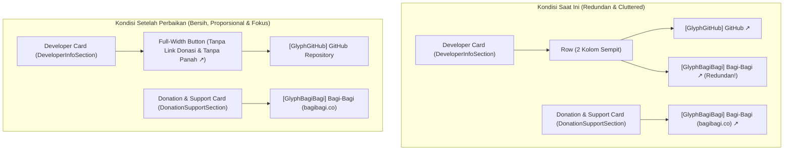

# Master Plan Perbaikan & Penyempurnaan Developer Card (`planning-developer-card.md`)

**Tanggal Perencanaan:** 31 Oktober 2026  
**Disusun Oleh:** Senior Android UI/UX & Systems Engineer  
**Ditujukan Untuk:** Junior Android Engineer (Panduan Eksekusi Langkah-demi-Langkah)  
**Referensi Audit:** [`AUDIT-PLANNING/audit-report-developer-card.md`](file:///Users/yuka/Documents/Projects/tsrossa-ujicoba/AUDIT-PLANNING/audit-report-developer-card.md)  
**Referensi Masalah:** [`test-bug.md`](file:///Users/yuka/Documents/Projects/tsrossa-ujicoba/test-bug.md)

---

## 1. Pengantar untuk Junior Engineer: Tujuan & Filosofi Eksekusi

Halo Junior! Setelah kita membaca hasil bedah audit di [`AUDIT-PLANNING/audit-report-developer-card.md`](file:///Users/yuka/Documents/Projects/tsrossa-ujicoba/AUDIT-PLANNING/audit-report-developer-card.md), sekarang kita akan menyusun langkah eksekusi yang presisi untuk memperbaiki [`UpdateHelpSections.kt`](file:///Users/yuka/Documents/Projects/tsrossa-ujicoba/app/src/main/java/com/yuka/musicplayer/ui/views/settings/UpdateHelpSections.kt).

Target utama dari [`test-bug.md`](file:///Users/yuka/Documents/Projects/tsrossa-ujicoba/test-bug.md) adalah:
> `1.hilangkan icon tanda panah keatas di developer card dan hilangkan link donasi yang berada di samping link github.`

Mari kita lihat diagram transformasi tata letak (*Layout Transformation*) di bawah ini agar kamu memiliki gambaran visual yang utuh sebelum menyentuh kode:



---

## 2. Tahap 1: Refactoring `DeveloperInfoSection` di [`UpdateHelpSections.kt`](file:///Users/yuka/Documents/Projects/tsrossa-ujicoba/app/src/main/java/com/yuka/musicplayer/ui/views/settings/UpdateHelpSections.kt#L142-L285)

### 2.1. Mengapa Kita Mengubah Bagian Ini?
1. **Menghapus Tombol Donasi di Samping Tombol GitHub:**
   Pada baris [`203-282`](file:///Users/yuka/Documents/Projects/tsrossa-ujicoba/app/src/main/java/com/yuka/musicplayer/ui/views/settings/UpdateHelpSections.kt#L203-L282), terdapat `Row` yang menampung dua `TactileBox` dengan `Modifier.weight(1f)` (satu untuk GitHub, satu untuk Bagi-Bagi). Kita akan menghapus `Row` pembungkus dua kolom tersebut beserta seluruh blok `TactileBox` donasi Bagi-Bagi di dalam `DeveloperInfoSection`.
2. **Mengembalikan Tombol GitHub Menjadi Full-Width (`Modifier.fillMaxWidth()`):**
   Dengan hanya menyisakan tombol GitHub di dalam Developer Card, tombol tersebut kembali menggunakan `.fillMaxWidth()` dengan `padding(vertical = 10.dp, horizontal = 14.dp)` yang simetris dan nyaman disentuh.
3. **Menghilangkan Ikon/Simbol Panah Ke Atas (`↗`):**
   Kita mengubah teks dari `"GitHub ↗"` menjadi `"GitHub Repository"` (tanpa karakter `↗`), didampingi oleh ikon vektor [`GlyphGitHub`](file:///Users/yuka/Documents/Projects/tsrossa-ujicoba/app/src/main/java/com/yuka/musicplayer/ui/components/AudioGlyphs.kt#L520-L530) berukuran `18.dp` dan jarak `Spacer(modifier = Modifier.width(8.dp))`.

### 2.2. Kode Pengganti untuk `DeveloperInfoSection` (Baris 202–283):

```kotlin
            // Full-width GitHub Repository Button with official GitHub icon (no arrow symbol, no duplicate donation button)
            TactileBox(
                onClick = {
                    try {
                        val intent = android.content.Intent(
                            android.content.Intent.ACTION_VIEW,
                            android.net.Uri.parse("https://github.com/yukaatsu/tsrossa")
                        ).apply {
                            addFlags(android.content.Intent.FLAG_ACTIVITY_NEW_TASK)
                        }
                        context.startActivity(intent)
                    } catch (e: Exception) {
                        android.widget.Toast.makeText(context, "Could not open browser", android.widget.Toast.LENGTH_SHORT).show()
                    }
                },
                pressedScale = 0.94f,
                modifier = Modifier
                    .fillMaxWidth()
                    .clip(RoundedCornerShape(12.dp))
                    .background(accent.copy(alpha = 0.16f))
                    .padding(vertical = 10.dp, horizontal = 14.dp)
            ) {
                Row(
                    modifier = Modifier.fillMaxWidth(),
                    horizontalArrangement = Arrangement.Center,
                    verticalAlignment = Alignment.CenterVertically
                ) {
                    GlyphGitHub(color = accent, modifier = Modifier.size(18.dp))
                    Spacer(modifier = Modifier.width(8.dp))
                    Text(
                        text = "GitHub Repository",
                        color = accent,
                        fontFamily = ModernSansFont,
                        fontWeight = FontWeight.Bold,
                        fontSize = 12.sp
                    )
                }
            }
```

---

## 3. Tahap 2: Penyempurnaan Konsistensi pada `DonationSupportSection` di [`UpdateHelpSections.kt`](file:///Users/yuka/Documents/Projects/tsrossa-ujicoba/app/src/main/java/com/yuka/musicplayer/ui/views/settings/UpdateHelpSections.kt#L287-L349)

### 3.1. Mengapa Kita Menyempurnakan Bagian Ini Juga?
Sebagai seorang engineer yang teliti, ketika kamu membersihkan simbol tanda panah ke atas (`↗`) pada `DeveloperInfoSection`, perhatikan juga kartu `DonationSupportSection` tepat di bawahnya (baris [`338-344`](file:///Users/yuka/Documents/Projects/tsrossa-ujicoba/app/src/main/java/com/yuka/musicplayer/ui/views/settings/UpdateHelpSections.kt#L338-L344)):
```kotlin
Text(
    text = "Bagi-Bagi (bagibagi.co) ↗",
    ...
)
```
Karena tombol tersebut juga berada di halaman **About / Developer** yang sama dan sudah memiliki ikon [`GlyphBagiBagi`](file:///Users/yuka/Documents/Projects/tsrossa-ujicoba/app/src/main/java/com/yuka/musicplayer/ui/components/AudioGlyphs.kt#L532-L545) di sebelah kirinya, menghapus karakter `↗` sehingga menjadi `"Bagi-Bagi (bagibagi.co)"` akan membuat kedua kartu pada halaman About tampil 100% seragam, bersih, dan bebas dari simbol panah ke atas!

### 3.2. Kode Pengganti pada `DonationSupportSection` (Baris 331–346):

```kotlin
                Row(
                    modifier = Modifier.fillMaxWidth(),
                    horizontalArrangement = Arrangement.Center,
                    verticalAlignment = Alignment.CenterVertically
                ) {
                    GlyphBagiBagi(color = accent, modifier = Modifier.size(18.dp))
                    Spacer(modifier = Modifier.width(8.dp))
                    Text(
                        text = "Bagi-Bagi (bagibagi.co)",
                        color = accent,
                        fontFamily = ModernSansFont,
                        fontWeight = FontWeight.Bold,
                        fontSize = 12.sp
                    )
                }
```

---

## 4. Tahap 3: Verifikasi Kompilasi, Unit Test & Build

Setelah perubahan kode pada [`UpdateHelpSections.kt`](file:///Users/yuka/Documents/Projects/tsrossa-ujicoba/app/src/main/java/com/yuka/musicplayer/ui/views/settings/UpdateHelpSections.kt) selesai diterapkan, jalankan langkah-langkah verifikasi wajib berikut:

1. **Verifikasi Unit Test JVM:**
   ```bash
   JAVA_HOME=/opt/homebrew/opt/openjdk@17 ./gradlew testDebugUnitTest
   ```
   *Ekspektasi:* `BUILD SUCCESSFUL` (seluruh test lulus tanpa regresi).

2. **Verifikasi Build Debug APK:**
   ```bash
   JAVA_HOME=/opt/homebrew/opt/openjdk@17 ./gradlew assembleDebug
   ```
   *Ekspektasi:* `BUILD SUCCESSFUL` tanpa *compiler warning* maupun *error* pada Jetpack Compose.

3. **Instalasi ke Perangkat USB (Jika Diminta User):**
   ```bash
   JAVA_HOME=/opt/homebrew/opt/openjdk@17 ./gradlew installDebug
   ```

---

## 5. Ringkasan Berkas yang Akan Dimodifikasi Saat Eksekusi

| No | Berkas | Rincian Perubahan |
| :-: | :--- | :--- |
| 1 | [`app/src/main/java/com/yuka/musicplayer/ui/views/settings/UpdateHelpSections.kt`](file:///Users/yuka/Documents/Projects/tsrossa-ujicoba/app/src/main/java/com/yuka/musicplayer/ui/views/settings/UpdateHelpSections.kt) | 1. Menghapus tombol donasi Bagi-Bagi yang berada di samping tombol GitHub di dalam `DeveloperInfoSection`.<br>2. Mengembalikan tombol GitHub di `DeveloperInfoSection` menjadi *full-width* (`fillMaxWidth()`).<br>3. Menghilangkan ikon/simbol tanda panah ke atas (`↗`) pada label tombol di `DeveloperInfoSection` (`"GitHub Repository"`) dan `DonationSupportSection` (`"Bagi-Bagi (bagibagi.co)"`). |
