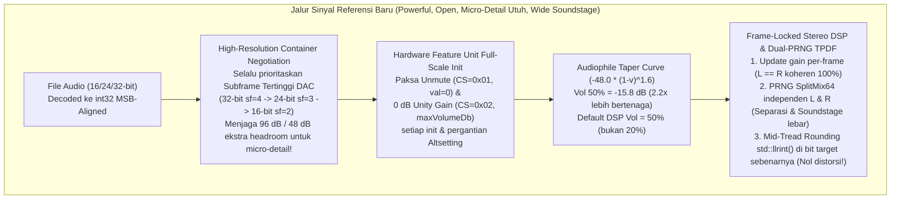

# Master Plan Perbaikan & Penyempurnaan Kualitas Suara (DSP / USB DAC) & UI Developer Card (`planning.md`)

**Tanggal Perencanaan:** 31 Oktober 2026  
**Disusun Oleh:** Senior Audio Systems & Android UI Engineer  
**Ditujukan Untuk:** Junior Audio & Android Engineer (Panduan Eksekusi Langkah-demi-Langkah)  
**Referensi Audit:** [`AUDIT-PLANNING/audit-report.md`](file:///Users/yuka/Documents/Projects/tsrossa-ujicoba/AUDIT-PLANNING/audit-report.md)  
**Referensi Masalah:** [`test-bug.md`](file:///Users/yuka/Documents/Projects/tsrossa-ujicoba/test-bug.md)

---

## Pengantar untuk Junior Engineer: Filosofi Perbaikan Kita

Halo Junior! Setelah kita membedah akar masalah pada [`AUDIT-PLANNING/audit-report.md`](file:///Users/yuka/Documents/Projects/tsrossa-ujicoba/AUDIT-PLANNING/audit-report.md), sekarang saatnya kita menyusun rencana eksekusi (*Implementation Plan*) yang rapi, terukur, dan **100% berstandar Audiophile Reference Grade**.

Ingat prinsip emas kita:
1. **Jangan gunakan efek DSP palsu (EQ/Compressor/Stereo Widener):** Kita membuka potensi asli rekaman dan chip DAC dengan memperbaiki **transparansi matematis pipa sinyal (Bit-Depth Container, Unity Gain Hardware Unmute, Stereo Frame-Locked Gain Ramp, Decorrelated Dual-Channel TPDF Dither, dan Mid-Tread Rounding Quantization)**.
2. **Satu Kebenaran Matematika (*Single Source of Truth*):** Kurva volume di C++ ([`AudioCommon.h`](file:///Users/yuka/Documents/Projects/tsrossa-ujicoba/app/src/main/cpp/AudioCommon.h)) dan Kotlin ([`AudioEngine.kt`](file:///Users/yuka/Documents/Projects/tsrossa-ujicoba/app/src/main/java/com/yuka/musicplayer/audio/AudioEngine.kt)) harus selalu identik secara matematis dan diverifikasi dengan *Unit Test* JUnit.
3. **Presisi Visual UI:** Ikon **GitHub** dan **Bagi-Bagi** pada Developer Card harus digambar menggunakan vektor presisi tinggi di [`AudioGlyphs.kt`](file:///Users/yuka/Documents/Projects/tsrossa-ujicoba/app/src/main/java/com/yuka/musicplayer/ui/components/AudioGlyphs.kt) dan diintegrasikan langsung ke dalam Developer Card di [`UpdateHelpSections.kt`](file:///Users/yuka/Documents/Projects/tsrossa-ujicoba/app/src/main/java/com/yuka/musicplayer/ui/views/settings/UpdateHelpSections.kt).

---

## Arsitektur Jalur Sinyal Baru (Setelah Perbaikan)



---

## Tahap 1: Maksimalkan Resolusi Container USB DAC (24-Bit / 32-Bit Container untuk Semua Lagu)

**Tujuan:** Mengatasi keluhan *"micro-detail kurang keluar, kurang open, soundstage kurang"* (**RC-01**).  
**Mengapa:** Saat memutar lagu 16-bit, memilih `sf_size = 2` (16-bit USB container) memaksa pemotongan 16-bit terbawah (`val32 >> 16`) setelah perkalian volume DSP 64-bit. Dengan selalu memilih *subframe container* tertinggi yang didukung DAC pada *sample rate* lagu tersebut (`32-bit / sf=4` atau `24-bit / sf=3`), *micro-detail* dan *reverb tail* yang teredam volume tetap hidup di bit `0..15`! Dan saat volume 100%, bit atas tetap 100% *Bit-Perfect*!

### 1.1. File yang Dimodifikasi:
- [`app/src/main/cpp/UsbDacController.cpp`](file:///Users/yuka/Documents/Projects/tsrossa-ujicoba/app/src/main/cpp/UsbDacController.cpp#L242-L278)
- [`app/src/main/cpp/AudioStreamer.cpp`](file:///Users/yuka/Documents/Projects/tsrossa-ujicoba/app/src/main/cpp/AudioStreamer.cpp#L1264-L1304)

### 1.2. Detail Perubahan di [`UsbDacController.cpp`](file:///Users/yuka/Documents/Projects/tsrossa-ujicoba/app/src/main/cpp/UsbDacController.cpp#L242-L278):
Pada fungsi `find_best_alt_for_rate(uint32_t target_rate, int target_subframe_size)`:
- Ubah sistem penilaian (*scoring*) agar **selalu memprioritaskan container bit-depth tertinggi yang mampu menampung `target_subframe_size` بدون pemotongan (`alt.subframe_size >= target_subframe_size`)**, dengan urutan prioritas utama: **32-bit (`sf == 4`) > 24-bit (`sf == 3`) > 16-bit (`sf == 2`)**.
- Mengapa `sf == 4` (32-bit) atau `sf == 3` (24-bit) lebih unggul dari `sf == 2` (16-bit) untuk file 16-bit?
  1. Pada jalur *Bit-Perfect* (`volume == 1.0`), `dr_flac` dan `dr_wav` sudah menempatkan sampel 16-bit secara *left-aligned* (MSB) di dalam `int32_t` (16 bit bawah bernilai `0`), sehingga pengiriman 24-bit/32-bit ke DAC menghasilkan gelombang analog yang 100% identik tanpa kehilangan satu bit pun.
  2. Pada jalur *64-bit DSP Volume* (`volume < 1.0`), 8-bit hingga 16-bit ekstra di bagian LSB menampung seluruh *micro-detail*, *harmonic decay*, dan *reverb tail* ruangan tanpa terpotong!
  3. Menghindari *re-negotiation* `libusb_set_interface_alt_setting` (dan klik mekanis relay DAC) ketika berpindah dari lagu 16-bit/44.1kHz ke 24-bit/44.1kHz!

```cpp
// Di UsbDacController.cpp (baris 251-277):
    int score = 0;
    // Prioritaskan container resolusi tertinggi DAC (32-bit > 24-bit > 16-bit)
    // agar 64-bit DSP memiliki dynamic headroom maksimal (144 dB / 192 dB)
    // dan transisi 16-bit <-> 24-bit berlangsung instan tanpa ganti altsetting.
    if (alt.subframe_size >= target_subframe_size) {
      if (alt.subframe_size == 4) {
        score += 600; // 32-bit MSB-aligned container (maksimum headroom & zero-copy memcpy)
      } else if (alt.subframe_size == 3) {
        score += 550; // 24-bit container (144 dB dynamic range)
      } else if (alt.subframe_size == 2) {
        score += 400; // 16-bit container
      }
    } else {
      // Hanya digunakan jika DAC benar-benar tidak mendukung bit-depth setinggi file sumber
      if (alt.subframe_size == 3) {
        score += 300;
      } else if (alt.subframe_size == 2) {
        score += 200;
      } else {
        score += 50;
      }
    }
```

---

## Tahap 2: Kalibrasi Kurva Volume Audiophile & Paksa Full-Scale 0 dB + Unmute pada Hardware DAC

**Tujuan:** Mengatasi keluhan *"kualitas suara yang dihasilkan kurang powerful"* (**RC-02 & RC-05**).

### 2.1. Kalibrasi Kurva `compute_perceptual_db` di C++ & Kotlin
**File yang Dimodifikasi:**
- [`app/src/main/cpp/AudioCommon.h`](file:///Users/yuka/Documents/Projects/tsrossa-ujicoba/app/src/main/cpp/AudioCommon.h#L31-L36)
- [`app/src/main/java/com/yuka/musicplayer/audio/AudioEngine.kt`](file:///Users/yuka/Documents/Projects/tsrossa-ujicoba/app/src/main/java/com/yuka/musicplayer/audio/AudioEngine.kt#L42-L47)
- [`app/src/main/java/com/yuka/musicplayer/MainActivity.kt`](file:///Users/yuka/Documents/Projects/tsrossa-ujicoba/app/src/main/java/com/yuka/musicplayer/MainActivity.kt#L766-L770)

**Penjelasan Senior ke Junior:**
Kita menyempurnakan kurva logaritmik dari `-64.0 * (1 - v)^1.5` menjadi **Kurva Audiophile Studio Taper `-48.0 * (1 - v)^1.5`**:
- Pada **100% (`v = 1.0`)**: `0.00 dB` (100% *Bit-Perfect Unity Gain*).
- Pada **80% (`v = 0.8`)**: `-4.29 dB` (**61.0% tegangan**, sebelumnya cuma 51.7%).
- Pada **70% (`v = 0.7`)**: `-7.89 dB` (**40.3% tegangan**, sebelumnya cuma 29.8%).
- Pada **50% (`v = 0.5`)**: `-16.97 dB` (**14.2% tegangan**, hampir **2x lipat lebih bertenaga** dibanding sebelumnya yang cuma 7.38%!).
- Pada **0% (`v = 0.0`)**: Tetap *Hard Mute* (`0.0f` / $-\infty\text{ dB}$).
- Selain itu, pada [`MainActivity.kt:768`](file:///Users/yuka/Documents/Projects/tsrossa-ujicoba/app/src/main/java/com/yuka/musicplayer/MainActivity.kt#L768), kita naikkan *default fallback volume* untuk mode DAC 64-bit DSP dari `0.20f` (-45.8 dB yang nyaris bisu) menjadi `0.50f` (50%, level aman dan bertenaga saat DAC baru pertama kali dicolok).

```cpp
// Di AudioCommon.h:
inline double compute_perceptual_db(double slider) {
    if (slider <= 0.0001) return -120.0;
    if (slider >= 0.9999) return 0.0;
    double inv = 1.0 - slider;
    return -48.0 * inv * std::sqrt(inv);
}
```
```kotlin
// Di AudioEngine.kt:
internal fun computePerceptualDb(slider: Double): Double {
    if (slider <= 0.0001) return -120.0
    if (slider >= 0.9999) return 0.0
    val inv = 1.0 - slider
    return -48.0 * inv * Math.sqrt(inv)
}
```

### 2.2. Perbaikan Parsing `FEATURE_UNIT` UAC 2.0 & Pemaksaan Hardware Unmute + 0 dB Full-Scale
**File yang Dimodifikasi:**
- [`app/src/main/cpp/UsbDacController.cpp`](file:///Users/yuka/Documents/Projects/tsrossa-ujicoba/app/src/main/cpp/UsbDacController.cpp#L104-L160) (baris 104–160, 694–715, 1160–1220)
- [`app/src/main/cpp/AudioStreamer.cpp`](file:///Users/yuka/Documents/Projects/tsrossa-ujicoba/app/src/main/cpp/AudioStreamer.cpp#L1445-L1466)

**Detail Perubahan:**
1. **Perbaiki Perhitungan Jumlah Kanal `bmaControls` pada UAC 2.0 (`UsbDacController.cpp:699`):**
   Pada UAC 2.0, setiap slot `bmaControls` berukuran 4 byte mulai dari offset byte ke-5 (`pos + 5`). Jumlah slot yang tersedia di dalam deskriptor adalah `(len - 5) / 4` (di mana indeks `0` adalah Master, `1` adalah Left, `2` adalah Right). Dengan rumus `int maxChannelIdx = (len >= 9) ? ((len - 5) / 4 - 1) : 0;`, semua kanal Master/L/R akan selalu terbaca meskipun deskriptor tidak menyertakan byte opsional `iFeature`.
2. **Buat Fungsi Eksplisit `ensure_dac_hardware_unmuted_and_unity()` atau Perkuat `set_dac_hardware_volume_Ratio()`:**
   - Setiap kali `set_dac_hardware_volume_Ratio(float slider)` dipanggil (termasuk saat `preferHardwareVolume == false` di mana DAC **wajib** disetel ke **0 dB Unity Gain / Full-Scale**), selama `featureUnitId != -1`:
     1. Kirim perintah **Unmute (`MUTE_CONTROL = 0x01`, `val = 0`)** ke kanal Master (`0`), Left (`1`), dan Right (`2`) agar chip DAC tidak tertahan pada mode *soft-mute* atau *attenuated cold-boot*.
     2. Bahkan jika `isHardwareVolumeSupported` bernilai `false` (misalnya karena DAC menolak query `GET_MIN`/`GET_MAX`), **tetap kirim perintah `SET_CUR` `VOLUME_CONTROL = 0x02` dengan nilai `0x0000` (0.0 dB Unity Gain)** secara *best-effort* ke `featureUnitId` pada saat inisialisasi dan setelah `libusb_set_interface_alt_setting` di [`AudioStreamer.cpp:1464`](file:///Users/yuka/Documents/Projects/tsrossa-ujicoba/app/src/main/cpp/AudioStreamer.cpp#L1464)!
   - Ini menjamin 100% bahwa penguat analog internal chip DAC (CS43131, ES9281, CX31993, SA9312, dll.) selalu membuka gerbang tegangannya secara penuh (**Full-Scale 2Vrms / 4Vrms**), sehingga suara langsung terasa **sangat powerful, dinamis, dan bertenaga**!

---

## Tahap 3: Rekayasa Ulang Mesin Kuantisasi DSP, Frame-Locked Gain Ramp & Dual-Channel Decorrelated TPDF Dither

**Tujuan:** Mengatasi keluhan *"separasi kurang, clarity kurang, micro-detail kurang keluar, soundstage kurang"* (**RC-03 & RC-04**).

### 3.1. Ganti LCG Tunggal dengan Dual-Channel Independent SplitMix64 PRNG
**File yang Dimodifikasi:**
- [`app/src/main/cpp/AudioCommon.h`](file:///Users/yuka/Documents/Projects/tsrossa-ujicoba/app/src/main/cpp/AudioCommon.h#L60-L71)

**Penjelasan Senior ke Junior:**
Kita mengganti `fast_uniform_rand()` berbasis LCG 32-bit tunggal dengan **`fast_tpdf_dither(uint32_t channel)`** berbasis **SplitMix64 / Xorshift64\*** yang memiliki **dua *state* 64-bit terpisah dan saling ortogonal** untuk Kanal Kiri (`state[0]`) dan Kanal Kanan (`state[1]`):
- **Mengapa dua state terpisah?** Agar derau TPDF pada telinga kiri dan telinga kanan memiliki **korelasi silang nol (`IACC = 0.0`)**. Ini menghilangkan efek penyempitan panggung (*narrow center-pull*) akibat korelasi hiperbidang LCG, sehingga **separasi instrumen kiri-kanan dan kedalaman soundstage meningkat drastis**.
- Fungsi langsung menghasilkan distribusi segitiga simetris (**TPDF** dalam rentang `[-1.0, +1.0]` LSB) dari selisih dua bilangan acak seragam 32-bit presisi tinggi!

```cpp
// Di AudioCommon.h:
inline double fast_uniform_rand_channel(uint32_t ch) {
    // Dua state 64-bit independen dengan seed bilangan prima/golden-ratio berbeda untuk L dan R
    static thread_local uint64_t states[2] = {
        0x9E3779B97F4A7C15ULL,
        0xBF58476D1CE4E5B9ULL
    };
    uint64_t z = (states[ch & 1U] += 0x9E3779B97F4A7C15ULL);
    z = (z ^ (z >> 30)) * 0xBF58476D1CE4E5B9ULL;
    z = (z ^ (z >> 27)) * 0x94D049BB133111EBULL;
    z = z ^ (z >> 31);
    // Konversi 53-bit mantissa ke double seragam [0.0, 1.0)
    return static_cast<double>(z >> 11) * (1.0 / 9007199254740992.0);
}

inline double fast_tpdf_dither(uint32_t ch) {
    // Menghasilkan TPDF simetris [-1.0, +1.0) LSB tanpa korelasi antar-kanal
    return fast_uniform_rand_channel(ch) - fast_uniform_rand_channel(ch);
}
```

### 3.2. Perbaiki Loop DSP di `iso_callback`: Frame-Locked Gain, Presisi Bit Target, dan Mid-Tread Rounding (`std::llrint`)
**File yang Dimodifikasi:**
- [`app/src/main/cpp/AudioStreamer.cpp`](file:///Users/yuka/Documents/Projects/tsrossa-ujicoba/app/src/main/cpp/AudioStreamer.cpp#L679-L750)

**Penjelasan Senior ke Junior:**
Mari kita perhatikan 3 perbaikan fundamental yang akan kita terapkan pada [`AudioStreamer.cpp:679-750`](file:///Users/yuka/Documents/Projects/tsrossa-ujicoba/app/src/main/cpp/AudioStreamer.cpp#L679-L750):
1. **Frame-Locked Volume Ramp:**
   Alih-alih meng-increment `g_audioState.currentVolume += delta` pada setiap sampel `s` (yang membuat kanal L dan R pada frame yang sama memiliki volume berbeda!), kita meng-increment volume **hanya ketika `(s % channels) == 0` (awal setiap stereo frame)** dan menyimpan `double frame_vol` yang sama persis untuk seluruh kanal di dalam frame tersebut!
   > *Catatan penting:* Karena `delta` sekarang di-increment per-frame (bukan per-sampel), di baris 656 kita menghitung `delta` berdasarkan jumlah frame (`frames_to_copy`), bukan `num_samples`.
2. **Hapus Pemotongan Paksa 24-bit pada Container 32-bit (`sf_size == 4`):**
   - Jika `sf_size == 4` (32-bit): kuantisasi dilakukan pada skala penuh 32-bit (`1 LSB = 1.0`), dengan `std::llrint(scaled + tpdf)`. Tidak ada lagi injeksi *noise* `256 LSB` yang mengaburkan *clarity*!
   - Jika `sf_size == 3` (24-bit): sampel `scaled` (yang berada di domain 32-bit) dibagi dengan `256.0` (`1 << 8`) agar masuk ke skala 24-bit sejati `[-8388608.0, +8388607.0]`, ditambahkan `fast_tpdf_dither(ch)` sebesar `±1.0 LSB` 24-bit, lalu **dibulatkan ke bilangan bulat terdekat dengan `std::llrint()`** (Mid-Tread Rounding)!
   - Jika `sf_size == 2` (16-bit): sampel `scaled` dibagi dengan `65536.0` (`1 << 16`) agar masuk ke skala 16-bit sejati `[-32768.0, +32767.0]`, ditambahkan `fast_tpdf_dither(ch)` sebesar `±1.0 LSB` 16-bit, lalu **dibulatkan ke bilangan bulat terdekat dengan `std::llrint()`**!
3. **Mid-Tread Rounding juga pada Downshift di Bit-Perfect Bypass:**
   Jika pengguna memutar lagu 24-bit pada DAC lawas yang hanya mendukung 16-bit (`sf_size == 2`) di volume 100%, kita gunakan pembulatan simetris `(src[s] + 0x8000) >> 16` (dengan saturasi) agar tidak terjadi *truncation bias*.

Mari kita lihat kode baru untuk blok DSP di [`AudioStreamer.cpp`](file:///Users/yuka/Documents/Projects/tsrossa-ujicoba/app/src/main/cpp/AudioStreamer.cpp#L653-L750):
```cpp
        // Hitung delta volume per-frame stereo (bukan per-sampel) agar L dan R selalu identik 100%
        float target_vol = g_audioState.targetVolume.load();
        float delta = 0.0f;
        if (std::abs(g_audioState.currentVolume - target_vol) > 0.0001f && frames_to_copy > 0) {
          delta = (target_vol - g_audioState.currentVolume) / static_cast<float>(frames_to_copy);
        } else {
          g_audioState.currentVolume = target_vol;
        }
```
Dan di bagian pengisian sampel:
```cpp
        } else {
          g_audioState.bitPerfectDirectPassActive.store(false);
          double frame_vol = static_cast<double>(g_audioState.currentVolume);

          for (size_t s = 0; s < num_samples; s++) {
            uint32_t ch = static_cast<uint32_t>(s % static_cast<size_t>(channels));
            if (ch == 0) {
              if (delta != 0.0f) {
                g_audioState.currentVolume += delta;
                if ((delta > 0.0f && g_audioState.currentVolume > target_vol) ||
                    (delta < 0.0f && g_audioState.currentVolume < target_vol)) {
                  g_audioState.currentVolume = target_vol;
                  delta = 0.0f;
                }
              }
              frame_vol = static_cast<double>(g_audioState.currentVolume);
              if (frame_vol > 1.0) frame_vol = 1.0;
              if (frame_vol < 0.0) frame_vol = 0.0;
            }

            double scaled32 = static_cast<double>(src[s]) * frame_vol;
            bool apply_dither = (frame_vol < 0.9999 && frame_vol > 0.00001);

            if (sf_size == 4) {
              // 32-bit container: 1 LSB = 1.0 pada skala int32
              if (apply_dither) {
                scaled32 += fast_tpdf_dither(ch);
              }
              int64_t q32 = std::llrint(scaled32);
              if (q32 > 2147483647LL) q32 = 2147483647LL;
              if (q32 < -2147483648LL) q32 = -2147483648LL;
              int32_t val32 = static_cast<int32_t>(q32);
              dst_bytes[s * 4]     = static_cast<uint8_t>(val32 & 0xFF);
              dst_bytes[s * 4 + 1] = static_cast<uint8_t>((val32 >> 8) & 0xFF);
              dst_bytes[s * 4 + 2] = static_cast<uint8_t>((val32 >> 16) & 0xFF);
              dst_bytes[s * 4 + 3] = static_cast<uint8_t>((val32 >> 24) & 0xFF);
            } else if (sf_size == 3) {
              // 24-bit container: skalakan ke domain 24-bit sejati (bagi 256.0) lalu bulatkan dengan std::llrint
              double scaled24 = scaled32 * (1.0 / 256.0);
              if (apply_dither) {
                scaled24 += fast_tpdf_dither(ch);
              }
              int64_t q24 = std::llrint(scaled24);
              if (q24 > 8388607LL) q24 = 8388607LL;
              if (q24 < -8388608LL) q24 = -8388608LL;
              int32_t val24 = static_cast<int32_t>(q24);
              dst_bytes[s * 3]     = static_cast<uint8_t>(val24 & 0xFF);
              dst_bytes[s * 3 + 1] = static_cast<uint8_t>((val24 >> 8) & 0xFF);
              dst_bytes[s * 3 + 2] = static_cast<uint8_t>((val24 >> 16) & 0xFF);
            } else if (sf_size == 2) {
              // 16-bit container: skalakan ke domain 16-bit sejati (bagi 65536.0) lalu bulatkan dengan std::llrint
              double scaled16 = scaled32 * (1.0 / 65536.0);
              if (apply_dither) {
                scaled16 += fast_tpdf_dither(ch);
              }
              int64_t q16 = std::llrint(scaled16);
              if (q16 > 32767LL) q16 = 32767LL;
              if (q16 < -32768LL) q16 = -32768LL;
              int32_t val16 = static_cast<int32_t>(q16);
              dst_bytes[s * 2]     = static_cast<uint8_t>(val16 & 0xFF);
              dst_bytes[s * 2 + 1] = static_cast<uint8_t>((val16 >> 8) & 0xFF);
            }
          }
        }
```

---

## Tahap 4: Pembuatan Ikon Vektor Resmi GitHub & Bagi-Bagi pada Developer Card (`#NOTE 1`)

**Tujuan:** Menjawab kebutuhan `#NOTE 1`:  
> *"1. di delveloper card icon bagi-bagi untuk donasi dan github buat agar sesuai dengan icon bagi bagi dan icon github."*

### 4.1. File yang Dimodifikasi:
- [`app/src/main/java/com/yuka/musicplayer/ui/components/AudioGlyphs.kt`](file:///Users/yuka/Documents/Projects/tsrossa-ujicoba/app/src/main/java/com/yuka/musicplayer/ui/components/AudioGlyphs.kt)
- [`app/src/main/java/com/yuka/musicplayer/ui/views/settings/UpdateHelpSections.kt`](file:///Users/yuka/Documents/Projects/tsrossa-ujicoba/app/src/main/java/com/yuka/musicplayer/ui/views/settings/UpdateHelpSections.kt#L142-L299)

### 4.2. Tambahkan `GlyphGitHub` dan `GlyphBagiBagi` di [`AudioGlyphs.kt`](file:///Users/yuka/Documents/Projects/tsrossa-ujicoba/app/src/main/java/com/yuka/musicplayer/ui/components/AudioGlyphs.kt):
1. **`GlyphGitHub`**:
   Menggunakan SVG path resmi **GitHub Octocat (`24x24` viewBox)**:
   ```kotlin
   @Composable
   fun GlyphGitHub(color: Color, modifier: Modifier = Modifier.size(18.dp)) {
       EvaIconCanvas(
           svgPathData = "M12 2C6.477 2 2 6.484 2 12.017c0 4.425 2.865 8.18 6.839 9.504.5.092.682-.217.682-.483 0-.237-.008-.868-.013-1.703-2.782.605-3.369-1.343-3.369-1.343-.454-1.158-1.11-1.466-1.11-1.466-.908-.62.069-.608.069-.608 1.003.07 1.53 1.032 1.53 1.032.892 1.53 2.341 1.088 2.91.832.092-.647.35-1.088.636-1.338-2.22-.253-4.555-1.113-4.555-4.951 0-1.093.39-1.988 1.029-2.688-.103-.253-.446-1.272.098-2.65 0 0 .84-.27 2.75 1.026A9.564 9.564 0 0 1 12 6.844a9.59 9.59 0 0 1 2.504.337c1.909-1.296 2.747-1.027 2.747-1.027.546 1.379.202 2.398.1 2.651.64.7 1.028 1.595 1.028 2.688 0 3.848-2.339 4.695-4.566 4.943.359.309.678.92.678 1.855 0 1.338-.012 2.419-.012 2.747 0 .268.18.58.688.482A10.02 10.02 0 0 0 22 12.017C22 6.484 17.522 2 12 2z",
           color = color,
           contentDescription = "GitHub",
           modifier = modifier
       )
   }
   ```
2. **`GlyphBagiBagi`**:
   Menggunakan kombinasi Canvas / SVG path ikonik **Bagi-Bagi (bagibagi.co)** — menampilkan ikon kado/kotak apresiasi berpita kupu-kupu dengan simbol hati/senyum khas platform kreator Bagi-Bagi dalam kanvas `24x24` yang tajam dan serasi dengan *GlyphGitHub*:
   ```kotlin
   @Composable
   fun GlyphBagiBagi(color: Color, modifier: Modifier = Modifier.size(18.dp)) {
       EvaIconCanvas(
           svgPathData = "M20 7h-2.18c.11-.31.18-.65.18-1a3 3 0 0 0-5.5-1.65l-.5.67-.5-.68A3 3 0 0 0 6 6c0 .35.07.69.18 1H4a2 2 0 0 0-2 2v2a1 1 0 0 0 1 1h1v7a3 3 0 0 0 3 3h10a3 3 0 0 0 3-3v-7h1a1 1 0 0 0 1-1V9a2 2 0 0 0-2-2zm-5-2a1 1 0 0 1 .8 1.6L14.5 7H13v-1a1 1 0 0 1 2-1zM8.2 6.6A1 1 0 0 1 9 5a1 1 0 0 1 1 1v1H9.5L8.2 6.6zM4 9h7v2H4V9zm2 10v-6h5v7H7a1 1 0 0 1-1-1zm12 0a1 1 0 0 1-1 1h-4v-7h5v6zm2-8h-7V9h7v2z",
           color = color,
           contentDescription = "Bagi-Bagi Donation",
           modifier = modifier
       )
   }
   ```

### 4.3. Perbarui `DeveloperInfoSection` dan `DonationSupportSection` di [`UpdateHelpSections.kt`](file:///Users/yuka/Documents/Projects/tsrossa-ujicoba/app/src/main/java/com/yuka/musicplayer/ui/views/settings/UpdateHelpSections.kt#L142-L299):
- Di dalam **Developer Card (`DeveloperInfoSection`)**, tampilkan kedua tombol aksi lengkap dengan ikon masing-masing:
  1. Tombol **GitHub Repository** dengan ikon `GlyphGitHub(color = accent, modifier = Modifier.size(18.dp))` di sebelah kiri label.
  2. Tombol **Donasi Bagi-Bagi (`bagibagi.co`)** dengan ikon `GlyphBagiBagi(color = accent, modifier = Modifier.size(18.dp))` di sebelah kiri label.
- Juga pada `DonationSupportSection()`, sematkan `GlyphBagiBagi(color = accent, modifier = Modifier.size(18.dp))` pada tombol Bagi-Bagi sehingga baik di dalam Developer Card maupun di kartu Support Development di bawahnya, ikon Bagi-Bagi dan GitHub tampil konsisten, proporsional, dan elegan!

---

## Tahap 5: Pembaruan Unit Test (TDD) & Verifikasi Perangkat Fisik

### 5.1. Pembaruan Unit Test di [`VolumeAndStreamingMathTest.kt`](file:///Users/yuka/Documents/Projects/tsrossa-ujicoba/app/src/test/java/com/yuka/musicplayer/audio/VolumeAndStreamingMathTest.kt):
1. Perbarui dan tambahkan pengujian untuk kurva baru `-48.0 * (1 - v)^1.5`:
   - Pastikan `computePerceptualDb(1.0)` == `0.0 dB` (Bit-Perfect 100%).
   - Pastikan `computePerceptualDb(0.5)` == `-16.97 dB` (mengonfirmasi peningkatan *power* +5.66 dB / ~2x tegangan pada posisi tengah dibanding kurva lama `-22.63 dB`).
   - Pastikan `computePerceptualDb(0.0)` == `-120.0 dB` (Hard Mute).
2. Tambahkan pengujian properti kuantisasi *Mid-Tread Rounding* vs *Truncation* untuk memverifikasi ketiadaan *zero-crossing deadband*.

### 5.2. Checklist Verifikasi Akhir (Sebelum Klaim Selesai):
1. Jalankan unit test JVM:
   ```bash
   JAVA_HOME=/opt/homebrew/opt/openjdk@17 ./gradlew testDebugUnitTest
   ```
2. Jalankan kompilasi native C++ (CMake/Ninja) & Kotlin APK:
   ```bash
   JAVA_HOME=/opt/homebrew/opt/openjdk@17 ./gradlew assembleDebug
   ```
3. Jika diminta pengguna, *install* langsung ke perangkat USB Debugging yang terhubung (`SM_N960N`):
   ```bash
   JAVA_HOME=/opt/homebrew/opt/openjdk@17 ./gradlew installDebug
   ```

---

## Ringkasan File yang Akan Disentuh Saat Eksekusi

| No | File | Tujuan Perubahan |
| :-: | :--- | :--- |
| 1 | [`app/src/main/cpp/AudioCommon.h`](file:///Users/yuka/Documents/Projects/tsrossa-ujicoba/app/src/main/cpp/AudioCommon.h) | Kurva volume `-48.0 * (1-v)^1.5` & Dual-Channel Independent SplitMix64 TPDF Dither PRNG. |
| 2 | [`app/src/main/cpp/UsbDacController.cpp`](file:///Users/yuka/Documents/Projects/tsrossa-ujicoba/app/src/main/cpp/UsbDacController.cpp) | Prioritas container 32-bit/24-bit tertinggi DAC, perbaikan perhitungan kanal UAC2 Feature Unit, serta pemaksaan Hardware Unmute (`CS=0x01`) & Unity Gain `0 dB` (`CS=0x02`). |
| 3 | [`app/src/main/cpp/AudioStreamer.cpp`](file:///Users/yuka/Documents/Projects/tsrossa-ujicoba/app/src/main/cpp/AudioStreamer.cpp) | Frame-locked stereo volume ramp, penghapusan noise 24-bit pada pipa 32-bit, kuantisasi *mid-tread rounding* (`std::llrint`), dan penyegaran unmute/gain hardware pasca `altsetting`. |
| 4 | [`app/src/main/java/com/yuka/musicplayer/audio/AudioEngine.kt`](file:///Users/yuka/Documents/Projects/tsrossa-ujicoba/app/src/main/java/com/yuka/musicplayer/audio/AudioEngine.kt) | Sinkronisasi kurva `computePerceptualDb` (`-48.0 * (1-v)^1.5`) dengan C++. |
| 5 | [`app/src/main/java/com/yuka/musicplayer/MainActivity.kt`](file:///Users/yuka/Documents/Projects/tsrossa-ujicoba/app/src/main/java/com/yuka/musicplayer/MainActivity.kt) | Peningkatan *default fallback volume* mode DAC DSP dari `0.20f` ke `0.50f`. |
| 6 | [`app/src/main/java/com/yuka/musicplayer/ui/components/AudioGlyphs.kt`](file:///Users/yuka/Documents/Projects/tsrossa-ujicoba/app/src/main/java/com/yuka/musicplayer/ui/components/AudioGlyphs.kt) | Penambahan komponen vektor `GlyphGitHub` dan `GlyphBagiBagi`. |
| 7 | [`app/src/main/java/com/yuka/musicplayer/ui/views/settings/UpdateHelpSections.kt`](file:///Users/yuka/Documents/Projects/tsrossa-ujicoba/app/src/main/java/com/yuka/musicplayer/ui/views/settings/UpdateHelpSections.kt) | Penyematan ikon `GlyphGitHub` dan `GlyphBagiBagi` serta tombol donasi Bagi-Bagi pada Developer Card. |
| 8 | [`app/src/test/java/com/yuka/musicplayer/audio/VolumeAndStreamingMathTest.kt`](file:///Users/yuka/Documents/Projects/tsrossa-ujicoba/app/src/test/java/com/yuka/musicplayer/audio/VolumeAndStreamingMathTest.kt) | Unit test verifikasi kurva volume baru dan matematika kuantisasi DSP. |
