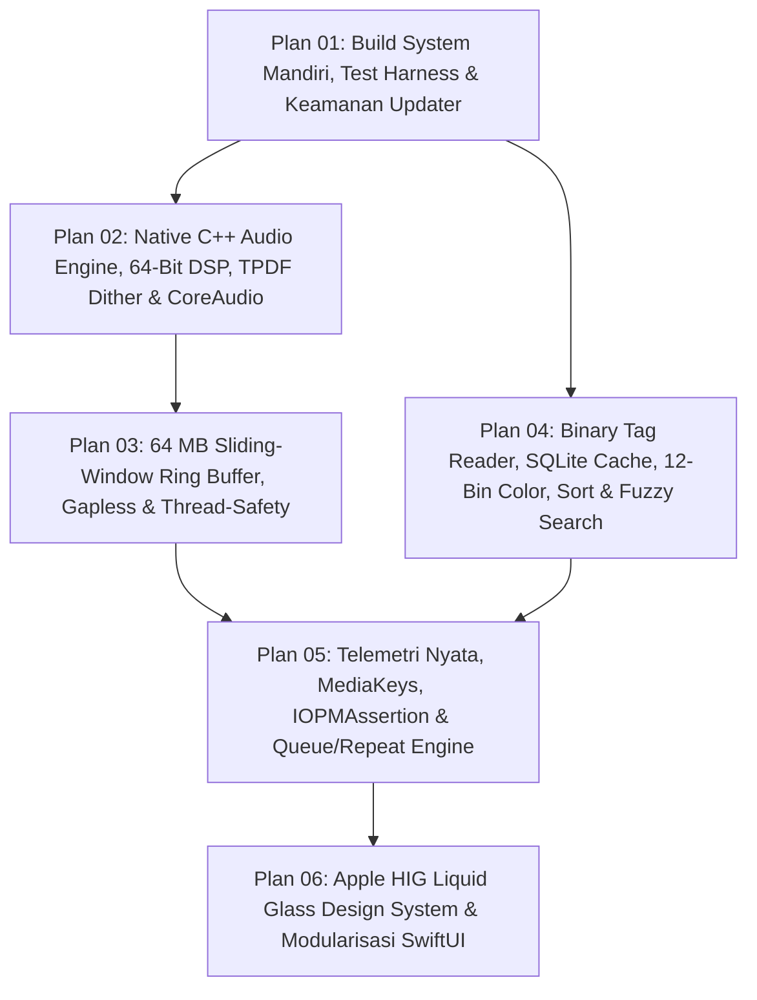

# Master Roadmap & Arsitektur Perbaikan Total TSRossa macOS

> **For agentic workers:** REQUIRED SUB-SKILL: Use superpowers:subagent-driven-development (recommended) or superpowers:executing-plans to implement this plan task-by-task. Steps use checkbox (`- [ ]`) syntax for tracking.

**Goal:** Memperbaiki dan menyempurnakan 100% temuan hasil audit pada folder [`AUDIT-ANALISA`](file:///Users/yuka/Documents/Projects/tsrossa-macos/AUDIT-ANALISA) agar port macOS (`/Users/yuka/Documents/Projects/tsrossa-macos`) mencapai paritas penuh bahkan melampaui arsitektur referensi Android (`/Users/yuka/Documents/Projects/tsrossa-ujicoba` — **STRICTLY READ-ONLY**), dilengkapi desain **Apple HIG Liquid Glass** modern.

**Architecture:** Perbaikan dibagi menjadi **6 Fase Independen & Berurutan (Sub-Plan 01 s/d 06)** di mana setiap fase menghasilkan binary aplikasi dan test suite yang dapat dikompilasi serta diverifikasi secara mandiri (Test-Driven Development / TDD). Lapisan C++ CoreAudio menangani streaming ring-buffer 64 MB, gapless handover, dan 64-bit DSP + TPDF Dither; lapisan Swift Data menangani binary parser FLAC/WAV/ID3v2 dan SQLite incremental cache; serta lapisan SwiftUI mengadopsi arsitektur modular dengan sistem material **Liquid Glass**.

**Tech Stack:** C++17 (`CoreAudio`, `AudioToolbox`, `AudioUnit`, `dr_flac`, `dr_wav`), C Bridge (`TsrossaAudioBridge.h`), Swift 5.9+ (`SwiftUI`, `AppKit`, `MediaPlayer`, `IOKit.pwr_mgt`, `SQLite3`, `Accelerate`).

---

## 1. Aturan & Batasan Global (Strict Constraints)

1. **Referensi Android Bersifat 100% READ-ONLY:** Direktori `/Users/yuka/Documents/Projects/tsrossa-ujicoba` hanya boleh dibaca atau disalin header-nya (`dr_flac.h`, `dr_wav.h`, ikon aset) ke dalam `/Users/yuka/Documents/Projects/tsrossa-macos`. **Dilarang keras** mengubah file apa pun di `/Users/yuka/Documents/Projects/tsrossa-ujicoba`.
2. **Bebas Hardcoded Path (`/Users/alen/...`):** Seluruh path lokal milik developer lama wajib dihapus dari [`build_mac.sh`](file:///Users/yuka/Documents/Projects/tsrossa-macos/build_mac.sh), [`dr_impl.c`](file:///Users/yuka/Documents/Projects/tsrossa-macos/src/nativeMain/cpp/dr_impl.c), [`MacAudioDecoder.h`](file:///Users/yuka/Documents/Projects/tsrossa-macos/src/nativeMain/cpp/MacAudioDecoder.h), [`Theme.swift`](file:///Users/yuka/Documents/Projects/tsrossa-macos/macos/Theme.swift), dan [`AppViewModel.swift`](file:///Users/yuka/Documents/Projects/tsrossa-macos/macos/AppViewModel.swift).
3. **Verifikasi Otomatis (`./run_tests.sh` & `./build_mac.sh`):** Setiap tugas mengikuti siklus TDD: tulis unit test yang gagal -> jalankan test runner -> implementasikan kode -> verifikasi test lulus & aplikasi ter-build tanpa error.

---

## 2. Daftar Dokumen Perencanaan di Folder `PLANNING-PERBAIKAN`

| No | Dokumen Plan | Menjawab Dokumen Audit | Fokus Utama Perbaikan |
| :--- | :--- | :--- | :--- |
| **00** | [`00-MASTER-ROADMAP-DAN-ARSITEKTUR-PERBAIKAN.md`](file:///Users/yuka/Documents/Projects/tsrossa-macos/PLANNING-PERBAIKAN/00-MASTER-ROADMAP-DAN-ARSITEKTUR-PERBAIKAN.md) | [`00-RINGKASAN-EKSEKUTIF-DAN-MATRIKS-PARITAS.md`](file:///Users/yuka/Documents/Projects/tsrossa-macos/AUDIT-ANALISA/00-RINGKASAN-EKSEKUTIF-DAN-MATRIKS-PARITAS.md) & [`LAPORAN-AUDIT-LENGKAP.md`](file:///Users/yuka/Documents/Projects/tsrossa-macos/AUDIT-ANALISA/LAPORAN-AUDIT-LENGKAP.md) | Arsitektur menyeluruh, peta dekomposisi file, urutan dependensi antar-fase, dan matriks pelacakan temuan audit. |
| **01** | [`01-PLAN-BUILD-SYSTEM-UPDATER-DAN-TEST-HARNESS.md`](file:///Users/yuka/Documents/Projects/tsrossa-macos/PLANNING-PERBAIKAN/01-PLAN-BUILD-SYSTEM-UPDATER-DAN-TEST-HARNESS.md) | [`05-AUDIT-BUILD-SYSTEM-KEAMANAN-UPDATER-DAN-TESTING.md`](file:///Users/yuka/Documents/Projects/tsrossa-macos/AUDIT-ANALISA/05-AUDIT-BUILD-SYSTEM-KEAMANAN-UPDATER-DAN-TESTING.md) | Self-contained repo (`dr_flac.h`, `dr_wav.h`, `Resources/`), penghapusan path `/Users/alen`, Universal Binary build, C++/Swift Test Harness (`run_tests.sh`), dan pengamanan `UpdateManager.swift` (SemVer pre-release, filter aset macOS, verifikasi `codesign`). |
| **02** | [`02-PLAN-AUDIO-ENGINE-DSP-DAN-COREAUDIO.md`](file:///Users/yuka/Documents/Projects/tsrossa-macos/PLANNING-PERBAIKAN/02-PLAN-AUDIO-ENGINE-DSP-DAN-COREAUDIO.md) | [`01-AUDIT-AUDIO-ENGINE-DSP-DAN-COREAUDIO.md`](file:///Users/yuka/Documents/Projects/tsrossa-macos/AUDIT-ANALISA/01-AUDIT-AUDIO-ENGINE-DSP-DAN-COREAUDIO.md) | Jalur ganda 32-bit Integer Direct Pass + 64-bit `double` DSP, SplitMix64 TPDF Dither, `std::llrint()`, per-sample linear volume ramp, Studio Taper curve, Hybrid CoreAudio Hardware Volume + Residual Gain, validasi `supportedRates` & fallback kelipatan integer, Hog Mode jujur, profil buffer 64/160/192ms, dan DAC Warm-up. |
| **03** | [`03-PLAN-MEMORI-RINGBUFFER-GAPLESS-DAN-KONKURENSI.md`](file:///Users/yuka/Documents/Projects/tsrossa-macos/PLANNING-PERBAIKAN/03-PLAN-MEMORI-RINGBUFFER-GAPLESS-DAN-KONKURENSI.md) | [`02-AUDIT-MEMORI-STREAMING-GAPLESS-DAN-KONKURENSI.md`](file:///Users/yuka/Documents/Projects/tsrossa-macos/AUDIT-ANALISA/02-AUDIT-MEMORI-STREAMING-GAPLESS-DAN-KONKURENSI.md) | 64 MB Sliding-Window Ring Buffer + 5s Fast-Start + `m_decodeThread`, keamanan `mlock()` (`RLIMIT_MEMLOCK` + unlock/reset saat `stop()`), Gapless Playback (`prepareNextTrack` 32 MB pre-buffer), atomic EOF flag, CAS `compare_exchange_strong` pada `m_currentFrame`, clamp seek 250ms, dan `std::mutex` pada C Bridge. |
| **04** | [`04-PLAN-METADATA-SQLITE-SORTING-DAN-SEARCH.md`](file:///Users/yuka/Documents/Projects/tsrossa-macos/PLANNING-PERBAIKAN/04-PLAN-METADATA-SQLITE-SORTING-DAN-SEARCH.md) | [`03-AUDIT-METADATA-DATABASE-LIBRARY-DAN-SEARCH.md`](file:///Users/yuka/Documents/Projects/tsrossa-macos/AUDIT-ANALISA/03-AUDIT-METADATA-DATABASE-LIBRARY-DAN-SEARCH.md) | Binary parser `AudioTagReader.swift` (FLAC Vorbis/Picture, WAV INFO/ID3, ID3v2.2/2.3/2.4, deteksi MQA), `TrackTitleParser` (`lastIndexOf(" - ")`), SQLite incremental cache (`MusicLibraryDatabase.swift`), `AlbumArtCache.swift` + 12-Bin Hue-Family `ColorContrastHelper.swift`, 12-field `SortField` + `SortOrder`, `FuzzySearchHelper.swift`, dan persistensi `UserDefaults` + memori volume per-DAC. |
| **05** | [`05-PLAN-TELEMETRI-NYATA-MEDIAKEYS-DAN-PARITAS-FITUR.md`](file:///Users/yuka/Documents/Projects/tsrossa-macos/PLANNING-PERBAIKAN/05-PLAN-TELEMETRI-NYATA-MEDIAKEYS-DAN-PARITAS-FITUR.md) | [`04-AUDIT-UI-UX-TELEMETRI-PALSU-DAN-INTEGRASI-MACOS.md`](file:///Users/yuka/Documents/Projects/tsrossa-macos/AUDIT-ANALISA/04-AUDIT-UI-UX-TELEMETRI-PALSU-DAN-INTEGRASI-MACOS.md) | Penggantian seluruh telemetri palsu di `TelemetryModalView.swift` dengan JSON real-time & `AppLogger.swift`, integrasi `MPNowPlayingInfoCenter` & `MPRemoteCommandCenter` (Media Keys `F7`/`F8`/`F9`), `IOPMAssertion` anti-sleep, perbaikan keyboard monitor arrow-key, 3-state `RepeatMode` + Shuffle Deck (`QueueHelper.swift`), manajemen Playlist lengkap, dan `TrackDetailsModalSheet`. |
| **06** | [`06-PLAN-UI-UX-THEMES-SWIFT-HIG-DAN-LIQUID-GLASS.md`](file:///Users/yuka/Documents/Projects/tsrossa-macos/PLANNING-PERBAIKAN/06-PLAN-UI-UX-THEMES-SWIFT-HIG-DAN-LIQUID-GLASS.md) | [`06-AUDIT-UI-UX-THEMES-SWIFT-HIG-DAN-LIQUID-GLASS.md`](file:///Users/yuka/Documents/Projects/tsrossa-macos/AUDIT-ANALISA/06-AUDIT-UI-UX-THEMES-SWIFT-HIG-DAN-LIQUID-GLASS.md) | Transformasi tema dari Android Material You ke **Apple HIG Liquid Glass** (`LiquidGlassModifier`, `MacVisualEffectView`, *Anisotropic Specular Rim*, *Continuous Squircle* `.continuous` + jari-jari konsentris), layout `NavigationSplitView` + `.safeAreaInset` dengan refraksi scroll-under, pemecahan `MainAppView.swift` (3.579 baris) menjadi 8 file modular dengan isolasi `@ObservedObject` di `PlaybackScrubberView`, enum strongly-typed, dan dukungan penuh Light/Dark Mode & Accessibility. |
| **07** | [`07-PLAN-PERBAIKAN-BUG-RESIZE-FIT-SCREEN-DAN-MENU-LAG.md`](file:///Users/yuka/Documents/Projects/tsrossa-macos/PLANNING-PERBAIKAN/07-PLAN-PERBAIKAN-BUG-RESIZE-FIT-SCREEN-DAN-MENU-LAG.md) | [`07-AUDIT-BUG-WINDOW-RESIZE-FIT-SCREEN-DAN-MENU-LAG.md`](file:///Users/yuka/Documents/Projects/tsrossa-macos/AUDIT-ANALISA/07-AUDIT-BUG-WINDOW-RESIZE-FIT-SCREEN-DAN-MENU-LAG.md) & [`bug-note.md`](file:///Users/yuka/Documents/Projects/tsrossa-macos/bug-note.md) | Isolasi geometri `AmbientArtworkMeshBackground` (`GeometryReader` + `.clipped()`), arsitektur **Deterministic App Shell** (`HStack`/`VStack` pengganti `NavigationSplitView` yang rusak saat resize), implementasi **`WindowZoomManager`** untuk gestur **Double-Tap Fit to Screen**, pemisahan **`AudioProgressModel`** agar timer 250ms tidak me-rerender seluruh UI, serta *Negative Cache* di `AlbumArtCache` untuk menghilangkan lag saat berpindah menu. |
| **08** | [`08-PLAN-PERBAIKAN-MODAL-TAP-THEME-SIDEBAR-SHORTCUT-ANTI-SLOP-DAN-ANIMASI.md`](file:///Users/yuka/Documents/Projects/tsrossa-macos/PLANNING-PERBAIKAN/08-PLAN-PERBAIKAN-MODAL-TAP-THEME-SIDEBAR-SHORTCUT-ANTI-SLOP-DAN-ANIMASI.md) | [`08-AUDIT-BUG-RESIZE-MODAL-TAP-TO-CLICK-THEME-SIDEBAR-SHORTCUT-DAN-ANIMASI.md`](file:///Users/yuka/Documents/Projects/tsrossa-macos/AUDIT-ANALISA/08-AUDIT-BUG-RESIZE-MODAL-TAP-TO-CLICK-THEME-SIDEBAR-SHORTCUT-DAN-ANIMASI.md) & [`bug-note.md`](file:///Users/yuka/Documents/Projects/tsrossa-macos/bug-note.md) | Layout adaptif modal & menu saat aplikasi dikecilkan (`GridItem(.adaptive)`, `GeometryReader`), konsistensi *Tap-to-Click* (`.contentShape(Rectangle())` + penghapusan konflik `.onTapGesture(count: 2)`), perbaikan tumpukan teks `'BIT-PERFECT'` (`.fixedSize()` + `.lineLimit(1)`), **Chromatic Liquid Glass Sidebar** + `.preferredColorScheme`, perbaikan `⌘F` & `KeyboardShortcutsModalSheet` (`⌘/`), pembersihan AI Slop, serta koreografi animasi kontekstual (`@Namespace matchedGeometryEffect` & transisi arah). |
| **09** | [`09-PLAN-PERBAIKAN-DOCK-ICON-SHORTCUT-ARROW-SELECT-SETTINGS-GRID-DAN-NOW-PLAYING-DRAWER.md`](file:///Users/yuka/Documents/Projects/tsrossa-macos/PLANNING-PERBAIKAN/09-PLAN-PERBAIKAN-DOCK-ICON-SHORTCUT-ARROW-SELECT-SETTINGS-GRID-DAN-NOW-PLAYING-DRAWER.md) | [`09-AUDIT-BUG-DOCK-ICON-SHORTCUT-ARROW-SELECT-SETTINGS-GRID-DAN-NOW-PLAYING-DRAWER.md`](file:///Users/yuka/Documents/Projects/tsrossa-macos/AUDIT-ANALISA/09-AUDIT-BUG-DOCK-ICON-SHORTCUT-ARROW-SELECT-SETTINGS-GRID-DAN-NOW-PLAYING-DRAWER.md) & [`bug-note.md`](file:///Users/yuka/Documents/Projects/tsrossa-macos/bug-note.md) | Generator ikon **macOS HIG Squircle** ($80.47\%$ body, $9.765\%$ margin, $22.5\%$ corner radius + drop shadow) untuk Dock & `AppIcon.icns`, state seleksi lagu (`selectedTrackPath`) untuk navigasi **Arrow Key (`↑`/`↓`) + Auto-Scroll** dan **Klik 1x (Select) vs Klik 2x (Play)** tanpa delay, perbaikan shortcut `⌘` saat kolom search fokus, penyelarasan geometris kartu Bento & switch di `SettingsBentoView`, penghapusan menu `Now Playing` dari Sidebar, serta transformasi **Drag-Up Mini Player -> Full Now Playing Stage Drawer** lengkap dengan *Hero Transport Console*, *Playable Queue*, dan *Click-to-Seek Live Lyrics*. |
| **10** | [`10-PLAN-PERBAIKAN-SIDEBAR-CLIPPING-GESTUR-TRACKPAD-DUA-JARI-DAN-ANIMASI-NOW-PLAYING.md`](file:///Users/yuka/Documents/Projects/tsrossa-macos/PLANNING-PERBAIKAN/10-PLAN-PERBAIKAN-SIDEBAR-CLIPPING-GESTUR-TRACKPAD-DUA-JARI-DAN-ANIMASI-NOW-PLAYING.md) | [`10-AUDIT-BUG-SIDEBAR-CLIPPING-GESTUR-TRACKPAD-DUA-JARI-DAN-ANIMASI-NOW-PLAYING.md`](file:///Users/yuka/Documents/Projects/tsrossa-macos/AUDIT-ANALISA/10-AUDIT-BUG-SIDEBAR-CLIPPING-GESTUR-TRACKPAD-DUA-JARI-DAN-ANIMASI-NOW-PLAYING.md) & [`bug-note.md`](file:///Users/yuka/Documents/Projects/tsrossa-macos/bug-note.md) | Penyesuaian anggaran `minWidth` responsif pada `LiquidTransportBarView` & `SidebarView` (`.layoutPriority(2)`, penghapusan `Spacer()` ganda, perataan `.leading` di `MainAppView`) agar Sidebar kiri bebas terpotong ($0\text{ pt}$ overflow) saat jendela dikecilkan, engine gestur dua jari Trackpad native (`NSEvent.scrollWheel` `hasPreciseScrollingDeltas`) terpadu dengan `DragGesture` satu jari, serta arsitektur **Persistent Geometry-Driven Drawer** ($Y_{\text{drawer}} = \text{clamp}(\text{baseOffset} + \text{dragOffset}, 0, H)$) untuk animasi pegas buka/tutup Now Playing yang mulus. |

---

## 3. Diagram Alur Eksekusi & Dependensi Antar-Fase



---

## 4. Peta Struktur File Target (`File Structure Map`)

Berikut adalah struktur akhir repositori `/Users/yuka/Documents/Projects/tsrossa-macos` setelah seluruh 6 fase selesai diimplementasikan:

```text
/Users/yuka/Documents/Projects/tsrossa-macos/
├── build_mac.sh                                # [MODIFY] Mandiri tanpa /Users/alen, dukung Universal Binary & link libsqlite3 + MediaPlayer + IOKit
├── run_tests.sh                                # [CREATE] Script test runner otomatis untuk C++ & Swift unit tests
├── src/nativeMain/cpp/
│   ├── dr_flac.h                               # [CREATE] Disalin dari referensi Android agar repositori mandiri
│   ├── dr_wav.h                                # [CREATE] Disalin dari referensi Android agar repositori mandiri
│   ├── dr_impl.c                               # [MODIFY] Gunakan #include "dr_flac.h" dan "dr_wav.h" lokal
│   ├── MacAudioDecoder.h                       # [MODIFY] Gunakan header lokal + API seekFrame() & readFramesChunk() untuk streaming
│   ├── DspUtils.h                              # [CREATE] Fungsi murni: Studio Taper, SplitMix64 TPDF Dither, Linear Gain Ramp, Integer Rate Fallback
│   ├── CoreAudioSink.h                         # [MODIFY] Atomic state, 64MB Ring Buffer, 32MB Gapless Next Buffer, Dual Integer/64-bit DSP
│   ├── CoreAudioSink.cpp                       # [MODIFY] Implementasi streaming thread, gapless handover, Hog Mode jujur, HW Volume, DAC Warmup
│   ├── TsrossaAudioBridge.h                    # [MODIFY] Tambah API C untuk gapless, warmup, atomic EOF, dan structured telemetry
│   └── TsrossaAudioBridge.cpp                  # [MODIFY] Tambah std::mutex s_bridgeMutex dan serialisasi JSON telemetri lengkap
├── macos/
│   ├── Resources/
│   │   ├── ic_launcher.png                     # [CREATE] Disalin dari referensi Android
│   │   └── ic_launcher_foreground.png          # [CREATE] Disalin dari referensi Android
│   ├── main.swift                              # [MODIFY] Menu commands lengkap (Cmd+O, Cmd+F, Cmd+U, Cmd+[, Cmd+], Space, Esc)
│   ├── Theme.swift                             # [MODIFY] Sistem desain Apple HIG Liquid Glass, Continuous Squircle, Adaptive Light/Dark, Strongly-Typed Enums
│   ├── LiquidGlassComponents.swift             # [CREATE] MacVisualEffectView, LiquidGlassModifier, SpecularRim, ConcentricSquircle
│   ├── ColorContrastHelper.swift               # [CREATE] Porting v4 12-Bin Hue-Family Chromatic Clustering & WCAG Contrast dari Android
│   ├── AudioTagReader.swift                    # [CREATE] Binary parser untuk FLAC (STREAMINFO/Vorbis/Picture), WAV (fmt/INFO/ID3), ID3v2.2/2.3/2.4, MQA, Lirik
│   ├── MetadataScanner.swift                   # [MODIFY] Orkestrasi pemindaian direktori incremental + TrackTitleParser (lastIndexOf(" - "))
│   ├── MusicLibraryDatabase.swift              # [CREATE] Wrapper native libsqlite3 untuk cold-start <20ms & incremental diffing
│   ├── AlbumArtCache.swift                     # [CREATE] Disk thumbnail cache (SHA-256) + NSCache RAM + palet warna dominan
│   ├── FuzzySearchHelper.swift                 # [CREATE] Pencarian 3 lapis: substring langsung, multi-token out-of-order, subsequence
│   ├── QueueHelper.swift                       # [CREATE] 3-state RepeatMode (.off/.all/.one), Shuffle Deck anti-ulang, Playback History Stack
│   ├── AppLogger.swift                         # [CREATE] Structured ring-buffer logger (500 entri) dengan timestamp tetap & ekspor file
│   ├── AudioEngine.swift                       # [MODIFY] Integrasi Gapless, MediaPlayer (MPNowPlayingInfoCenter), IOPMAssertion, anti-snap-back scrubber, per-DAC volume memory
│   ├── AppViewModel.swift                      # [MODIFY] Strongly-typed enums, SQLite load, 12-field sorting, persistensi UserDefaults lengkap, perbaikan keyboard monitor
│   ├── UpdateManager.swift                     # [MODIFY] SemVer pre-release comparator, filter aset macOS ketat, Cache UUID dir, verifikasi CFBundleIdentifier & codesign
│   ├── TelemetryModalView.swift                # [MODIFY] Mengonsumsi JSON telemetri C++ nyata & AppLogger, pencarian log, NSSavePanel export
│   ├── MainAppView.swift                       # [MODIFY] Kerangka utama NavigationSplitView + safeAreaInset (dipecah dari 3.579 baris menjadi <350 baris)
│   └── Views/
│       ├── SidebarView.swift                   # [CREATE] Navigasi sidebar Liquid Glass dengan badge dan daftar playlist
│       ├── LibraryView.swift                   # [CREATE] Grid/List perpustakaan lagu, filter chip Liquid Glass, menu Sort 12-field
│       ├── NowPlayingSplitView.swift           # [CREATE] Panel hero artwork dengan ambient refraction mesh & badge sinyal bit-perfect
│       ├── QueueLyricsView.swift               # [CREATE] Panel antrean (Up Next / Priority) & tampilan lirik sinkron/unsinkron
│       ├── SettingsBentoView.swift             # [CREATE] Bento grid pengaturan DAC, DSP, Library, Tema Liquid Glass, dan Updater
│       ├── LiquidTransportBarView.swift        # [CREATE] Floating bottom capsule transport bar (.safeAreaInset(edge: .bottom))
│       ├── PlaybackScrubberView.swift          # [CREATE] Subview terisolasi untuk progress bar & waktu (mencegah re-render seluruh window 4x/detik)
│       └── TrackDetailsModalSheet.swift        # [CREATE] Native macOS sheet (.presentationBackground(.ultraThinMaterial)) untuk inspeksi properti audio & pembuatan playlist
└── tests/
    ├── cpp/
    │   ├── test_dsp_utils.cpp                  # [CREATE] Unit test C++: Studio Taper, TPDF Dither, Gain Ramp, Rate Fallback
    │   └── test_ringbuffer_gapless.cpp         # [CREATE] Unit test C++: 64MB Ring Buffer wrap-around, CAS seek, Gapless handover
    └── swift/
        ├── TestRunner.swift                    # [CREATE] Entrypoint pengujian unit Swift mandiri
        ├── UpdateVersionTests.swift            # [CREATE] Pengujian SemVer pre-release & pemilihan aset macOS
        ├── AudioTagReaderTests.swift           # [CREATE] Pengujian FLAC Vorbis/Picture, ID3v2, MQA, dan TrackTitleParser
        ├── SortAndFuzzySearchTests.swift       # [CREATE] Pengujian 12-field sorting, FuzzySearchHelper, dan QueueHelper
        └── ColorAndThemeTests.swift            # [CREATE] Pengujian 12-Bin Hue-Family ColorContrastHelper & Concentric Squircle math
```

---

## 5. Matriks Pelacakan Cakupan Audit (`100% Traceability Matrix`)

| ID Temuan Audit | Ringkasan Masalah pada `AUDIT-ANALISA` | Lokasi Perbaikan di `PLANNING-PERBAIKAN` |
| :--- | :--- | :--- |
| **BUILD-01** | Hardcoded `/Users/alen/Downloads/tsrossa-perfect/...` di `build_mac.sh`, `dr_impl.c`, `MacAudioDecoder.h`, `Theme.swift`, `AppViewModel.swift` | Plan 01 — Task 1 & Task 2 |
| **BUILD-02** | Binary hanya terkompilasi untuk 1 arsitektur host dan tanpa target versi macOS minimum | Plan 01 — Task 2 |
| **SEC-01** | `UpdateManager.swift` salah memakai `yuka/tsrossa-macos`, mencocokkan `.zip` Android sembarang, menggunakan `/tmp` tanpa verifikasi `codesign` & `CFBundleIdentifier`, serta gagal membandingkan pre-release (`beta2` vs `beta10`) | Plan 01 — Task 3 & Task 4 |
| **TEST-01** | 0 unit test di repositori macOS (dibandingkan 4 suite di Android) | Plan 01 — Task 5 (serta unit test di tiap Plan 02–06) |
| **DSP-01** | Pemrosesan sample di `CoreAudioSink.cpp:L384` memakai 32-bit `float` tanpa dither (kehilangan presisi 24/32-bit) | Plan 02 — Task 1 & Task 2 |
| **DSP-02** | Perubahan gain langsung melompat per buffer tanpa interpolasi per-sample (menyebabkan bunyi *click/pop*) | Plan 02 — Task 1 & Task 2 |
| **DSP-03** | Kurva volume kubik kasar `pow(v, 3.0)` dan ketiadaan kontrol Hardware Volume DAC CoreAudio + Residual Gain | Plan 02 — Task 1 & Task 3 |
| **AUDIO-01** | `setDeviceSampleRate()` langsung memaksa `sampleRate` file tanpa mengecek `supportedRates` DAC dan tanpa membaca balik rate aktual | Plan 02 — Task 4 |
| **AUDIO-02** | Telemetri `"Hog Mode (Exclusive)"` di-hardcode palsu meskipun `m_hoggerPid == -1`, serta ketiadaan ukuran buffer 64/160/192ms dan DAC Warm-up | Plan 02 — Task 4 & Task 5 |
| **MEM-01** | Dekode seluruh file secara sinkron ke `std::vector<int32_t> m_pcmBuffer` di main thread (potensi OOM dan UI freeze) | Plan 03 — Task 1 & Task 2 |
| **MEM-02** | `mlock()` tanpa cek `RLIMIT_MEMLOCK`, tidak di-unlock saat toggle dimatikan, dan buffer tidak dibersihkan saat `stop()` | Plan 03 — Task 2 |
| **GAPLESS-01** | Tidak ada engine Gapless (`prepareNextTrack`) dan bug deteksi akhir lagu `t >= totalDuration - 0.5` yang memotong 500ms terakhir / macet pada lagu `< 0.5s` | Plan 03 — Task 3 |
| **CONC-01** | Data race antara `playTrack()`, `seekTo()`, `handleRender()`, dan `TsrossaAudioBridge.cpp` (`s_cachedDevices` / `s_lastTelemetry`) serta slider scrubber memantul balik | Plan 03 — Task 4 |
| **META-01** | `MetadataScanner.swift` hanya membaca `STREAMINFO` FLAC & `fmt/data` WAV; buta terhadap Vorbis Comments, ID3v2, Artwork, Lirik, dan MQA; salah memotong judul pada `" - "` pertama | Plan 04 — Task 1 & Task 2 |
| **DB-01** | Tidak ada database SQLite (scan ulang setiap buka aplikasi) dan tidak ada disk thumbnail/color cache | Plan 04 — Task 3 & Task 4 |
| **SORT-01** | 6 dari 12 opsi Sortir gagal bekerja, arah Descending diabaikan, dan urutan rusak setelah background enrichment | Plan 04 — Task 5 |
| **SEARCH-01** | Pencarian hanya `.localizedCaseInsensitiveContains` tanpa Fuzzy Search, serta 10+ pengaturan hilang saat restart | Plan 04 — Task 5 & Task 6 |
| **TELEM-01** | `TelemetryModalView.swift` menampilkan string statis palsu dan timestamp `Date()` yang berubah tiap re-render | Plan 05 — Task 1 |
| **MACOS-01** | Tidak ada integrasi `MPNowPlayingInfoCenter` / Media Keys (`F7`/`F8`/`F9`), `IOPMAssertion` layar tetap menyala, dan arrow key dibajak secara global | Plan 05 — Task 2 & Task 3 |
| **QUEUE-01** | Tidak ada Repeat Mode (`Off`/`All`/`One`), Shuffle masih acak murni tanpa Shuffle Deck & History Stack, serta tidak ada Rename/Pin/Folder Playlist & Track Details Sheet | Plan 05 — Task 4 & Task 5 |
| **HIG-01** | `Theme.swift` menyalin warna flat Android Material You, mengabaikan Light Mode & Reduce Transparency, memakai `.cornerRadius` terdeprekasi, serta `MainAppView.swift` (3.579 baris) me-rerender seluruh layar 4x/detik tanpa efek **Liquid Glass** | Plan 06 — Task 1 s/d Task 6 |

---

## 6. Review Focus

Bagian-bagian keputusan arsitektur utama yang perlu diperhatikan saat mengeksekusi rangkaian plan ini:
1. **Urutan Eksekusi Fase 01 Lebih Dulu:** Fase 01 wajib dijalankan pertama kali karena menyalin `dr_flac.h`, `dr_wav.h`, dan aset ikon ke dalam repositori serta menyiapkan `./run_tests.sh` yang dibutuhkan oleh Fase 02 hingga Fase 06.
2. **Kompatibilitas C Bridge (`TsrossaAudioBridge.h`):** Penambahan fungsi C baru di Fase 02 dan Fase 03 dirancang *backward-compatible* dengan mempertahankan fungsi eksisting sambil menambahkan API terstruktur untuk gapless, warmup, dan JSON telemetri nyata.
3. **Pemecahan `MainAppView.swift` di Fase 06:** Dilakukan pada fase terakhir setelah seluruh logika `AppViewModel` dan `AudioEngine` stabil, sehingga pemisahan view dan penerapan modifier `.liquidGlass(...)` tidak menimbulkan konflik merge pada state logic.
