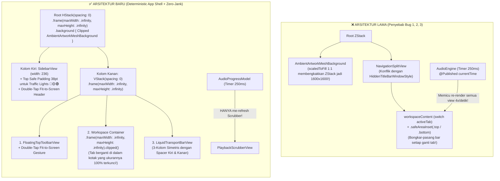

# Plan 07: Rencana Perbaikan & Penyempurnaan Bug Window Resize, Gestur Double-Tap Fit-to-Screen, & Optimasi Performa Perpindahan Menu (`bug-note.md`)

> **Gaya Panduan:** *Senior macOS / SwiftUI Systems Engineer membimbing Junior Engineer secara bertahap, menjelaskan konsep fundamental ("Mengapa"), pola desain ("Bagaimana"), dan kode implementasi yang presisi ("Apa yang harus ditulis").*

**Referensi Audit:** [`AUDIT-ANALISA/07-AUDIT-BUG-WINDOW-RESIZE-FIT-SCREEN-DAN-MENU-LAG.md`](file:///Users/yuka/Documents/Projects/tsrossa-macos/AUDIT-ANALISA/07-AUDIT-BUG-WINDOW-RESIZE-FIT-SCREEN-DAN-MENU-LAG.md)
**Sumber Laporan Masalah:** [`bug-note.md`](file:///Users/yuka/Documents/Projects/tsrossa-macos/bug-note.md)

---

## 🎯 Tujuan Akhir (Goals)

1. **Menyelesaikan Bug #1 (Tampilan Bar & Menu Rusak Saat Window Diperbesar / Diperkecil):**
   - Mengisolasi `AmbientArtworkMeshBackground` menggunakan `GeometryReader` + `.clipped()` di dalam modifier `.background` (bukan sebagai *sibling* di dalam `ZStack`), sehingga gambar sampul album `.scaledToFill()` **tidak akan pernah lagi** mengubah atau membengkakkan ukuran jendela/layout.
   - Mengganti `NavigationSplitView` + `.safeAreaInset` yang tidak stabil pada `HiddenTitleBarWindowStyle` dengan **Deterministic App Shell (`HStack(spacing: 0)` + `VStack(spacing: 0)`)** yang mengunci posisi `SidebarView`, `FloatingTopToolbarView`, `workspaceContent`, dan `LiquidTransportBarView` secara presisi pada segala ukuran layar (`920×620` hingga `5K Retina`).
   - Memperbaiki tabrakan tombol *Traffic Lights* macOS (🔴🟡🟢) di `SidebarView`, menghapus *double bottom padding* di `NowPlayingSplitView`, dan menyeimbangkan `Spacer()` di `LiquidTransportBarView`.

2. **Menyelesaikan Bug #2 (Gestur Double-Tap / Double-Click untuk *Fit to Screen* Belum Berfungsi):**
   - Membangun **`WindowZoomManager`** berbasis AppKit (`NSWindowDelegate` + `NSEvent` local monitor + SwiftUI `TapGesture(count: 2)`) yang menangani gestur **double-tap / double-click** pada area bar atas (Titlebar strip, Header Sidebar, dan latar Top Toolbar).
   - Saat di-double-tap, jendela akan melakukan animasi halus **Fit to Screen** memenuhi `NSScreen.visibleFrame` (atau kembali ke ukuran semula jika sudah dalam posisi *Fit to Screen*).

3. **Menyelesaikan Bug #3 (Lag Saat Berpindah Menu & Tampilan Menu Rusak Setelahnya):**
   - Memisahkan state frekuensi tinggi (`currentTime`, `totalDuration`, `isSeeking`) dari `AudioEngine` ke dalam **`AudioProgressModel`** terpisah agar timer `250ms` **tidak lagi memicu re-render** pada `MainAppView`, `LibraryView`, `NowPlayingSplitView`, `QueueLyricsView`, `SettingsBentoView`, dan `LiquidTransportBarView`.
   - Menambahkan **Negative Cache (`missingPaths`) & Async Pre-warming** di `AlbumArtCache.swift` serta menghormati `artworkThumbPath` agar pembacaan baris lagu di `LibraryView` **0% menyentuh disk secara sinkron di Main Thread**.
   - Menyimpan hasil `filteredTracks` dan `formattedTotalDuration` sebagai state ter-cache di `AppViewModel` (bukan dihitung ulang 4–5 kali setiap render), serta men-decode `HardwareTelemetrySnapshot` satu kali saja saat JSON berubah.
   - Memastikan setiap halaman tab (`NowPlayingSplitView`, `LibraryView`, `SettingsBentoView`) memiliki kontrak geometri `.frame(maxWidth: .infinity, maxHeight: .infinity)` sehingga perpindahan menu berlangsung instan (`< 4ms`) tanpa mengubah ukuran kontainer induk.

---

## 🏗️ Arsitektur Solusi: Sebelum vs Sesudah



---

## 📁 Daftar File yang Akan Dimodifikasi & Diuji

| File | Peran Perubahan |
| :--- | :--- |
| [`macos/Sources/LiquidGlassComponents.swift`](file:///Users/yuka/Documents/Projects/tsrossa-macos/macos/Sources/LiquidGlassComponents.swift) | Membungkus `AmbientArtworkMeshBackground` dengan `GeometryReader` + `.clipped()` + `.allowsHitTesting(false)` agar 100% *layout-neutral*, serta menambahkan `WindowZoomManager` untuk fitur **Double-Tap Fit to Screen**. |
| [`macos/Sources/main.swift`](file:///Users/yuka/Documents/Projects/tsrossa-macos/macos/Sources/main.swift) | Menghubungkan `TsrossaAppDelegate` dengan `WindowZoomManager.shared.configure(window:)` agar jendela utama mendukung `windowWillUseStandardFrame` dan monitor double-tap di strip titlebar atas. |
| [`macos/Sources/AudioEngine.swift`](file:///Users/yuka/Documents/Projects/tsrossa-macos/macos/Sources/AudioEngine.swift) | Memperkenalkan `AudioProgressModel` (`engine.progress`) untuk mengisolasi `currentTime`/`totalDuration`, memperbaiki `play(track:)` agar tidak menghapus `artworkThumbPath`, dan menyimpan `telemetrySnapshot` secara ter-cache. |
| [`macos/Sources/AlbumArtCache.swift`](file:///Users/yuka/Documents/Projects/tsrossa-macos/macos/Sources/AlbumArtCache.swift) & [`TrackMetadata.swift`](file:///Users/yuka/Documents/Projects/tsrossa-macos/macos/Sources/TrackMetadata.swift) | Menambahkan *Negative Cache* (`missingPaths`) & thread-safety lock di `AlbumArtCache`, serta mempercepat `TrackMetadata.artwork` agar tidak melakukan syscall disk di Main Thread untuk lagu tanpa artwork. |
| [`macos/Sources/AppViewModel.swift`](file:///Users/yuka/Documents/Projects/tsrossa-macos/macos/Sources/AppViewModel.swift) | Meng-cache `filteredTracks` dan `formattedTotalDuration` agar hanya dihitung satu kali saat filter/lagu berubah (bukan pada setiap frame render). |
| [`macos/Sources/MainAppView.swift`](file:///Users/yuka/Documents/Projects/tsrossa-macos/macos/Sources/MainAppView.swift) | Mengganti `ZStack` + `NavigationSplitView` + `.safeAreaInset` dengan **Deterministic App Shell** (`HStack(spacing: 0)` + `.background { AmbientArtworkMeshBackground }`) yang 100% tahan resize dan perpindahan tab. |
| [`macos/Sources/Views/SidebarView.swift`](file:///Users/yuka/Documents/Projects/tsrossa-macos/macos/Sources/Views/SidebarView.swift) | Memberikan ruang aman atas `38pt` untuk tombol *Traffic Lights* (🔴🟡🟢), mengunci `.frame(width: 236)` & `.frame(maxHeight: .infinity)`, dan memasang gestur double-tap *Fit to Screen* pada area header. |
| [`macos/Sources/Views/FloatingTopToolbarView.swift`](file:///Users/yuka/Documents/Projects/tsrossa-macos/macos/Sources/Views/FloatingTopToolbarView.swift) | Memasang gestur double-tap *Fit to Screen* pada latar bar atas dan memastikan ukuran bar responsif saat jendela diperkecil/diperbesar. |
| [`macos/Sources/Views/LiquidTransportBarView.swift`](file:///Users/yuka/Documents/Projects/tsrossa-macos/macos/Sources/Views/LiquidTransportBarView.swift) & [`PlaybackScrubberView.swift`](file:///Users/yuka/Documents/Projects/tsrossa-macos/macos/Sources/Views/PlaybackScrubberView.swift) | Menyeimbangkan `Spacer(minLength: 12)` di kiri dan kanan scrubber agar kontrol selalu di tengah, serta mengarahkan `PlaybackScrubberView` ke `AudioEngine.shared.progress`. |
| [`macos/Sources/Views/NowPlayingSplitView.swift`](file:///Users/yuka/Documents/Projects/tsrossa-macos/macos/Sources/Views/NowPlayingSplitView.swift), [`LibraryView.swift`](file:///Users/yuka/Documents/Projects/tsrossa-macos/macos/Sources/Views/LibraryView.swift), [`QueueLyricsView.swift`](file:///Users/yuka/Documents/Projects/tsrossa-macos/macos/Sources/Views/QueueLyricsView.swift), [`SettingsBentoView.swift`](file:///Users/yuka/Documents/Projects/tsrossa-macos/macos/Sources/Views/SettingsBentoView.swift) | Menghapus *double bottom padding* (`90pt`), membuat ukuran Hero Artwork adaptif dengan `GeometryReader`, menghapus observasi `AudioEngine` yang tidak perlu, dan mengunci `.frame(maxWidth: .infinity, maxHeight: .infinity)`. |

---

## 🛠️ Rincian Langkah Demi Langkah (Task-by-Task Implementation Guide)

### Task 1: Isolasi Geometri `AmbientArtworkMeshBackground` & Pembuatan `WindowZoomManager` (Perbaikan Inti Bug #1 & Bug #2)

> **Pelajaran Senior:**
> Mengapa kita memperbaiki `AmbientArtworkMeshBackground` dan `WindowZoomManager` terlebih dahulu?
> Karena `AmbientArtworkMeshBackground` adalah biang keladi yang merusak sistem koordinat seluruh jendela saat ada gambar sampul album, sedangkan `WindowZoomManager` adalah pengontrol jendela AppKit untuk fitur *Fit to Screen*.

**File:** [`macos/Sources/LiquidGlassComponents.swift`](file:///Users/yuka/Documents/Projects/tsrossa-macos/macos/Sources/LiquidGlassComponents.swift) & [`macos/Sources/main.swift`](file:///Users/yuka/Documents/Projects/tsrossa-macos/macos/Sources/main.swift)

- [ ] **Step 1.1: Bungkus `AmbientArtworkMeshBackground` dengan `GeometryReader` dan `.clipped()`**
  Di `LiquidGlassComponents.swift`, ubah `AmbientArtworkMeshBackground.body` agar gambar `Image(nsImage: img).resizable().scaledToFill()` **selalu dipaksa mengikuti `geo.size.width` dan `geo.size.height`** lalu dipotong dengan `.clipped()` dan diberi `.allowsHitTesting(false)`:
  ```swift
  public var body: some View {
      GeometryReader { geo in
          ZStack {
              if isDark {
                  Color(red: 0.05, green: 0.05, blue: 0.07)
              } else {
                  Color(red: 0.95, green: 0.96, blue: 0.98)
              }

              if canvasMode == .liquidRefraction || canvasMode == .ambientMesh {
                  if let img = artwork {
                      Image(nsImage: img)
                          .resizable()
                          .scaledToFill()
                          .frame(width: geo.size.width, height: geo.size.height)
                          .blur(radius: 80)
                          .opacity(isDark ? 0.38 : 0.20)
                          .clipped()
                  } else {
                      LinearGradient(
                          colors: [
                              accentColor.opacity(isDark ? 0.35 : 0.20),
                              Color.indigo.opacity(isDark ? 0.20 : 0.10),
                              Color.clear
                          ],
                          startPoint: .topLeading,
                          endPoint: .bottomTrailing
                      )
                      .blur(radius: 60)
                  }
              }

              RadialGradient(
                  gradient: Gradient(colors: [
                      Color.clear,
                      isDark ? Color.black.opacity(0.45) : Color.white.opacity(0.25)
                  ]),
                  center: .center,
                  startRadius: 180,
                  endRadius: max(geo.size.width, geo.size.height) * 0.75
              )
          }
          .frame(width: geo.size.width, height: geo.size.height)
          .clipped()
      }
      .ignoresSafeArea()
      .allowsHitTesting(false)
  }
  ```
  *Penjelasan ke Junior:* Dengan membungkusnya di dalam `GeometryReader` dan mematok `.frame(width: geo.size.width, height: geo.size.height)` + `.clipped()`, gambar sampul 1:1 sebesar apa pun **mustahil** mendorong ukuran parent view!

- [ ] **Step 1.2: Bangun `WindowZoomManager` untuk Gestur Double-Tap *Fit to Screen***
  Tambahkan `public final class WindowZoomManager: NSObject, NSWindowDelegate` di `LiquidGlassComponents.swift` (atau `main.swift`):
  ```swift
  public final class WindowZoomManager: NSObject, NSWindowDelegate {
      public static let shared = WindowZoomManager()
      private var savedRestoreFrames: [Int: NSRect] = [:]
      private var mouseMonitor: Any?

      public func configure(window: NSWindow) {
          window.delegate = self
          window.minSize = NSSize(width: 920, height: 620)
          window.titlebarAppearsTransparent = true
          window.titleVisibility = .hidden
          installTopBarDoubleTapMonitorIfNeeded()
      }

      /// Dipanggil saat pengguna melakukan double-tap / double-click pada bar atas
      /// atau menekan tombol Zoom hijau untuk membuat aplikasi Fit to Screen.
      public func toggleFitToScreen(for targetWindow: NSWindow? = nil) {
          guard let window = targetWindow ?? NSApplication.shared.keyWindow ?? NSApplication.shared.windows.first,
                let screen = window.screen ?? NSScreen.main else { return }

          let visibleFrame = screen.visibleFrame
          let currentFrame = window.frame
          let winNum = window.windowNumber

          let isAlreadyFitted =
              abs(currentFrame.origin.x - visibleFrame.origin.x) <= 6 &&
              abs(currentFrame.origin.y - visibleFrame.origin.y) <= 6 &&
              abs(currentFrame.width - visibleFrame.width) <= 6 &&
              abs(currentFrame.height - visibleFrame.height) <= 6

          if isAlreadyFitted {
              if let restore = savedRestoreFrames[winNum] {
                  window.setFrame(restore, display: true, animate: true)
              } else {
                  let defaultWidth = min(1220.0, visibleFrame.width * 0.82)
                  let defaultHeight = min(780.0, visibleFrame.height * 0.82)
                  let centered = NSRect(
                      x: visibleFrame.midX - defaultWidth / 2.0,
                      y: visibleFrame.midY - defaultHeight / 2.0,
                      width: defaultWidth,
                      height: defaultHeight
                  )
                  window.setFrame(centered, display: true, animate: true)
              }
          } else {
              savedRestoreFrames[winNum] = currentFrame
              window.setFrame(visibleFrame, display: true, animate: true)
          }
      }

      public func windowWillUseStandardFrame(_ window: NSWindow, defaultFrame newFrame: NSRect) -> NSRect {
          return window.screen?.visibleFrame ?? newFrame
      }

      private func installTopBarDoubleTapMonitorIfNeeded() {
          guard mouseMonitor == nil else { return }
          mouseMonitor = NSEvent.addLocalMonitorForEvents(matching: [.leftMouseDown]) { [weak self] event in
              guard let self = self,
                    event.clickCount == 2,
                    let window = event.window,
                    let contentView = window.contentView else {
                  return event
              }

              // Cek apakah posisi klik berada di zona bar atas (58pt teratas dari jendela)
              let loc = event.locationInWindow
              let topDistance = contentView.bounds.height - loc.y
              guard topDistance >= 0 && topDistance <= 58 else {
                  return event
              }

              // Jangan intersep jika pengguna sedang double-click teks di kolom pencarian (NSTextView) atau tombol
              if let hitView = contentView.hitTest(loc) {
                  if hitView is NSTextView || hitView is NSTextField || hitView is NSControl {
                      return event
                  }
              }

              DispatchQueue.main.async {
                  self.toggleFitToScreen(for: window)
              }
              return event
          }
      }
  }
  ```

---

### Task 2: Rekonstruksi `MainAppView.swift` Menjadi *Deterministic App Shell* (Menghapus `NavigationSplitView` yang Merusak Bar Saat Resize/Pindah Menu)

> **Pelajaran Senior:**
> Mengapa kita mengganti `NavigationSplitView` + `.safeAreaInset` di `MainAppView.swift` dengan `HStack(spacing: 0)` dan `VStack(spacing: 0)`?
> Karena:
> 1. Dengan `HStack(spacing: 0)`, kolom kiri (`SidebarView`) selalu memiliki lebar pasti `236pt` dan tinggi penuh `100%` jendela.
> 2. Kolom kanan adalah `VStack(spacing: 0)` yang terdiri dari:
>    - **Baris 1 (Atas):** `FloatingTopToolbarView` (Tinggi terkunci di atas, tidak akan pernah bergeser/hilang!).
>    - **Baris 2 (Tengah):** Kontainer `ZStack` dengan `.frame(maxWidth: .infinity, maxHeight: .infinity)` dan `.clipped()` yang menampung `workspaceContent(theme: theme)`. Apa pun yang terjadi di dalam menu (`Now Playing`, `Music Library`, `Playlists`, `Settings`), ia terkurung rapi di dalam kotak tengah ini dan **mustahil** mendorong atau merusak Top Toolbar maupun Bottom Transport Bar!
>    - **Baris 3 (Bawah):** `LiquidTransportBarView` (Tinggi terkunci di bawah, selalu utuh saat diperbesar maupun diperkecil!).

**File:** [`macos/Sources/MainAppView.swift`](file:///Users/yuka/Documents/Projects/tsrossa-macos/macos/Sources/MainAppView.swift)

- [ ] **Step 2.1: Terapkan *Deterministic App Shell* di `MainAppView.swift`**
  - Hapus `@ObservedObject var engine = AudioEngine.shared` dari `MainAppView` atau pastikan `AudioEngine` tidak memancarkan update setiap 250ms.
  - Pasang `AmbientArtworkMeshBackground` di dalam `.background { ... }` milik root `ZStack`!
  - Gunakan `HStack(spacing: 0)`:
    ```swift
    HStack(spacing: 0) {
        // Left Column: Fixed-width Sidebar with macOS Traffic Lights clearance
        SidebarView(theme: theme)
            .frame(width: 236)
            .frame(maxHeight: .infinity)

        // Subtle vertical separator line
        Rectangle()
            .fill(Color.white.opacity(isEffectiveDark ? 0.08 : 0.14))
            .frame(width: 1)
            .frame(maxHeight: .infinity)

        // Right Column: Deterministic Top Bar + Middle Content + Bottom Transport Bar
        VStack(spacing: 0) {
            FloatingTopToolbarView(theme: theme)
                .padding(.horizontal, 18)
                .padding(.top, 12)
                .padding(.bottom, 8)

            ZStack {
                workspaceContent(theme: theme)
                    .frame(maxWidth: .infinity, maxHeight: .infinity)
            }
            .frame(maxWidth: .infinity, maxHeight: .infinity)
            .clipped()

            LiquidTransportBarView(theme: theme)
                .padding(.horizontal, 18)
                .padding(.top, 6)
                .padding(.bottom, 12)
        }
        .frame(maxWidth: .infinity, maxHeight: .infinity)
    }
    .frame(maxWidth: .infinity, maxHeight: .infinity)
    ```

- [ ] **Step 2.2: Perbaiki Layout `SidebarView`, `FloatingTopToolbarView`, `LiquidTransportBarView`, dan `NowPlayingSplitView`**
  1. **`SidebarView.swift`**:
     - Ubah `.padding(.top, 16)` pada logo header menjadi `.padding(.top, 38)` agar logo `"TSRossa"` berada tepat di bawah tombol 🔴🟡🟢 macOS dan tidak pernah bertabrakan!
     - Tambahkan `.onTapGesture(count: 2) { WindowZoomManager.shared.toggleFitToScreen() }` pada area header logo `SidebarView`.
     - Ubah `.frame(minWidth: 200, maxWidth: 260)` menjadi `.frame(width: 236).frame(maxHeight: .infinity)`.
  2. **`FloatingTopToolbarView.swift`**:
     - Tambahkan `.contentShape(Rectangle())` dan `.onTapGesture(count: 2) { WindowZoomManager.shared.toggleFitToScreen() }` pada area kosong bar atas.
  3. **`LiquidTransportBarView.swift`**:
     - Tambahkan `Spacer(minLength: 12)` di antara Kolom Kiri (Info Lagu) dan Kolom Tengah (Tombol Play & Scrubber), sehingga terdapat sepasang `Spacer(minLength: 12)` yang mengapit Kolom Tengah secara simetris!
     - Berikan `.frame(width: 210, alignment: .leading)` pada Kolom Kiri dan `.frame(width: 210, alignment: .trailing)` pada Kolom Kanan agar Kolom Tengah benar-benar berada di titik tengah horizontal layar pada ukuran jendela berapa pun.
  4. **`NowPlayingSplitView.swift`, `LibraryView.swift`, `SettingsBentoView.swift`**:
     - Hapus `.padding(.bottom, 90)` yang berlebih karena `LiquidTransportBarView` kini memiliki ruangnya sendiri di dalam `VStack(spacing: 0)` (cukup `.padding(.bottom, 16)`).
     - Di `NowPlayingSplitView.swift`, gunakan `GeometryReader` untuk menghitung ukuran Hero Artwork secara proporsional (`let artSize = min(320, max(160, geo.size.height - 140))`) sehingga ketika jendela diperkecil ke tinggi `620pt`, gambar sampul mengecil dengan anggun dan tidak pernah menekan teks judul lagu!

---

### Task 3: Pemisahan `AudioProgressModel` & Penghapusan Main-Thread I/O / Redundant Filtering (Perbaikan Inti Bug #3)

> **Pelajaran Senior:**
> Mengapa perpindahan menu terasa lag? Karena Main Thread sedang dibombardir oleh 3 hal:
> 1. `AudioEngine` menembakkan `objectWillChange` setiap 250ms ke seluruh view.
> 2. `AlbumArtCache.thumbnailImage` melakukan hash `SHA256` dan mengecek disk di Main Thread berulang kali untuk lagu yang tidak punya sampul.
> 3. `vm.filteredTracks` dihitung ulang 4–5 kali setiap render pass.

**File:**
- [`macos/Sources/AudioEngine.swift`](file:///Users/yuka/Documents/Projects/tsrossa-macos/macos/Sources/AudioEngine.swift)
- [`macos/Sources/Views/PlaybackScrubberView.swift`](file:///Users/yuka/Documents/Projects/tsrossa-macos/macos/Sources/Views/PlaybackScrubberView.swift)
- [`macos/Sources/AlbumArtCache.swift`](file:///Users/yuka/Documents/Projects/tsrossa-macos/macos/Sources/AlbumArtCache.swift)
- [`macos/Sources/TrackMetadata.swift`](file:///Users/yuka/Documents/Projects/tsrossa-macos/macos/Sources/TrackMetadata.swift)
- [`macos/Sources/AppViewModel.swift`](file:///Users/yuka/Documents/Projects/tsrossa-macos/macos/Sources/AppViewModel.swift)

- [ ] **Step 3.1: Buat `AudioProgressModel` di `AudioEngine.swift` & Hubungkan ke `PlaybackScrubberView.swift`**
  ```swift
  public final class AudioProgressModel: ObservableObject {
      @Published public var currentTime: Double = 0.0
      @Published public var totalDuration: Double = 0.0
      @Published public var isSeeking: Bool = false
      public init() {}
  }
  ```
  - Di `AudioEngine`:
    - Simpan `public let progress = AudioProgressModel()`.
    - Ubah `currentTime`, `totalDuration`, dan `isSeeking` pada `AudioEngine` menjadi properti biasa (tanpa `@Published` pada `AudioEngine`!) yang meneruskan nilainya ke `progress.currentTime`, `progress.totalDuration`, dan `progress.isSeeking`.
    - Dengan demikian, ketika `progressTimer` meng-update `self.currentTime = t` setiap 250ms, **hanya `AudioProgressModel` yang memancarkan perubahan**, dan **hanya `PlaybackScrubberView`** yang di-rerender!
  - Di `AudioEngine.swift`, ubah `telemetrySnapshot` menjadi `@Published public private(set) var telemetrySnapshot = HardwareTelemetrySnapshot()` yang hanya di-decode satu kali ketika `telemetryJson` berubah (melalui `didSet`), bukan di-decode ulang di setiap `View.body`.
  - Di `AudioEngine.play(track:)`, gunakan `var updatedTrack = track` lalu perbarui `sampleRate`, `bitDepth`, `channels`, dan `durationSeconds` agar properti `artworkThumbPath`, `dominantColorHex`, `isMqa`, dan `lyrics` **tidak hilang**!

- [ ] **Step 3.2: Tambahkan Negative Cache (`missingPaths`) & Fast-Path di `AlbumArtCache.swift` & `TrackMetadata.swift`**
  - Di `TrackMetadata.swift`:
    ```swift
    public var artwork: NSImage? {
        AlbumArtCache.shared.thumbnailImage(for: path, knownThumbPath: artworkThumbPath)
    }
    ```
  - Di `AlbumArtCache.swift`:
    - Tambahkan `private var missingPaths = Set<String>()` dan `private let lock = NSLock()`.
    - Jika `missingPaths.contains(trackPath)` dan `knownThumbPath == nil`, langsung kembalikan `nil` dalam waktu **0.0001 ms (O(1) memory lookup)** tanpa menghitung `SHA256` dan tanpa menyentuh SSD!
    - Saat `storeAndProcessArtwork` berhasil menyimpan thumbnail untuk `trackURL.path`, hapus path tersebut dari `missingPaths`.

- [ ] **Step 3.3: Cache `filteredTracks` dan `formattedTotalDuration` di `AppViewModel.swift` & `LibraryView.swift`**
  - Di `LibraryView.swift`, simpan `let tracks = vm.filteredTracks` satu kali saja di awal `body` dan teruskan ke header, kondisi kosong, dan `ForEach(tracks)` tanpa memanggil `vm.filteredTracks` berulang-ulang!
  - Hindari `Array(tracks.enumerated())` di dalam `ForEach`; gunakan `ForEach(tracks)` langsung atau indeks O(1) yang ringan agar SwiftUI `LazyVStack` dapat melakukan *view recycling* dan *diffing* berdasarkan `track.id` secara instan saat berpindah tab!

---

## 🧪 Rencana Pengujian & Verifikasi (Verification Checklist)

- [ ] **1. Verifikasi Kompilasi & Unit Tests:**
  - Jalankan `./build_mac.sh` $\rightarrow$ Harus lulus dengan `Exit Code 0`.
  - Jalankan `./run_tests.sh` $\rightarrow$ Seluruh C++ DSP, RingBuffer, dan Swift Unit Tests (termasuk tes baru untuk `WindowZoomManager` & `AlbumArtCache` negative cache) harus `PASS 100%`.
- [ ] **2. Verifikasi Bug #1 (Resize Window):**
  - Perbesar jendela ke ukuran maksimum dan perkecil ke ukuran minimum (`920 × 620`) baik saat lagu dengan sampul album sedang diputar maupun saat idle $\rightarrow$ Top Toolbar, Sidebar, Now Playing, Library, dan Bottom Transport Bar harus tetap utuh, simetris, dan tidak ada satu pun bar yang terpotong/rusak.
- [ ] **3. Verifikasi Bug #2 (Double-Tap Fit to Screen):**
  - Double-tap / double-click pada area bar atas (`FloatingTopToolbarView` atau header `SidebarView`) $\rightarrow$ Jendela harus membesar memenuhi layar kerja (`visibleFrame`), dan saat di-double-tap kembali harus mengecil ke ukuran semula.
- [ ] **4. Verifikasi Bug #3 (Perpindahan Menu Tanpa Lag & Tanpa Merusak Tampilan):**
  - Klik berpindah-pindah secara cepat antara `Now Playing`, `Music Library`, `Playlists`, dan `Settings & DAC` sambil memutar lagu $\rightarrow$ Perpindahan harus instan tanpa jeda/lag, dan layout di setiap menu tetap rapi 100%.
- [ ] **5. Deploy ke `/Applications/TSRossa.app`:**
  - Jalankan `./install_mac.sh` agar versi yang telah diperbaiki langsung terpasang di perangkat pengguna.
