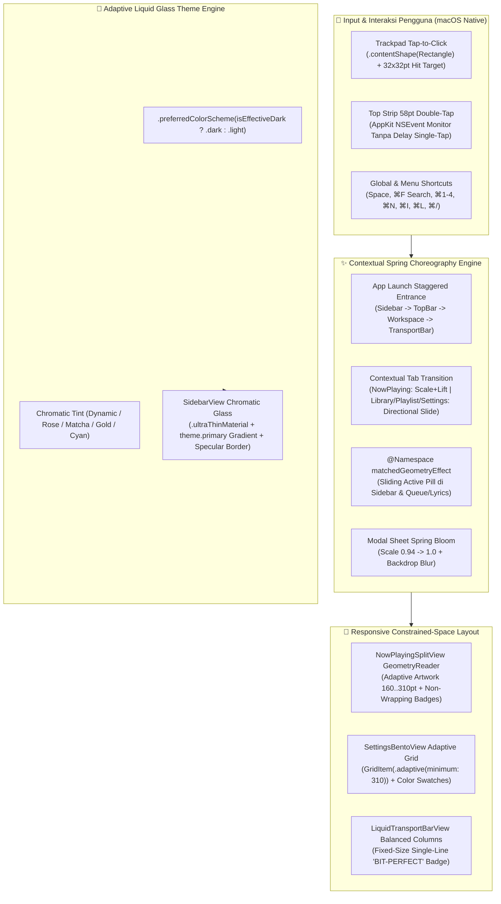

# Plan 08: Rencana Perbaikan & Penyempurnaan Layout Responsif Modal/Menu, Konsistensi Gestur Tap-to-Click, Perbaikan Teks `'BIT-PERFECT'` Bertumpuk, Theme Sidebar Liquid Glass, Shortcut Keyboard Lengkap, Eliminasi "AI Slop", & Koreografi Animasi Kontekstual (`bug-note.md`)

> **Gaya Panduan:** *Senior macOS / SwiftUI Systems Engineer membimbing Junior Engineer langkah demi langkah dengan penjelasan konsep ("Mengapa"), arsitektur visual ("Bagaimana"), dan potongan kode produksi ("Apa yang harus ditulis").*

**Referensi Audit:** [`AUDIT-ANALISA/08-AUDIT-BUG-RESIZE-MODAL-TAP-TO-CLICK-THEME-SIDEBAR-SHORTCUT-DAN-ANIMASI.md`](file:///Users/yuka/Documents/Projects/tsrossa-macos/AUDIT-ANALISA/08-AUDIT-BUG-RESIZE-MODAL-TAP-TO-CLICK-THEME-SIDEBAR-SHORTCUT-DAN-ANIMASI.md)  
**Sumber Laporan Masalah:** [`bug-note.md`](file:///Users/yuka/Documents/Projects/tsrossa-macos/bug-note.md)

---

## 🎯 Target Penyelesaian (7 Sasaran Utama)

1. **Menyelesaikan #BUG 1 (Tampilan Modal & Menu Bertabrakan Saat Aplikasi Dikecilkan):**
   - Mengubah `SettingsBentoView` dari grid 2-kolom kaku menjadi **Adaptive Bento Grid (`GridItem(.adaptive(minimum: 310), spacing: 14)`)** dan mengganti `SegmentedPickerStyle` yang kepanjangan dengan kontrol pilihan kompak + swatch warna interaktif.
   - Mengubah `NowPlayingSplitView` agar menggunakan `GeometryReader` proporsional sehingga ukuran Hero Artwork (`160pt`–`310pt`), info lagu, badge, dan panel `QueueLyricsView` menyesuaikan diri secara mulus tanpa pernah bertabrakan pada ukuran jendela kecil.
   - Membungkus seluruh modal (`TelemetryModalView`, `TrackDetailsModalSheet`, `CreatePlaylistModalSheet`, dan `KeyboardShortcutsModalSheet`) dengan batas ukuran adaptif terhadap ukuran jendela (`min(idealWidth, windowWidth - 48)` dan `min(idealHeight, windowHeight - 64)`).

2. **Menyelesaikan #BUG 2 (Gestur *Tap-to-Click* Belum Konsisten):**
   - Menghapus `.onTapGesture(count: 2)` pada kontainer induk `FloatingTopToolbarView` dan `SidebarView` yang selama ini menahan *single-tap* selama `250ms` (karena fitur double-tap zoom sudah ditangani secara instan di level AppKit oleh `WindowZoomManager` tanpa menunda *single-tap*).
   - Menambahkan `.contentShape(Rectangle())` di dalam **semua** label `Button` (`SidebarView`, `SettingsBentoView`, `QueueLyricsView`, `LibraryView`, `TelemetryModalView`) agar seluruh permukaan baris/tombol (termasuk `Spacer()` dan `padding`) 100% merespons ketukan ringan satu jari (*tap-to-click*).
   - Memperbesar *hit-target* semua tombol ikon di `LiquidTransportBarView` menjadi minimum **`32×32 pt`** dengan `.contentShape(Rectangle())`.

3. **Menyelesaikan #BUG 3 (Tulisan `'BIT-PERFECT'` di Bar Now Playing & Halaman Utama Masih Bertumpuk):**
   - Memperlebar dan menyeimbangkan alokasi ruang kolom kanan `LiquidTransportBarView` serta menambahkan `.lineLimit(1)` dan `.fixedSize(horizontal: true, vertical: false)` pada badge `'BIT-PERFECT'` / `'192 kHz / 24-bit'` agar teks **tidak pernah lagi** terlipat menjadi 2–3 baris yang saling bertumpuk.
   - Menambahkan `.lineLimit(1)` dan `.fixedSize(horizontal: true, vertical: false)` pada semua `badgeView` di `NowPlayingSplitView`.

4. **Menyelesaikan #BUG 4 (Background di Bar Kiri / Sidebar Masih Hitam Saja & Belum Mengikuti Theme):**
   - Mengganti background `SidebarView` dari flat `theme.surface.opacity(0.70)` menjadi **Adaptive Chromatic Liquid Glass Sidebar** yang memadukan `.ultraThinMaterial`, gradasi warna `theme.primary.opacity(isDark ? 0.16 : 0.12)`, `theme.primaryContainer`, dan `theme.surface` sehingga bar kiri langsung berubah warna secara elegan mengikuti tema (*Dynamic Artwork, Rose, Matcha, Gold, Cyan*) maupun mode (*Dark Glass / Light Glass*).
   - Memasang `.preferredColorScheme(isEffectiveDark ? .dark : .light)` pada `MainAppView` dan menyelaraskan nilai default `themeMode` / `bgCanvasMode` di `AppViewModel`.

5. **Menyelesaikan #NOTE 1 (Shortcut Keyboard Lengkap, Fokus `⌘F`, & Panduan Shortcut Visual):**
   - Memperbaiki `⌘F` agar memfokuskan kursor langsung ke kolom pencarian di `FloatingTopToolbarView` (menggunakan `@FocusState` & sinyal `vm.searchFieldFocusTrigger`), bukan memicu `isTheaterMode` yang sudah usang.
   - Menampilkan badge shortcut (`⌘1`–`⌘4`, `⌘N`, `⌘/`, `⌘U`) secara halus di `SidebarView` dan `.help(...)` tooltip pada seluruh tombol kontrol.
   - Membuat **`KeyboardShortcutsModalSheet` (`⌘/` atau tombol `?` di Top Bar & Sidebar)** serta melengkapi menu bar macOS di `main.swift`.

6. **Menyelesaikan #NOTE 2 (Menghilangkan Semua Unsur "AI Slop" dari UI/UX):**
   - Menghapus *fake mobile drag handle* (`Capsule 38×4pt`) dari `TelemetryModalView` dan menyelaraskan warnanya dengan sistem `LiquidGlassTheme`.
   - Mengganti teks `ALL-CAPS MONOSPACED` yang berlebihan dan pemilih teks mentah `DYNAMIC / ROSE / MATCHA / GOLD / CYAN` di `SettingsBentoView` menjadi tipografi Apple HIG yang tenang dan **Interactive Color Swatch Circles**.
   - Merapikan `CreatePlaylistModalSheet`, `SidebarView`, dan `FloatingTopToolbarView` agar tampil bersih, dewasa, dan autentik seperti aplikasi native macOS Sequoia.

7. **Menyelesaikan #NOTE 3 (Menambahkan Animasi Halus & Kontekstual di Semua Aspek):**
   - Menambahkan **`@Namespace matchedGeometryEffect`** untuk indikator menu aktif di `SidebarView` dan tab `Up Next / Lyrics` di `QueueLyricsView` agar pil indikator meluncur mulus.
   - Menambahkan **Transisi Halaman Kontekstual (*Directional & Zoom Spring Transitions*)** di `MainAppView` yang menyesuaikan animasi berdasarkan menu apa yang dibuka (`Now Playing` mekar dengan *scale + opacity*, perpindahan antar `Library / Playlists / Settings` meluncur sesuai arah indeks menu).
   - Menambahkan animasi *staggered entrance* saat aplikasi dibuka, animasi *spring bloom* saat membuka/menutup modal, animasi skala Hero Artwork saat *Play vs Pause*, dan efek *hover* halus pada baris lagu & tombol.

---

## 🏗️ Diagram Arsitektur Perbaikan (Plan 08)



---

## 📁 Daftar File yang Akan Dimodifikasi

| File | Ringkasan Perubahan |
| :--- | :--- |
| [`macos/Sources/Theme.swift`](file:///Users/yuka/Documents/Projects/tsrossa-macos/macos/Sources/Theme.swift) | Meningkatkan saturasi permukaan tema (`sidebarTint`, `surfaceContainer`) agar warna tema terlihat jelas di Dark & Light mode, serta menambahkan helper warna palet (`ROSE`, `MATCHA`, `GOLD`, `CYAN`). |
| [`macos/Sources/LiquidGlassComponents.swift`](file:///Users/yuka/Documents/Projects/tsrossa-macos/macos/Sources/LiquidGlassComponents.swift) | Menyempurnakan `LiquidGlassModifier` untuk `.navigationSidebar` agar merender gradasi warna `tint` yang nyata dan menambahkan style tombol baris (`TsrossaRowButtonStyle`) yang 100% responsif terhadap *Tap-to-Click* + efek *hover*. |
| [`macos/Sources/AppViewModel.swift`](file:///Users/yuka/Documents/Projects/tsrossa-macos/macos/Sources/AppViewModel.swift) | Menambahkan `@Published public var showKeyboardShortcutsModal: Bool = false`, `@Published public var searchFocusTrigger: Int = 0`, `@Published public var previousTabIndex: Int = 0`, memperbaiki shortcut `⌘F` agar memfokuskan Search Bar, menambah `⌘I` (Track Info) & `⌘/` (Shortcuts Modal), serta menyelaraskan nilai default `themeMode`/`bgCanvasMode`. |
| [`macos/Sources/main.swift`](file:///Users/yuka/Documents/Projects/tsrossa-macos/macos/Sources/main.swift) | Melengkapi `.commands` di Menu Bar macOS dengan `Find / Search (⌘F)`, `New Playlist (⌘N)`, `Open Music Folder (⌘O)`, `Rescan Library (⌘R)`, `Track Info (⌘I)`, `Like Track (⌘L)`, dan `Keyboard Shortcuts (⌘/)`. |
| [`macos/Sources/MainAppView.swift`](file:///Users/yuka/Documents/Projects/tsrossa-macos/macos/Sources/MainAppView.swift) | Memasang `.preferredColorScheme(isEffectiveDark ? .dark : .light)`, menambahkan animasi *App Launch Entrance*, transisi kontekstual antar menu (`switch vm.activeTab`), animasi *spring* pada seluruh modal, dan merender `KeyboardShortcutsModalSheet`. |
| [`macos/Sources/Views/SidebarView.swift`](file:///Users/yuka/Documents/Projects/tsrossa-macos/macos/Sources/Views/SidebarView.swift) | Mengganti background hitam statis dengan **Chromatic Liquid Glass Sidebar** yang mengikuti `theme.primary`, menambahkan `@Namespace matchedGeometryEffect` pada pil menu aktif, menambahkan `.contentShape(Rectangle())` di semua tombol, menampilkan badge `⌘1`–`⌘4`, dan membersihkan AI slop. |
| [`macos/Sources/Views/FloatingTopToolbarView.swift`](file:///Users/yuka/Documents/Projects/tsrossa-macos/macos/Sources/Views/FloatingTopToolbarView.swift) | Menghapus `.onTapGesture(count: 2)` yang menghambat *tap-to-click*, menghubungkan `@FocusState` dengan `vm.searchFocusTrigger` (`⌘F`), menambahkan tombol `?` (`⌘/` Shortcuts) & `Track Info` (`⌘I`), serta merapikan placeholder. |
| [`macos/Sources/Views/LiquidTransportBarView.swift`](file:///Users/yuka/Documents/Projects/tsrossa-macos/macos/Sources/Views/LiquidTransportBarView.swift) | Memperbaiki tumpukan teks `'BIT-PERFECT'` dengan `.fixedSize(horizontal: true, vertical: false)`, `.lineLimit(1)`, dan proporsi kolom kanan yang lega; memperbesar hit-target semua tombol kontrol menjadi `32×32pt` dengan `.contentShape(Rectangle())`. |
| [`macos/Sources/Views/NowPlayingSplitView.swift`](file:///Users/yuka/Documents/Projects/tsrossa-macos/macos/Sources/Views/NowPlayingSplitView.swift) | Menggunakan `GeometryReader` agar ukuran Hero Artwork & panel kanan adaptif saat jendela dikecilkan, mengunci `badgeView` dengan `.fixedSize()` agar `'BIT-PERFECT'` tidak pernah terlipat, dan menambahkan animasi skala sampul saat *Playing vs Paused*. |
| [`macos/Sources/Views/QueueLyricsView.swift`](file:///Users/yuka/Documents/Projects/tsrossa-macos/macos/Sources/Views/QueueLyricsView.swift) | Menambahkan `@Namespace matchedGeometryEffect` pada tab `Up Next / Lyrics`, transisi halus saat berganti tab, dan `.contentShape(Rectangle())` pada seluruh baris antrean. |
| [`macos/Sources/Views/LibraryView.swift`](file:///Users/yuka/Documents/Projects/tsrossa-macos/macos/Sources/Views/LibraryView.swift) | Membungkus baris filter dengan `ScrollView(.horizontal, showsIndicators: false)` agar tidak bertabrakan saat jendela dikecilkan, menyembunyikan kolom album secara adaptif pada lebar sempit, serta menambahkan animasi hover & klik baris yang konsisten untuk *tap-to-click*. |
| [`macos/Sources/Views/SettingsBentoView.swift`](file:///Users/yuka/Documents/Projects/tsrossa-macos/macos/Sources/Views/SettingsBentoView.swift) | Mengubah grid menjadi `GridItem(.adaptive(minimum: 310))` agar otomatis menjadi 1 kolom saat jendela dikecilkan, mengganti picker teks mentah `DYNAMIC/ROSE/MATCHA/GOLD/CYAN` dengan **Interactive Color Swatches**, dan menghilangkan seluruh teks AI slop. |
| [`macos/Sources/Views/CreatePlaylistModalSheet.swift`](file:///Users/yuka/Documents/Projects/tsrossa-macos/macos/Sources/Views/CreatePlaylistModalSheet.swift), [`TrackDetailsModalSheet.swift`](file:///Users/yuka/Documents/Projects/tsrossa-macos/macos/Sources/Views/TrackDetailsModalSheet.swift), & [`TelemetryModalView.swift`](file:///Users/yuka/Documents/Projects/tsrossa-macos/macos/Sources/TelemetryModalView.swift) | Menghapus drag handle iOS & warna hardcoded di `TelemetryModalView`, menerapkan ukuran modal adaptif yang tidak pernah bertabrakan saat jendela dikecilkan, dan menambahkan `KeyboardShortcutsModalSheet`. |

---

## 🛠️ Panduan Implementasi Langkah Demi Langkah (Task-by-Task)

### Task 1: Penyempurnaan `Theme.swift` & `LiquidGlassComponents.swift` (Perbaikan #BUG 2 & #BUG 4)

> **Penjelasan Senior ke Junior:**
> Mengapa `SidebarView` terlihat hitam saja meskipun pengguna sudah mengganti tema ke *Matcha*, *Rose*, *Gold*, atau *Cyan*?
> Karena di `Theme.swift`, `neutralSat` dibatasi maksimal `0.12` dan `surface` memiliki lightness `0.065` (`#0F0F12`).
> Agar Sidebar dan kartu Bento memancarkan warna tema (*Chromatic Liquid Glass*) yang indah namun tetap elegan, kita perlu:
> 1. Meningkatkan kontribusi rona warna (*tint*) pada permukaan `navigationSidebar` di `LiquidGlassModifier`.
> 2. Membuat `TsrossaInteractiveRowButtonStyle` yang secara otomatis memasang `.contentShape(Rectangle())`, efek hover halus, dan animasi tekan mikro untuk memastikan *tap-to-click* trackpad bekerja 100% di seluruh baris dan tombol!

**Langkah Kerja di [`macos/Sources/LiquidGlassComponents.swift`](file:///Users/yuka/Documents/Projects/tsrossa-macos/macos/Sources/LiquidGlassComponents.swift):**
1. Pada `LiquidGlassModifier`, tingkatkan refraksi warna khusus untuk `.navigationSidebar` sehingga bar kiri menampilkan gradasi vertikal dari `tint.opacity(isDark ? 0.22 : 0.16)` di bagian atas ke `tint.opacity(isDark ? 0.08 : 0.05)` di bagian bawah di atas `.ultraThinMaterial`.
2. Tambahkan `TsrossaInteractiveRowStyle: ButtonStyle` dengan `.contentShape(Rectangle())` dan state `@State private var isHovered = false` agar setiap tombol baris menu, playlist, dan kontrol merespons *tap-to-click* di seluruh area kotaknya serta memberikan umpan balik visual instan.

---

### Task 2: Perbaikan Shortcut Keyboard, Fokus `⌘F`, & State Transisi di `AppViewModel.swift` & `main.swift` (Perbaikan #NOTE 1 & #NOTE 3)

> **Penjelasan Senior ke Junior:**
> Saat pengguna menekan `⌘F`, pengguna mengharapkan kursor langsung masuk ke kotak pencarian di bar atas (dan jika sedang berada di halaman Settings, otomatis beralih atau menampilkan hasil pencarian).
> Selain itu, untuk membuat animasi perpindahan menu yang kontekstual ("sesuai dengan apa yang dibuka dan berganti ke menu apa"), kita perlu mengetahui **arah perpindahan tab** (apakah berpindah ke menu di bawahnya atau di atasnya di Sidebar).

**Langkah Kerja di [`macos/Sources/AppViewModel.swift`](file:///Users/yuka/Documents/Projects/tsrossa-macos/macos/Sources/AppViewModel.swift):**
1. Tambahkan urutan indeks pada `AppTab`:
   ```swift
   public enum AppTab: String, CaseIterable {
       case nowPlaying = "Now Playing"
       case library = "Library"
       case playlist = "Playlist"
       case settings = "Settings"

       public var index: Int {
           switch self {
           case .nowPlaying: return 0
           case .library: return 1
           case .playlist: return 2
           case .settings: return 3
           }
       }
   }
   ```
2. Tambahkan properti state di `AppViewModel`:
   - `@Published public var tabTransitionDirection: Int = 1` (`1` = maju/turun, `-1` = mundur/naik)
   - `@Published public var showKeyboardShortcutsModal: Bool = false`
   - `@Published public var searchFocusTrigger: Int = 0`
   - Fungsi `switchTab(to newTab: AppTab)` yang membungkus perubahan `activeTab` dan `tabTransitionDirection` di dalam `withAnimation(.spring(response: 0.36, dampingFraction: 0.85))`.
3. Perbaiki `setupKeyboardMonitor()` di `AppViewModel.swift`:
   - `case 3` (`⌘F`): Panggil `focusSearchBar()` yang menaikkan `searchFocusTrigger += 1` dan (bila di Settings) mengarahkan ke `.library` dengan animasi halus.
   - `case 34` (`⌘I`): Toggle `showTrackDetailsModal` dengan animasi spring.
   - `case 44` (`⌘/` atau `⌘?`): Toggle `showKeyboardShortcutsModal` dengan animasi spring.
   - Pastikan `Escape` (`keyCode == 53`) menutup semua modal yang sedang terbuka (`showKeyboardShortcutsModal`, `showTrackDetailsModal`, `showNewPlaylistModal`, `showTelemetry`) dengan `withAnimation`.
4. Lengkapi `.commands` di [`macos/Sources/main.swift`](file:///Users/yuka/Documents/Projects/tsrossa-macos/macos/Sources/main.swift) agar seluruh shortcut tampil resmi di Menu Bar macOS bagian atas.

---

### Task 3: Perbaikan `LiquidTransportBarView.swift` & `NowPlayingSplitView.swift` (Perbaikan #BUG 1, #BUG 2, #BUG 3, & #NOTE 3)

> **Penjelasan Senior ke Junior:**
> Ingat hitungan matematika kita di Audit 08!
> Di `LiquidTransportBarView`, kolom kanan tadinya dikunci `width: 210`, sedangkan slider volume memakan `142pt`, menyisakan `56pt` untuk badge `'BIT-PERFECT'` yang butuh `102pt`!
> Bagaimana cara memperbaikinya secara permanen?
> 1. Berikan badge status audio `.lineLimit(1)` dan `.fixedSize(horizontal: true, vertical: false)` agar SwiftUI **dilarang keras** melipat teks `'BIT-PERFECT'` menjadi beberapa baris!
> 2. Gunakan layout fleksibel pada `LiquidTransportBarView` dengan `GeometryReader` atau ukuran kolom proporsional di mana kolom kiri dan kanan memiliki `minWidth: 200, maxWidth: 290` dan slider volume memiliki lebar adaptif (`68pt`), sehingga badge `'BIT-PERFECT'` + `'192 kHz / 24-bit'` memiliki ruang lega (`~115pt`) dan tidak pernah bertumpuk!
> 3. Bungkus semua tombol kontrol (`Shuffle`, `Prev`, `Play/Pause`, `Next`, `Repeat`, `Track Info`) dengan `.frame(width: 32, height: 32).contentShape(Rectangle())` agar *tap-to-click* selalu kena 100%!

**Langkah Kerja di [`macos/Sources/Views/LiquidTransportBarView.swift`](file:///Users/yuka/Documents/Projects/tsrossa-macos/macos/Sources/Views/LiquidTransportBarView.swift):**
- Tambahkan `.frame(width: 32, height: 32).contentShape(Rectangle())` pada semua tombol transport.
- Tambahkan `.lineLimit(1)` dan `.fixedSize(horizontal: true, vertical: false)` pada badge `'BIT-PERFECT'` dan teks sample rate.
- Buat area info lagu di kiri dapat di-tap untuk membuka `NowPlaying` atau `TrackDetailsModalSheet` dengan animasi halus.

**Langkah Kerja di [`macos/Sources/Views/NowPlayingSplitView.swift`](file:///Users/yuka/Documents/Projects/tsrossa-macos/macos/Sources/Views/NowPlayingSplitView.swift):**
- Gunakan `GeometryReader` untuk menghitung ukuran Hero Artwork secara dinamis:
  ```swift
  let availableHeight = geo.size.height
  let availableWidth = geo.size.width
  let artworkSize = min(310, max(140, min(availableWidth * 0.36, availableHeight - 165)))
  ```
  Dengan rumus ini, ketika jendela dikecilkan ke tinggi minimum, sampul album otomatis mengecil dengan mulus ke `140–220pt`, memberikan ruang yang cukup bagi judul lagu, nama artis, dan deretan badge tanpa pernah bertabrakan!
- Tambahkan `.lineLimit(1)` dan `.fixedSize(horizontal: true, vertical: false)` pada `badgeView`.
- Tambahkan animasi skala sampul album saat lagu sedang diputar vs dijeda:
  `.scaleEffect(engine.isPlaying && !engine.isPaused ? 1.0 : 0.94)` dengan `.animation(.spring(response: 0.45, dampingFraction: 0.72), value: engine.isPlaying && !engine.isPaused)`.

---

### Task 4: Rekonstruksi `SidebarView.swift` & `FloatingTopToolbarView.swift` (Perbaikan #BUG 2, #BUG 4, #NOTE 1, #NOTE 2, & #NOTE 3)

> **Penjelasan Senior ke Junior:**
> Di Task ini kita menyelesaikan 4 keluhan sekaligus:
> 1. **Background Sidebar Mengikuti Theme (#BUG 4)**: Kita ganti `.background(theme.surface.opacity(0.70))` dengan lapisan **Chromatic Liquid Glass Sidebar** yang memadukan `.ultraThinMaterial`, gradasi warna `theme.primary.opacity(theme.isDark ? 0.18 : 0.14)`, `theme.primaryContainer.opacity(theme.isDark ? 0.35 : 0.25)`, dan garis tepi spekular. Begitu lagu berganti atau pengguna memilih *Matcha / Rose / Gold / Cyan / Light Glass*, seluruh bar kiri langsung memancarkan rona warna tema tersebut dengan sangat jelas dan elegan!
> 2. **Konsistensi Tap-to-Click (#BUG 2)**: Kita hapus `.onTapGesture(count: 2)` dari `FloatingTopToolbarView` dan `SidebarView` (karena `WindowZoomManager` sudah menangani double-tap di strip 58pt teratas secara native tanpa menahan single-tap), lalu kita pasang `.contentShape(Rectangle())` dan efek hover pada setiap item menu & playlist.
> 3. **Animasi Indikator Menu Aktif (#NOTE 3)**: Kita gunakan `@Namespace private var sidebarNamespace` dan `.matchedGeometryEffect(id: "activeNavPill", in: sidebarNamespace)` sehingga latar warna menu aktif meluncur mulus saat berpindah dari *Now Playing* ke *Music Library*, *Playlists*, atau *Settings*!
> 4. **Visibilitas Shortcut & Pembersihan AI Slop (#NOTE 1 & #NOTE 2)**: Kita tampilkan petunjuk `⌘1`, `⌘2`, `⌘3`, `⌘4` di setiap item navigasi, tombol `+` (`⌘N`), serta tombol bantuan `Keyboard Shortcuts (⌘/)` dan `Diagnostics (⌘U)` yang ringkas dan bebas AI slop.

---

### Task 5: Pembaruan `SettingsBentoView.swift`, `LibraryView.swift`, & `QueueLyricsView.swift` (Perbaikan #BUG 1, #BUG 2, #NOTE 2, & #NOTE 3)

1. **Di [`macos/Sources/Views/SettingsBentoView.swift`](file:///Users/yuka/Documents/Projects/tsrossa-macos/macos/Sources/Views/SettingsBentoView.swift):**
   - Ubah `LazyVGrid` menjadi `LazyVGrid(columns: [GridItem(.adaptive(minimum: 320), spacing: 16)], spacing: 16)` sehingga ketika jendela dikecilkan, kartu Bento otomatis berbaris rapi secara vertikal (1 kolom) dan **tidak pernah lagi saling menabrak**!
   - Ganti `SegmentedPickerStyle` yang kepanjangan pada *Background Canvas* dan *Accent Palette* dengan **Interactive Pill Selector** dan **Visual Color Swatch Circles** (lingkaran warna *Dynamic Artwork, Rose, Matcha, Gold, Cyan* dengan animasi *spring scale* saat dipilih).
   - Bersihkan seluruh teks `ALL-CAPS MONOSPACED` dan jargon AI slop menjadi bahasa pengaturan macOS Sequoia yang bersih dan profesional.

2. **Di [`macos/Sources/Views/LibraryView.swift`](file:///Users/yuka/Documents/Projects/tsrossa-macos/macos/Sources/Views/LibraryView.swift):**
   - Bungkus deretan filter chips dengan `ScrollView(.horizontal, showsIndicators: false)` agar saat jendela diperkecil, chip filter tidak terhimpit.
   - Gunakan `GeometryReader` atau batas adaptif agar pada jendela sempit, baris lagu tetap rapi dan tombol *Tap-to-Click* (`Button` dengan `.contentShape(Rectangle())` + efek hover baris) bekerja 100% konsisten.

3. **Di [`macos/Sources/Views/QueueLyricsView.swift`](file:///Users/yuka/Documents/Projects/tsrossa-macos/macos/Sources/Views/QueueLyricsView.swift):**
   - Tambahkan `@Namespace private var queueTabNamespace` dengan `.matchedGeometryEffect(id: "queueTabPill", in: queueTabNamespace)` pada tombol `Up Next` dan `Lyrics`.
   - Tambahkan transisi `.asymmetric` yang halus saat berganti antara daftar antrean (`Up Next`) dan lirik (`Lyrics`), serta pastikan setiap baris antrean memiliki `.contentShape(Rectangle())`.

---

### Task 6: Pembaruan Modal Responsif, Pembuatan `KeyboardShortcutsModalSheet`, & Koreografi Transisi di `MainAppView.swift` (Perbaikan #BUG 1, #NOTE 1, #NOTE 2, & #NOTE 3)

1. **Di [`macos/Sources/TelemetryModalView.swift`](file:///Users/yuka/Documents/Projects/tsrossa-macos/macos/Sources/TelemetryModalView.swift), [`TrackDetailsModalSheet.swift`](file:///Users/yuka/Documents/Projects/tsrossa-macos/macos/Sources/Views/TrackDetailsModalSheet.swift), dan [`CreatePlaylistModalSheet.swift`](file:///Users/yuka/Documents/Projects/tsrossa-macos/macos/Sources/Views/CreatePlaylistModalSheet.swift):**
   - Hapus *fake mobile drag handle* (`Capsule 38×4pt`) dari `TelemetryModalView` dan gunakan `theme` aktif (`LiquidGlassTheme`) agar warnanya menyatu dengan tema aplikasi.
   - Gunakan pembungkus responsif agar ukuran modal selalu menyesuaikan ruang jendela (`maxWidth: min(600, windowWidth - 48)`, `maxHeight: min(520, windowHeight - 64)`) sehingga **tidak pernah menabrak pinggiran jendela saat aplikasi dikecilkan**!
   - Buat komponen baru `KeyboardShortcutsModalSheet` yang menampilkan seluruh daftar shortcut keyboard dalam grid 2 kolom yang rapi (`Space`, `⌘F`, `⌘1–⌘4`, `⌘N`, `⌘O`, `⌘R`, `⌘S`, `⌘T`, `⌘L`, `⌘I`, `⌘U`, `⌥←/→`, `⌘↑/↓`, `⌘⌥Z`).

2. **Di [`macos/Sources/MainAppView.swift`](file:///Users/yuka/Documents/Projects/tsrossa-macos/macos/Sources/MainAppView.swift):**
   - Pasang `.preferredColorScheme(isEffectiveDark ? .dark : .light)` pada root view.
   - Implementasikan **Koreografi Transisi Menu Kontekstual**:
     ```swift
     private var contextualTabTransition: AnyTransition {
         if vm.activeTab == .nowPlaying {
             return .asymmetric(
                 insertion: .scale(scale: 0.95).combined(with: .opacity),
                 removal: .scale(scale: 1.03).combined(with: .opacity)
             )
         } else {
             let edge: Edge = vm.tabTransitionDirection >= 0 ? .bottom : .top
             return .asymmetric(
                 insertion: .move(edge: edge).combined(with: .opacity),
                 removal: .move(edge: edge == .bottom ? .top : .bottom).combined(with: .opacity)
             )
         }
     }
     ```
   - Tambahkan animasi *App Launch Staggered Entrance* (`hasAppeared`) saat aplikasi pertama kali dibuka agar Sidebar, Top Bar, Workspace, dan Transport Bar muncul dengan gerakan pegas yang anggun.

---

## 🧪 Task 7: Verifikasi, Pengujian Otomatis, & Deployment

- [ ] **Step 7.1:** Jalankan `./build_mac.sh` dan pastikan kompilasi C++ & Swift selesai dengan **0 error**.
- [ ] **Step 7.2:** Jalankan `./run_tests.sh` dan pastikan seluruh unit test C++ & Swift **100% PASS**.
- [ ] **Step 7.3:** Jalankan `./install_mac.sh` untuk memasang aplikasi terbaru ke `/Applications/TSRossa.app`.
- [ ] **Step 7.4:** Verifikasi seluruh 7 poin `bug-note.md`:
  1. Kecilkan jendela aplikasi ke ukuran minimum $\rightarrow$ pastikan semua kartu di Settings, Hero Artwork di Now Playing, dan semua modal menyesuaikan ukuran dengan rapi tanpa bertabrakan.
  2. Gunakan *Tap-to-Click* satu jari di trackpad pada semua menu Sidebar, playlist, tombol transport, filter, dan baris lagu $\rightarrow$ pastikan 100% responsif pada ketukan pertama.
  3. Putar lagu dan periksa tulisan `'BIT-PERFECT'` di bar bawah dan halaman Now Playing $\rightarrow$ pastikan tampil satu baris utuh dan tidak bertumpuk.
  4. Ganti tema ke *Light Glass / Dark Glass* dan ubah Accent Palette ke *Rose, Matcha, Gold, Cyan, Dynamic* $\rightarrow$ pastikan background bar kiri (`SidebarView`) berubah mengikuti warna tema dengan efek kaca *Liquid Glass*.
  5. Tekan `⌘F` (fokus pencarian), `⌘1`–`⌘4` (pindah menu), `⌘/` (buka daftar shortcut), `⌘I` (detail lagu), `Space` (play/pause) $\rightarrow$ pastikan semua shortcut berfungsi dan tertera jelas di UI.
  6. Periksa kebersihan visual $\rightarrow$ tidak ada lagi drag handle HP, tidak ada banjir teks kapital monospaced AI slop.
  7. Amati animasi saat membuka aplikasi, berpindah antar menu, membuka modal, dan menjeda lagu $\rightarrow$ pastikan seluruhnya bergerak mulus (*smooth spring animation*) sesuai konteks menu yang dibuka.
