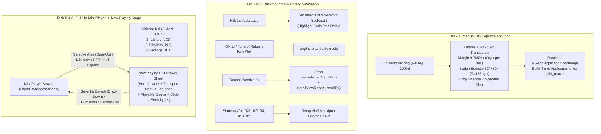

# 09 — Rencana Implementasi Perbaikan: Ikon Squircle Dock macOS, Keyboard Shortcut & Arrow Key Selection, Klik 1x vs 2x, Keselarasan Grid Settings, & Drag-Up Now Playing Drawer (`bug-note.md` Tahap 3)

**Tanggal Penyusunan:** 2 November 2026  
**Dokumen Acuan Audit:** [`AUDIT-ANALISA/09-AUDIT-BUG-DOCK-ICON-SHORTCUT-ARROW-SELECT-SETTINGS-GRID-DAN-NOW-PLAYING-DRAWER.md`](file:///Users/yuka/Documents/Projects/tsrossa-macos/AUDIT-ANALISA/09-AUDIT-BUG-DOCK-ICON-SHORTCUT-ARROW-SELECT-SETTINGS-GRID-DAN-NOW-PLAYING-DRAWER.md)  
**Target Repositori:** `/Users/yuka/Documents/Projects/tsrossa-macos`  
**Pendekatan Dokumen:** *Senior Principal macOS Engineer Mentoring a Junior Engineer* (Panduan Langkah-demi-Langkah, Kode Siap Implementasi, Penjelasan Arsitektural, & Kriteria Verifikasi).

---

## Daftar Isi
1. [Arsitektur Solusi Menyeluruh (Diagram Alur & State)](#1-arsitektur-solusi-menyeluruh-diagram-alur--state)
2. [Task 1: Generator Ikon Squircle Standar macOS HIG (Runtime Dock & Build-Time `.icns`)](#2-task-1-generator-ikon-squircle-standar-macos-hig-runtime-dock--build-time-icns)
3. [Task 2: State Seleksi Lagu, Navigasi Arrow Key (`↑`/`↓`), Perbaikan Shortcut, & State Drawer di `AppViewModel` + `AudioEngine`](#3-task-2-state-seleksi-lagu-navigasi-arrow-key--perbaikan-shortcut--state-drawer-di-appviewmodel--audioengine)
4. [Task 3: Klik 1x (Select) vs Klik 2x (Play) Tanpa Delay & Auto-Scroll Arrow Key di `LibraryView.swift`](#4-task-3-klik-1x-select-vs-klik-2x-play-tanpa-delay--auto-scroll-arrow-key-di-libraryviewswift)
5. [Task 4: Penyelarasan Geometris Kartu Bento & Kontrol Switch di `SettingsBentoView.swift`](#5-task-4-penyelarasan-geometris-kartu-bento--kontrol-switch-di-settingsbentoviewswift)
6. [Task 5: Penghapusan Menu Sidebar "Now Playing" & Gestur Drag-Up Mini Player (`SidebarView`, `LiquidTransportBarView`, `MainAppView`)](#6-task-5-penghapusan-menu-sidebar-now-playing--gestur-drag-up-mini-player-sidebarview-liquidtransportbarview-mainappview)
7. [Task 6: Redesign Total `NowPlayingSplitView.swift` & `QueueLyricsView.swift` (Apple Music / Roon Stage + Fix Playback Bug)](#7-task-6-redesign-total-nowplayingsplitviewswift--queuelyricsviewswift-apple-music--roon-stage--fix-playback-bug)
8. [Task 7: Verifikasi Kompilasi, Unit Test Suite, & Instalasi ke `/Applications`](#8-task-7-verifikasi-kompilasi-unit-test-suite--instalasi-ke-applications)

---

## 1. Arsitektur Solusi Menyeluruh (Diagram Alur & State)



---

## 2. Task 1: Generator Ikon Squircle Standar macOS HIG (Runtime Dock & Build-Time `.icns`)

**File Target:**
- [`macos/Sources/Theme.swift`](file:///Users/yuka/Documents/Projects/tsrossa-macos/macos/Sources/Theme.swift)
- [`build_mac.sh`](file:///Users/yuka/Documents/Projects/tsrossa-macos/build_mac.sh)

### 2.1 Penjelasan Senior ke Junior
Mengapa kita harus memperbaiki ikon di **dua tempat** (di `Theme.swift` dan di `build_mac.sh`)?
- **`Theme.swift` (`applyMacDockIcon()`)**: Dipanggil saat aplikasi sedang berjalan (`applicationDidFinishLaunching`). Jika fungsi ini memberikan `NSImage` yang sudah dipotong dalam bentuk *macOS Squircle* dengan margin transparan $9.765\%$ dan bayangan lembut, maka begitu aplikasi terbuka, ikon di Dock langsung tampil bulat sempurna.
- **`build_mac.sh` (`AppIcon.icns`)**: Digunakan oleh Finder, Launchpad, dan Dock saat aplikasi sedang **ditutup** (belum dijalankan). Dengan menghasilkan `AppIcon.icns` yang sudah berbentuk *macOS Squircle*, maka baik saat aplikasi mati maupun hidup, ikon di Dock tidak pernah berubah menjadi persegi kasar!

### 2.2 Implementasi di `macos/Sources/Theme.swift`
Pada `enum TsrossaBrandLogo`, tambahkan fungsi `makeMacSquircleIcon(from:canvasSize:)` dan gunakan di `applyMacDockIcon()`:

```swift
public static func makeMacSquircleIcon(from source: NSImage, canvasSize: CGFloat = 512) -> NSImage {
    let targetSize = NSSize(width: canvasSize, height: canvasSize)
    let output = NSImage(size: targetSize)
    output.lockFocus()
    defer { output.unlockFocus() }

    guard let ctx = NSGraphicsContext.current?.cgContext else { return source }
    ctx.setAllowsAntialiasing(true)
    ctx.setShouldAntialias(true)
    ctx.interpolationQuality = .high

    // Standar Apple macOS Big Sur+ Icon Grid:
    // Badan squircle = 80.47% dari kanvas (824/1024), margin = 9.765% di tiap sisi.
    let margin = canvasSize * 0.09765625
    let bodySize = canvasSize - (margin * 2.0)
    let bodyRect = NSRect(x: margin, y: margin, width: bodySize, height: bodySize)
    let cornerRadius = bodySize * 0.225

    // 1. Gambar Drop Shadow standar macOS Dock di belakang squircle
    ctx.saveGState()
    let shadowOffset = CGSize(width: 0, height: -canvasSize * 0.018)
    let shadowBlur = canvasSize * 0.045
    ctx.setShadow(
        offset: shadowOffset,
        blur: shadowBlur,
        color: NSColor(calibratedWhite: 0.0, alpha: 0.38).cgColor
    )
    let shadowPath = NSBezierPath(roundedRect: bodyRect, xRadius: cornerRadius, yRadius: cornerRadius)
    NSColor.black.setFill()
    shadowPath.fill()
    ctx.restoreGState()

    // 2. Clip ke Continuous Squircle dan gambar artwork ikon
    ctx.saveGState()
    let clipPath = NSBezierPath(roundedRect: bodyRect, xRadius: cornerRadius, yRadius: cornerRadius)
    clipPath.addClip()
    source.draw(
        in: bodyRect,
        from: NSRect(origin: .zero, size: source.size),
        operation: .sourceOver,
        fraction: 1.0
    )

    // 3. Tambahkan Inner Specular Rim Highlight (1.5pt) khas Liquid Glass macOS
    let strokePath = NSBezierPath(roundedRect: bodyRect.insetBy(dx: 1.0, dy: 1.0), xRadius: cornerRadius - 1.0, yRadius: cornerRadius - 1.0)
    strokePath.lineWidth = max(1.5, canvasSize * 0.003)
    NSColor(calibratedWhite: 1.0, alpha: 0.22).setStroke()
    strokePath.stroke()
    ctx.restoreGState()

    return output
}

public static func applyMacDockIcon() {
    if let rawIcon = launcherImage {
        NSApplication.shared.applicationIconImage = makeMacSquircleIcon(from: rawIcon, canvasSize: 512)
    }
}
```

### 2.3 Implementasi di `build_mac.sh`
Sebelum menjalankan `sips` untuk membuat `AppIcon.iconset`, jalankan skrip singkat `swift -e` yang memproses `ic_launcher.png` menjadi `squircle_1024.png` dengan geometri yang sama persis, lalu jalankan `sips` dan `iconutil` dari `squircle_1024.png` tersebut!

---

## 3. Task 2: State Seleksi Lagu, Navigasi Arrow Key (`↑`/`↓`), Perbaikan Shortcut, & State Drawer di `AppViewModel` + `AudioEngine`

**File Target:**
- [`macos/Sources/AppViewModel.swift`](file:///Users/yuka/Documents/Projects/tsrossa-macos/macos/Sources/AppViewModel.swift)
- [`macos/Sources/AudioEngine.swift`](file:///Users/yuka/Documents/Projects/tsrossa-macos/macos/Sources/AudioEngine.swift)
- [`macos/Sources/main.swift`](file:///Users/yuka/Documents/Projects/tsrossa-macos/macos/Sources/main.swift)
- [`macos/Sources/Views/KeyboardShortcutsModalSheet.swift`](file:///Users/yuka/Documents/Projects/tsrossa-macos/macos/Sources/Views/KeyboardShortcutsModalSheet.swift)

### 3.1 Perubahan State di `AppViewModel.swift`
1. **Default Workspace Tab & Now Playing Drawer State**:
   - Ubah nilai awal `activeTab` menjadi `.library` (karena menu `Now Playing` dihapus dari Sidebar).
   - Tambahkan state untuk **Expandable Now Playing Drawer**:
     ```swift
     @Published public var isNowPlayingExpanded: Bool = false
     @Published public var nowPlayingDragOffset: CGFloat = 0.0
     ```
   - Tambahkan state untuk **Seleksi Lagu & Double-Click Detection**:
     ```swift
     @Published public var selectedTrackPath: String? = nil
     public var lastClickedTrackPath: String? = nil
     public var lastTrackClickTime: TimeInterval = 0
     ```
2. **Metode Navigasi Daftar Lagu dengan Arrow Key (`↑` / `↓`) & `Return`**:
   ```swift
   public func selectNextTrackInList() {
       let list = filteredTracks
       guard !list.isEmpty else { return }
       if activeTab != .library && activeTab != .playlist && !isNowPlayingExpanded {
           switchTab(to: .library)
       }
       if let currentSel = selectedTrackPath, let idx = list.firstIndex(where: { $0.path == currentSel }) {
           let nextIdx = min(list.count - 1, idx + 1)
           selectedTrackPath = list[nextIdx].path
       } else if let playing = AudioEngine.shared.currentTrack?.path, let idx = list.firstIndex(where: { $0.path == playing }) {
           let nextIdx = min(list.count - 1, idx + 1)
           selectedTrackPath = list[nextIdx].path
       } else {
           selectedTrackPath = list.first?.path
       }
   }

   public func selectPreviousTrackInList() {
       let list = filteredTracks
       guard !list.isEmpty else { return }
       if activeTab != .library && activeTab != .playlist && !isNowPlayingExpanded {
           switchTab(to: .library)
       }
       if let currentSel = selectedTrackPath, let idx = list.firstIndex(where: { $0.path == currentSel }) {
           let prevIdx = max(0, idx - 1)
           selectedTrackPath = list[prevIdx].path
       } else if let playing = AudioEngine.shared.currentTrack?.path, let idx = list.firstIndex(where: { $0.path == playing }) {
           let prevIdx = max(0, idx - 1)
           selectedTrackPath = list[prevIdx].path
       } else {
           selectedTrackPath = list.first?.path
       }
   }

   public func playSelectedOrHighlightedTrack() {
       let list = filteredTracks
       guard !list.isEmpty else { return }
       if let selPath = selectedTrackPath, let track = list.first(where: { $0.path == selPath }) {
           AudioEngine.shared.play(track: track)
       } else if let first = list.first {
           selectedTrackPath = first.path
           AudioEngine.shared.play(track: first)
       }
   }
   ```
3. **Perbaikan `setupKeyboardMonitor()` di `AppViewModel.swift`**:
   - Ekstrak modifier flags secara bersih:
     ```swift
     let cleanFlags = event.modifierFlags
         .intersection(.deviceIndependentFlagsMask)
         .subtracting([.numericPad, .function])
     let isCommandOnly = (cleanFlags == [.command])
     let isOptionOnly = (cleanFlags == [.option])
     let isCommandOption = (cleanFlags == [.command, .option])
     let isNoModifiers = cleanFlags.isEmpty
     ```
   - **Izinkan Shortcut `⌘` Tetap Berjalan Saat Search Fokus (`isEditingText == true`)**:  
     Jika `isEditingText == true`, hanya biarkan shortcut teks standar (`⌘A` keyCode 0, `⌘C` keyCode 8, `⌘V` keyCode 9, `⌘X` keyCode 7, `⌘Z` keyCode 6) diteruskan ke `NSTextView`. Semua shortcut aplikasi (`⌘1`, `⌘2`, `⌘3`, `⌘F`, `⌘I`, `⌘U`, `⌘/`, `⌘P`, `⌘↑`, `⌘↓`, `⌘←`, `⌘→`) dieksekusi secara konsisten!
   - Saat `isEditingText == true` (di kolom Search) dan pengguna menekan:
     - `↓` (`keyCode == 125`): Lepaskan fokus dari kolom Search (`NSApp.keyWindow?.makeFirstResponder(nil)`) dan pilih lagu pertama di `filteredTracks` (`selectNextTrackInList()`).
     - `Return` / `Enter` (`keyCode == 36 || keyCode == 76`): Putar lagu yang dipilih di `filteredTracks`!
   - Saat `isEditingText == false`:
     - `keyCode == 125` (`↓` tanpa modifier): Panggil `selectNextTrackInList()` dan `return nil` (tidak ada bunyi error `NSBeep()`!).
     - `keyCode == 126` (`↑` tanpa modifier): Panggil `selectPreviousTrackInList()` dan `return nil`.
     - `keyCode == 36 || keyCode == 76` (`Return` / `Enter` tanpa modifier): Panggil `playSelectedOrHighlightedTrack()` dan `return nil`.
     - `keyCode == 49` (`Spacebar` tanpa modifier): Panggil `AudioEngine.shared.togglePlayPause()` dan `return nil`.
     - `keyCode == 53` (`Escape`): Tutup modal yang sedang terbuka, atau jika `isNowPlayingExpanded == true`, tutup Now Playing Drawer (`withAnimation(.spring(response: 0.38, dampingFraction: 0.85)) { isNowPlayingExpanded = false }`)!
4. **Perbaikan `AudioEngine.togglePlayPause()` di [`AudioEngine.swift`](file:///Users/yuka/Documents/Projects/tsrossa-macos/macos/Sources/AudioEngine.swift#L360-L370)**:
   ```swift
   public func togglePlayPause() {
       if isPlaying {
           if isPaused {
               resume()
           } else {
               pause()
           }
       } else if let track = currentTrack {
           play(track: track)
       } else if let selPath = AppViewModel.shared.selectedTrackPath,
                 let selTrack = AppViewModel.shared.filteredTracks.first(where: { $0.path == selPath }) {
           play(track: selTrack)
       } else if let first = AppViewModel.shared.filteredTracks.first ?? AppViewModel.shared.tracks.first {
           play(track: first)
       }
   }
   ```
   Juga di `scanFolderAsync` (`AppViewModel.swift:L951-L957`), ketika `MetadataScanner.enrichMetadataInBackground` selesai memperbarui `self.tracks`, perbarui juga `AudioEngine.shared.currentTrack` jika belum memutar lagu (`!AudioEngine.shared.isPlaying`), serta muat liriknya (`loadLyrics(for:)`), sehingga durasi, bit-depth, sample rate, dan lirik lagu pertama langsung siap!

---

## 4. Task 3: Klik 1x (Select) vs Klik 2x (Play) Tanpa Delay & Auto-Scroll Arrow Key di `LibraryView.swift`

**File Target:**
- [`macos/Sources/Views/LibraryView.swift`](file:///Users/yuka/Documents/Projects/tsrossa-macos/macos/Sources/Views/LibraryView.swift)

### 4.1 Pelajaran Senior ke Junior: Mengapa Deteksi `clickCount` + Timestamp Lebih Unggul daripada `.onTapGesture(count: 2)`?
Jika kita memasang `.onTapGesture(count: 2)` dan `.onTapGesture(count: 1)` secara bersamaan di SwiftUI, sistem gesture SwiftUI akan **menahan klik pertama selama ~250ms** untuk menunggu apakah pengguna akan mengklik lagi. Hal itu membuat aplikasi terasa lambat saat memilih baris!  
Sebaliknya, jika kita menggunakan satu `.onTapGesture` yang membaca:
```swift
public func handleTrackRowClick(track: TrackMetadata) {
    NSApp.keyWindow?.makeFirstResponder(nil)
    let now = ProcessInfo.processInfo.systemUptime
    let nativeDoubleClick = (NSApp.currentEvent?.clickCount ?? 1) >= 2
    let rapidSecondTap = (lastClickedTrackPath == track.path) && ((now - lastTrackClickTime) < 0.40)

    selectedTrackPath = track.path
    lastClickedTrackPath = track.path
    lastTrackClickTime = now

    if nativeDoubleClick || rapidSecondTap {
        lastTrackClickTime = 0 // reset agar klik ke-3 tidak dianggap double-click lagi
        AudioEngine.shared.play(track: track)
    }
}
```
**Apa hasilnya?**
1. **Klik/Tap Pertama (1x)**: Dalam **0 milidetik** (instan!), baris lagu langsung tersorot (`selectedTrackPath = track.path`) tanpa memutar lagu!
2. **Klik/Tap Kedua (2x)**: Baik menggunakan klik fisik mouse (`clickCount >= 2`) maupun *Tap-to-Click* dua jari/satu jari di trackpad (`rapidSecondTap < 0.40s`), lagu **langsung terputar secara instan**!
3. Selain itu, pada kolom nomor urut/artwork di sebelah kiri baris, kita juga menyediakan tombol Play langsung jika pengguna mengklik tepat pada ikon indikator pemutaran.

### 4.2 Auto-Scroll Saat Navigasi Arrow Key (`ScrollViewReader`)
Di `LibraryView.swift`:
- Bungkus `ScrollView` dengan `ScrollViewReader { proxy in ... }`.
- Berikan `.id(track.path)` pada setiap `trackRow`.
- Tambahkan:
  ```swift
  .onChange(of: vm.selectedTrackPath) { newPath in
      guard let target = newPath else { return }
      withAnimation(.easeOut(duration: 0.16)) {
          proxy.scrollTo(target)
      }
  }
  ```
Dengan ini, saat pengguna menekan tombol panah `↓` atau `↑` di keyboard, sorotan seleksi bergerak dari lagu ke lagu dengan mulus dan layar otomatis bergulir mengikuti lagu yang dipilih!

---

## 5. Task 4: Penyelarasan Geometris Kartu Bento & Kontrol Switch di `SettingsBentoView.swift`

**File Target:**
- [`macos/Sources/Views/SettingsBentoView.swift`](file:///Users/yuka/Documents/Projects/tsrossa-macos/macos/Sources/Views/SettingsBentoView.swift)

### 5.1 Arsitektur Grid Bento Simetris
Untuk memastikan keempat kartu di Settings memiliki ukuran yang **100% selaras (tinggi dan lebar identik pada setiap baris)**:
1. Gunakan `GeometryReader` untuk membaca lebar ruang kerja (`availableWidth`).
2. Jika `availableWidth >= 660`, susun dalam **2 Baris `HStack(alignment: .top, spacing: 16)`** dengan modifier `.fixedSize(horizontal: false, vertical: true)`:
   - **Baris 1**: `coreAudioCard` (Kiri) + `memoryJitterCard` (Kanan)
   - **Baris 2**: `appearanceCard` (Kiri) + `libraryAppCard` (Kanan)
3. Di dalam fungsi `bentoCard(title:icon:content:)`:
   - Tambahkan `Spacer(minLength: 0)` di bagian bawah `VStack`.
   - Tambahkan `.frame(maxWidth: .infinity, maxHeight: .infinity, alignment: .topLeading)` sebelum `.padding(18)` dan `.liquidGlass(...)`.
   - Karena `HStack` induk memiliki `.fixedSize(horizontal: false, vertical: true)` dan setiap kartu memiliki `maxHeight: .infinity`, SwiftUI secara matematis menyamakan tinggi Kartu Kiri dan Kartu Kanan hingga ke satuan piksel!
4. **Penyelarasan Kontrol Internal (macOS System Settings Style)**:
   - Buat komponen `settingSwitchRow(title: String, subtitle: String, isOn: Binding<Bool>)` yang menaruh `VStack` judul & subjudul di kiri, `Spacer()`, dan `Toggle("", isOn: isOn).labelsHidden().toggleStyle(.switch).tint(theme.primary)` di kanan.
   - Tambahkan `.labelsHidden()` pada semua `Picker` agar tidak ada indentasi kosong di sebelah kiri.
   - Batasi daftar perangkat output di Kartu 1 dengan tinggi konsisten sehingga ukuran kartu selalu proporsional dan rapi.

---

## 6. Task 5: Penghapusan Menu Sidebar "Now Playing" & Gestur Drag-Up Mini Player (`SidebarView`, `LiquidTransportBarView`, `MainAppView`)

**File Target:**
- [`macos/Sources/Views/SidebarView.swift`](file:///Users/yuka/Documents/Projects/tsrossa-macos/macos/Sources/Views/SidebarView.swift)
- [`macos/Sources/Views/LiquidTransportBarView.swift`](file:///Users/yuka/Documents/Projects/tsrossa-macos/macos/Sources/Views/LiquidTransportBarView.swift)
- [`macos/Sources/MainAppView.swift`](file:///Users/yuka/Documents/Projects/tsrossa-macos/macos/Sources/MainAppView.swift)

### 6.1 Pembaruan `SidebarView.swift`
- Hapus tombol navigasi `Now Playing` dari daftar menu utama di Sidebar kiri.
- Susun menu navigasi dengan shortcut yang berurutan dan bersih:
  1. **Library** (`music.note.house.fill`, Shortcut: `⌘1`)
  2. **Playlists** (`music.note.list`, Shortcut: `⌘2`)
  3. **Settings** (`slider.horizontal.3`, Shortcut: `⌘3`)

### 6.2 Gestur Seret-ke-Atas (Drag-Up) & Tombol Expand pada `LiquidTransportBarView.swift`
1. Di bagian tengah atas `LiquidTransportBarView`, tambahkan indikator *Pull-Up Grabber Handle*:
   ```swift
   Capsule()
       .fill(Color.white.opacity(0.28))
       .frame(width: 36, height: 4)
       .padding(.top, 5)
   ```
2. Ketika area sampul mini / judul lagu di sebelah kiri diklik, atau tombol **`chevron.up`** di sisi kanan diklik, buka Now Playing Drawer:
   ```swift
   withAnimation(.spring(response: 0.42, dampingFraction: 0.84)) {
       vm.isNowPlayingExpanded = true
   }
   ```
3. Pasang `SimultaneousGesture` / `DragGesture` pada bar Mini Player untuk menangkap seretan ke atas (*drag-up*):
   ```swift
   .gesture(
       DragGesture(minimumDistance: 6, coordinateSpace: .global)
           .onChanged { value in
               if value.translation.height < 0 {
                   vm.nowPlayingDragOffset = value.translation.height
               }
           }
           .onEnded { value in
               let shouldExpand = value.translation.height < -28 || value.predictedEndTranslation.height < -65
               withAnimation(.spring(response: 0.42, dampingFraction: 0.84)) {
                   vm.nowPlayingDragOffset = 0
                   if shouldExpand {
                       vm.isNowPlayingExpanded = true
                   }
               }
           }
   )
   ```

### 6.3 Integrasi Expandable Now Playing Drawer di `MainAppView.swift`
Di `MainAppView.swift`, di atas layer workspace utama:
- Ketika `vm.isNowPlayingExpanded` bernilai `true` atau pengguna sedang menyeret Mini Player ke atas (`vm.nowPlayingDragOffset < 0`), tampilkan `NowPlayingSplitView(theme: theme)` sebagai *Full-Window Sheet Drawer* yang meluncur mulus dari bawah ke atas!
- Saat `NowPlayingSplitView` terbuka penuh, ia juga mendukung *Drag-Down Gesture* (`value.translation.height > 0`) untuk menyeretnya kembali turun ke bawah menjadi Mini Player!

---

## 7. Task 6: Redesign Total `NowPlayingSplitView.swift` & `QueueLyricsView.swift` (Apple Music / Roon Stage + Fix Playback Bug)

**File Target:**
- [`macos/Sources/Views/NowPlayingSplitView.swift`](file:///Users/yuka/Documents/Projects/tsrossa-macos/macos/Sources/Views/NowPlayingSplitView.swift)
- [`macos/Sources/Views/QueueLyricsView.swift`](file:///Users/yuka/Documents/Projects/tsrossa-macos/macos/Sources/Views/QueueLyricsView.swift)

### 7.1 Desain Baru `NowPlayingSplitView.swift` (Referensi Apple Music macOS + Roon)
1. **Latar Belakang Stage Atmosferik**:
   - Menampilkan sampul album yang sedang aktif dengan `blur(radius: 75)`, lapisan gradien `theme.primary.opacity(0.22)` & `theme.surface.opacity(0.88)`, serta `.ultraThinMaterial` sehingga menciptakan efek ruang konser kaca (*Liquid Glass Concert Stage*).
2. **Top Drawer Handle & Studio Header**:
   - Indikator *Drag-Down Capsule* (`42×5pt`) di tengah atas yang bisa diseret ke bawah untuk menutup drawer.
   - Tombol **Minimize (`chevron.down`)** di kiri atas (`"Hide Now Playing"`).
   - **Live Signal Path Pill** di tengah (`EXCLUSIVE HOG • 24-BIT / 192 kHz` atau `SHARED HAL • DSP ACTIVE`).
   - Tombol **Track Info (`⌘I`)** dan **Diagnostics (`⌘U`)** di kanan atas.
3. **Left Stage — Hero Artwork & Studio Transport Console**:
   - **Hero Album Artwork**: Ukuran proporsional adaptif dengan animasi skala *play/pause*, *specular border*, dan bayangan berwarna. Jika pengguna mengklik tombol Play/Pause atau belum ada lagu yang diputar, tombol Play akan langsung memutar lagu terpilih atau lagu pertama dari koleksi!
   - **Track Identity & Actions**: Judul lagu, nama artis — album, tombol **Like (`heart.fill`)**, dan badge spesifikasi audio (`BIT-PERFECT`, `kHz`, `BIT`, `MQA`).
   - **Interactive Scrubber (`PlaybackScrubberView`)**: Lengkap dengan pembacaan waktu berjalan dan waktu total.
   - **5-Button Studio Transport Console**:
     - `Shuffle` (`shuffle`)
     - `Previous Track` (`backward.fill`)
     - **`Hero Play/Pause Circle Button` (`54×54pt`)**
     - `Next Track` (`forward.fill`)
     - `Repeat Mode` (`repeat` / `repeat.1`)
   - **Hardware Volume & DAC Selector Bar**: Slider volume dBFS dengan ikon speaker + menu cepat untuk memilih perangkat output CoreAudio.

### 7.2 Perbaikan Bug Pemutaran & Redesign `QueueLyricsView.swift`
1. **Kartu "Now Playing" di Puncak Queue**:
   - Menampilkan lagu yang sedang dimuat/diputar lengkap dengan sampul mini, judul, artis, dan tombol **Play/Pause langsung** di sebelah kanan.
2. **Perbaikan Item `Manual Queue` (`vm.upNextQueue`)**:
   - Setiap item di `Manual Queue` kini dibungkus aksi pemutaran (klik pada baris atau tombol Play langsung memutar lagu tersebut dan menghapusnya dari antrean tunggu) serta tombol `xmark` untuk menghapus.
3. **Perbaikan Daftar `"Up Next from Library"` (Tidak Pernah Kosong!)**:
   - Jika `currIdx` ditemukan di `vm.filteredTracks`, ambil lagu-lagu setelah `currIdx` **ditambah** lagu-lagu dari awal daftar (*wrap-around*) jika sisa lagu sedikit, sehingga daftar `"Up Next from Library"` selalu menampilkan hingga 30 lagu berikutnya!
   - Jika belum ada lagu yang aktif (`currIdx == nil`), tampilkan `vm.filteredTracks.prefix(30)`.
   - Setiap baris lagu di Queue menampilkan **Thumbnail Artwork**, **Judul + Artis**, **Badge Sample Rate**, dan **Tombol Play Instan** saat diklik!
4. **Peningkatan `Live Lyrics` (Click-to-Seek)**:
   - Setiap baris lirik yang memiliki timestamp (`line.isSynced`) kini dapat **diklik langsung** untuk melompat (`engine.seek(to: line.timestampSeconds)`) ke bagian lagu tersebut, dengan tipografi Apple Music (*active line* `18pt bold` bercahaya vs *inactive line* `14pt medium` redup).

---

## 8. Task 7: Verifikasi Kompilasi, Unit Test Suite, & Instalasi ke `/Applications`

1. Jalankan `./build_mac.sh` — pastikan keluar dengan **Exit Code 0** dan `AppIcon.icns` terbentuk dengan *macOS Squircle Mask*.
2. Jalankan `./run_tests.sh` — pastikan seluruh **C++ DSP Tests**, **C++ RingBuffer & Concurrency Tests**, dan **15 Swift Unit Tests** lulus **100% PASS**.
3. Jalankan `./install_mac.sh` — pastikan `/Applications/TSRossa.app` diperbarui dengan bundel terbaru.
