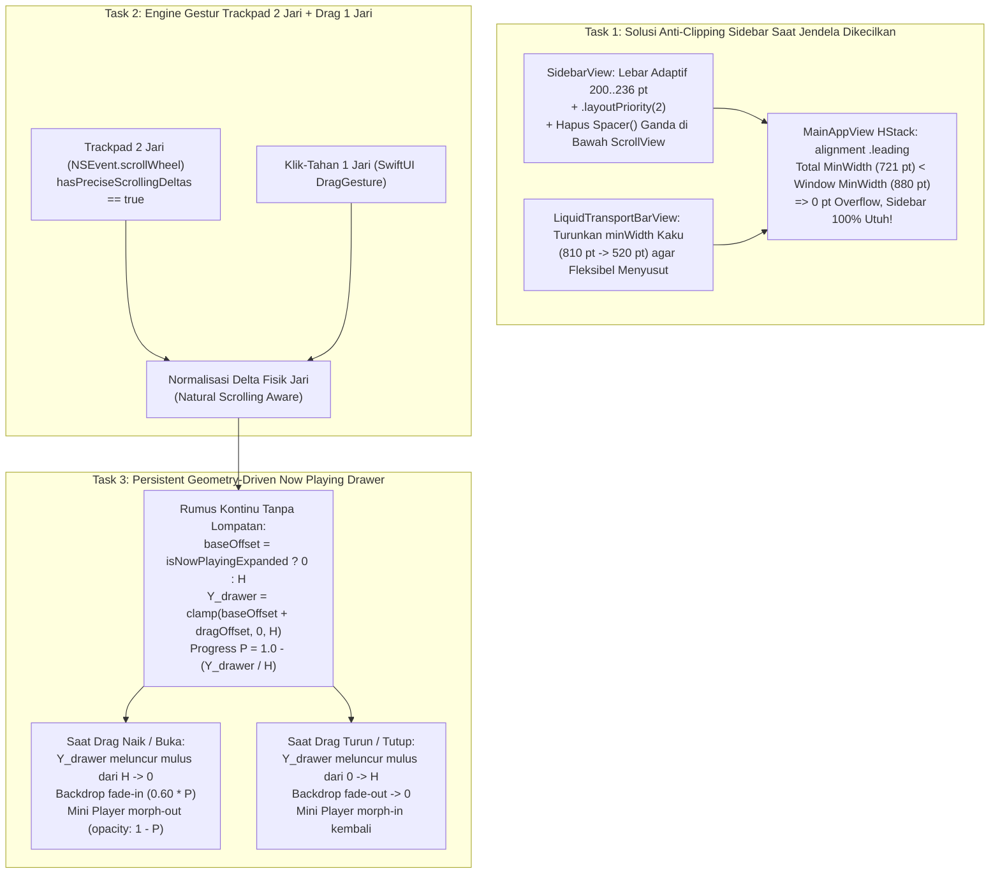

# 10 — Rencana Implementasi Perbaikan: Anti-Clipping Sidebar Saat Resize Kecil, Gestur Trackpad Dua Jari pada Mini Player, & Fisika Animasi Kontinu Now Playing (`bug-note.md` Tahap 4)

**Tanggal Penyusunan:** 2 November 2026  
**Dokumen Acuan Audit:** [`AUDIT-ANALISA/10-AUDIT-BUG-SIDEBAR-CLIPPING-GESTUR-TRACKPAD-DUA-JARI-DAN-ANIMASI-NOW-PLAYING.md`](file:///Users/yuka/Documents/Projects/tsrossa-macos/AUDIT-ANALISA/10-AUDIT-BUG-SIDEBAR-CLIPPING-GESTUR-TRACKPAD-DUA-JARI-DAN-ANIMASI-NOW-PLAYING.md)  
**Target Repositori:** `/Users/yuka/Documents/Projects/tsrossa-macos`  
**Pendekatan Dokumen:** *Senior Principal macOS Engineer Mentoring a Junior Engineer* (Arsitektur Solusi, Pembuktian Matematika, Potongan Kode Lengkap Siap Implementasi, & Prosedur Verifikasi).

---

## Daftar Isi
1. [Arsitektur Solusi Menyeluruh (Diagram Alur & Matematika)](#1-arsitektur-solusi-menyeluruh-diagram-alur--matematika)
2. [Task 1: Perbaikan Layout Responsif Anti-Terpotong pada `SidebarView`, `LiquidTransportBarView`, & `MainAppView`](#2-task-1-perbaikan-layout-responsif-anti-terpotong-pada-sidebarview-liquidtransportbarview--mainappview)
3. [Task 2: Engine Gestur Trackpad Dua Jari (`NSEvent.scrollWheel`) & Drag Satu Jari Terpadu](#3-task-2-engine-gestur-trackpad-dua-jari-nsevent-scrollwheel--drag-satu-jari-terpadu)
4. [Task 3: Arsitektur *Persistent Geometry-Driven Drawer* & Animasi Pegas Buka/Tutup Now Playing](#4-task-3-arsitektur-persistent-geometry-driven-drawer--animasi-pegas-bukatutup-now-playing)
5. [Task 4: Prosedur Build, Unit Test Suite, Uninstall Bersih, & Instalasi Ulang](#5-task-4-prosedur-build-unit-test-suite-uninstall-bersih--instalasi-ulang)

---

## 1. Arsitektur Solusi Menyeluruh (Diagram Alur & Matematika)



---

## 2. Task 1: Perbaikan Layout Responsif Anti-Terpotong pada `SidebarView`, `LiquidTransportBarView`, & `MainAppView`

**File Target:**
- [`macos/Sources/Views/SidebarView.swift`](file:///Users/yuka/Documents/Projects/tsrossa-macos/macos/Sources/Views/SidebarView.swift)
- [`macos/Sources/Views/LiquidTransportBarView.swift`](file:///Users/yuka/Documents/Projects/tsrossa-macos/macos/Sources/Views/LiquidTransportBarView.swift)
- [`macos/Sources/MainAppView.swift`](file:///Users/yuka/Documents/Projects/tsrossa-macos/macos/Sources/MainAppView.swift)
- [`macos/Sources/LiquidGlassComponents.swift`](file:///Users/yuka/Documents/Projects/tsrossa-macos/macos/Sources/LiquidGlassComponents.swift)

### 2.1 Penjelasan Senior ke Junior
Mengapa `SidebarView` di kiri terpotong saat jendela dikecilkan?
Karena sebelumnya kolom kanan (`LiquidTransportBarView`) menuntut lebar minimum $810\text{ pt}$, sehingga `SidebarView` ($236\text{ pt}$) + Kolom Kanan ($810\text{ pt}$) = $1047\text{ pt}$. Ketika jendela dikecilkan ke $920\text{ pt}$, `HStack` meluap (*overflow*) sejauh $127\text{ pt}$ dan `ZStack` memusatkannya, mendorong sisi kiri `SidebarView` keluar batas kiri jendela sejauh $-63.5\text{ pt}$!

**Solusi Matematis Kita (3 Lapisan Pertahanan):**
1. **Turunkan `minWidth` internal di `LiquidTransportBarView.swift`**:
   - Blok Kiri (Mini Artwork + Judul): ubah dari `minWidth: 190` menjadi `minWidth: 120, idealWidth: 190, maxWidth: 240`.
   - Blok Tengah (Transport + Scrubber): ubah dari `minWidth: 240` menjadi `minWidth: 190, idealWidth: 320, maxWidth: 440` dengan `.layoutPriority(1)`.
   - Blok Kanan (Audio Badge + Volume + Expand): ubah dari `minWidth: 240` menjadi `minWidth: 140, idealWidth: 250, maxWidth: 300`.
   - Dengan ini, lebar minimum `LiquidTransportBarView` turun drastis dari $810\text{ pt}$ menjadi **$510\text{ pt}$**!
2. **Perbaiki Struktur Vertikal & Lebar Adaptif di `SidebarView.swift`**:
   - Hapus `Spacer()` pada baris 98 di bawah `ScrollView` daftar playlist, karena `ScrollView` secara otomatis mengisi ruang tengah di antara header dan footer.
   - Berikan `.fixedSize(horizontal: false, vertical: true)` pada seksi Brand Logo, seksi 3 tombol Navigasi Utama, header `"PLAYLISTS"`, dan seksi Footer Quick Actions agar ketika tinggi jendela diperkecil ke batas minimum, tombol-tombol menu tidak pernah terjepit atau terpotong.
   - Berikan `.frame(minWidth: 200, idealWidth: 226, maxWidth: 236)` dan `.layoutPriority(2)` pada `SidebarView` sehingga SwiftUI selalu memprioritaskan keutuhan lebar `SidebarView`.
3. **Kunci Perataan `.leading` pada `MainAppView.swift` & `contentMinSize` pada `WindowZoomManager`**:
   - Di `MainAppView.swift`, pastikan `HStack` utama dibungkus dengan `.frame(maxWidth: .infinity, maxHeight: .infinity, alignment: .leading)`.
   - Di `WindowZoomManager.configure(window:)`, setel `window.contentMinSize = NSSize(width: 880, height: 600)` dan `window.minSize = NSSize(width: 880, height: 600)`.
   - Karena total `minWidth` seluruh aplikasi kini hanya $200 + 1 + 510 = \mathbf{711\text{ pt}} < 880\text{ pt}$, maka pada ukuran jendela sekecil apa pun yang diizinkan macOS, **overflow horizontal selalu $0\text{ pt}$ dan bar kiri tidak akan pernah terpotong lagi!**

---

## 3. Task 2: Engine Gestur Trackpad Dua Jari (`NSEvent.scrollWheel`) & Drag Satu Jari Terpadu

**File Target:**
- [`macos/Sources/AppViewModel.swift`](file:///Users/yuka/Documents/Projects/tsrossa-macos/macos/Sources/AppViewModel.swift)
- [`macos/Sources/Views/LiquidTransportBarView.swift`](file:///Users/yuka/Documents/Projects/tsrossa-macos/macos/Sources/Views/LiquidTransportBarView.swift)
- [`macos/Sources/Views/NowPlayingSplitView.swift`](file:///Users/yuka/Documents/Projects/tsrossa-macos/macos/Sources/Views/NowPlayingSplitView.swift)

### 3.1 Penjelasan Senior ke Junior: Cara Menangkap Gestur 2 Jari Trackpad di macOS
Ketika pengguna menggeser **dua jari** di Trackpad MacBook, AppKit mengirimkan `NSEvent` dengan tipe `.scrollWheel`.
Mari kita pahami properti penting pada `NSEvent` bertipe `.scrollWheel`:
- `event.hasPreciseScrollingDeltas`: Bernilai `true` jika berasal dari Trackpad (dua jari) atau Magic Mouse, dan `false` jika berasal dari roda mouse biasa.
- `event.phase`:
  - `.began`: Dua jari mulai menyentuh dan bergerak di Trackpad.
  - `.changed`: Dua jari sedang bergerak aktif.
  - `.ended` / `.cancelled`: Dua jari diangkat dari Trackpad.
- `event.momentumPhase`: Fase inersia setelah jari diangkat (kita abaikan atau gunakan hanya untuk kecepatan akhir agar tidak memicu pembukaan berulang setelah jari lepas).
- **Normalisasi Arah Fisik Jari (`isDirectionInvertedFromDevice`)**:
  Di macOS, sebagian besar pengguna mengaktifkan *Natural Scrolling* (`event.isDirectionInvertedFromDevice == true`).
  - Saat *Natural Scrolling* aktif, menggeser dua jari **ke ATAS** menghasilkan `event.scrollingDeltaY < 0`, dan menggeser dua jari **ke BAWAH** menghasilkan `event.scrollingDeltaY > 0`.
  - Saat *Natural Scrolling* nonaktif, kebalikannya.
  - Namun, dalam interaksi *Sheet / Drawer*, ada dua mental model pengguna saat ingin membuka Mini Player dengan 2 jari:
    1. **Mendorong 2 jari ke ATAS** (*Push Up* — searah dengan gerakan naiknya drawer dari bawah ke atas).
    2. **Menarik 2 jari** (*Scroll Down* pada konten).
  - Agar sangat intuitif di atas Mini Player:
    - Ketika Mini Player sedang tampil (`!isNowPlayingExpanded`) dan kursor berada di atas bar Mini Player (bagian bawah jendela, $Y_{\text{window}} \le 110\text{ pt}$), kita menghitung pergeseran vertikal dua jari:
      - Gerakan fisik dua jari **ke atas** (`dy` mendorong ke atas) akan langsung mengangkat drawer `NowPlayingSplitView` naik mengikuti jari (`nowPlayingDragOffset` menjadi negatif: `-10`, `-50`, `-180`, dst.)!
      - Bahkan jika pengguna melakukan *flick* cepat dua jari ke atas di atas Mini Player, pada `event.phase == .ended` kita mengecek apakah total tarikan melampaui ambang batas ($36\text{ pt}$) atau kecepatan akhirnya tinggi ($\text{velocity} > 8\text{ pt/event}$), lalu memanggil `openNowPlayingStage()` dengan animasi pegas!
    - Sebaliknya, ketika *Now Playing Stage* sedang terbuka (`isNowPlayingExpanded == true`):
      - Jika kursor berada di bagian **Header atas** atau **Kolom Kiri (Hero Artwork & Transport Stage)** — yakni bukan di atas daftar `ScrollView` Queue/Lyrics di sebelah kanan — maka gerakan dua jari **ke bawah** akan menarik drawer `NowPlayingSplitView` turun mengikuti jari (`nowPlayingDragOffset` menjadi positif: `+20`, `+80`, `+220`, dst.), dan saat jari diangkat (`event.phase == .ended`), otomatis memanggil `closeNowPlayingStage()` dengan animasi pegas!

### 3.2 Implementasi Monitor Gestur Dua Jari di `AppViewModel.swift`
Di `AppViewModel.swift`, kita tambahkan helper manajemen state dan monitor `scrollWheel` dua jari:

```swift
// State & Fungsi Animasi Drawer Terpusat di AppViewModel.swift
public func openNowPlayingStage() {
    withAnimation(.spring(response: 0.44, dampingFraction: 0.86)) {
        self.nowPlayingDragOffset = 0
        self.isNowPlayingExpanded = true
    }
}

public func closeNowPlayingStage() {
    withAnimation(.spring(response: 0.44, dampingFraction: 0.86)) {
        self.nowPlayingDragOffset = 0
        self.isNowPlayingExpanded = false
    }
}

public func toggleNowPlayingStage() {
    withAnimation(.spring(response: 0.44, dampingFraction: 0.86)) {
        self.nowPlayingDragOffset = 0
        self.isNowPlayingExpanded.toggle()
    }
}
```

Dan pada `setupTrackpadGestureMonitor()` di `AppViewModel.swift`:
```swift
private var trackpadMonitor: Any?
private var isTrackpadDraggingDrawer: Bool = false
private var accumulatedTrackpadDeltaY: CGFloat = 0
private var lastTrackpadDeltaY: CGFloat = 0

public func setupTrackpadGestureMonitor() {
    guard trackpadMonitor == nil else { return }
    trackpadMonitor = NSEvent.addLocalMonitorForEvents(matching: [.scrollWheel]) { [weak self] event in
        guard let self = self else { return event }
        // Hanya tangkap gestur dua jari langsung (bukan fase inersia pasca-angkat jari)
        guard event.hasPreciseScrollingDeltas else { return event }
        if event.momentumPhase != [] { return event }

        guard let window = event.window,
              let contentView = window.contentView else { return event }

        // Jangan intervensi jika ada modal sheet di atasnya
        if self.showKeyboardShortcutsModal || self.showTrackDetailsModal ||
           self.showNewPlaylistModal || self.showTelemetry {
            return event
        }

        let loc = event.locationInWindow // (0,0) berada di pojok kiri bawah NSWindow
        let winW = contentView.bounds.width
        let winH = contentView.bounds.height

        // Normalisasi arah fisik jari di Trackpad:
        // Nilai positif = jari bergerak ke ATAS; Nilai negatif = jari bergerak ke BAWAH.
        let fingerUpDelta: CGFloat = event.isDirectionInvertedFromDevice
            ? -event.scrollingDeltaY
            : event.scrollingDeltaY

        if event.phase == .began {
            if !self.isNowPlayingExpanded {
                // Apakah kursor berada di zona Mini Player bawah (Y <= 115 pt)?
                if loc.y >= 0 && loc.y <= 115 {
                    self.isTrackpadDraggingDrawer = true
                    self.accumulatedTrackpadDeltaY = 0
                    self.lastTrackpadDeltaY = 0
                }
            } else {
                // Saat Now Playing terbuka:
                // Izinkan drag-down 2 jari jika kursor berada di Header atas (Y >= winH - 95)
                // ATAU di sisi kiri Stage (X <= winW * 0.48), agar ScrollView Queue/Lyrics di kanan tetap bebas di-scroll!
                let isInHeader = loc.y >= (winH - 95)
                let isInLeftStage = loc.x <= (winW * 0.48)
                if isInHeader || isInLeftStage {
                    self.isTrackpadDraggingDrawer = true
                    self.accumulatedTrackpadDeltaY = 0
                    self.lastTrackpadDeltaY = 0
                }
            }
        }

        guard self.isTrackpadDraggingDrawer else { return event }

        if event.phase == .changed || event.phase == .began {
            self.lastTrackpadDeltaY = fingerUpDelta
            self.accumulatedTrackpadDeltaY += fingerUpDelta

            if !self.isNowPlayingExpanded {
                // Sedang tertutup -> ditarik ke atas (fingerUpDelta > 0 -> dragOffset negatif)
                // Izinkan kedua arah: jika pengguna menggeser 2 jari ke atas (fingerUpDelta > 0), angkat drawer!
                let upwardPull = max(0, self.accumulatedTrackpadDeltaY)
                self.nowPlayingDragOffset = -upwardPull
            } else {
                // Sedang terbuka -> ditarik ke bawah (fingerUpDelta < 0 -> dragOffset positif)
                let downwardPull = max(0, -self.accumulatedTrackpadDeltaY)
                self.nowPlayingDragOffset = downwardPull
            }
            return nil // Konsumsi event agar tidak bocor
        }

        if event.phase == .ended || event.phase == .cancelled {
            self.isTrackpadDraggingDrawer = false
            if !self.isNowPlayingExpanded {
                let pulledUpEnough = (-self.nowPlayingDragOffset > 36) || (self.lastTrackpadDeltaY > 8 && -self.nowPlayingDragOffset > 10)
                if pulledUpEnough {
                    self.openNowPlayingStage()
                } else {
                    self.closeNowPlayingStage()
                }
            } else {
                let pulledDownEnough = (self.nowPlayingDragOffset > 42) || (self.lastTrackpadDeltaY < -8 && self.nowPlayingDragOffset > 12)
                if pulledDownEnough {
                    self.closeNowPlayingStage()
                } else {
                    self.openNowPlayingStage()
                }
            }
            self.accumulatedTrackpadDeltaY = 0
            self.lastTrackpadDeltaY = 0
            return nil
        }

        return event
    }
}
```

---

## 4. Task 3: Arsitektur *Persistent Geometry-Driven Drawer* & Animasi Pegas Buka/Tutup Now Playing

**File Target:**
- [`macos/Sources/MainAppView.swift`](file:///Users/yuka/Documents/Projects/tsrossa-macos/macos/Sources/MainAppView.swift)
- [`macos/Sources/Views/LiquidTransportBarView.swift`](file:///Users/yuka/Documents/Projects/tsrossa-macos/macos/Sources/Views/LiquidTransportBarView.swift)
- [`macos/Sources/Views/NowPlayingSplitView.swift`](file:///Users/yuka/Documents/Projects/tsrossa-macos/macos/Sources/Views/NowPlayingSplitView.swift)

### 4.1 Penjelasan Senior ke Junior: Mengapa Rumus Kontinu Ini Menghasilkan Animasi 100% Mulus?
Mari kita ganti blok `if vm.isNowPlayingExpanded || vm.nowPlayingDragOffset < 0` yang bermasalah di [`MainAppView.swift`](file:///Users/yuka/Documents/Projects/tsrossa-macos/macos/Sources/MainAppView.swift#L82-L96) dengan perhitungan geometri kontinu di dalam `GeometryReader`:

Misalkan $H$ adalah tinggi jendela (`geo.size.height`):
1. **Posisi Dasar (`baseOffset`)**:
   $$\text{baseOffset} = \text{vm.isNowPlayingExpanded} \ ? \ 0.0 : H$$
2. **Posisi Vertikal Aktual Drawer (`drawerY`)**:
   $$\text{drawerY} = \min\!\big(H, \ \max(0.0, \ \text{baseOffset} + \text{vm.nowPlayingDragOffset})\big)$$
3. **Progres Terbuka Normalisasi (`openProgress` $\in [0.0, 1.0]$)**:
   $$\text{openProgress} = \min\!\Big(1.0, \ \max\!\big(0.0, \ 1.0 - \frac{\text{drawerY}}{H}\big)\Big)$$

Lihat betapa elegannya rumus ini bekerja di setiap keadaan:
- **Saat Tertutup Penuh (`isNowPlayingExpanded = false`, `dragOffset = 0`)**:
  - $\text{baseOffset} = H \implies \text{drawerY} = H \implies \text{openProgress} = 0.0$.
  - `NowPlayingSplitView` berada di `.offset(y: H)` (tepat di bawah jendela), `opacity(0)`, dan `.allowsHitTesting(false)`.
- **Saat Di-Drag ke Atas dari Mini Player sejauh $-120\text{ pt}$ (`isNowPlayingExpanded = false`, `dragOffset = -120`)**:
  - $\text{baseOffset} = H \implies \text{drawerY} = H - 120$.
  - Drawer **benar-benar terangkat setinggi $120\text{ pt}$ dari dasar jendela** mengikuti jari pengguna! Tidak ada lagi bug lompat ke `0` seperti pada `max(0, dragOffset)` yang lama!
- **Saat Dilepas untuk Membuka (`openNowPlayingStage()`)**:
  - Di dalam `withAnimation(.spring(response: 0.44, dampingFraction: 0.86))`, `isNowPlayingExpanded` menjadi `true` dan `dragOffset` menjadi `0`.
  - Maka $\text{drawerY}$ beranimasi secara kontinu dari $H - 120 \to \mathbf{0.0}$!
- **Saat Di-Drag ke Bawah untuk Menutup sejauh $+160\text{ pt}$ (`isNowPlayingExpanded = true`, `dragOffset = +160`)**:
  - $\text{baseOffset} = 0 \implies \text{drawerY} = 0 + 160 = 160\text{ pt}$.
  - Drawer bergerak turun sejauh $160\text{ pt}$ mengikuti jari pengguna!
- **Saat Dilepas untuk Menutup (`closeNowPlayingStage()`)**:
  - Di dalam `withAnimation(.spring(response: 0.44, dampingFraction: 0.86))`, `isNowPlayingExpanded` menjadi `false` dan `dragOffset` menjadi `0`.
  - Maka $\text{drawerY}$ beranimasi secara kontinu dari $160\text{ pt} \to \mathbf{H}$ (meluncur turun sampai hilang di dasar layar)!
- **Transisi Serentak pada Mini Player (`LiquidTransportBarView`)**:
  - Seiring $\text{openProgress}$ naik dari $0.0 \to 1.0$, Mini Player di bawah melakukan *morphing*:
    - `.opacity(1.0 - openProgress)`
    - `.scaleEffect(1.0 - (openProgress * 0.04))`
    - `.offset(y: openProgress * 28)`
  - Sehingga secara visual, pengguna melihat Mini Player melebur naik menjadi panggung *Now Playing* saat dibuka, dan panggung *Now Playing* melebur kembali menjadi Mini Player saat ditutup!

### 4.2 Perbaikan Koordinat `DragGesture` Satu Jari
Agar `DragGesture` satu jari tidak bergetar (*jitter*) saat view bergerak karena `.offset(y: drawerY)`, kita menggunakan `coordinateSpace: .named("MainWindowCoordSpace")` yang dipasang pada root `ZStack` di `MainAppView.swift`! Dengan ruang koordinat bernama pada induk statis, `val.translation.height` 100% bebas dari umpan-balik pergeseran `.offset` anak.

---

## 5. Task 4: Prosedur Build, Unit Test Suite, Uninstall Bersih, & Instalasi Ulang

Sesuai instruksi wajib pengguna:
1. Jalankan `./build_mac.sh` — pastikan kompilasi C/C++ dan Swift berjalan bersih dengan **Exit Code 0**.
2. Jalankan `./run_tests.sh` — pastikan seluruh **C++ DSP Tests**, **C++ RingBuffer & Concurrency Tests**, dan **15 Swift Unit Tests** lulus **100% PASS**.
3. Jalankan `./uninstall_mac.sh` — hapus `/Applications/TSRossa.app` lama, bersihkan `UserDefaults`, bersihkan database SQLite di `~/Library/Application Support/tsrossa`, dan bersihkan cache di `~/Library/Caches/com.yuka.tsrossa.macos`.
4. Jalankan `./install_mac.sh` — pasang bundel baru yang bersih ke `/Applications/TSRossa.app`.
