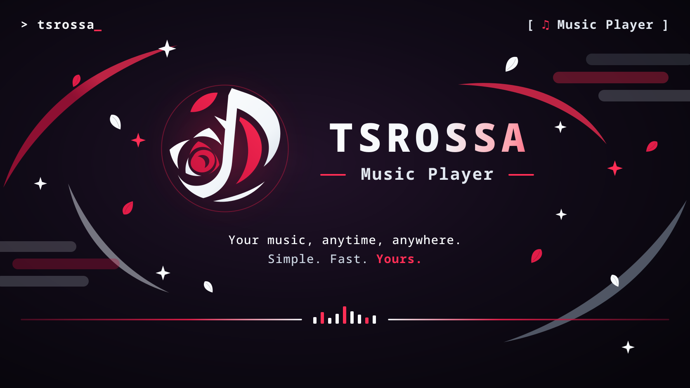
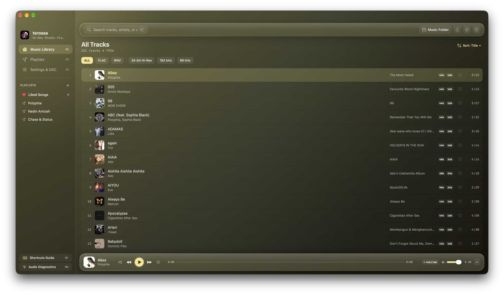
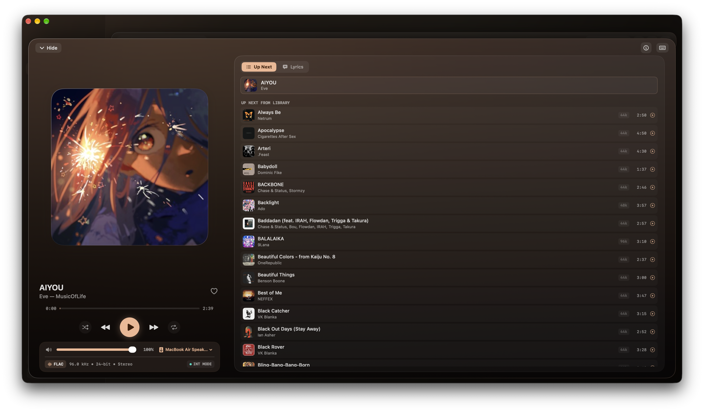
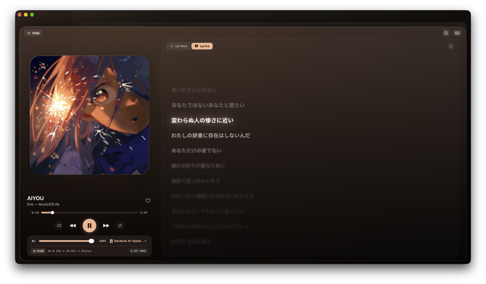
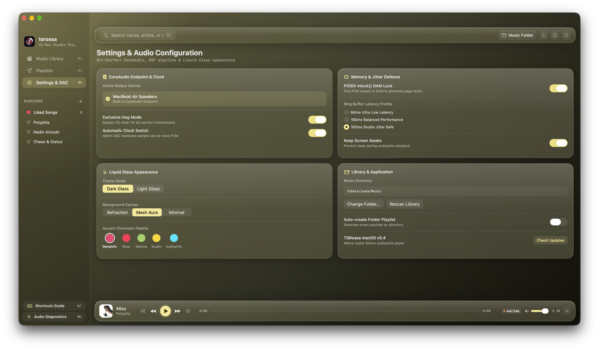
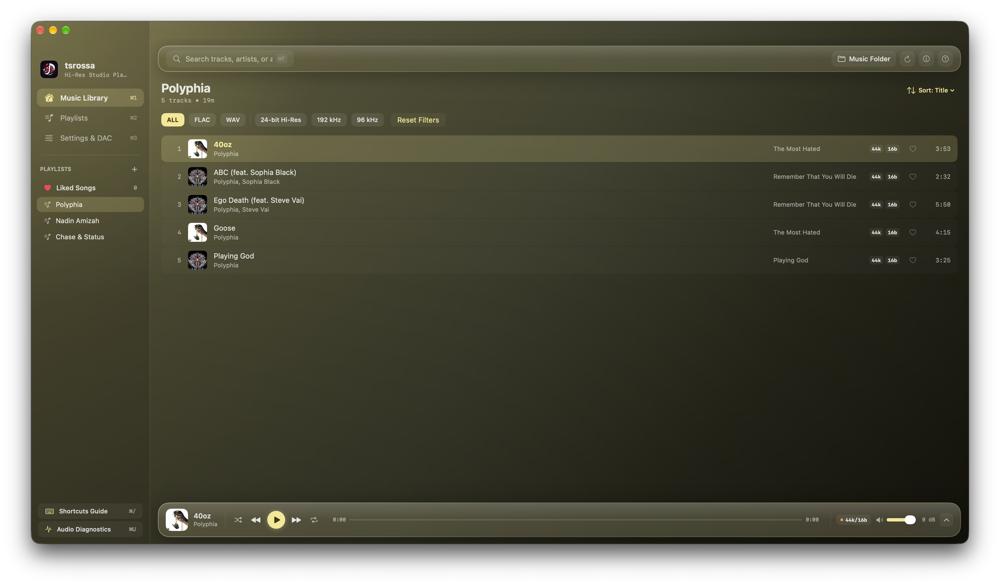

<p align="center">
  
</p>

<h1 align="center">tsrossa for macOS</h1>

<p align="center">
  <strong>Direct-to-DAC, Bit-Perfect Audiophile Player for Apple Silicon & Intel</strong><br/>
  Native C++17 CoreAudio HAL engine with Exclusive Hog Mode and dynamic hardware crystal clock switching.
</p>

<p align="center">
  <a href="https://github.com/yukaatsu/tsrossa/releases"></a>
  <a href="#"></a>
  <a href="#"></a>
  <a href="#"></a>
  <a href="LICENSE"></a>
  <a href="https://bagibagi.co/Yukaatsu"></a>
</p>

<p align="center">
  
  
  
  
</p>

> 💡 **Looking for the Android version?**  
> We keep each platform in its own dedicated branch. Switch to the default [`android` branch](https://github.com/yukaatsu/tsrossa/tree/android) or run:  
> `git clone -b android --single-branch https://github.com/yukaatsu/tsrossa.git tsrossa-android`

---

## Why tsrossa on macOS?

By default, macOS routes all sound through its system CoreAudio mixer (`AUHAL`). If your DAC is configured in *Audio MIDI Setup* to 96 kHz and you play a 44.1 kHz CD rip, macOS silently resamples it. If you play a 192 kHz high-res track, macOS downsamples it. On top of that, system notifications, Slack beeps, and browser audio get mixed directly into your music stream.

**tsrossa takes direct, bit-transparent control of your DAC.**

- **Exclusive Hog Mode (`kAudioDevicePropertyHogMode`)**  
  tsrossa takes physical ownership of your output device. All other apps, browser tabs, and system notification sounds are locked out from reaching the DAC.
- **Dynamic Hardware Sample Rate Switching**  
  Whenever you start a track, tsrossa queries your DAC's crystal oscillators and switches the physical hardware clock on the fly (44.1 kHz, 48 kHz, 88.2 kHz, 96 kHz, 176.4 kHz, 192 kHz, up to 384 kHz). No software interpolation, no resampling.
- **In-Memory Pre-Caching with POSIX `mlock()`**  
  Decodes audio files into raw 32-bit linear PCM in RAM and locks the memory pages to physical RAM. The macOS kernel is prevented from swapping memory to disk, eliminating SSD read latency and micro-stutters during heavy multitasking.
- **True Bit-Perfect Unity Gain (0.0 dBFS)**  
  Volume control interfaces directly with the hardware master scalar on supported DACs. Setting volume to 100% delivers pure, uncompromised bit-for-bit dynamic range without digital math attenuation.

---

## Interface & Navigation

### Audiophile Music Library
<p align="center">
  
  <br/>
  <em>Audiophile Library: Clean Liquid Glass widescreen interface with dynamic sidebar, typeahead search, format & sampling rate filter chips, and floating transport player bar.</em>
</p>

### Dedicated Views & Audio Engine Controls

<table align="center">
  <tr>
    <td align="center" width="50%">
      
      <br/><b>Now Playing & Up Next Queue</b><br/>
      <sub>Album artwork showcase, track metadata, bit-perfect sample rate badge, and drag-and-drop queue</sub>
    </td>
    <td align="center" width="50%">
      
      <br/><b>Time-Synced Lyrics</b><br/>
      <sub>Real-time synchronized lyrics engine with active line focus and millisecond seek support</sub>
    </td>
  </tr>
  <tr>
    <td align="center" width="50%">
      
      <br/><b>Settings & Audio Configuration</b><br/>
      <sub>Exclusive Hog Mode, hardware clock switcher, POSIX mlock memory defense, and Liquid Glass theme picker</sub>
    </td>
    <td align="center" width="50%">
      
      <br/><b>Smart Playlists & Organization</b><br/>
      <sub>Instant playlist filtering, favorite track curation, and library search</sub>
    </td>
  </tr>
</table>

---

## Highlights

- **3-Column Responsive Studio Workspace**  
  - **Left Sidebar:** Instant navigation for Now Playing, Hi-Res Masters (24-bit filter), FLAC/WAV archives, custom playlists, and active DAC device indicators.
  - **Center Stage:** Hero album showcase with mastering metadata, audiophile filter chips, and animated equalizer bars on the playing track.
  - **Collapsible Right Inspector:** 3-tab drawer for synchronized `.lrc` lyrics, live 32-band FFT spectrum visualizer & signal path audit, and queue management.
- **Spinning Vinyl Transport**  
  Smoothly animated vinyl disc with concentric grooves and center spindle that spins in real-time during playback.
- **Floating Mini-Player**  
  A clean 360x480 floating desktop card featuring ambient artwork glow, live synchronized lyric preview, mini scrubber, and transport controls.
- **Synchronized Lyrics Engine**  
  Discovers companion `.lrc` and `.txt` files alongside your tracks with millisecond timestamp synchronization, plus fallback parsing for embedded ID3 and Vorbis lyrics tags.
- **Full-Screen Theater Mode (`Cmd + F`)**  
  Distraction-free large-format view with animated canvas designed for 4K and 5K displays.
- **No Bulky Xcode IDE Required to Build**  
  Compiles cleanly from the command line using standard `clang++` and `swiftc` toolchains in just a few seconds.

---

## Technical Specifications

| Parameter | Supported Range / Specification |
| :--- | :--- |
| **Supported Formats** | • **FLAC** (`.flac`): 16-bit, 24-bit, 32-bit integer PCM (44.1 kHz to 384 kHz)<br/>• **WAV** (`.wav`, `.wave`): 16-bit, 24-bit, 32-bit Linear PCM, and 32-bit IEEE Float |
| **Output Target** | External USB DACs, Thunderbolt audio interfaces, and built-in 3.5mm headphone jacks |
| **Operating System** | macOS 12.0 (Monterey), macOS 13 (Ventura), macOS 14 (Sonoma), and macOS 15+ (Sequoia) |
| **Hardware Architecture** | Universal: Apple Silicon (M1/M2/M3/M4, arm64) and Intel (x86_64) |
| **Primary Language** | **Swift 6** (SwiftUI, reactive state, lyrics parser, visualizers) |
| **Audio Engine Core** | **C++17** (Direct CoreAudio HAL driver, Exclusive Hog Mode, POSIX `mlock`) |
| **Interface Style** | SwiftUI with Liquid Glass aesthetic and macOS HIG |

---

## Quick Start

### 1. Installation
1. Download the latest **`tsrossa-mac.dmg`** from the [GitHub Releases](https://github.com/yukaatsu/tsrossa/releases).
2. Open the disk image and drag **tsrossa.app** into your **Applications** folder.
3. Launch tsrossa from Applications or Spotlight (`Cmd + Space`).

### 2. Connect Your DAC
1. Connect your USB or Thunderbolt DAC.
2. Go to **Settings (`Cmd + 4`)** and verify that **Exclusive Hog Mode** is enabled.
3. Select your FLAC or WAV library folder in the Library tab (`Cmd + 2`) to start bit-perfect listening.

---

## Building from Source

You do not need full Xcode installed to compile tsrossa — just the standard macOS Command Line Tools (`xcode-select --install`):

```bash
# 1. Compile the C++ CoreAudio dylib and bundle tsrossa.app
./build_mac.sh

# 2. Package into a distributable DMG installer
./package_dmg.sh
# Output: build/tsrossa-mac-installer.dmg

# 3. Run unit tests
./run_tests.sh
```

---

## Community & Support

tsrossa for macOS is an independent open-source project. If it enhances your desktop listening setup, support is warmly appreciated:

[](https://bagibagi.co/Yukaatsu)

Found an issue or want to report hardware DAC compatibility? Please open an issue on [GitHub Issues](https://github.com/yukaatsu/tsrossa/issues) with your system details!

---

## License

tsrossa for macOS is distributed under the [Apache License 2.0](LICENSE).
